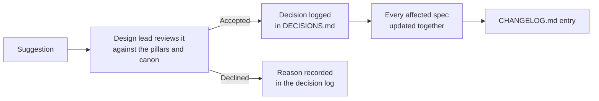

# Contributing

This is an open specification. It changes as the team, players and the community suggest better ideas. This page explains how a suggestion becomes part of the spec.

> **Version:** v0.1 · **Updated:** 10-10-2026 · **Owner:** Design lead
>
> **Related:** [Conventions](docs/00-meta/conventions.md) · [Decisions](DECISIONS.md) · [Changelog](CHANGELOG.md)

## How a change happens

Every change follows the same path, so the spec never holds half-made decisions.

1. **Suggest.** Describe the change, the problem it solves and the documents it touches. Anyone can suggest.
2. **Review.** The design lead checks it against the [vision pillars](docs/01-vision/vision.md#5-pillars), canon and existing decisions. The creative director and the game director decide anything that changes the core vision ([Team](docs/11-production/team.md)).
3. **Decide.** An accepted change that affects more than one document gets a new entry in [DECISIONS.md](DECISIONS.md). A declined one is recorded in the log's Declined section with the reason, so the same idea isn't reopened without new information.
4. **Update.** Every affected document changes in the same edit. Specs only ever state decisions; a suggestion never sits in a spec waiting to be decided.
5. **Record.** Add a line to [CHANGELOG.md](CHANGELOG.md).

## What a good suggestion includes

- The problem, told from the player's side.
- The rule you would change, and the requirement IDs it touches.
- Any evidence, as a source we can add to the [reference library](references/README.md).
- What the change costs: horizon, dependencies, risks.

## House rules

- Follow the [conventions](docs/00-meta/conventions.md): plain British English, no em dashes, link everything you reference.
- New system specs start from the [spec template](docs/00-meta/spec-template.md).
- Never edit hidden canon in public channels. Story changes go to the narrative director.
- Requirement IDs and source IDs are permanent. Retire them; never reuse them.
