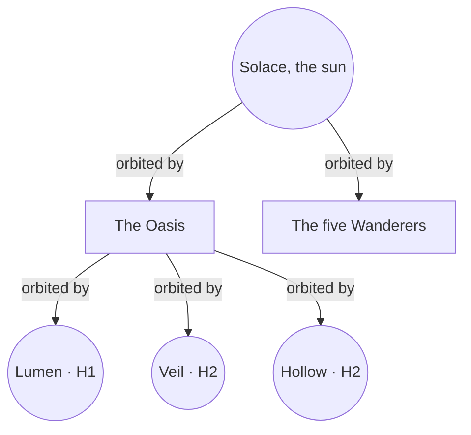

# Cosmology

The physical and hidden structure of the Oasis: its sun, planets and moons, the Long Night, the Great Conjunction, Veil, and why Returners return.

> **Version:** v0.1 · **Updated:** 10-10-2026 · **Owner:** World lead
>
> **Horizons:** H1 the Oasis and Lumen · H2 Veil and Hollow · H3 the world beyond the Wanderers (Oasis 2.0)
>
> **Related:** [The Story of the Oasis](../../STORY.md) · [Time and Calendar](time-and-calendar.md) · [World Laws](world-laws.md) · [Spaceflight and Moon Travel](../05-systems/spaceflight-and-moon-travel.md) · [D-012](../../DECISIONS.md#d-012) · [D-033](../../DECISIONS.md#d-033) · [D-013](../../DECISIONS.md#d-013)
> ⚠ Contains hidden canon, marked where it appears.

## 1. The system at a glance

The diagram shows what orbits what.

| Body | What people know | Role in play |
| --- | --- | --- |
| **Solace** | A warm golden sun. Some cultures honour it as a gentle parent. | Its noon heat rises each Long Year ([WLD-002](#2-the-sky-as-a-clock)). At the Great Conjunction it flares. |
| **The Oasis** | The world: continents, oceans and floating isles | The play space ([Geography and Domains](geography-and-domains.md)) |
| **Lumen** | Silver and close, home of the Lumenari | The first off-world destination: by Skyferry from launch, by personal ship from the third Long Night ([D-033](../../DECISIONS.md#d-033)) |
| **Veil** | Wrapped in pale mist. Nobody who goes there comes back to describe it. | Opens at the fifth Long Night |
| **Hollow** | Dark, with a faint red rim. Sailors won't look at it. | Opens for exploration at the eighth Long Night, whatever the state of the world. Its heart stays sealed until all six Celestials are freed. |
| **The Wanderers** | Five faint outer planets that navigators steer by | The countdown in the sky: each Long Night they stand visibly closer to their line |

## 2. The sky as a clock

The countdown can be read from the sky as well as from the interface (pillar P1 in [Vision](../01-vision/vision.md#5-pillars)).

- **WLD-001 [H1]** The Wanderers' spread across the night sky shrinks steadily over ten real years. At the tenth Long Night they form a perfect line.
- **WLD-002 [H1]** Solace's noon intensity rises in ten steps, one per Long Year. It drives the Ember Wastes heat modifier and the worldwide bloom and colour grade.
- **WLD-003 [H1]** The World Clock above Halcyon shows the exact real time left until the Conjunction, in days and hours, and always agrees with the sky.

**Moons in the sky.** All three moons are visible from every region. Lumen is the largest and brightest, about three times the apparent size of Earth's Moon. Veil is about one and a half times that size and glows faintly through its mist. Hollow is about the size of Earth's Moon and is seen mostly as a red rim and the stars it hides. These sizes are design targets for the art pass. Each moon's cycle sets regional seasons ([Time and Calendar](time-and-calendar.md#4-regional-seasons-driven-by-the-moons)).

## 3. The Long Night

Once a Long Year, on the launch anniversary, the three moons align and the Oasis is dark for 24 real hours ([D-013](../../DECISIONS.md#d-013)). The calendar is set in [Time and Calendar](time-and-calendar.md), and each year's story beat in [Ten-Year Saga](../03-narrative/ten-year-saga.md#3-ten-long-nights).

| Effect | Rule |
| --- | --- |
| Darkness | Night lighting everywhere. Lanterns, Arts and bioluminescence matter. |
| Monster surge | Spawn density and the chance of colossus arrivals rise. The Weaver runs Long Night events ([Director and World Events](../06-ai/director-and-world-events.md)). |
| Society | Many shops close. Some NPCs hide and some celebrate. Black markets open. |
| Hidden things | Doors, Eggs and paths exist only during the Long Night ([Eggs and Mysteries](../03-narrative/eggs-and-mysteries.md)). |
| Choice | Taking part is never required. Story beats that can't be missed are recorded as Chronicles ([D-030](../../DECISIONS.md#d-030)). |

The tenth Long Night is the Great Conjunction.

## 4. The Great Conjunction

Ten real years after launch, the Wanderers line up with the three moons and Solace "breathes": a flare that will turn the Oasis to glass.

- **What people know:** it has happened before. The Grand Library holds proof, and the glass of the Ember Wastes is the scar.
- **What can stop it:** only the **Dawnkey**, forged from the six freed Celestial Oaths and the Returners' own seventh Oath ([The Story of the Oasis](../../STORY.md#8-the-dawnkey-and-the-seventh-oath)).
- **What follows:** success leads to Oasis 2.0 [H3]. Failure ends the live world and opens Archive Mode ([D-011](../../DECISIONS.md#d-011), [D-047](../../DECISIONS.md#d-047)). Both endings are told in [Ten-Year Saga](../03-narrative/ten-year-saga.md#6-the-endings).

## 5. Veil, Wayshrines and Returners

| Layer | Truth |
| --- | --- |
| **Public canon** | Returners wake at a Wayshrine after death, and nobody knows why. Wayshrines are ancient. They can be found but never built. |
| **Hidden canon** | Veil holds the Oasis's memory. Wayshrines are Veil's anchors. Returners are "remembered back" by Veil, and the whole world was rebuilt from Veil's memory after the last Burning ([The Story of the Oasis](../../STORY.md#2-how-the-world-was-remade-and-what-returners-are)). |
| **In play** | Return is part of the fiction ([Death and Return](../04-gameplay/death-and-return.md)), and finding Wayshrines is a core exploration reward. Once Veil opens at the fifth Long Night [H2], a fallen Returner glimpses their Echo from the mist before waking and may choose to Return beside it. |

**Time on Veil.** Veil shows remembered scenes at the hour they happened, so its skies and shadows don't match the Oasis clock. This is only what Returners see. Real time and Oasis time never change on Veil.

**The nature of the Oasis stays open** ([D-012](../../DECISIONS.md#d-012)). Two readings always coexist: Returners are travellers from beyond, or they are the world dreaming its own heroes. Public canon and generated text never say "it's a simulation" or "it's definitely real".

## 6. Natural Law: why the regions differ

Each of the six Domains is shaped by the leftover power of its bound Celestial, and that power sets the Domain's **Natural Law**: how physics and Resonance behave there. The Hearthlands, outside every Domain, follow plain law. When a Celestial is freed, its Domain's law softens for everyone. The rules are in [World Laws](world-laws.md).

## 7. Scale

The Oasis is scaled for play, not for astronomy. Distances are compressed so that travel never feels empty. The figures are design targets.

| Measure | Target | Why |
| --- | --- | --- |
| Surface at H1 | Seven regions (the Hearthlands and six Domains), each 1 to 1.5 rt hours to cross on foot | Large enough to feel grand, dense enough for [VIS-001](../01-vision/vision.md#4-experience-goals-observable-testable) |
| Ground to low orbit | About 2 to 3 rt minutes of flight | Spaceflight should be a journey, not a loading screen |
| Oasis to Lumen | About 5 to 8 rt minutes by personal ship, about 10 by Skyferry (with social space aboard) | The trip is short enough to fly yourself ([D-033](../../DECISIONS.md#d-033)) |
| Coordinates | UE Large World Coordinates (double precision) cover the planet and its moons in one space [S6] | None |

## 8. The moons as places

- **Lumen** is a low-gravity world of crystal cities and observatories. Its people, the Lumenari, keep a law of non-interference called the Stillness ([Peoples and Factions](peoples-and-factions.md#3-factions)).
- **Veil** is a landscape of memory: places and people from the Oasis's past, half-formed in the mist.
- **Hollow** stays sealed until the Hollow Age.

The places on each moon are listed in [Geography and Domains](geography-and-domains.md#5-off-world-the-moons).

**Hidden canon.** Hollow is hollow. Inside it Zero rebuilt Everbright as it was on the morning before the Seven Days, and he lives there alone among statues of the six. It is the stage of Convergence VII ([The Story of the Oasis](../../STORY.md#5-inside-hollow)).

## 9. Beyond the Wanderers [H3]

**Hidden canon.** If the Dawnkey breaks the cycle, Solace's fire becomes a road outward to a second world, where Oasis 2.0 begins ([The Story of the Oasis](../../STORY.md#9-the-endings-in-truth)).

## 10. Inspirations

| Source | What we take | What we change |
| --- | --- | --- |
| The OASIS zones in *Ready Player One* [R1] | Regions where different rules apply, such as magic or technology working only in some places | Our laws have a physical, story-bound cause, and they change when a Celestial is freed |
| The Minovsky particle in *Gundam* [J5] | A physical reason behind how fighting works in a place | The reason is a chained Celestial's power, and players can learn it in the world |
| Pandora's living network in *Avatar* [W16] | A world whose life is linked by one network | Veil holds the world's memory, and Returners are remembered back through it |
| The three suns in *The Three-Body Problem* [W18] | A sky that has destroyed civilisations again and again | Our cycle is predictable: the Conjunction is public from launch day, and the Wanderers show the time left |
| *The Chronicles of Narnia* [W11] | A place where time seems to run differently | On Veil only what Returners see changes. Real time and the shared clock never do. |
| *Interstellar* [W24] | A dying home and a road to another world | Solace's fire becomes the road to Oasis 2.0, if the players earn it |
| *Inception* [W20] | Shared dream-spaces whose rules are taught before they matter | Veil's memory-landscapes follow the same principle |
| *The Matrix* [W22] | A counterexample: the "it was all a simulation" reveal | We never make it. Both readings of what Returners are stay open. |

## 11. Acceptance criteria

| ID | Test |
| --- | --- |
| [WLD-001](#2-the-sky-as-a-clock) | Rendering the night sky at every Long Night from launch to the tenth shows the Wanderers' spread shrinking each time and a straight line at the tenth |
| [WLD-002](#2-the-sky-as-a-clock) | Sampling noon intensity across ten simulated Long Years shows exactly ten rising steps, each at a Long Night |
| [WLD-003](#2-the-sky-as-a-clock) | Over 24 rt hours, the World Clock's remaining time matches the server's Conjunction timestamp to the second, in every region and layer |

<!-- citation links: generated, do not edit by hand -->

[J5]: ../../references/anime-and-manga.md
[R1]: ../../references/ready-player-and-lifecycle.md
[S6]: ../../references/technology-and-ai.md
[W11]: ../../references/film-literature-and-music.md
[W16]: ../../references/film-literature-and-music.md
[W18]: ../../references/film-literature-and-music.md
[W20]: ../../references/film-literature-and-music.md
[W22]: ../../references/film-literature-and-music.md
[W24]: ../../references/film-literature-and-music.md
