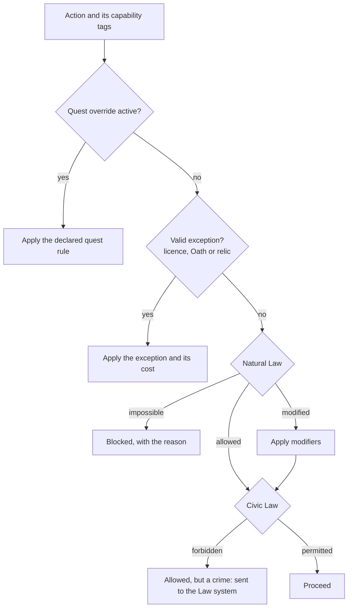

# World Laws

The one rule framework that decides what a Returner, their gear, their machines and their abilities can do in any place: what is permitted, changed, illegal or impossible there, and why.

> **Version:** v0.1 · **Updated:** 10-10-2026 · **Owner:** Systems design
>
> **Horizons:** H0 the evaluator and two laws · H1 every Domain law and Civic Law · H2 era shifts as Celestials are freed
>
> **Related:** [D-023](../../DECISIONS.md#d-023) · [D-042](../../DECISIONS.md#d-042) · [D-026](../../DECISIONS.md#d-026) · [Cosmology](cosmology.md) · [Law, Crime and Bounties](../05-systems/law-crime-and-bounties.md) · [Traversal and Flight](../04-gameplay/traversal-and-flight.md) · [AI Architecture](../06-ai/architecture.md)

## 1. Player experience

> *Kaito flies over the Stormcrown with ease: the sky is lighter here. As he crosses into the Verdant Spine, his flight-pack sputters. The forest rejects anything flying high above its canopy. He lands, annoyed. Then he remembers the Lumenari charm he won last month. While it hums, the forest "doesn't see" him. He takes off again, slowly and low, and the charm warns him that its patience won't last.*

A player can always answer "why can't I do this here?" and usually "how could I?"

## 2. Two layers of law

| Aspect | Natural Law | Civic Law |
| --- | --- | --- |
| Source | The leftover power of the Celestial bound in a Domain ([Cosmology](cosmology.md#6-natural-law-why-the-regions-differ)) | People: cities, factions and Stewards |
| Nature | Physics and Resonance. It can't be broken, only bent by exceptions. | Rules. They can be broken, with consequences. |
| When it is broken | The action is impossible, or its effect weakens or changes | A crime: Heat, a Record and a Bounty, handled by the local Watch ([Law, Crime and Bounties](../05-systems/law-crime-and-bounties.md)) |
| How players learn it | NPC lore, Library texts, experiment, each Domain's own signs, and the boundary cues in [WLD-015](#4-natural-law-by-domain) | Posted signs, warnings from the Watch, the jurisdiction banner |
| Change over time | Softens when the Domain's Celestial is freed (an era shift) [H2] | Changed by factions and Stewardships [H2] |

## 3. The evaluation model

Every action carries **capability tags** that say what is being attempted. The server checks them against the **law stack** at the actor's position.

**Capability tags** (examples): `FLIGHT.GLIDE` · `FLIGHT.HOVER` · `FLIGHT.SUSTAINED` · `MACHINE.FRAME.M` · `MACHINE.FRAME.COLOSSAL` · `MACHINE.AUTONOMY.HIGH` · `WEAPON.FIREARM` · `WEAPON.ENERGY` · `ART.ROOT` · `ART.TIDE` · `ART.STORM` · `ART.EMBER` · `ART.SPARK` · `ART.HOUR` · `ENERGY.SPARKCELL` · `SPACE.LAUNCH` · `TELEPORT` · `CLIMB`

The diagram shows the order of the law stack. The first rule that decides the case wins.



There are four outcomes: **Permitted**, **Modified** (numbers or behaviour change), **Restricted** (allowed but illegal, so it feeds the Law system) and **Impossible** (blocked, with an in-world reason).

- **WLD-010 [H1]** Evaluation runs on the server and is deterministic: the same inputs always give the same result.
- **WLD-011 [H1]** An Impossible or Restricted result always shows an in-world reason and, where one exists, a hint towards a lawful route ("The forest rejects your wings. The mountain clans are said to know other ways.").
- **WLD-012 [H1]** Natural Law never removes progression. It changes or blocks use, and never takes away ownership or levels.
- **WLD-013 [H1]** The avatar's own capabilities and a machine's capabilities are checked separately. A Frame that is banned doesn't affect its pilot's Arts, and the reverse.
- **WLD-014 [H1]** Every quest that overrides a law declares the override up front, on its quest card ([Quest Architecture](../03-narrative/quest-architecture.md#4-the-quest-card)).

## 4. Natural Law by Domain

Each Domain has one signature law that is easy to remember, plus a few secondary modifiers. All values are design targets, tuned in the H0 traversal prototype.

| Region | Signature law | Secondary modifiers | Favoured | Disfavoured |
| --- | --- | --- | --- | --- |
| **Hearthlands** | *Plain law.* Nothing is changed. | None | Everything at baseline | None |
| **Verdant Spine** (Orun) | **The forest rejects what doesn't belong.** `MACHINE.FRAME.M` and larger can't operate. `FLIGHT.SUSTAINED` fails more than 20 m above the canopy. | Root paths cut climbing stamina cost by 30%. Lost travellers are "guided" by roots. | `ART.ROOT`, climbing, companion-size Automata | Large machines, high flight |
| **Drowned Reach** (Maris) | **Fire sleeps under water.** `ART.EMBER` is impossible when submerged. Firearms lose 70% of their range. | Depth tiers need gear. Sound carries for kilometres (song-speech). | `ART.TIDE`, harpoons, energy weapons | Fire, firearms |
| **Stormcrown** (Kestra) | **The sky is lighter.** Flight stamina cost falls by 40% and glide range doubles. | Lightning seeks metal at height. Long falls onto sky-reef are survivable. | `ART.STORM`, flight | Heavy armour |
| **Ember Wastes** (Sahr) | **Noon is a weapon.** From the 11th to the 15th bell, `FLIGHT.*` drains three times as fast and metal gear heats up, draining stamina. | Nights are cold and clear (better stealth). Glass sand reflects Arts. | `ART.EMBER`, night travel | Midday flight, heavy metal |
| **Iron Meridian** (Vantor) | **Machines are welcome; wild magic is not.** Arts cost 50% more Resonance and may misfire. All `MACHINE.*` tags are permitted. | Spark-cells recharge twice as fast. Automata gain autonomy. | `ART.SPARK`, Frames, gadgets, firearms | Raw Arts |
| **Frostmarch** (Ysolde) | **Time is thick.** `ART.HOUR` grows stronger. Other Arts' cooldowns run 15% slower. | Memories linger: scenes from the past can be seen (a lore and Egg mechanic). | `ART.HOUR`, patience, ranged play | Haste |
| **Lumen** (moon) | **Low gravity, still air.** Jumps are twice as high and glides 50% longer. There is no weather. | Lumenari Civic Law forbids drawn weapons in their cities. | Movement | Fighting in cities |
| **Veil** (moon, H2) | **Memory holds the ground.** Returners can't harm each other here, and scenes from the past replay where they happened. There is no jurisdiction and no Heat. | No Civic Law: Veil belongs to no one. | Discovery, Hour Arts | Any player-against-player harm |
| **Hollow** (moon, H2) | **His will is law.** The False Celestial's stolen Oaths press on everything: Resonance regenerates half as fast. There is no jurisdiction and no PvP, so every Returner faces him together. | No Civic Law | Kept Oaths | Going it alone |

- **WLD-015 [H1]** Every Natural Law boundary can be felt without the interface: each Domain has a signature sound and a visible shimmer at its edge, and a Returner crossing it hears and sees the change before any banner appears.

**Era shifts [H2].** When a Domain's Celestial is freed, its signature law softens but never disappears. For example, the freed Verdant Spine allows medium Frames on marked root-roads. The change is visible to everyone ([D-030](../../DECISIONS.md#d-030)).

## 5. Civic Law (jurisdictions)

Every settlement, road network and stretch of airspace belongs to a jurisdiction with its own code, kept by that jurisdiction's Watch (for example, the Halcyon Watch). The shared defaults:

| Rule | Default | Examples of variation |
| --- | --- | --- |
| Drawn weapons | Allowed outside towns, holstered inside town walls | Halcyon's market bans drawn weapons. The Lawless Reaches allow anything. |
| Flight ceilings | Cities allow low-altitude corridors only | Iron Meridian sky-lanes. Frostmarch monasteries ban overflight. |
| Frame size in cities | Up to companion and utility size | Medium Frames on Iron Meridian freight avenues |
| Spaceflight | Launch and land only at authorised zones ([D-033](../../DECISIONS.md#d-033)) | An unauthorised launch is a crime ([D-034](../../DECISIONS.md#d-034)) |
| PvP | Off in lawful zones, except Banner duels | The Lawless Reaches, arenas and declared clan wars ([D-025](../../DECISIONS.md#d-025)) |
| Teleport | Allowed at Wayshrines | Some sacred sites forbid arriving by teleport |

The places with no jurisdiction at all are listed in [The Lawless Reaches](geography-and-domains.md#6-the-lawless-reaches). Natural Law still applies there.

- **WLD-020 [H1]** Entering a new jurisdiction shows a short banner with its name and the main rules. The full code can be read in the journal at any time.

## 6. Exceptions: licences, Oaths and relics

| Exception | What it bends | Cost and limits | Defined in |
| --- | --- | --- | --- |
| **Licence** | Civic Law, such as sustained flight in a city corridor or carrying a Frame | Earned through quests, rank and fees. Crime can revoke it. | [Law, Crime and Bounties](../05-systems/law-crime-and-bounties.md) |
| **Oath** | Personal power, and sometimes Natural Law for the one who keeps it ("I will never touch the ground at night" lets them glide without end after dark) | Breaking the Oath has a cost | [Combat and Abilities](../04-gameplay/combat-and-abilities.md) |
| **Wanderer Relic** | Natural Law in one specific way, such as one Ember Art working under water | Each has a cost (Resonance drain, unwanted attention or side effects), a history and limits. Bound to the holder. | [Economy and Crafting](../05-systems/economy-and-crafting.md) |
| **Singular Relic** [H2] | A unique, world-famous effect | Only one exists. It is held for one Oasis season (7 rt days), then returns to the world to be found again. It can't be traded or hoarded. | This document |
| **Celestial Gift** [H2] | A freed Celestial's Oath, granted to every Returner as a lasting bonus tied to their Domain | Global and permanent | [Celestial Convergence](../05-systems/celestial-convergence.md) |

- **WLD-030 [H1]** No exception is invented at runtime. Every exception is an authored entity with a validated effect ([D-042](../../DECISIONS.md#d-042)).
- **WLD-031 [H1]** A player can learn how an exception works before it ever solves a quest or encounter for them (Sanderson's First Law [W8]).

## 7. Data model (for engineering and AI)

A Domain's law set and one exception, as stored in content data:

```yaml
LawSet:
  id: LAW.DOMAIN.VERDANT_SPINE
  layer: natural            # natural | civic | quest
  scope: region_polygon_id
  era: 0                    # increases by one at each era shift
  rules:
    - id: VS-01
      match: [MACHINE.FRAME.M, MACHINE.FRAME.COLOSSAL]
      outcome: impossible
      reason_key: lore.vs.forest_rejects_machines
      hint_key: hint.vs.root_roads
    - id: VS-02
      match: [CLIMB]
      outcome: modified
      modifiers: { stamina_cost: -0.30 }
    - id: VS-03
      match: [FLIGHT.SUSTAINED]
      when: { altitude_above_canopy_m: ">20" }
      outcome: impossible
      reason_key: lore.vs.forest_rejects_wings
      hint_key: hint.vs.clan_paths
Exception:
  id: RELIC.LUMEN_CHARM_OF_UNSEEING
  bends: [VS-03]
  cost: { resonance_per_min: 4, duration_max_min: 6 }
  learnability: [book.lumenari_charms, npc.ilsa_tellmar]
```

- **AI access.** NPC Minds and the Weaver can read the law stack at a position, to explain, warn and plan. They can never write it ([AI Architecture](../06-ai/architecture.md)).
- **Telemetry.** Every Impossible or Restricted outcome is logged with its rule ID, so designers can find laws that frustrate players instead of intriguing them.

## 8. Examples

| Allowed | Not allowed |
| --- | --- |
| A Frame stops working in the Verdant Spine, and the player sees why and gets a hint | A Frame vanishes from the player's inventory (removes ownership, breaking [WLD-012](#3-the-evaluation-model)) |
| Fire Arts fail under water, and a relic lets one Ember Art work at a heavy Resonance cost | An NPC grants a "special exception" because the player argued well (breaks [WLD-030](#6-exceptions-licences-oaths-and-relics) and rule zero) |
| A city bans flight. A player flies anyway, gains Heat and escapes. | Flight in a city is blocked silently, with no reason given (breaks [WLD-011](#3-the-evaluation-model)) |

## 9. Acceptance criteria

| ID | Test |
| --- | --- |
| [WLD-010](#3-the-evaluation-model) | 10,000 random (action, position, inventory) cases, each evaluated twice, give identical outcomes |
| [WLD-011](#3-the-evaluation-model) | Every Impossible or Restricted rule in content data has a `reason_key`, and at least 80% have a `hint_key` |
| [WLD-012](#3-the-evaluation-model) | Fuzzing law transitions never changes inventory or level data |
| [WLD-015](#4-natural-law-by-domain) | In a blind test, at least 80% of testers notice they have crossed a Domain boundary before the banner appears |
| [WLD-030](#6-exceptions-licences-oaths-and-relics) | The Validator rejects 100% of AI proposals that name an exception ID that doesn't exist |

<!-- citation links: generated, do not edit by hand -->

[W8]: ../../references/film-literature-and-music.md
