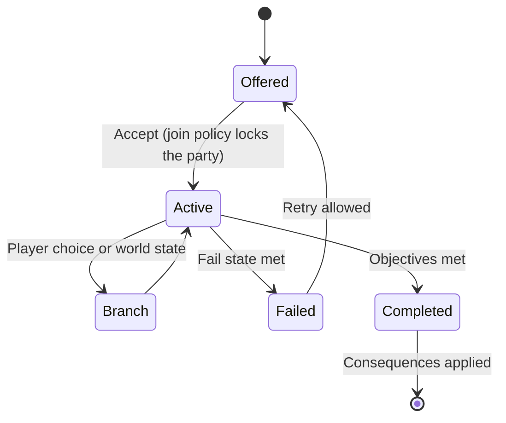

# Quest Architecture

The kinds of quests and events in the Oasis, which happen once and which repeat, how friends and NPCs join, how variation stays bounded and explainable, and how quests are specified and tested.

> **Version:** v0.1 · **Updated:** 10-10-2026 · **Owner:** Quest design
>
> **Horizons:** H0 micro-events and one personal quest · H1 every quest type · H2 Stewardship and faction stories grow
>
> **Related:** [D-030](../../DECISIONS.md#d-030) · [D-042](../../DECISIONS.md#d-042) · [D-024](../../DECISIONS.md#d-024) · [D-032](../../DECISIONS.md#d-032) · [Director and World Events](../06-ai/director-and-world-events.md) · [Celestial Convergence](../05-systems/celestial-convergence.md) · [NPC Bonds and Help-Calls](../05-systems/npc-bonds-and-help-calls.md) · [Reveal Graph](reveal-graph.md)

## 1. Quest types

| Type | Scope | Repeatable? | Authored or generated | State | Horizon |
| --- | --- | --- | --- | --- | --- |
| **World Saga** (Convergences, Long Night beats, the Dawn Rite) | Global | **No: once, for everyone** | Authored | Global ([D-030](../../DECISIONS.md#d-030)) | H1–H2 |
| **The Returner's Path** (personal main story) | Personal | No | Authored | Phased | H1 |
| **Domain stories** | Personal | No | Authored | Phased | H1 |
| **Faction stories** | Personal, with effects on the faction | No | Authored | Phased, plus faction reputation | H1 |
| **Character quests** (NPC life stories) | Personal | No | Authored, with generated variation in dialogue | Phased | H1 |
| **Mysteries and Eggs** | Personal, or global for world-firsts | Mostly no | Authored, with clues held on the server | Mixed ([Eggs and Mysteries](eggs-and-mysteries.md)) | H1 |
| **Mastery Trials** | Personal | Attempts repeat; completion happens once | Authored, with conditions varied by the Weaver | Personal | H1 |
| **Micro-events** | Local | **Yes, with variation** | **Generated** from validated templates | Local and short-lived | H0–H1 |
| **Help-calls** (from friends and NPCs) | Small group | Yes | Templates | Short-lived | H1 |
| **Long Night events** | Regional | Yearly, with variation | Templates plus authored beats | Regional | H1 |

**Completing the game** means finishing the Returner's Path and having contributed to the World Saga. Both can be done solo ([D-024](../../DECISIONS.md#d-024)).

## 2. The Returner's Path (personal main story)

The Returner's Path is an authored personal story that runs alongside the World Saga, in chapters that unlock as the Ages advance ([Ten-Year Saga](ten-year-saga.md#4-the-returners-path)). It answers personal questions: who am I, why did I arrive, and what will I swear at the Dawn Rite? NPC mentors age, relationships deepen, and the Arrival Dream chosen at creation pays off ([Avatar and Progression](../04-gameplay/avatar-and-progression.md)).

## 3. Joining rules

| ID | Rule |
| --- | --- |
| **QST-001 [H1]** | A friend can travel to a caller's location when the world and activity rules allow it ([NPC Bonds and Help-Calls](../05-systems/npc-bonds-and-help-calls.md)). |
| **QST-002 [H1]** | A friend who isn't part of an active quest can't join it after it begins, even if they are standing there. The interface explains why and offers alternatives: help outside the quest (escort, defend, gather) or join the next attempt. |
| **QST-003 [H1]** | A few authored quests are solo-only even for an existing party, such as a memory only you can enter. Each has a story reason, says so on its quest card, and is enforced the same way every time. |
| **QST-004 [H1]** | A quest that needs a team composition shows its requirements up front, supports matchmaking and inviting friends, and always lets NPC allies fill roles. No quest is clan-only. |
| **QST-005 [H1]** | NPCs may ask nearby eligible players for help, under the same quest-state, reward and privacy rules. |

## 4. The quest card

Every quest has a card, shown before the player accepts it. The card is also the contract that tests check against.

```yaml
QuestCard:
  id: Q.HL.LOWHAVEN.NETS_OF_MEMORY
  type: character_quest
  horizon: H1
  repeatable: false
  join_policy: party_at_start_only     # party_at_start_only | solo_only | open
  team_requirements: none              # or {roles:[...], npc_fill: true}
  law_overrides: []                    # WLD-014
  temporary_form: none                 # PRG-060
  reward_band: { insight: M, omnis: S, items: [ITEM.NET_CHARM.R1], trust: { npc.oswin_marr: +15 } }
  consequences: [phase.lowhaven.oswin_reconciled]
  reveal_nodes: [RV-06]                # delivers foreshadowing: the sealed cottage
  fail_states: [oswin_trust_below_0, timeout_none]
```

## 5. Variation within bounds

Repeatable activities vary their objectives, information, NPCs and rewards, but never at random without a reason. Quests are assembled from **atoms**:

| Atom | Examples | Who authors it |
| --- | --- | --- |
| **Premise** | Missing person, monster sighting, rival claim, strange light | Writers |
| **Actors** | NPCs from the local population, with real Minds | The simulation ([NPC Minds and Conversation](../06-ai/npc-minds-and-conversation.md)) |
| **Complication** | Weather, betrayal, a second faction, a colossus nearby | Writers and the Weaver |
| **Objective** | Find, escort, defend, persuade, investigate, craft | Designers |
| **Reward** | Drawn from a validated reward band | Economy design |
| **Flavour** | Dialogue, rumours, notes | The generative expression layer ([D-042](../../DECISIONS.md#d-042)) |

- **QST-010 [H1]** Every generated quest passes the Validator: every atom exists in canon or comes from an approved generator, laws are respected ([WLD-030](../02-world/world-laws.md#6-exceptions-licences-oaths-and-relics)), rewards stay in band, and no reveal lock is broken ([AI Architecture](../06-ai/architecture.md)).
- **QST-011 [H1]** Two players doing the "same" micro-event may get different variants and rewards within the published band. Power rewards vary by no more than 15% either way. Information, cosmetic and story rewards may vary freely.
- **QST-012 [H1]** Every reward grant logs its reason: template, atoms, random seeds and the Validator's verdict. Support and QA can always answer "why did I get this?"
- **QST-013 [H1]** Generated stories have "Legends" status. They are real for the player who lived them and never become canon unless writers promote them.

## 6. State, branching and failure

The diagram shows a quest's life from offer to completion.



- **QST-020 [H1]** Every authored quest with a conflict has at least two routes to success, such as fighting, talking, sneaking, crafting or bribing.
- **QST-021 [H1]** Failure is a story outcome where possible (the NPC remembers that you failed), not just a retry screen.
- **QST-022 [H1]** A one-time authored quest can't be repeated after it is fully completed. Chronicles let players relive World Saga moments without rewards.

## 7. Consequences

| Scope | Stored as | Example |
| --- | --- | --- |
| Personal | The player's phase flags | Oswin forgives you, and his shop greets you by name |
| Local and shared | Settlement state, shared by every layer | A bridge rebuilt in a recovery event stays rebuilt |
| Global | The world's canonical state | Orun is freed, and the Spine's law softens for everyone |

No quest lets a player kill an NPC that other players share. Authored world deaths are rare and always recorded as Chronicles ([D-032](../../DECISIONS.md#d-032)).

## 8. Inspirations

| Source | What we take | What we change |
| --- | --- | --- |
| *Final Fantasy XIV*'s Duty Support [M26] | NPC parties that let solo players finish team content | Every team-composition quest in the game accepts NPC allies ([QST-004](#3-joining-rules)) |
| Ken Levine's "Narrative Legos" [A28] | Quests built from recombinable story atoms | Every atom and every reward passes the Validator before a player sees it ([QST-010](#5-variation-within-bounds)) |
| Lucasfilm's Story Group and its Legends tier [W4] | A clear line between canon and non-canon stories | Generated stories are Legends by default, and only writers can promote them ([QST-013](#5-variation-within-bounds)) |

## 9. Acceptance criteria

| ID | Test |
| --- | --- |
| [QST-002](#3-joining-rules) | Automation: a friend arriving after a quest starts is refused every time, with the explanation and alternatives shown |
| [QST-004](#3-joining-rules) | Every team-requirement quest is completed solo with NPC allies in automated runs |
| [QST-010](#5-variation-within-bounds) | Fuzzing the generator with 100,000 template combinations produces 0 Validator escapes (no unknown entities, no out-of-band rewards) |
| [QST-011](#5-variation-within-bounds) | Across 10,000 runs of each micro-event, no power reward falls outside 15% of its band's centre |
| [QST-012](#5-variation-within-bounds) | Every reward event in telemetry has a reason record |
| [QST-020](#6-state-branching-and-failure) | Content audit: every authored quest with a conflict lists at least two completion routes, each passed by a test run |

<!-- citation links: generated, do not edit by hand -->

[A28]: ../../references/technology-and-ai.md
[M26]: ../../references/industry-and-live-service.md
[W4]: ../../references/film-literature-and-music.md
