# Reveal Graph

Every major truth in the saga: what must foreshadow it, what delivers it, when it can arrive and how it is locked, so neither variation nor AI can break setup and payoff.

> **Version:** v0.1 · **Updated:** 10-10-2026 · **Owner:** Narrative director
>
> **Related:** [D-012](../../DECISIONS.md#d-012) · [D-042](../../DECISIONS.md#d-042) · [D-018](../../DECISIONS.md#d-018) · [The Story of the Oasis: hidden canon](../../STORY.md#part-iii-hidden-canon) · [Celestials](celestials.md) · [Ten-Year Saga](ten-year-saga.md) · [NPC Minds and Conversation](../06-ai/npc-minds-and-conversation.md)
> ⚠ Hidden canon throughout.

## 1. Rules

- **NAR-020 [H1]** Every reveal has at least two foreshadowing nodes that ship before it, so the reveal deepens earlier scenes instead of only surprising.
- **NAR-021 [H1]** Every reveal has a lock of one of two kinds. **Server-held:** the content doesn't exist on clients until it is triggered, which defeats datamining. **Spoiler-proof:** knowing the truth early doesn't spoil the experience.
- **NAR-022 [H1]** Every reveal defines its knowledge scope: which NPC Minds may know it, and from when. The AI can't speak a locked truth; the Validator enforces this ([AI Architecture](../06-ai/architecture.md)).
- **NAR-023 [H1]** A reveal delivered by a global event is recorded as a Chronicle for late joiners ([D-030](../../DECISIONS.md#d-030)).
- **NAR-024 [H1]** Hidden canon is never put on a public schedule. Published calendars show only earliest Unseal dates and world unlocks ([D-018](../../DECISIONS.md#d-018)).

Any truth that resolves the saga, above all the Dawnkey rule, is revealed well before it is used (Sanderson's First Law [W8]).

## 2. The graph

The diagram shows what must ship before each reveal. F nodes are foreshadowing; RV nodes are reveals. An arrow means "ships before". RV-13 is left out because it is never resolved.

```mermaid
flowchart TD
    F1["Glass of the Ember Wastes"] --> RV01
    F2["Herald's Warning: it happened before"] --> RV01
    RV01["RV-01 The Burning happened before"]
    F3["Tavern legends of those who went up"] --> RV02
    F4["Library vault 1: Ascension texts"] --> RV02
    RV02["RV-02 The Celestials were Returners"]
    F5["Walking mountains at the first Long Night"] --> RV03
    F6["Maris's grief-floods on the coast"] --> RV03
    RV03["RV-03 The six are Bound, not dead"]
    F7["Sahr's lantern-shrines"] --> RV04
    F8["Herald's Warning: power freely given"] --> RV04
    RV03 --> RV04
    RV04["RV-04 The Dawnkey needs seven given Oaths"]
    F9["Blankday customs"] --> RV05
    F10["Crescent mark in Lowhaven"] --> RV05
    RV05["RV-05 Blankday was the seventh's day"]
    F11["Rumour that he lived in Lowhaven"] --> RV06
    F12["The sealed Lowhaven cottage"] --> RV06
    RV06["RV-06 The False Celestial was a Lowhaven net-mender"]
    RV05 --> RV07
    RV06 --> RV07
    F13["Erased Library pages"] --> RV07
    RV07["RV-07 His name is Zero, the first Returner"]
    F14["Wayshrines can't be built"] --> RV08
    F15["Ruins older than the cultures around them"] --> RV08
    RV08["RV-08 Veil is the world's memory, and Returners are remembered back"]
    RV03 --> RV09
    RV08 --> RV09
    F16["Era shifts after each Release"] --> RV09
    RV09["RV-09 Natural Laws are the six's chained power"]
    RV07 --> RV10
    RV09 --> RV10
    RV10["RV-10 Zero saw the cycle: the Dawnkey only turns the Burning aside"]
    RV04 --> RV11
    RV10 --> RV11
    RV11["RV-11 Many given Oaths can break the cycle"]
    F17["The Stillness law"] --> RV12
    RV01 --> RV12
    RV12["RV-12 The Lumenari watched the last Burning and did nothing"]
    F18["The Herald remembers every record but nothing of his own life"] --> RV14
    F19["A Keeper with the Herald's face in Hallowmere's frozen hour"] --> RV14
    RV14["RV-14 The Herald is what remains of Ysolde's Oath"]
```

## 3. Node table

| ID | Truth | Foreshadowing (at least two) | Delivered by | Earliest | Lock | NPCs who may know |
| --- | --- | --- | --- | --- | --- | --- |
| RV-01 | The Burning happened before | Ember glass; the Herald's Warning | Library vault 1, Ember Wastes archaeology, confirmed at the fourth Long Night | Hinted from launch, confirmed in Year 4 | Spoiler-proof | Keepers, Lumenari elders |
| RV-02 | The Celestials were Returners | Tavern legends; Ascension texts in vault 1 | Library vault 2, at the second Long Night | Year 2 | Spoiler-proof | Keepers, Cairnfolk elders |
| RV-03 | The six are Bound, not dead | The walking mountains; Maris's grief-floods | Orun's Release | Year 1 | Server-held | None before Orun's Release |
| RV-04 | The Dawnkey needs seven *given* Oaths | Sahr's lantern-shrines; the Herald's "freely given"; RV-03 | Sahr's Release, or slot IV's Release if Sahr comes later | Year 4 | Server-held | Keepers, after the reveal |
| RV-05 | Blankday was the seventh Celestial's day | Blankday customs; the crescent mark | Frostmarch scenes from the past and the Library's erasures | Year 7 | Spoiler-proof | Hallowmere monks |
| RV-06 | The False Celestial was a Lowhaven net-mender | The public rumour; the sealed cottage | The Lowhaven Egg chain and the Library | Rumour from launch, proof in Year 5 | Spoiler-proof | Lowhaven elders (rumour only) |
| RV-07 | His name is **Zero**, the first Returner | RV-05; RV-06; erased Library pages | **Ysolde's Release** | Year 7 | **Server-held, hard lock** ([CEL-003](celestials.md#9-vii--the-false-celestial-player-zero)) | No one before Ysolde's Release |
| RV-08 | Veil is memory, and Returners are remembered back | Wayshrines can't be built; ruins older than their cultures | Veil opening at the fifth Long Night | Year 5 | Server-held | Lumenari Intercessors (in part) |
| RV-09 | Natural Laws are the six's chained power | RV-03; RV-08; era shifts | Exploring Hollow, which opens by date at the eighth Long Night | Year 8 | Server-held | None |
| RV-10 | Zero saw the cycle | RV-07; RV-09 | Zero speaks at the ninth Long Night; Hollow | Year 9 | Server-held | None |
| RV-11 | Many given Oaths can break the cycle | RV-04; RV-10 | The Dawn Rite | Year 10 | Server-held | None |
| RV-12 | The Lumenari watched the last Burning and did nothing | The Stillness law; RV-01 | The Lumen faction story | Year 4 | Spoiler-proof | Lumenari |
| RV-13 | What Returners are: two readings, never collapsed ([D-012](../../DECISIONS.md#d-012)) | The Arrival Dream; Veil; the Returner motif | Ongoing, into Oasis 2.0 | Never resolved | Spoiler-proof | Everyone, as belief only |
| RV-14 | The Herald is what remains of Ysolde's Oath outside her chains ([The Story of the Oasis](../../STORY.md#6-the-herald)) | The Herald remembers every record but nothing of his own life; a Keeper with his face appears in Hallowmere's frozen hour | **Ysolde's Release**, when the Herald fades into her | Year 7 | Server-held | No one, including the Herald |

## 4. Acceptance criteria

| ID | Test |
| --- | --- |
| [NAR-020](#1-rules) | Graph lint: every RV node except RV-13 has at least two incoming edges, each scheduled to ship earlier |
| [NAR-021](#1-rules) | Build audit: server-held reveal assets are absent from client packages before their trigger |
| [NAR-022](#1-rules) | AI evaluation: 10,000 adversarial prompts asking NPCs for locked truths produce 0 disclosures ([AI Safety and Evaluation](../06-ai/safety-and-evaluation.md)) |
| [NAR-023](#1-rules) | Every reveal delivered by a global event has a Chronicle within 24 hours of the event |
| [NAR-024](#1-rules) | Audit of every published calendar, announcement and store page finds no hidden-canon reveal or its date |

<!-- citation links: generated, do not edit by hand -->

[W8]: ../../references/film-literature-and-music.md
