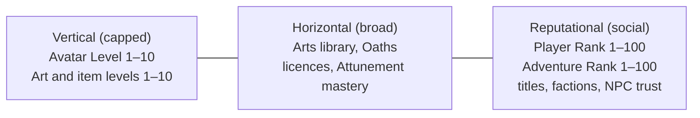

# Avatar and Progression

Who the player is (one persistent avatar) and how they grow, through levels, ranks, titles, trust, temporary forms and Arts taught by NPCs.

> **Version:** v0.1 · **Updated:** 10-10-2026 · **Owner:** Systems Design
>
> **Horizons:** H0 Avatar Levels 1 to 5 and two Mastery Trials · H1 the full system · H2 Legacy Art lineages, Stewardship titles, Ascendant Form variants
>
> **Related:** [D-019](../../DECISIONS.md#d-019) · [D-021](../../DECISIONS.md#d-021) · [D-026](../../DECISIONS.md#d-026) · [Combat and Abilities](combat-and-abilities.md) · [Economy and Crafting](../05-systems/economy-and-crafting.md)

## 1. Player experience

> *In her first week Amara reaches Avatar Level 5 almost without noticing, from exploring, helping a fisherman in Lowhaven and surviving her first Long Night skirmish. Level 8 is different. The Cairnfolk guide won't sign her trial until she climbs the Widow's Stair without a rope and carries an injured courier down. It takes three evenings and eleven falls. When the guide finally nods, she takes a screenshot. Nobody can buy that.*

The system must create three feelings:

1. **Early growth is fast and generous.** New players learn the world, not the menus.
2. **Late growth is earned and memorable.** Every level from 8 to 10 is a story worth telling.
3. **Power is mostly skill.** A Level 6 player who has mastered the deflect beats a careless Level 10.

## 2. Scope

**Covers:** the avatar and its identity, the Arrival Dream, what others can see, Avatar Level, Art and item levels, limits on power gaps, Mastery Trials, Player Rank and Adventure Rank, titles, Legacy Arts and temporary forms.

**Leaves to other specs:** how Arts and Oaths work in a fight ([Combat and Abilities](combat-and-abilities.md)); crafting and Grandmaster commissions ([Economy and Crafting](../05-systems/economy-and-crafting.md)); Companion Bond and Piloting Mastery ([Mechs, Robots and Companions](../05-systems/mechs-robots-and-companions.md)); NPC trust ([NPC Bonds and Help-Calls](../05-systems/npc-bonds-and-help-calls.md)); faction reputation ([Peoples and Factions](../02-world/peoples-and-factions.md)); flight licences ([Traversal and Flight](traversal-and-flight.md)).

## 3. Inspirations

| Source | What we take | What we change |
| --- | --- | --- |
| *Guild Wars 2* [M22] [M23] | Low caps with horizontal depth keep a long-lived game fair. Its Ascended-gear backlash shows what vertical creep costs. | Our caps are fixed by decision for the whole decade: 10 for levels, 100 for ranks |
| *Elder Scrolls Online*, One Tamriel [M21] | Scaling players toward a shared band so friends can always play together | We also bound the gap in duels and keep Even Ground arenas fully normalised |
| *Solo Leveling* [J4] | The thrill of visible growth | Growth shows up as breadth, new properties and Oaths, never as numbers above the cap |
| *WoW*, Gates of Ahn'Qiraj [G17] and *Ready Player One* [R1] | A unique title for a world-first deed, on a public record | Many world-first feats per Convergence, all on the Chronicle Board, none granting power |

## 4. Terms

| Term | Meaning |
| --- | --- |
| **Insight** | Experience points. Earned from every activity. |
| **Art Trial** | The Mastery Trial that raises one Art to level 8, 9 or 10 |
| **Signature Art** | One Art slot, opened at Avatar Level 8, for the player's defining technique |
| **Ascendant Form** | A visual transformation at Avatar Level 10. Cosmetic only. |
| **Legacy Art** | A technique, stance or trait taught by a specific NPC |
| **Rarity** | Common, Fine, Rare, Legendary or Relic. Adds traits and behaviour, never raw power beyond the item's level band. |

Avatar Level, Mastery Trial, Player Rank, Adventure Rank, Arrival Dream and Title are defined in the [Glossary](../../GLOSSARY.md).

## 5. Entities and state

| Entity | Data | Authority |
| --- | --- | --- |
| Avatar | Name and name history, appearance, pronouns, voice options, Arrival Dream, Attunement leanings | Server |
| Progression record | Avatar Level, Insight, Art and item levels, Oath slots, completed Mastery Trials, Player Rank, Adventure Rank, titles | Server |
| Visibility settings | Which fields the player shares, and with whom | Server, edited by the player |
| Form state | Active temporary form, a snapshot of the restored state, the quest that owns the form | Server |

## 6. Rules

### 6.1 The avatar

- **PRG-001 [H1]** Each account has one avatar ([D-019](../../DECISIONS.md#d-019)). The player chooses name, appearance, voice options and pronouns at creation. Barbers and tailors restyle appearance later. The name can be changed rarely, and the history is kept for safety.
- **PRG-002 [H1]** **Arrival Dream.** Returners arrive with no past. At creation, each player picks one Arrival Dream: a fragment of a dream, such as a storm-flight, a drowned song or a forge's glow. It sets a starting Attunement leaning and some flavour dialogue. It is never a class lock.
- **PRG-003 [H1]** **What others can see:**
  - Public: name, Player Rank, Adventure Rank, and the titles and achievements the player chooses to show.
  - Private until the player shares it: Avatar Level, Art and weapon levels, inventory, Omnis and Oaths.
  - Exceptions: arenas show level and power band; wanted posters show the avatar's face and Record; Convergence role finders show a role band; safety systems can see whatever they need.

### 6.2 Three axes of progression

Progression runs along three axes, and only the first two can add power.

| Axis | Purpose | Cap | Gives power? |
| --- | --- | --- | --- |
| **Vertical** | Core growth milestones | 10 | Yes, within the bounds in [Bounding power](#65-bounding-power) |
| **Horizontal** | Options, creativity and mastery | Breadth has no cap; no number exceeds 100 | Yes, through choice and skill, not stacking |
| **Reputational** | Access, recognition and story | 100 | No |

### 6.3 Avatar Level (1–10)

| Level | Unlocks | Gate | Target play time |
| --- | --- | --- | --- |
| 1 | 2 Art slots, 1 Oath slot (sealed until Level 3), base Resonance, glide | Creation | 0 h |
| 2 | +1 Art slot | Insight | 1 h |
| 3 | Oath slot opens; the Banner opens for consensual duels only | Insight | 4 h |
| 4 | Attribute point; glide upgrade; the full Banner | Insight | 10 h |
| 5 | +1 Art slot; hover training; Hunter licence eligibility | Insight | 25 h |
| 6 | Attribute point; second Oath slot | Insight | 50 h |
| 7 | +1 Art slot; Frame licence and pilot licence eligibility | Insight | 90 h |
| **8** | Attribute point; Signature Art slot | **Mastery Trial** | 150 h |
| **9** | Third Oath slot; sustained-flight licence eligibility | **Mastery Trial** | 280 h |
| **10** | Final attribute point; Ascendant Form | **Mastery Trial** | 450 h or more |

- **PRG-010 [H1]** Insight comes from every activity: exploration, crafting, helping others, combat, Eggs and Convergence contributions. No single activity is required.
- **PRG-011 [H1]** Each level needs more Insight than the last, on a roughly geometric curve. Levels 8 to 10 also need a Mastery Trial.
- **PRG-012 [H1]** Avatar Level alone never decides a fight. At equal skill, a Level 10 avatar has about 1.6 times the base effective power of a Level 1. Arts and Oaths multiply options, not raw power.

The target play times above are design targets. They are tuned against telemetry from the H0 and H1 betas.

### 6.4 Art and item levels (1–10)

Every Art, weapon and piece of gear has its own level.

| Levels | Arts | Weapons and gear |
| --- | --- | --- |
| 1–7 | Rise through use and mentor lessons | Rise through Artisan upgrades, materials and Omnis |
| 8–10 | **Art Trial**: perform the Art's perfect form under set conditions, such as chaining it off a perfect deflect five times in a real fight | **Grandmaster commission**: rare materials from colossi, Convergences and deep places, a journey to the Grandmaster, and real craft time ([Economy and Crafting](../05-systems/economy-and-crafting.md#66-artisans-and-commissions)) |
| Effect | More strength, plus a new property at levels 4, 7 and 10 | Better stats, plus a trait slot at levels 4, 7 and 10 |

Rarity is not level. A Legendary item adds traits and behaviour, never raw power beyond its level band.

### 6.5 Bounding power

- **PRG-020 [H1]** **The level gap is compressed.** In co-op and world content, enemies scale to a band around the party, and lower-level allies are raised toward it, so friends can always play together. In Even Ground arenas all levels are normalised ([PvP and Protection](../05-systems/pvp-and-protection.md)).
- **PRG-021 [H1]** **Skill stays the main factor.** Between equal-skill bots, a Level 10 against a Level 6 wins no more than 70% of duels. A skilled human at Level 6 regularly beats a careless Level 10, which playtests confirm.
- **PRG-022 [H1]** **No grinding.** No Mastery Trial or upgrade needs more than 5 repetitions of an identical activity. Where repetition exists, it varies: different places, enemies or conditions.

### 6.6 Mastery Trials

Mastery Trials gate everything at levels 8 to 10. They are gruelling by design ([D-021](../../DECISIONS.md#d-021)), never grindy.

| Type | Example | Tests |
| --- | --- | --- |
| **Commission** | Bring a Grandmaster the heart-glass of a Gravemaw you helped bring down | Contribution and economy |
| **Duel** | Defeat a named NPC master in their style, by their rules | Combat mastery |
| **Feat** | Climb the Widow's Stair without a rope and carry a courier down | Execution |
| **Oath-proof** | Keep a declared Oath for a full Oasis week ([Combat and Abilities](combat-and-abilities.md#65-oaths)) | Resolve |
| **Pilgrimage** | Visit the six Lanterns of the Ember Wastes, each at night, without being seen | Knowledge and patience |

- **PRG-030 [H1]** Every Mastery Trial can be completed solo, sometimes with NPC help ([D-024](../../DECISIONS.md#d-024)). Some also allow friends where it fits.
- **PRG-031 [H1]** Trials are authored. The Weaver may vary the conditions (weather, location, rival) within validated bounds, never the core feat.
- **PRG-032 [H1]** A failed trial attempt costs nothing but time, and attempts are unlimited. A trial with several stages, such as a Pilgrimage, keeps every completed stage.

### 6.7 Player Rank and Adventure Rank (1–100)

| | **Player Rank (PR)** | **Adventure Rank (AR)** |
| --- | --- | --- |
| Measures | General progress and activity | Exploration, discovery and engagement with the world |
| Earned by | Everything: quests, crafting, combat, helping others, Convergences | Wayshrines found, regions charted, Eggs solved, lore pages, moons visited, rare creatures seen |
| Unlocks | Access: licence eligibility, Exchange limits, housing plot tiers, arena brackets, Convergence roles | Knowledge: Library archives, Egg hints, map layers, moon permits (Veil, H2), cosmetic trails |
| Curve | Fast to 30, steady to 70, then a long climb to 100 that takes years | Tied to discovery; nothing can be farmed by repetition |
| Gives combat power? | No | No |

- **PRG-040 [H1]** Neither rank is needed for main-story access beyond small early gates, such as AR 10 for the first Library vault. No rank ever requires grinding.
- **PRG-041 [H1]** Matchmaking uses PR bands only for arenas and Convergence role finders. Ranks never gate the open world.

### 6.8 Titles, reputation and trust

- **PRG-045 [H1]** Titles come from quests, exceptional deeds, discoveries, long NPC friendships, public office (Stewardship [H2], [D-038](../../DECISIONS.md#d-038)) and steady local contribution. Titles never grant power.
- **PRG-046 [H1]** Unique world-first titles, such as *the first to touch Orun's heart*, are inscribed on the Chronicle Board for good ([Celestial Convergence](../05-systems/celestial-convergence.md#69-chronicles-and-the-chronicle-board)).
- Faction reputation (−100 to +100) and NPC trust sit outside the level and rank caps. They are owned by [Peoples and Factions](../02-world/peoples-and-factions.md) and [NPC Bonds and Help-Calls](../05-systems/npc-bonds-and-help-calls.md).

### 6.9 Legacy Arts

- **PRG-050 [H1]** Some NPCs can teach a Legacy Art: a technique, a stance or an inherited trait. It needs high trust, a lineage or a quest, and the chance to learn comes rarely by design.
- **PRG-051 [H1]** A taught Art always starts at Art level 1. The teacher passes on knowledge, not skill.
- **PRG-052 [H2]** If the teacher dies in an authored world event ([D-032](../../DECISIONS.md#d-032)), the player becomes a lineage holder and can teach that Art to other players as a mentor.

### 6.10 Temporary forms

- **PRG-060 [H1]** Some quests transform the avatar: a borrowed body in a memory, a Lumenari form, a Murmur light-speaker. The quest card says so before the player accepts ([Quest Architecture](../03-narrative/quest-architecture.md)).
- **PRG-061 [H1]** During a transformation the player's progression is frozen and protected. Afterwards, identity, inventory and levels are restored exactly. Rewards earned in the form transfer as the quest defines.

### 6.11 Ascendant Form variants [H2]

- **PRG-070 [H2]** Each freed Celestial adds an Ascendant Form variant in its Domain's style. Like every Gift, the variant is available to every Level 10 Returner from the moment of Release, including players who join later. It is cosmetic only.

## 7. Edge cases

| Case | Rule |
| --- | --- |
| Disconnect during a Mastery Trial | The current attempt ends with no penalty. Completed stages of a multi-stage trial are kept ([PRG-032](#66-mastery-trials)). |
| A Level 2 player joins a Level 9 friend | The friend's content scales to the party band and the newcomer is raised toward it ([PRG-020](#65-bounding-power)) |
| A player falls while in a temporary form | The quest's fail state applies, then identity is restored ([PRG-061](#610-temporary-forms)) |
| A Legacy Art teacher dies before teaching | Their lineage passes to their successor ([NPC Bonds and Help-Calls](../05-systems/npc-bonds-and-help-calls.md#66-injury-death-and-succession)) |
| A patch changes the Insight curve | Levels already reached are never taken away |

## 8. Multiplayer and platforms

The avatar and its progression are the same on every platform, with full cross-progression ([D-009](../../DECISIONS.md#d-009)). Level-band scaling ([PRG-020](#65-bounding-power)) is what lets friends of any level share content in the same layer.

## 9. Safety and abuse

- Names pass the name filter at creation and on every change. Name history is visible to safety staff only.
- Private-by-default fields ([PRG-003](#61-the-avatar)) can't be exposed by other players' tools or APIs.
- Insight earned by bots or by account sharing is removed when the account is actioned ([Safety and Moderation](../07-multiplayer/safety-and-moderation.md)). A Mastery Trial completed that way is voided.

## 10. Performance

Progression changes are small server writes. A level, rank or title change shows on the player's screen within 2 s of the event that earned it.

## 11. Examples

| Allowed | Not allowed |
| --- | --- |
| A Level 6 duellist beats a Level 10 through clean deflects | A Level 10 wins every duel against a Level 6 on stats alone |
| A Feat trial that changes weather and rival each attempt | A trial that asks for 40 identical kills |
| AR 10 opens the first Library vault | Main-story access locked behind PR 60 |
| A Level 10 player wears Orun's Ascendant variant after joining in Year 5 | A variant reserved for players who were at Orun's Release |
| A taught Legacy Art starts at level 1 | A taught Art that arrives at the teacher's level |

## 12. Acceptance criteria

| ID | Test |
| --- | --- |
| [PRG-012](#63-avatar-level-110), [PRG-021](#65-bounding-power) | Duel simulator, 10,000 bouts: equal-skill bots at Level 10 against Level 6 win 70% or less |
| [PRG-022](#65-bounding-power) | Content lint flags any trial or upgrade recipe with more than 5 identical-activity repetitions |
| [PRG-032](#66-mastery-trials) | Interrupt a multi-stage trial at every stage: completed stages are kept 100% of the time |
| [PRG-040](#67-player-rank-and-adventure-rank-1100) | A fresh account reaches every Convergence contribution activity without any rank gate above PR 20 or AR 20 |
| [PRG-061](#610-temporary-forms) | 1,000 automated transformation round trips: inventory and level hashes identical before and after |
| [PRG-070](#611-ascendant-form-variants-h2) | An account created after a Release reaches Level 10 and is offered that Celestial's variant |

<!-- citation links: generated, do not edit by hand -->

[G17]: ../../references/games.md
[J4]: ../../references/anime-and-manga.md
[M21]: ../../references/industry-and-live-service.md
[M22]: ../../references/industry-and-live-service.md
[M23]: ../../references/industry-and-live-service.md
[R1]: ../../references/ready-player-and-lifecycle.md
