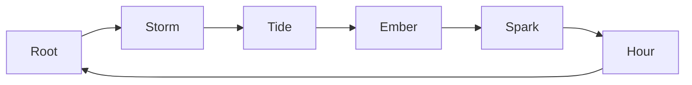

# Combat and Abilities

How fighting feels and works: weighty, readable real-time combat built on Arts, Oaths and skill, fair across every input and protected against degenerate play.

> **Version:** v0.1 · **Updated:** 10-10-2026 · **Owner:** Combat Design
>
> **Horizons:** H0 melee core with the deflect, 6 Arts and 1 Oath · H1 the full kit, aerial and ranged combat, Frames · H2 Domain Arts, Celestial Oaths, Colossal Frame combat, rollback duels
>
> **Related:** [D-026](../../DECISIONS.md#d-026) · [D-020](../../DECISIONS.md#d-020) · [World Laws](../02-world/world-laws.md) · [Avatar and Progression](avatar-and-progression.md) · [PvP and Protection](../05-systems/pvp-and-protection.md)

## 1. Player experience

> *The Gravemaw's tail comes down. Ren reads the tell (dust lifting, a low groan) and steps into it, deflecting with a ringing clang that stops the world for a heartbeat. Its Poise cracks. She spends Resonance on a Storm Art, a tether of lightning to the sand, while her friend's Tide Art soaks the ground. Together they make an electrified marsh neither of them planned. The colossus staggers, and three strangers watching from a ridge come running.*

Combat stands on five pillars:

| Pillar | Means |
| --- | --- |
| **Weight** | Every action commits the body. Hits land with impact you feel in sound, hit-stop and motion. |
| **Rhythm** | Fights are conversations: attack, read, deflect, punish. Mastery is timing. |
| **Readability** | Every threat has a tell and every state is visible. Effects never hide the game. |
| **Creativity** | Arts combine through shared rules, and Oaths create personal builds. There are no fixed combo lists to memorise. |
| **Fairness** | Skill decides. Competitive play pools players by input. No paid power, ever. |

## 2. Scope

**Covers:** core verbs and resources, the feel of weight, Arts, Weaving, Oaths, weapons and ranged combat, aerial and scale combat, enemies and difficulty, anti-degenerate rules, input and targeting, and combat authority.

**Leaves to other specs:** where players may fight each other ([PvP and Protection](../05-systems/pvp-and-protection.md)); Frame piloting ([Mechs, Robots and Companions](../05-systems/mechs-robots-and-companions.md)); how each Domain modifies Arts and weapons ([World Laws](../02-world/world-laws.md#4-natural-law-by-domain)); levels and Oath slots ([Avatar and Progression](avatar-and-progression.md)); what happens at 0 Health ([Death and Return](death-and-return.md)); accessibility settings ([Controls, Camera and Accessibility](../09-platforms/controls-camera-and-accessibility.md)).

## 3. Inspirations

| Source | What we take | What we change |
| --- | --- | --- |
| *Sekiro* [G10] | The posture duel: deflects break an opponent's balance, and mastery is timing | It works in a shared world with groups, and PvE assist options widen the window for those who need it |
| *Sword of the Stranger* [J8] | Footwork and spacing as part of the duel | Root motion moves the body on every attack |
| *Breath of the Wild* [A23] | Systems that multiply: elements and states combine by rule | Our chemistry table is published in the Grand Library, and works the same for one caster or two |
| *Hunter x Hunter* [J3] and *Jujutsu Kaisen* [J2] | Vows and limits: the stricter the constraint, the stronger the power | Oaths come from an authored library with set breach costs, and they carry the story's theme: the Celestials ascended by keeping Oaths |
| *Avatar: The Last Airbender* [W15] | Each element fights in a real martial art's style | Each Attunement gets its own movement language from a real tradition, chosen with consultants. We don't reuse the show's mapping. |
| *Naruto* [J1] | Elemental natures that counter each other | Our own six Attunements in one cycle, as a game rule, not borrowed lore |
| *Jujutsu Kaisen* Domain Expansion [J2] | An ultimate technique that claims space | Domain Arts are H2, short and readable, and obey Natural Law |
| *Fullmetal Alchemist: Brotherhood* [J11] | Equivalent Exchange: every power has a price of equal value | Each Oath trades a chosen constraint for its boon, and breaking it costs in proportion |

## 4. Terms

| Term | Meaning |
| --- | --- |
| **Deflect** | Guard pressed inside a tight window before impact. No damage taken; the attacker loses Poise. |
| **Stamina** | Fuels guard, dodge, sprint and climbing. Regenerates quickly. |
| **Weaving** | Combining Arts through their properties |
| **Chemistry table** | The published table of property interactions |
| **Attunement counter** | The cycle that decides which Art wins when two collide |
| **Breach cost** | What a player pays for breaking an Oath |
| **Combo decay** | The rule that shortens hit-stun on a target hit repeatedly in the air |

Poise, Resonance, Art, Attunement and Oath are defined in the [Glossary](../../GLOSSARY.md).

## 5. Entities and state

| Entity | Data | Authority |
| --- | --- | --- |
| Combatant | Health, Stamina, Poise, Resonance, active properties (wet, burning, charged and so on), stun immunity timer | Server, with client prediction |
| Art | Attunement, category, properties, Resonance cost, level, properties gained at levels 4, 7 and 10 | Content data |
| Oath instance | Template, chosen strictness, boon, breach state and timer | Server |
| Chemistry table | Property pairs and results | Content data, mirrored in the Grand Library |
| Weapon | Class, item level, tell and sound profile, resource | Server |

## 6. Rules

### 6.1 Core verbs and resources

| Verb | Notes |
| --- | --- |
| Light and heavy attack | Weapon-specific chains; heavy attacks can be charged |
| **Guard** | Reduces damage and drains Stamina |
| **Deflect** | Guard inside the window: no damage, hurts the enemy's Poise, rings out audibly |
| Dodge | Brief invulnerability with recovery; costs Stamina |
| Jump and aerial | Air attacks and a limited air dodge |
| Grapple and throw | Beats guard; loses to attacks |
| Context actions | Environment kills (drop a chandelier), wall-runs, ledge attacks, finishers on Poise-broken foes |
| Arts | Resonance-powered techniques ([Arts](#63-arts)) |

| Resource | Role |
| --- | --- |
| **Health** | Survival. Regenerates only out of combat, at Hearths, or through consumables. |
| **Stamina** | Guard, dodge, sprint, climb |
| **Poise** | Every combatant's balance. It breaks under pressure, opening a finisher, and recovers when pressure stops. |
| **Resonance** | Fuel for Arts. Builds through good play (deflects, perfect dodges, hits) and slowly over time. |

- **CMB-001 [H1]** Deflecting a heavy attack inside the window takes at least 35% of the attacker's Poise and costs the defender no Stamina.
- **CMB-002 [H1]** Every enemy attack has both an audio and a visual tell, and its window is learnable because it is the same every time for that move.
- **CMB-003 [H1]** A perfect deflect gives at least 3 times the Resonance of a plain hit.

### 6.2 The feel of weight

| Element | Target | Why |
| --- | --- | --- |
| Hit-stop | Light 40–60 ms; heavy 90–140 ms; deflect 120 ms with an audio ring | The pause sells the impact |
| Commitment | Heavy attacks can't be cancelled after their startup frames, except by a costly dodge | Decisions matter |
| Footwork | Attacks move the body; spacing is part of skill | Duels read as duels |
| Armour weight | Heavier gear gives more Poise, a slower dodge and higher Stamina cost | Build trade-offs |
| Reactions | Stylised physical reactions (stagger, knockback, ragdoll blend). No gore, in line with the 13+ rating [G9]. | Weight within the rating |
| Camera | A restrained shake budget; readable lock-on and free-aim modes | Readability |
| Sound | A low-end thump on heavy hits, silence before big strikes, a distinct deflect ring per weapon class | Weight and rhythm ([Art and Audio Direction](../01-vision/art-and-audio-direction.md)) |

### 6.3 Arts

Arts are learned techniques drawn from the six Attunements (Root, Tide, Storm, Ember, Spark and Hour) plus neutral martial Arts. There is no class lock. Mentors across the Domains teach them.

| Category | Example | Notes |
| --- | --- | --- |
| **Strike** | *Root: Stonepalm*, a Poise-crushing palm | Strengthens melee |
| **Form** | *Storm: Gale Step*, faster movement and lighter hits | A stance that changes the moveset while active |
| **Projection** | *Ember: Lantern Arc*, a thrown crescent of flame | Ranged |
| **Movement** | *Storm: Updraft*, a vertical launch | Traversal and combat |
| **Ward** | *Tide: Undertow Veil*, which redirects projectiles | Defence |
| **Domain** [H2] | *Hour: Stillpoint*, a sphere where your Arts can't be interrupted | An ultimate |

When two Arts collide directly, the Attunement counter decides the winner. Each Attunement overpowers the next one in this cycle.

- **CMB-004 [H1]** In a direct clash, the Art whose Attunement overpowers the other wins and the other is cancelled. Two Arts of the same Attunement cancel each other out.

### 6.4 Weaving

Arts carry properties (element, shape, state). Properties interact through the chemistry table, not through hand-authored combos.

| Property A | Property B | Result |
| --- | --- | --- |
| Wet (Tide) | Charged (Storm) | Electrified area |
| Burning (Ember) | Growth (Root) | Burning thorns: damage over time and area denial |
| Frozen (Hour) | Force (any heavy attack) | Shatter: a burst of Poise damage |
| Spark field | Metal armour | Magnetise: pull or slow |
| Wind (Storm) | Burning | Firestorm cone |

- **CMB-010 [H1]** Any two Arts whose properties interact produce the defined result, whether one player casts both or two players cast one each.
- **CMB-011 [H1]** The chemistry table is public in the game and can be learned in the Grand Library, so players understand a combination before they rely on it [W8].

### 6.5 Oaths

An Oath is a constraint the player chooses in exchange for power ([D-026](../../DECISIONS.md#d-026)). It is also the game's central idea: the Celestials ascended by keeping Oaths ([STORY.md](../../STORY.md)).

Every Oath has four parts: a constraint, a scope, a boon and a breach cost.

| Example Oath | Constraint | Boon | Breach cost |
| --- | --- | --- | --- |
| *Carry Them* (an echo of Orun) | Revive any Downed ally you see | Revive speed doubled; brief Poise armour on revive | Boon lost for 1 Oasis day |
| *Never First* | Never strike before being struck in an encounter | +40% damage on your first riposte | Boon lost for the encounter; a Stamina shock |
| *Single Path* | Use only one Attunement's Arts | +35% to that Attunement's Arts | Boon lost for 1 Oasis day |
| *The Bare Hand* | Fight with no weapon equipped | +60% unarmed Poise damage | Boon lost for 1 Oasis day; −20% Resonance |
| *The Night Promise* | Fight only between dusk and dawn (Oasis time) | Arts cost 30% less at night | Boon lost until the next dusk |

- **CMB-020 [H1]** Oaths come from an authored library with parameter ranges. Players tune the strictness, and the boon scales with it. AI can't invent Oaths ([WLD-030](../02-world/world-laws.md#6-exceptions-licences-oaths-and-relics)).
- **CMB-021 [H1]** The number of Oath slots follows Avatar Level ([Avatar Level](avatar-and-progression.md#63-avatar-level-110)).
- **CMB-022 [H1]** A player can always break an Oath, and it always costs something in proportion to its boon.
- **CMB-023 [H1]** In PvP, opponents see that you hold Oaths (a visible glow), never which ones.
- **CMB-024 [H2]** **Celestial Oaths.** Each freed Celestial grants every Returner an Oath based on its virtue, as its Gift ([Celestial Convergence](../05-systems/celestial-convergence.md#68-the-release-moment)).

### 6.6 Weapons and ranged combat

| Class | Handling | Resource | Natural Law notes |
| --- | --- | --- | --- |
| Blades (sword, paired blades, katana class) | Fast, built around the deflect | Stamina | None |
| Heavy (hammer, greataxe) | Slow, crushes Poise | Stamina | None |
| Polearms | Reach and spacing | Stamina | None |
| Gauntlets | Grapples and combos | Stamina | Strong with Oaths like *The Bare Hand* |
| Bows | Draw, arc, precision | Arrows (craftable) | Arcs carry in Stormcrown winds |
| Throwing (knives, chakram class) | Fast utility | Limited stock | None |
| **Firearms** | Recoil, reload, high damage | Ammunition | Weakened under water; at home in the Iron Meridian |
| **Energy weapons** | Heat build-up, no ammunition | Spark-cells | Favoured under water and in the Iron Meridian |
| Domain tools | Harpoons, glass-slings, rope-darts | Varies | Native to their Domain |

- **CMB-030 [H1]** Every weapon obeys the item level cap of 10 ([D-021](../../DECISIONS.md#d-021)).
- **CMB-031 [H1]** Ranged damage falls off with distance, and projectiles travel visibly. In PvP there is no invisible hitscan, except one designated sniper class with a clear tracer and a long reload. Melee gets gap-closers, and projectiles can be deflected.
- **CMB-032 [H1]** Each weapon class has its own deflect sound and tell profile.
- **CMB-033 [H1]** Aim assist is tuned per input and disabled or normalised in competitive pools, following Fortnite's input pools [M39].
- **CMB-034 [H1]** Targeting defaults depend on input: soft lock-on on controller and touch, free aim on keyboard and mouse. Every player can switch modes at any time.
- **CMB-035 [H1]** A Signature Art may use an optional input sequence of up to three inputs, in the spirit of hand seals [J1]. Every such sequence has a single-button alternative with the same effect and timing, on every input ([UX-004](../09-platforms/controls-camera-and-accessibility.md#61-control-schemes) in [Controls, Camera and Accessibility](../09-platforms/controls-camera-and-accessibility.md)).

### 6.7 Aerial and scale combat

| Space | Rules |
| --- | --- |
| **Aerial** | Altitude bands (low, mid, high). Momentum carries. Tight turns cost Stamina. Landing has recovery frames, which leave the flyer open. The air dodge is limited per airtime. |
| **Anti-air** | Grapple-pull Arts, nets, Storm tethers, arcing bows, flak-class firearms. Every Domain offers at least two anti-air options. |
| **Frames** | A separate mastery ([Mechs, Robots and Companions](../05-systems/mechs-robots-and-companions.md)). Pilots can be hit when exposed, and can eject. A Frame's stomp is telegraphed and dodgeable, so infantry are never deleted in one hit. |
| **Colossi** | Climb, target parts, and coordinate ground, air and Frame roles ([Machines and Colossi](../02-world/machines-and-colossi.md)) |

### 6.8 Enemies, bosses and difficulty

Enemy archetypes: duellist, brute, skirmisher, caster, swarm, flyer and sapper.

- **CMB-040 [H1]** Boss phases change the questions, not just the numbers: new tells and new arena states.
- **CMB-041 [H1]** Difficulty is set in visible tiers per area. The Weaver may adjust which enemies appear and when, within published bounds ([The Weaver](../06-ai/director-and-world-events.md)). It never changes stats in secret.
- **CMB-042 [H1]** PvE assist options include a wider deflect window, auto-guard and slowed aiming ([Controls, Camera and Accessibility](../09-platforms/controls-camera-and-accessibility.md)). They are off in ranked PvP.

### 6.9 Anti-degenerate rules

| Problem | Rule |
| --- | --- |
| Infinite combos | **Combo decay:** repeated hits on a target in the air give less hit-stun, and gravity pulls harder. After 6 airborne hits the target falls. |
| Stun-lock | A stun immunity window follows every Poise break and finisher |
| Spam | Resonance costs, plus diminishing returns on repeating the same Art within 6 s |
| Oath exploits | Oath conditions are checked on the server. Ambiguous cases go against the boon. |
| Dominant builds | Telemetry flags any build whose win rate differs from the average by more than 5 points. Balance is reviewed with every quarterly update, using the metrics-led approach of *Slay the Spire* [T44]. |

### 6.10 Authority

- **CMB-050 [H1]** Combat is server-authoritative with client prediction. Hits are validated with bounded lag compensation, as in Overwatch's architecture [M34] and For Honor's move to dedicated servers [M38]. Details are in [Server and Backend](../08-technology/server-and-backend.md).
- **CMB-051 [H2]** One-on-one duel arenas may use rollback netcode for fighting-game precision [M36].

## 7. Edge cases

| Case | Rule |
| --- | --- |
| Natural Law forbids an Art where it is cast (Ember under water) | The cast is refused before any Resonance is spent, with an in-world reason ([WLD-011](../02-world/world-laws.md#3-the-evaluation-model)) |
| An Oath condition is ambiguous (was that a strike first?) | It resolves against the boon |
| Two players' Arts weave by accident | The result hits enemies only. In lawful zones, Weaving never damages allies or bystanders. |
| A player disconnects mid-fight | The avatar stays in the world for the logout window ([Waypoints and Healing](../05-systems/waypoints-and-healing.md#64-login-logout-and-spawn-choice)) |
| A hit arrives beyond the lag-compensation bound | The server rejects it and the client corrects |

## 8. Multiplayer and platforms

- Combat is designed for third person first. First person is fully supported outside specific encounters, and competitive rulesets lock the perspective ([D-020](../../DECISIONS.md#d-020)).
- Competitive pools are by input, never by platform alone ([CMB-033](#66-weapons-and-ranged-combat)).
- Touch players get the same rules, with soft lock-on by default and single-button Signature Arts ([CMB-034](#66-weapons-and-ranged-combat), [CMB-035](#66-weapons-and-ranged-combat)).

## 9. Safety and abuse

- No gore. Intensity options, such as turning blood effects off, are open to everyone ([D-006](../../DECISIONS.md#d-006)).
- Oath checks, hit validation and Resonance are all server-side, so a modified client gains nothing.
- Kill feeds and taunts follow the rules in [PvP and Protection](../05-systems/pvp-and-protection.md).

## 10. Performance

- Hit feedback is predicted on the client within one frame. The server confirms within one round trip.
- Effects stay inside a per-platform budget, and readability wins over spectacle when the budget is tight ([Platform Support](../09-platforms/platform-support.md)).

## 11. Examples

| Allowed | Not allowed |
| --- | --- |
| A Tide user and a Storm user electrify a marsh together | A hand-authored combo that only works for one class |
| A boss's second phase floods the arena and adds new tells | A second phase that only adds Health |
| A player breaks *Never First* to save a friend and loses the boon | Breaking an Oath with no cost |
| The Weaver sends a skirmisher pack at dusk | The Weaver quietly gives a boss 20% more Health |

## 12. Acceptance criteria

| ID | Test |
| --- | --- |
| [CMB-001](#61-core-verbs-and-resources) | Arena script: 100 heavy attacks deflected inside the window; each takes 35% or more Poise and leaves the defender's Stamina unchanged |
| [CMB-002](#61-core-verbs-and-resources) | Content lint: every enemy attack asset has both a `tell_vfx` and a `tell_sfx` |
| [CMB-004](#63-arts) | Clash test: every Attunement pair resolves as the cycle defines; same-Attunement clashes cancel |
| [CMB-010](#64-weaving) | Chemistry test: every property pair in the table gives the defined result for one caster and for two |
| [CMB-035](#66-weapons-and-ranged-combat) | The single-press alternative and the full sequence produce identical damage and timing in 1,000 casts |
| Combo decay | Bot exploration over 1,000,000 combo sequences finds no loop beyond the airborne cap |
| Fairness | Even Ground arena: equal-skill bots at Levels 1 and 10 win 50% ± 3 |

<!-- citation links: generated, do not edit by hand -->

[A23]: ../../references/technology-and-ai.md
[G9]: ../../references/games.md
[G10]: ../../references/games.md
[J1]: ../../references/anime-and-manga.md
[J2]: ../../references/anime-and-manga.md
[J3]: ../../references/anime-and-manga.md
[J8]: ../../references/anime-and-manga.md
[J11]: ../../references/anime-and-manga.md
[M34]: ../../references/industry-and-live-service.md
[M36]: ../../references/industry-and-live-service.md
[M38]: ../../references/industry-and-live-service.md
[M39]: ../../references/industry-and-live-service.md
[T44]: ../../references/technology-and-ai.md
[W8]: ../../references/film-literature-and-music.md
[W15]: ../../references/film-literature-and-music.md
