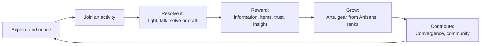

# Core Loops

What players do from second to second, session to session, week to week and across the decade, and how every play style finds a home.

> **Version:** v0.1 · **Updated:** 10-10-2026 · **Owner:** Game Director
>
> **Horizons:** H0 the moment and encounter loops · H1 every loop and the first hour · H2 the Long Year and decade loops play out
>
> **Related:** [Vision](../01-vision/vision.md) · [D-027](../../DECISIONS.md#d-027) · [Avatar and Progression](avatar-and-progression.md) · [Celestial Convergence](../05-systems/celestial-convergence.md)

## 1. Loops at every scale

| Scale | Loop | Feeds |
| --- | --- | --- |
| **Moment** (seconds) | Read, act, react: deflect, traverse, talk, notice | Mastery, Resonance, discovery |
| **Encounter** (minutes) | Notice an activity, join it, resolve it, take the reward (information, items, Insight, Omnis, trust) | Avatar growth, NPC bonds, world state |
| **Session** (15 min to 3 h) | Pick a goal (story, trial, craft, explore, socialise), travel, meet surprises on the way, go home to a Ward, commission an Artisan or plan the next trip | Progression, housing, economy |
| **Week** | Oasis week customs, regional seasons turning, Convergence phase goals, Artisan commissions finishing | Planning, community goals |
| **Long Year** | Festivals, the Long Night, Chronicle unveilings, a new Age | Saga progress ([Ten-Year Saga](../03-narrative/ten-year-saga.md)) |
| **Decade** | Free the six Celestials, defeat the False Celestial, swear at the Dawn Rite | Everyone's endgame |

Day, week and season lengths are set in [Time and Calendar](../02-world/time-and-calendar.md).

The encounter loop below is the one players repeat most. Each turn of it ends in a contribution to something bigger than the player.

## 2. Every motivation has a home

Each play style below has a place to thrive. The table uses Bartle's player types [R25] and the three needs of Self-Determination Theory (autonomy, competence and relatedness) [R26].

| Player type | Home in the Oasis | Need served |
| --- | --- | --- |
| **Achiever** | Mastery Trials (levels 8 to 10), Player Rank, titles, the Chronicle Board | Competence |
| **Competitor** | Opt-in PvP, bounty hunting, arenas, clan wars [H2] ([PvP and Protection](../05-systems/pvp-and-protection.md)) | Competence |
| **Creator** | House design, Frame customisation, Oath builds | Autonomy |
| **Explorer** | Adventure Rank, Eggs, discoveries at every altitude and depth, the moons, the Grand Library | Autonomy |
| **Socialiser** | Wards and housing, NPC friendships, clans, Skyferry rides, festivals, opt-in voice | Relatedness |
| **Storyteller** | Personal quests, Chronicles, recording and replays | Relatedness |

## 3. The first hour [H1]

The opening leads with warmth and wonder, then reveals the stakes ([D-027](../../DECISIONS.md#d-027)).

| Minute | Beat | Teaches |
| --- | --- | --- |
| 0–5 | Wake at a Wayshrine above Halcyon. A shrine keeper greets you, and you talk to them in your own words. The game says plainly that the keeper is AI-driven [A14]. | Warmth, NPC Minds |
| 5–12 | First glide off the Library terrace over Halcyon. A micro-event unfolds in the streets below. | Wonder, traversal |
| 12–15 | The Herald speaks from the bell tower and the World Clock appears. Launch-day players see this live. Everyone after sees it as a Chronicle. | The stakes |
| 15–30 | First fight: a Watch officer teaches the deflect | Combat rhythm |
| 30–45 | Lowhaven: a fisherman's small personal quest, and a sealed cottage you are "not supposed to look at" (your first Egg) | Small human stories, mystery |
| 45–60 | Back in Halcyon: claim your Ward plot, choose an Artisan, and add your first contribution on the Convergence board | Contribution, economy, home |

## 4. A week in the life

- **Solo explorer:** charts a Frostmarch time-echo, solves an Egg on Blankday, sells glass-cores, commissions a Grandmaster blade, and adds lore pages to the current Convergence's Discover phase.
- **Two friends:** ride a sky-mount in the Stormcrown, pick up Heat for unlicensed flight through Halcyon's airspace, escape, pay off the Record, and decorate the Ward house they share.
- **Clan:** runs supply caravans for the Convergence Prepare phase and plans for the next Grand Attempt. Half the clan pilots Frames, half fights on foot.

## 5. Loop health rules

- **LOOP-001 [H1]** Every activity type feeds at least two progression axes: vertical, horizontal or reputational ([Avatar and Progression](avatar-and-progression.md#62-three-axes-of-progression)).
- **LOOP-002 [H1]** No activity type is the only route to any progression milestone.
- **LOOP-003 [H1]** Every session length from 15 minutes to 3 hours has a satisfying goal available, from a micro-event up to a Mastery Trial.

## 6. Acceptance criteria

| ID | Test |
| --- | --- |
| [LOOP-001](#5-loop-health-rules) | Content audit: every activity type in the reward tables grants at least two of vertical, horizontal and reputational progress |
| [LOOP-002](#5-loop-health-rules) | Progression graph check: removing any one activity type leaves every milestone reachable |
| [LOOP-003](#5-loop-health-rules) | Session simulation from 20 random start points: a goal that fits 15 minutes and one that fits 3 hours are both on offer every time |
| First hour | Playtest: at least 90% of new players see the World Clock within 15 minutes, and at least 80% make a Convergence contribution within 60 minutes |

<!-- citation links: generated, do not edit by hand -->

[A14]: ../../references/technology-and-ai.md
[R25]: ../../references/ready-player-and-lifecycle.md
[R26]: ../../references/ready-player-and-lifecycle.md
