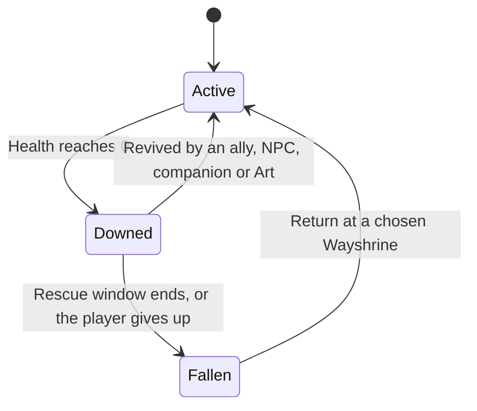
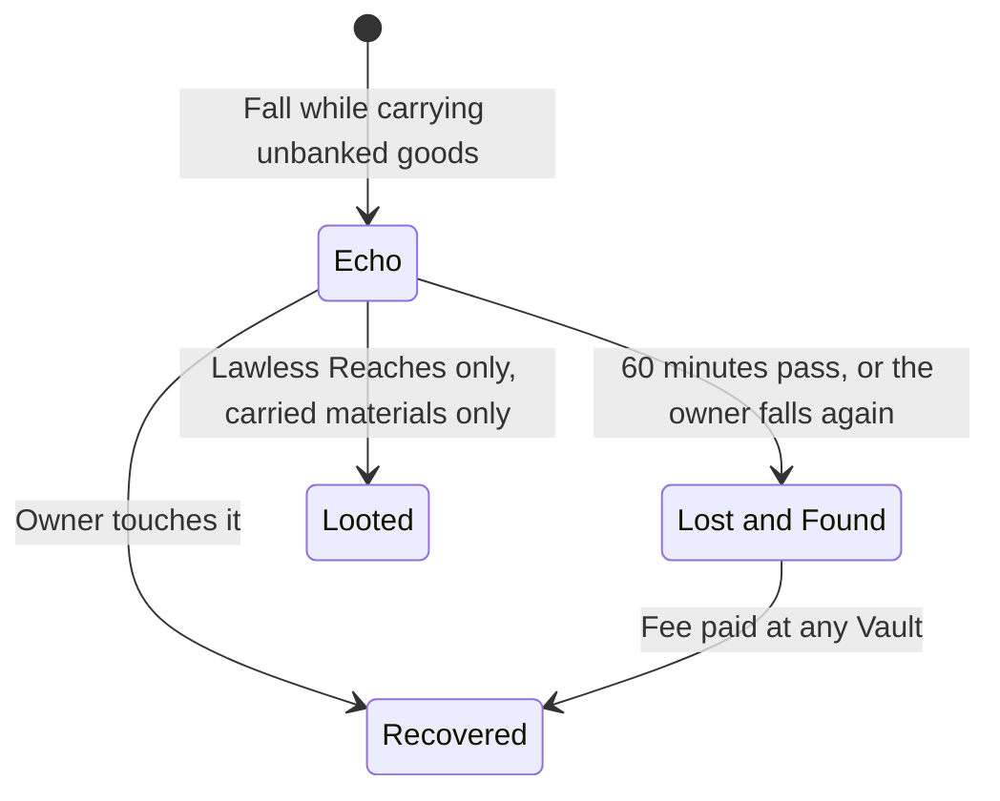

# Death and Return

What happens when a Returner falls, why they come back, and how the cost of falling changes by activity, so death has weight without being unfair or open to griefing.

> **Version:** v0.1 · **Updated:** 10-10-2026 · **Owner:** Systems Design
>
> **Horizons:** H0 Downed, Return and the Echo · H1 the full rules by activity · H2 Return at the Echo after Veil opens
>
> **Related:** [D-022](../../DECISIONS.md#d-022) · [D-039](../../DECISIONS.md#d-039) · [D-025](../../DECISIONS.md#d-025) · [Waypoints and Healing](../05-systems/waypoints-and-healing.md) · [Cosmology](../02-world/cosmology.md#5-veil-wayshrines-and-returners)

## 1. Player experience

Returners don't die for good. They wake at a Wayshrine, and nobody knows why ([Cosmology](../02-world/cosmology.md#5-veil-wayshrines-and-returners)). Death is still real to the world: NPCs mourn, worry or mock, and some never get used to it. The fear of dying is replaced by the cost of what you leave behind: your Echo, your time and your place in the fight.

> *Ada goes down to a Gravemaw in the dunes. For thirty seconds she crawls, shield up, while a stranger fights his way to her and pulls her to her feet. Twenty minutes later she falls again, alone this time, and wakes at the Lanternfall shrine with a purse a quarter lighter. Her Echo glows on the map where she fell. She has an hour. She goes back for it, slower and more careful.*

The system must create these feelings:

1. **Falling costs something,** mostly time and the goods you carried.
2. **Rescue is the best outcome,** so helping others matters.
3. **Nothing earned is lost forever.** Equipped gear, levels and banked goods are always safe.

## 2. Scope

**Covers:** being Downed, falling, Return, the Echo, gear wear, rules by activity, protections, anti-griefing, disconnects and the Veil-era change.

**Leaves to other specs:** which Wayshrines can be chosen, spawn protection timers and login rules ([Waypoints and Healing](../05-systems/waypoints-and-healing.md)); where players may fight each other ([PvP and Protection](../05-systems/pvp-and-protection.md)); Heat and capture by bounty hunters ([Law, Crime and Bounties](../05-systems/law-crime-and-bounties.md)); Frame wrecks ([Mechs, Robots and Companions](../05-systems/mechs-robots-and-companions.md)); Lost and Found fees and Vaults ([Economy and Crafting](../05-systems/economy-and-crafting.md#62-banked-vs-carried)).

## 3. Inspirations

| Source | What we take | What we change |
| --- | --- | --- |
| *Ultima Online*, Trammel and Felucca [M14] [M15] | Most players want protection by default; loss belongs only in places players choose | One world, not mirrored copies. Only the Lawless Reaches allow looting, and only of carried materials. |
| *New World* [M11] | Moving away from forced open PvP before launch | Opt-in from day one, so death in lawful places never feeds another player |
| *Ready Player One* [R1] | A world where a fall should matter | In the novel, dying wipes your avatar. Here the cost is time and carried goods, never your identity or progress. |
| *Edge of Tomorrow* [W23] | Each death teaches you something | Falling costs time and an Echo, never progress |

These options were weighed and rejected:

| Option | Why not |
| --- | --- |
| Checkpoint respawn only | Too little tension for an open world |
| Full item loss | Very high griefing risk; punishes co-op |
| Losing Insight or levels | Punishes progression, against [Mastery over money](../01-vision/vision.md#5-pillars) |

## 4. Terms

| Term | Meaning |
| --- | --- |
| **Rescue window** | How long a Downed player can be revived |
| **Fallen** | The state after the rescue window ends, before Return |
| **Veil-sickness** | A short debuff after Return: −10% Stamina regeneration for 2 minutes. Hearths cure it. |
| **Lost and Found** | Where an unrecovered Echo's goods wait, collectable for a fee |

Downed, Return, Echo and Wayshrine are defined in the [Glossary](../../GLOSSARY.md).

## 5. Entities and state

| Entity | Data | Authority |
| --- | --- | --- |
| Downed state | Start time, window length, reviver, activity rules in force | Server |
| Echo | Owner, contents (unbanked materials and Omnis), position, expiry, lootable flag | Server |
| Lost and Found record | Owner, contents, fee | Server (economy service) |

## 6. Rules

### 6.1 The Return sequence

A Returner at 0 Health moves through these states.

- **DTH-001 [H1]** At 0 Health the player is Downed for a 30 s rescue window. They can crawl and defend a little. Allies, companions, NPC medics or reviving Arts can revive them.
- **DTH-002 [H1]** After falling, the player chooses where to Return: any discovered Wayshrine in the current region, or the region's nearest one to the fall ([Waypoints and Healing](../05-systems/waypoints-and-healing.md#64-login-logout-and-spawn-choice)). They wake with 50% Health and Veil-sickness.
- **DTH-003 [H1]** Unbanked materials and up to 25% of carried Omnis form an **Echo** at the place of the fall. Only the owner can recover it, for 60 minutes. After that its goods move to the Lost and Found, which can be collected at any Vault for a fee.
- **DTH-004 [H1]** Equipped gear loses 5% durability per fall. Equipped gear is never lost ([D-022](../../DECISIONS.md#d-022), [D-039](../../DECISIONS.md#d-039)).

The Echo has its own short life.

### 6.2 Rules by activity

| Activity | Rescue window | Echo | Wear | Notes |
| --- | --- | --- | --- | --- |
| Open world (lawful) | 30 s | Yes, owner only | 5% | The default |
| Personal quest or Mastery Trial | 30 s | No | 5% | Retry from the quest checkpoint |
| Long Night | 30 s | Yes, owner only | 5% | Higher stakes, higher rewards |
| Convergence | 45 s | No | 0% | Contribution is kept; Return to a staging Wayshrine; no penalty of any kind |
| Lawless Reaches | 20 s | Yes, and others can loot **carried materials only** | 5% | Equipped gear and bound items never drop ([PvP and Protection](../05-systems/pvp-and-protection.md#61-where-pvp-can-happen)) |
| Arenas | None | No | 0% | Round-based |
| Captured by a bounty hunter | None | No | 0% | The target is taken to a Watch post ([Law, Crime and Bounties](../05-systems/law-crime-and-bounties.md#66-bounty-and-hunters)) |

### 6.3 Protections

- **DTH-005 [H1]** **New Returners (Avatar Level 1 to 3)** get a 45 s rescue window and no durability wear. Outside arenas, no other player can attack them except in a duel they accept at Level 3, and duels drop no Echo ([D-025](../../DECISIONS.md#d-025)). Their Echo is never looted.
- **DTH-006 [H1]** **Under-18 accounts:** their Echo is never lootable, in any zone ([D-025](../../DECISIONS.md#d-025)). It stays owner-only even in the Lawless Reaches.

### 6.4 Anti-griefing

- **DTH-010 [H1]** **Echo camping:** when the owner reaches their Echo, a 5 s invulnerability bubble lets them recover it. Any hostile act at another player's Echo in a lawful zone is a crime, and killing the same player at their Echo repeatedly brings Heat and a Record.
- **DTH-011 [H1]** Return can't be used to escape at Heat 2 or above. A player who Returns while hunted is sent to the jurisdiction's Watch post ([Law, Crime and Bounties](../05-systems/law-crime-and-bounties.md#64-heat-15)).
- **DTH-012 [H1]** Spawn protection: a Returner is untargetable for 10 s after waking. Attacking ends it early.

### 6.5 Return at the Echo [H2]

- **DTH-020 [H2]** Once Veil opens, a fallen Returner briefly sees their own Echo from the mist before waking. They may then Return beside the Echo instead of at a Wayshrine, for a Resonance cost. Where this option is unavailable (Heat, the Lawless Reaches, Convergences, recent PvP) is set in [Waypoints and Healing](../05-systems/waypoints-and-healing.md#66-the-veil-era-h2).

## 7. Edge cases

| Case | Rule |
| --- | --- |
| Disconnect while Downed | The avatar stays Downed for the rest of the window, then Returns automatically. In lawful zones no Echo forms, so a dropped connection costs nothing. In the Lawless Reaches the Echo forms as normal, so disconnecting can't dodge a fight. |
| Disconnect during a Convergence | The contribution is kept. Rejoining puts the player back in their layer if the phase is still running ([World Model](../07-multiplayer/world-model.md)). |
| Falling again before recovering an Echo | The older Echo's goods go straight to the Lost and Found, and a new Echo forms at the new spot |
| Falling in a temporary form | The quest's fail state applies, then identity is restored ([PRG-061](avatar-and-progression.md#610-temporary-forms)) |
| Falling while piloting a Frame | The pilot ejects if possible. The Frame becomes a wreck to tow or recover, never lost for good ([Mechs, Robots and Companions](../05-systems/mechs-robots-and-companions.md#65-loss-and-recovery)). |
| The Echo lands somewhere unreachable (a chasm, deep water) | It moves to the nearest reachable point on the player's path |

## 8. Multiplayer and platforms

- An Echo follows its owner across layers: the owner always finds it, whatever layer they are placed in. In the Lawless Reaches it can also be looted, but only in the layer where it fell.
- Anyone in the same layer can revive a Downed player, including strangers. Reviving gives no reward of its own, so it can't be farmed.
- The rules are identical on every platform.

## 9. Safety and abuse

Echo camping, return-escape and spawn camping are covered by the anti-griefing rules above. In PvP contexts, if the same attacker Downs a player 3 times within 30 minutes, the victim becomes immune to that attacker and, in a Lawless Reach, may Return free to a Wayshrine outside it ([PVP-040](../05-systems/pvp-and-protection.md#65-anti-griefing) in [PvP and Protection](../05-systems/pvp-and-protection.md#65-anti-griefing)). Under-18 and new-player protections ([DTH-005](#63-protections), [DTH-006](#63-protections)) can't be switched off by other players or by clan settings.

## 10. Performance

An Echo is a small server record (owner, contents, position, timer). Expired Echoes are cleared in the same tick their goods move to the Lost and Found.

## 11. Examples

| Allowed | Not allowed |
| --- | --- |
| A stranger revives a Downed player during a colossus fight | A Downed player losing their equipped sword |
| A Lawless kill lets the winner take the loser's carried ore | A Lawless kill dropping a bound Relic |
| A player recovers their Echo inside the 5 s bubble while a Banner rival waits | A rival killing the same player at their Echo again and again in a lawful zone without Heat |
| A Convergence fall with no penalty at all | A Convergence fall that drops an Echo |
| A 15-year-old's Echo in the Lawless Reaches stays owner-only | Another player looting that Echo |

## 12. Acceptance criteria

| ID | Test |
| --- | --- |
| [DTH-003](#61-the-return-sequence) | 10,000 simulated falls: Echoes recoverable only by their owners outside the Lawless Reaches; equipped item count unchanged |
| [DTH-004](#61-the-return-sequence) | 10,000 falls in every activity: 0 equipped items removed |
| [DTH-006](#63-protections) | Under-18 test accounts falling in the Lawless Reaches: 0 Echoes lootable by others |
| [DTH-010](#64-anti-griefing) | Bot griefing scenario: an attacker who kills the same player 3 times at their Echo in a lawful zone gets a Record 100% of the time |
| [DTH-011](#64-anti-griefing) | Return attempts at Heat 2 or above: 100% routed to the Watch post |
| Tension | Playtest survey: at least 60% say "death mattered" and no more than 15% say "death felt unfair" |

<!-- citation links: generated, do not edit by hand -->

[M11]: ../../references/industry-and-live-service.md
[M14]: ../../references/industry-and-live-service.md
[M15]: ../../references/industry-and-live-service.md
[R1]: ../../references/ready-player-and-lifecycle.md
[W23]: ../../references/film-literature-and-music.md
