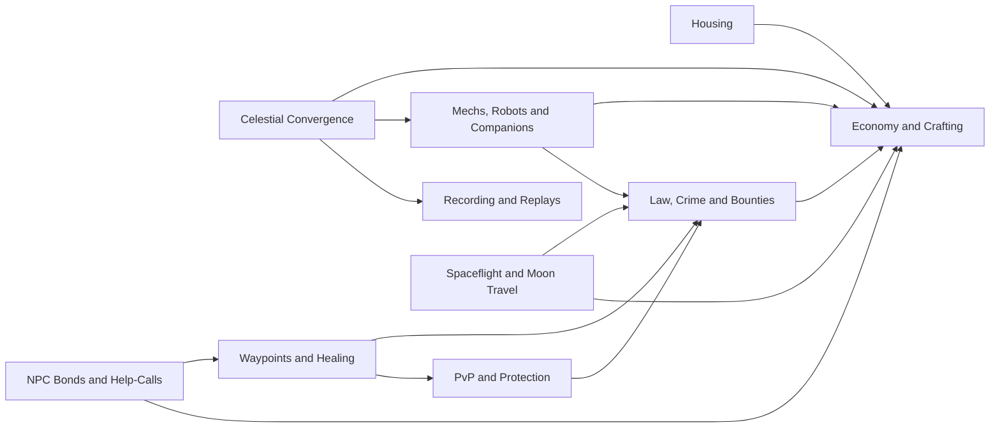

# 05 · Systems

The systems that make the Oasis a shared world: global events, trade, homes, law, protection, travel, machines, relationships and memories.

| Document | What it covers |
| --- | --- |
| [Celestial Convergence](celestial-convergence.md) | The global five-phase effort to free each Celestial, contribution tracking and the World Clock |
| [Economy and Crafting](economy-and-crafting.md) | Omnis sources and sinks, banking, Exchanges and trade limits, bound items, Artisans and commissions, field crafting and the cosmetic-only store |
| [Housing](housing.md) | Guaranteed Ward plots, the blueprint editor, NPC builders, equal-function homes, visiting and moderation, and Holdings |
| [Law, Crime and Bounties](law-crime-and-bounties.md) | Jurisdictions, crimes and witnesses, Heat 1–5, Records and wanted posters, Bounties and hunters, and clearing a Record without a wealth gate |
| [PvP and Protection](pvp-and-protection.md) | Opt-in PvP (duels, the Banner, the Lawless Reaches, arenas, clan wars) and the protections for new and under-18 Returners |
| [Waypoints and Healing](waypoints-and-healing.md) | Wayshrines, Hearths, login and spawn choice, sanctuaries and anti-escape rules |
| [Spaceflight and Moon Travel](spaceflight-and-moon-travel.md) | The Skyferry, personal ships, launch and landing law, traffic control, hazards, and how each moon is reached |
| [Mechs, Robots and Companions](mechs-robots-and-companions.md) | Companion and utility Automata, bonded creatures, piloted Frames, Colossal Frames, Wardens, and their upkeep and limits |
| [NPC Bonds and Help-Calls](npc-bonds-and-help-calls.md) | NPC trust and friendship, letters, NPCs who age and pass on their roles, and help-calls between friends |
| [Recording and Replays](recording-and-replays.md) | Replay-first capture, re-rendering any moment from any camera, export, privacy and the Long Night broadcasts |

This diagram shows the main ways the systems depend on each other. An arrow means "relies on".

**Previous:** [04 · Gameplay](../04-gameplay/README.md) · **Next:** [06 · AI](../06-ai/README.md)
