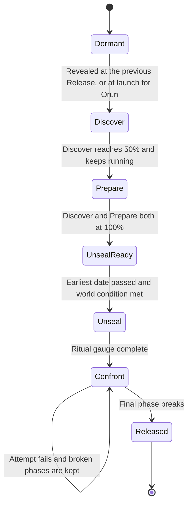
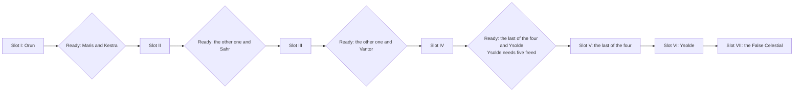

# Celestial Convergence

The one global system through which all Returners together free each Celestial, from the first lore page to the Release, and finally swear the Dawn Rite.

> **Version:** v0.1 · **Updated:** 10-10-2026 · **Owner:** Convergence Design
>
> **Horizons:** H0 none (excluded from the first playable) · H1 the full system, the World Clock, ledgers, Chronicles and Convergence I · H2 Convergences II to VII, the Dawn Rite, broadcast spectating · H3 the move into Oasis 2.0
>
> **Related:** [D-011](../../DECISIONS.md#d-011) · [D-016](../../DECISIONS.md#d-016) · [D-017](../../DECISIONS.md#d-017) · [Celestials](../03-narrative/celestials.md) · [Ten-Year Live Plan](../11-production/ten-year-live-plan.md) · [World Model](../07-multiplayer/world-model.md)
>
> **Canon:** mentions hidden canon (Zero and the Dawn Rite)

## 1. Player experience

> *Sami plays forty minutes a night, alone, mostly crafting. Their ledger reads: 212 rope-bridge spans, 3 lore pages, 1 escort. On the Convergence board the Spine's root-road gauge ticks past 80%, and on the walk home Sami crosses a bridge that wasn't there yesterday. Partly theirs.*

> *Confront night for Orun. Eleven thousand Returners in ninety-odd layers across four fronts: climbers on his flanks, flyers on his forest-heads, Frames bracing his knees, crafters re-roping root-roads under fire. Every layer shows the same Resolve gauge rising, and names from other fronts flash past. The attempt fails at 71%, and the chain tightens back to 35%. Eight hours later, at the next Grand Attempt, it breaks.*

> *The tenth Long Night. Mira logs in at 4 a.m. local time, walks to the Wayshrine above her Ward, and reads the words of the Returners' Oath for the first time. She swears it. Her name joins a list scrolling up the sky beside forty thousand others from every time zone.* [H2]

The system must create these feelings: **my part counts and I can see it**; **everyone matters, whatever they play**; **the rules are fair and public**; **we did this together**.

## 2. Scope

**Covers:** the phase model; global gauges; contribution types, weights and the personal ledger; unseal gating; order and the ready pair; Confront fronts, roles, Resolve, attempt windows, retries and published scaling; overload handling; the Release; Chronicles and the Chronicle Board; Gifts and era shifts; the Mercy tally; the Dawn Rite; failure; anti-griefing; rewards; late joiners.

**Leaves to other specs:** each Celestial's story, unseal ritual and encounter script ([Celestials](../03-narrative/celestials.md)); slot dates and production cadence ([Ten-Year Live Plan](../11-production/ten-year-live-plan.md)); layer and mesh mechanics ([World Model](../07-multiplayer/world-model.md)); replay capture ([Recording and Replays](recording-and-replays.md)); era-shift law values ([World Laws](../02-world/world-laws.md)).

## 3. Inspirations

| Source | What we take | What we change |
| --- | --- | --- |
| *WoW*, Gates of Ahn'Qiraj [G17] | A real global war effort that gates content, and a unique title for the gong-ringer | One world, not one per server; many world-first feats, not one; titles never grant power |
| *FFXIV*, Ishgard Restoration [R21] | Crafters and gatherers fill gauges that visibly rebuild the world | Our Prepare gauges change the ground of the coming fight: bridges and root-roads |
| *Pokémon GO*, Global Challenge [R23] | Any activity counts, so casual players feel part of the whole | Every phase accepts solo contributions ([D-024](../../DECISIONS.md#d-024)) |
| *EVE Online*, Triglavian Invasion [R22] | Player action permanently reshapes the world | Era shifts and Gifts are permanent world state |
| *EVE Online*, Time Dilation [M7] | Slow down rather than crash in mass battles | A 50% floor, with contribution scaled so nobody earns less in a crowded layer |
| *Ready Player One*, the Scoreboard [R1] | A public record of deeds | The Chronicle Board honours many people, and the goal is shared survival, not one winner |
| Sanderson's First Law [W8] | Players understand a solution's rules before they use it | Scaling formulas, thresholds and the Dawnkey rule are all published |

## 4. Terms

| Term | Meaning |
| --- | --- |
| **Gauge** | One global progress meter: a phase, or one objective within it |
| **Omens** | Discover work done on a Domain before it is ready, banked for later |
| **Attempt** | One timed Confront window |
| **Grand Attempt** | One of three fixed daily attempts, published for the whole Confront |
| **Re-tightening** | The share of an unbroken phase's Resolve lost between attempts |
| **Home line** | Supply work done from any city that feeds the fronts |
| **Release moment** | The single global instant a Celestial is freed |
| **Mercy tally** | The public record of whether each Confront phase was resolved by understanding or by force |

Slot, ready pair, ledger, front, Resolve, Mercy threshold and Rite roll are defined in the [Glossary](../../GLOSSARY.md).

## 5. Entities and state

All Convergence state is global canonical state, held by the world-state service ([World Model](../07-multiplayer/world-model.md#5-state-classes-and-authority)).

```yaml
Convergence:
  slot: I..VII
  celestial: ORUN | MARIS | KESTRA | SAHR | VANTOR | YSOLDE | FALSE
  status: dormant | discover | prepare | unseal_ready | unseal | confront | released
  gauges: [{ id, phase, target, value, scaling_rule_id }]
  earliest_unseal: timestamp        # from the slot
  unseal_condition: rule_id         # the Celestial's world condition
  confront: { phase_index, resolve, threshold, broken_phases: [], attempt_id }
  mercy_tally: [{ phase, understanding_share, result: understanding | force }]
ContributionReceipt:                # signed and commutative (MP-040)
  player_id, convergence, phase, type, gauge_id, amount, weight, at, layer, receipt_sig
LedgerView:                         # per player, derived from receipts
  totals_by_type, totals_by_phase, firsts[], titles[], share_public: bool
```

## 6. Rules

### 6.1 Lifecycle

Each Convergence moves through these states.



- **CEL-010 [H1]** Each Convergence runs Discover, Prepare, Unseal, Confront and Release. Prepare opens when Discover reaches 50%, so explorers and crafters work in parallel.
- **CEL-011 [H1]** Discover work done on a Domain before it is ready (lore pages, sites charted) is recorded as omens and banked into its Discover gauge when it becomes ready. Explorers never waste their time.

### 6.2 Global gauges and the World Clock

- **CEL-012 [H1]** The World Clock and every Convergence board always show: the phase, every gauge's value and target, the scaling rule in force, the earliest Unseal date, the ready pair's progress side by side, and a plain projection such as "at the current rate, Prepare completes in about 9 days" ([NAR-010](../03-narrative/ten-year-saga.md#promises-that-hold-for-both-endings)).
- **CEL-013 [H1]** Gauges change the world as they fill: bridges appear, villages move, song-lanterns light. These constructions are shared-place state, the same in every layer ([MP-002](../07-multiplayer/world-model.md#5-state-classes-and-authority)).

### 6.3 Contribution types

| Type | Discover | Prepare | Unseal | Confront |
| --- | --- | --- | --- | --- |
| **Arts** | Hour Arts read time-echoes | Root Arts grow root-roads | Arts-keyed rituals | Wards, revives, kept Oaths |
| **Combat** | Clear guardians | Defend construction | Hold ritual sites | Fight on the fronts |
| **Crafting** | None | Bridges, gear, lanterns, Frames (Vantor) | Ritual items | Field forges, Frame repair, consumables |
| **Escort** | Protect scholars | Evacuate villages, run caravans | Bring participants to sites | Medic and evacuation runs |
| **Exploration** | Chart sites, find resting stones | Scout safe routes | Reach ritual sites | Spot for the fronts |
| **Gathering** | Specimens | Materials for every Prepare gauge | None | Supply lines |
| **Lore** | Library pages, songs, Chronicles read | Decode plans | Ritual texts | Present memories (the understanding routes) |
| **Social** | Gather testimonies from NPCs | Rally villages; NPC trust tasks | Lead choirs (Maris) | Morale and calls |

- **CEL-020 [H1]** Every phase accepts every type it lists, and every type can be done solo ([D-024](../../DECISIONS.md#d-024)). No phase needs a clan ([SOC-041](../07-multiplayer/social-voice-and-clans.md#65-clans-and-alliances)).
- **CEL-021 [H1]** **Weights are published.** A contribution's gauge value is its base value times its type weight. A daily soft cap applies per player and per type. Above it, contributions still appear in the ledger at full value but count 25% toward the gauge. This rewards breadth over grinding ([PRG-022](../04-gameplay/avatar-and-progression.md#65-bounding-power)) and stops any one player dominating.
- **CEL-022 [H1]** **Credit is given at the moment of action.** The server signs a receipt when the action commits ([MP-040](../07-multiplayer/world-model.md#64-global-events-and-shared-pools)). Shared actions split credit by participation (damage, time present, materials supplied), never by last hit. Contributions can't be traded, transferred or bought.
- **CEL-023 [H1]** Companion actions count only during the owner's active play and are credited to the owner ([MCH-063](mechs-robots-and-companions.md#612-presence-and-anti-botting)).

### 6.4 The personal ledger

- **CEL-024 [H1]** Every player has a ledger: every receipt, totals by type and phase, firsts, titles, and their share of each gauge. It updates within seconds of each action, from the first contribution onward ([VIS-004](../01-vision/vision.md#4-experience-goals-observable-testable)).
- **CEL-025 [H1]** The ledger is private by default ([PRG-003](../04-gameplay/avatar-and-progression.md#61-the-avatar)). The player may share a summary card. There is no global ranking of individuals, because contribution is a shared act, not a race.

### 6.5 Unseal gating

- **CEL-030 [H1]** A Convergence unseals only when all three hold: the slot's earliest date has passed ([Ten-Year Live Plan](../11-production/ten-year-live-plan.md#4-year-by-year)); Discover and Prepare are complete; and its Celestial's world condition is met. Orun's condition is the first Long Night, the only Unseal bound to a Long Night. Every other condition recurs within weeks, such as a Stillsky season for Kestra or Starfall at Hallowmere for Ysolde ([Celestials](../03-narrative/celestials.md)).
- **CEL-031 [H1]** The Unseal itself is a global ritual gauge, filled across layers and data-centre regions on a shared beat clock ([World Model](../07-multiplayer/world-model.md#64-global-events-and-shared-pools)).
- **CEL-032 [H1]** If the world misses the first Long Night, a fallback rite unseals Orun at the next Lumen full phase once his Discover and Prepare are complete.

### 6.6 Order and the ready pair

- **CEL-040 [H1]** Orun is always slot I. Ysolde is always the last of the six. The False Celestial is always last, and his Unseal is no earlier than launch plus 8.5 years ([D-016](../../DECISIONS.md#d-016)).
- **CEL-041 [H2]** Domains join the ready pool in a fixed sequence: Maris and Kestra first, then Sahr, then Vantor. Two Domains are ready at once. Ysolde becomes ready once four Celestials are freed, but she can unseal only after five are freed.
- **CEL-042 [H2]** **The world's progress chooses.** The first ready Domain to meet every condition in [CEL-030](#65-unseal-gating) unseals. The other keeps all its banked progress and stays ready. There is no vote.
- **CEL-043 [H2]** At most one Convergence is in Unseal or Confront at any time. If the world falls behind, the next Convergence may unseal as soon as the current one is released and its own conditions are met, with no minimum gap ([OPS-024](../11-production/ten-year-live-plan.md#42-what-is-pinned-whatever-the-order)).
- **CEL-044 [H2]** Hollow opens for exploration at the eighth Long Night, by date, so Discover for Convergence VII can begin there. Convergence VII still unseals only once all six Celestials are freed, and no earlier than launch plus 8.5 years.

The ready pool moves through the decade like this.



### 6.7 The Confront

Each Confront defines 3 to 6 front types. For Orun they are the flank climb, the forest-heads in the air, knee bracing by Frames, and root-road repair. Each front runs as many layers as it needs ([World Model](../07-multiplayer/world-model.md#65-convergence-orchestration)).

- **CEL-050 [H1]** All fronts, in every layer, fill one global Resolve pool per phase. When Resolve reaches the phase threshold, that phase's chain breaks for everyone at once ([MP-041](../07-multiplayer/world-model.md#64-global-events-and-shared-pools)).
- **CEL-051 [H1]** Each front's success eases at least one other front: braced knees steady the climb, and flyers blind the forest-heads that sweep climbers off. Every role matters, and no front can win alone.
- **CEL-052 [H1]** Fronts are lawful zones with PvP off. Individual falls cost no Resolve and carry no penalty ([Death and Return](../04-gameplay/death-and-return.md#62-rules-by-activity)). A front that fails its objective takes a published setback of no more than 2% of the phase threshold, at most once per front every 10 minutes.
- **CEL-053 [H1]** Returners who keep their declared Oaths through an attempt add a published Resolve bonus, in every Confront.

| Role | Does | Placement |
| --- | --- | --- |
| **Ground** | Climb, hold, strike weak points | Ground fronts |
| **Air** | Distract, pull down aerial targets, ferry climbers | Air fronts |
| **Frame** | Brace, grapple, haul (Frames are issued on the front, [MCH-033](mechs-robots-and-companions.md#66-frames-getting-one-licence-and-mastery)) | Frame fronts |
| **Support** | Wards, calls, spotting, morale | Any front |
| **Medic** | Revives and evacuation | Any front |
| **Crafter** | Field forges, repairs, supply | Any front, or the home line from any city |

- **CEL-054 [H1]** The front finder places whole parties by role band and choice ([MP-051](../07-multiplayer/world-model.md#65-convergence-orchestration)). Solo players are always placed, with NPC allies filling roles ([MP-052](../07-multiplayer/world-model.md#65-convergence-orchestration)). Crafters and supporters can also contribute from any city on the home line.

**Attempts, retries and scaling.**

- **CEL-060 [H1]** **Attempt windows:** three Grand Attempts per real day at fixed UTC times 8 hours apart, published for the whole Confront, plus rolling attempts every 2 hours in between whenever the fronts' minimum numbers are met. Each attempt lasts 60 to 90 minutes. At least one attempt runs every 7 days whatever the turnout ([MP-054](../07-multiplayer/world-model.md#65-convergence-orchestration)).
- **CEL-061 [H1]** **Retries are unlimited until the Conjunction.** Broken phases stay broken. An unbroken phase keeps 50% of its Resolve into the next attempt.
- **CEL-062 [H1]** **Scaling is published.** A phase threshold scales with an attempt's participants as `T = T₀ × (N / N_ref)^0.85`. The curve is sublinear, so more people means less burden on each. The formula, T₀ and N_ref are shown on the board, and they change only with patch notes ([MP-043](../07-multiplayer/world-model.md#64-global-events-and-shared-pools), [NAR-011](../03-narrative/ten-year-saga.md#promises-that-hold-for-both-endings)).
- **CEL-063 [H1]** **Overload:** an overloaded front layer slows to no less than 50% speed, then splits by party blocks. Resolve from slowed layers is scaled so nobody earns less, and the slowdown is shown in the world and in the HUD ([MP-053](../07-multiplayer/world-model.md#65-convergence-orchestration)).

### 6.8 The Release moment

- **CEL-070 [H1]** When the final phase breaks, the Release is scheduled at a single server timestamp at least 120 s ahead, so every layer and data-centre region receives it. It plays at that moment in every layer worldwide: participants at the Celestial's heart, everyone else in the sky.
- **CEL-071 [H1]** At the Release, one global write applies the **Gift** (a Celestial Oath granted to every Returner, [CMB-024](../04-gameplay/combat-and-abilities.md#65-oaths)) and the **era shift** (the Domain's Natural Law softens, [World Laws](../02-world/world-laws.md#4-natural-law-by-domain)). Gifts are global and permanent, including for players who join later.
- **CEL-072 [H1]** Players offline at the Release see a "the world changed" card when they next log in, linked to the Chronicle.

### 6.9 Chronicles and the Chronicle Board

- **CEL-080 [H1]** The Grand Library compiles a Chronicle of every Convergence from server replays ([Recording and Replays](recording-and-replays.md)), with participants' names inscribed. Players can choose to appear as "a Returner". Under-18 names appear only if the player opts in [L9].
- **CEL-081 [H1]** Each Convergence defines 3 to 6 **feats**, such as *first to touch Orun's heart*. The first Returner or party to complete each feat is inscribed on the Chronicle Board for good. Titles never grant power.

### 6.10 The Mercy tally and Zero's fate

- **CEL-094 [H1]** From Convergence I onward, the board shows the **Mercy tally**: for every Confront phase, whether understanding routes or force supplied most of its Resolve when it broke. What the tally means is not explained until Convergence VII opens.
- **CEL-090 [H2]** Convergence VII's Confront has six echo phases (climbing, compassion, sky, shared burden, machines, time). Each has a force route and an understanding route, and both fill Resolve ([Celestials](../03-narrative/celestials.md)).
- **CEL-091 [H2]** A phase of Convergence VII counts as understanding if understanding routes supplied at least 50% of its Resolve when it broke. Only these six phases count toward the **Mercy threshold**, which is at least 4 of the 6. Earlier entries in the Mercy tally don't count; when Convergence VII opens, the board reveals what the tally is for. If it is met, Zero gives back what he stole; if not, he is unmade. Either way the Dawnkey can be forged ([D-017](../../DECISIONS.md#d-017)).
- **CEL-092 [H2]** **The Question:** every participant's free-form answer to Zero is recorded in the Chronicle of the end. AI never judges an answer, and answers never affect the tally ([D-042](../../DECISIONS.md#d-042)).

### 6.11 The Dawn Rite [H2]

- **CEL-100 [H2]** The Dawn Rite runs across the whole tenth Long Night: 24 hours from the tenth launch anniversary. Any Returner may swear the Returners' Oath once, at any Wayshrine, at any time in that window ([Ten-Year Saga](../03-narrative/ten-year-saga.md#6-the-endings)). The words stay on the server until the window opens (RV-11).
- **CEL-101 [H2]** The outcome is set when the tenth Long Night ends. It is **success** if all seven Convergences are resolved and at least one Returner has sworn. Otherwise it is **failure**. There is no minimum turnout. The number who swear shapes how the finale looks (every name on the roll, the brightness of the road), never the outcome.
- **CEL-102 [H2]** **Success:** the shared global moment, then the move toward Oasis 2.0 [H3]. **Failure:** the farewell night, the Burning at the end of the window, the coda, and Archive Mode ([D-047](../../DECISIONS.md#d-047)). Live servers close when the window ends ([OPS-032](../11-production/ten-year-live-plan.md#8-preparing-both-endings)).

### 6.12 Failure before the end

- **CEL-110 [H1]** No player or group can make the world fail ([NAR-012](../03-narrative/ten-year-saga.md#promises-that-hold-for-both-endings)). There are no negative contributions. The only losses are bounded front setbacks ([CEL-052](#67-the-confront)) and re-tightening ([CEL-061](#67-the-confront)).
- **CEL-111 [H2]** **Library insight:** each Long Night that passes while a ready Convergence's Discover or Prepare is unfinished lowers its remaining Discover and Prepare targets by 10%, to a total of 30%. In the world, the Library's records grow. The rule is published from launch, so it is a known rule, not hidden rubber-banding.
- **CEL-112 [H1]** If a bug corrupts a Confront attempt, the attempt is voided, the phase rolls back to its last checkpoint, contributions are kept, and a public notice explains what happened.

### 6.13 Anti-griefing

| Risk | Rule |
| --- | --- |
| Sabotage | **CEL-120 [H1]** No action reduces a gauge. Fronts are PvP-off, and falls cost nothing. |
| Stolen credit | Credit is split by participation, never by last hit, and can't be transferred ([CEL-022](#63-contribution-types)) |
| Idling on a front | **CEL-121 [H1]** After 3 minutes without meaningful input, contribution stops and the slot is freed |
| Disruption | **CEL-122 [H1]** Reports from 3 or more separate parties, confirmed by an automated check, move a disruptive player to a separate front layer pending review |
| Bots and real-money trading | Contributions from actioned accounts are voided ([ECO-093](economy-and-crafting.md#9-safety-and-abuse)) |

### 6.14 Rewards

| Reward | Who gets it | Kind |
| --- | --- | --- |
| Gift and era shift | Everyone, for good | World state ([CEL-071](#68-the-release-moment)) |
| Phase participation title and cosmetic | Anyone with a receipt in that phase | Bound cosmetic ([ECO-030](economy-and-crafting.md#64-bound-items)) |
| Release title | Participants in the final, successful attempt | Bound title |
| World-first feat titles | The first to complete each feat | Unique, on the Chronicle Board |
| Convergence materials | Confront and Prepare participants | Bound materials |
| Chronicle memento | Anyone who relives the Chronicle | Cosmetic remembrance only |

- **CEL-130 [H1]** Convergence materials can also be earned later from the freed Domain's content, so missing a Convergence never leaves a permanent power gap.

### 6.15 Late joiners

- **CEL-140 [H1]** Late joiners miss the live event, its titles and its live rewards ([D-030](../../DECISIONS.md#d-030)). They can relive any past Convergence as a Chronicle, with the real participants' names, and earn understanding and a cosmetic memento, never canonical rewards. Under [NAR-001](../03-narrative/ten-year-saga.md#5-late-joiners-and-chronicles) they understand the current stakes within 30 minutes.

## 7. Edge cases

| Case | Rule |
| --- | --- |
| A data-centre region loses contact during a Confront | Global writes are delayed, never forked ([MP-001](../07-multiplayer/world-model.md#5-state-classes-and-authority)). Queued receipts apply exactly once. |
| A threshold crossing reaches one region late | The beat plays late, never twice |
| A player disconnects mid-attempt | Their contribution is kept by receipt. They rejoin the same layer if the phase is still running ([MP-073](../07-multiplayer/world-model.md#68-persistence-disconnect-and-reconnect)). |
| Orun's Unseal misses the first Long Night | The fallback rite applies ([CEL-032](#65-unseal-gating)). Every other Unseal window recurs within weeks. |
| Both ready Domains complete within the same hour | The first to meet [CEL-030](#65-unseal-gating) by server timestamp unseals. The other stays ready with everything banked. |

## 8. Multiplayer and platforms

Capacity is pre-warmed at 1.5 times the forecast for each window ([MP-050](../07-multiplayer/world-model.md#65-convergence-orchestration)). Parties are placed whole ([MP-051](../07-multiplayer/world-model.md#65-convergence-orchestration)). The rules are identical on every platform ([MP-080](../07-multiplayer/world-model.md#69-simulation-parity-across-platforms)). Voice is never required on any front ([SOC-004](../07-multiplayer/social-voice-and-clans.md#61-defaults-by-age-band)).

## 9. Safety and abuse

Sabotage, stolen credit, idling and disruption are handled by the rules in [Anti-griefing](#613-anti-griefing). Chronicle inscriptions follow the privacy defaults in [CEL-080](#69-chronicles-and-the-chronicle-board). Answers to the Question pass moderation before inscription and appear without avatar names unless the author opts in. The Weaver has no write access to Convergence state ([AI-301](../06-ai/director-and-world-events.md#68-convergence-support)).

## 10. Performance

| Budget | Target |
| --- | --- |
| Front layer | 200 by default, hard cap 250 ([World Model](../07-multiplayer/world-model.md#62-layers-capacity-assignment-split-and-merge)) |
| Threshold broadcast | 2 s or less at p95, worldwide ([MP-041](../07-multiplayer/world-model.md#64-global-events-and-shared-pools)) |
| Receipts | 200 bytes or less each; ledger queries in 300 ms or less |
| Peak | The tenth Long Night is the decade's highest concurrency |

## 11. Examples

| Allowed | Not allowed |
| --- | --- |
| A crafter who never fights fills 0.01% of a Prepare gauge and sees it in their ledger | Only Confront damage counts |
| A failed attempt keeps its broken phases and 50% of the current one | A failed attempt silently resets everything, or silently gets easier |
| A newcomer in Year 6 relives Orun's Chronicle and gets a memento | A newcomer earns *first to touch Orun's heart* from a Chronicle |
| Orun's Gift applies to an account created in Year 8 | Gifts only for participants |
| The Dawn Rite succeeds with a small turnout because all seven are resolved | The world fails because too few people swore |

## 12. Acceptance criteria

| ID | Test |
| --- | --- |
| [CEL-020](#63-contribution-types) | Automated solo runs complete at least one contribution of every listed type in every phase of Convergence I |
| [CEL-022](#63-contribution-types) | Replay 1,000,000 shared actions: credit split matches participation within ±1%; 0 last-hit-only credits |
| [CEL-024](#64-the-personal-ledger) | 100% of contributing accounts see their ledger entry within 5 s; 100% of players have a record within 10 hours ([VIS-004](../01-vision/vision.md#4-experience-goals-observable-testable)) |
| [CEL-030](#65-unseal-gating) | Clock-skew tests: 0 Unseals before the earliest date or with an unmet condition |
| [CEL-050](#67-the-confront) | 300 layers across 4 fronts and 3 data-centre regions hold one Resolve value; the break broadcast arrives in 2 s or less at p95 |
| [CEL-061](#67-the-confront), [CEL-062](#67-the-confront) | Simulated attempts: the published formula reproduces every threshold exactly; re-tightening keeps 50% |
| [CEL-070](#68-the-release-moment) | The Release plays within ±1 s of its timestamp in every layer of every region |
| [CEL-091](#610-the-mercy-tally-and-zeros-fate) | Simulated Convergence VII with 3, 4 and 5 understanding phases: the Mercy outcome flips exactly at 4 |
| [CEL-101](#611-the-dawn-rite-h2) | Simulated end states: success whenever all seven are resolved and the roll has at least one name; failure otherwise |
| [CEL-120](#613-anti-griefing) | Bot sabotage scenarios (mass falls, idling, kiting): gauges never fall except by [CEL-052](#67-the-confront) setbacks |

<!-- citation links: generated, do not edit by hand -->

[G17]: ../../references/games.md
[L9]: ../../references/legal-and-policy.md
[M7]: ../../references/industry-and-live-service.md
[R1]: ../../references/ready-player-and-lifecycle.md
[R21]: ../../references/ready-player-and-lifecycle.md
[R22]: ../../references/ready-player-and-lifecycle.md
[R23]: ../../references/ready-player-and-lifecycle.md
[W8]: ../../references/film-literature-and-music.md
