# Economy and Crafting

How value enters, moves through and leaves the Oasis: one earnable currency, banking, trade, bound items, NPC Artisans, field crafting, protection against exploits, public reports and a cosmetic-only store.

> **Version:** v0.1 · **Updated:** 10-10-2026 · **Owner:** Economy Design
>
> **Horizons:** H0 the Omnis ledger, one Journeyman Artisan, field cooking · H1 the full economy, Exchanges, every Artisan tier, the store and Patron · H2 Singular Relics, Stewardship public works, moon trade · H3 Oasis 2.0 economies
>
> **Related:** [D-046](../../DECISIONS.md#d-046) · [D-045](../../DECISIONS.md#d-045) · [D-031](../../DECISIONS.md#d-031) · [Avatar and Progression](../04-gameplay/avatar-and-progression.md) · [Housing](housing.md)

## 1. Player experience

> *Tomas sells a sack of Gravemaw glass-cores at the Qasr Amber Exchange, pays the 5% tax without noticing, and banks the rest before riding out again. He learned the hard way: last week he fell in the dunes with a full purse, and his Echo cost him an anxious sprint back.*

> *Amara wants a level-9 spear. Only two Grandmasters forge them. Idrin al-Lume is travelling the caravan road this week, so she sends him a Letter of Intent, earns his trust on a Pilgrimage, and brings the heart-glass he asked for. He quotes 30 hours. She watches the forge glow that first night, and later collects a spear that will never leave her hands.*

The system must create three feelings: **money is earned, never bought**; **the best things come from people, with time and trust**; **the market is fair and safe**.

## 2. Scope

**Covers:** where Omnis come from and where they go, banking, Exchanges and direct trade, transfer limits, bound items, Artisans and commissions, field crafting, rarity and relics, anti-exploit and anti-RMT controls, economic reports, the store and the Patron subscription.

**Leaves to other specs:** house construction ([Housing](housing.md)); fines and bounties ([Law, Crime and Bounties](law-crime-and-bounties.md)); ship prices ([Spaceflight and Moon Travel](spaceflight-and-moon-travel.md)); companion and Frame upkeep ([Mechs, Robots and Companions](mechs-robots-and-companions.md)); what a fall puts at risk ([Death and Return](../04-gameplay/death-and-return.md)).

## 3. Inspirations

| Source | What we take | What we change |
| --- | --- | --- |
| *Ready Player One* [R1] | IOI, the villain, wanted to paywall the virtual world | Our answer is zero paid power: Omnis can't be bought, and the store sells only cosmetics |
| *EVE Online*'s economist and reports [M10] | A dedicated economy role and regular public reports | Reports never include anything that would teach an exploit |
| *EVE*'s PLEX [M9] and the WoW Token [M20] | Evidence that demand for buying game money is permanent [L21] | No bridge between real money and Omnis ([D-045](../../DECISIONS.md#d-045)) |
| *New World*'s duplication shutdown [M12] | Server-owned items and duplication audits | Circuit breakers per channel, instead of freezing every transfer in the game |
| Gold-farming research by Heeks [L22] | Real-money trading is an industry, not a nuisance | Bound top-tier gear, transfer limits and graph analysis shrink what can be sold |
| *Monster Hunter*'s Smithy [M45] | Gear forged by NPC smiths from hunted materials | Named Artisans with schedules, trust and real craft time ([D-031](../../DECISIONS.md#d-031)) |

## 4. Terms

| Term | Meaning |
| --- | --- |
| **Purse** | Omnis carried on the avatar. Part of it is at risk in an Echo. |
| **Vault** | Banked storage for Omnis and items, at Exchanges, Skyferry ports and every Ward house. Never at risk. |
| **Transfer Allowance** | The Omnis value a Returner may move to other players each day |
| **Bound** | Tied to one avatar: can't be traded, mailed, listed or dropped for others |
| **Commission** | An order to an NPC Artisan: Omnis, materials and real craft time |
| **Letter of Intent** | A reservation of a Returner's Grandmaster commission slot |

Omnis, Exchange, Artisan, Grandmaster and Oasis season are defined in the [Glossary](../../GLOSSARY.md).

## 5. Entities and state

| Entity | Data | Authority |
| --- | --- | --- |
| Omnis ledger | Double-entry: every credit has a matching debit from a faucet account, a sink account or another player | Server (economy service) |
| Item instance | Unique ID, template, level, rarity, durability, bound flag, and a provenance chain (why it was minted, [QST-012](../03-narrative/quest-architecture.md#5-variation-within-bounds), and every transfer) | Server |
| Artisan Mind | Schedule, location, tier, craft, trust per Returner, seasonal slot use per Returner | Server simulation; dialogue through the Loom under rule zero ([D-042](../../DECISIONS.md#d-042)) |
| Exchange | Listings held in that city's Vault, reference prices, price bands | Server |
| Account economy profile | Account age, Player Rank, Transfer Allowance used, linked-account graph, enforcement flags | Server; never visible to other players |

## 6. Rules

### 6.1 Sources and sinks

| Flow | Channel |
| --- | --- |
| Source | Quest and micro-event reward bands ([Quest Architecture](../03-narrative/quest-architecture.md)) |
| Source | World events and Long Night events |
| Source | Selling to NPC vendors (vendor demand is capped per item per day) |
| Source | Convergence contribution rewards ([Celestial Convergence](celestial-convergence.md)) |
| Source | The NPC-funded share of bounty payouts ([Law, Crime and Bounties](law-crime-and-bounties.md)) |
| Sink | Artisan commission and upgrade fees, and repairs |
| Sink | Wayshrine distance fees ([Waypoints and Healing](waypoints-and-healing.md)) |
| Sink | Licences (flight, Frame, pilot, Hunter) |
| Sink | House construction and renovation ([Housing](housing.md)) |
| Sink | Exchange listing fees, sale tax and courier delivery |
| Sink | Fines and record clearing |
| Sink | Lost and Found fees ([Death and Return](../04-gameplay/death-and-return.md)) |
| Sink | Ship maintenance and insurance [H2] |

- **ECO-001 [H1]** Omnis enter the world only through authored sources, each with a logged reason. No store item, subscription, promotion or support action creates Omnis.
- **ECO-002 [H1]** Selling to players moves Omnis between players. It never creates them.
- **ECO-003 [H1]** The economy team tunes sources and sinks only within the ranges published in the [economic report](#68-economy-role-and-public-reports). Every change is announced ([Vision](../01-vision/vision.md#6-design-principles)).

### 6.2 Banked vs carried

- **ECO-010 [H1]** Quest and sale proceeds go to the Purse. Gathered materials go to the pack. Both stay unbanked until deposited at a Vault.
- **ECO-011 [H1]** What a fall puts at risk is set by [DTH-003](../04-gameplay/death-and-return.md#61-the-return-sequence) in [Death and Return](../04-gameplay/death-and-return.md#61-the-return-sequence). Vault contents and equipped gear are never at risk.
- **ECO-012 [H1]** Every settlement with an Exchange, every Skyferry port and every Ward house has a Vault. All Vaults share one balance, so banking is about reaching a Vault, not which one. Carried risk gives the Echo meaning, and one shared balance avoids tedious logistics.

### 6.3 Exchanges and direct trade

- **ECO-020 [H1]** Each capital has an Exchange. Listings sit in that city's Vault. Buyers collect there, or pay an NPC courier to deliver to another Exchange in 10 to 30 minutes. Every Exchange can be browsed from any other. Regional prices create caravan and trading play without forcing anyone to travel to shop.
- **ECO-021 [H1]** Listing costs a 1% fee, which isn't refunded. Sales pay a 5% tax.
- **ECO-022 [H1]** **Price bands:** a commodity listing must sit between 0.2 and 5 times its median price over the last 7 days. Crafted goods are banded by item level and rarity. Out-of-band listings are refused with an explanation. This blocks "a pebble for a million Omnis" transfers.
- **ECO-023 [H1]** **Direct trade** (a face-to-face window or mail) is allowed for materials and most crafted goods. Any value moved beyond the items' reference value counts against the giver's Transfer Allowance.
- **ECO-024 [H1]** **Transfer Allowance** per day:

| Account state | Direct Omnis gifts | Direct item trade | Exchange |
| --- | --- | --- | --- |
| Account under 7 days old, or Player Rank under 10 | None | Materials only, with friends of at least 3 days | Buy freely; sell up to 20 listings |
| Player Rank 10 to 39 | Up to 2 times a typical day's quest earnings | Materials and crafted goods | Full |
| Player Rank 40 or more, and account at least 60 days old | Up to 5 times a typical day's quest earnings | Everything not bound | Full |

- **ECO-025 [H2]** A Steward can't change Exchange fees or taxes. They can direct a share of the sale tax already collected in their settlement to the public works they choose ([D-038](../../DECISIONS.md#d-038)).

### 6.4 Bound items

- **ECO-030 [H1]** These are bound when created ([D-046](../../DECISIONS.md#d-046)): gear at item level 9 and 10; artifacts (Wanderer Relics and quest artifacts); Celestial rewards (Gifts, Convergence mementos, world-first items); titles and Chronicle mementos.
- **ECO-031 [H1]** A bound item can be salvaged at an Artisan for up to 30% of its materials. Death, law, PvP and Natural Law never destroy one ([WLD-012](../02-world/world-laws.md#3-the-evaluation-model), [D-039](../../DECISIONS.md#d-039)).
- **ECO-032 [H1]** Item level 8 gear can be traded, and counts toward the Transfer Allowance at its reference value.

### 6.5 Rarity, levels and relics

- **ECO-040 [H1]** Rarity (Common, Fine, Rare, Legendary, Relic) adds traits and behaviour, never raw power beyond the item's level band ([Avatar and Progression](../04-gameplay/avatar-and-progression.md#64-art-and-item-levels-110)).
- **ECO-041 [H1]** Relic rarity is reserved for Wanderer Relics: bound artifacts that bend Natural Law at a cost ([World Laws](../02-world/world-laws.md#6-exceptions-licences-oaths-and-relics)). They are found, never crafted or sold.
- **ECO-042 [H2]** **Singular Relics** are unique in the world. A holder keeps one for a single Oasis season, then it returns to the world to be found again. It can't be traded, banked or hoarded, and being offline doesn't extend the holder's time.

### 6.6 Artisans and commissions

| Tier | Item levels | Typical craft time | Availability |
| --- | --- | --- | --- |
| **Journeyman** | 1–4 | 5–30 minutes | Every settlement, with regular hours; capitals keep services open at all hours ([TIM-005](../02-world/time-and-calendar.md#5-what-time-changes)) |
| **Master** | 5–7 | 1–6 hours | Regional cities, on weekly schedules (new commissions on Vantorday, for example) |
| **Grandmaster** | 8–10 | 12–48 hours | A handful of named NPCs who travel circuits and take a limited number of commissions |

- **ECO-050 [H1]** A commission costs Omnis, materials and real time. The time is shown before the player accepts and never changes afterwards. Work continues while the player is offline.
- **ECO-051 [H1]** **No queues** ([D-031](../../DECISIONS.md#d-031)). One Returner's commissions never reduce any other Returner's access to any Artisan. Scarcity comes from the world itself: schedules, travel, trust, prerequisites and craft time ([D-031](../../DECISIONS.md#d-031)).
- **ECO-052 [H1]** **Grandmaster slots:** each Grandmaster accepts one commission per Returner per Oasis season (7 days, the same everywhere, [Time and Calendar](../02-world/time-and-calendar.md#2-units)). Slots are personal, never shared, so the limit is never a race. A Letter of Intent reserves the slot for the current or next season. It can be cancelled freely and expires without penalty.
- **ECO-053 [H1]** Grandmaster prerequisites are authored: a trust threshold, a Commission-type Mastery Trial ([Avatar and Progression](../04-gameplay/avatar-and-progression.md#66-mastery-trials)) and named rare materials. The Weaver may vary conditions within bounds, never the core requirement ([PRG-031](../04-gameplay/avatar-and-progression.md#66-mastery-trials)).
- **ECO-054 [H1]** **Alternatives:** every craft at levels 8 to 10 has at least two Grandmasters in different regions, and every craft at levels 5 to 7 has at least three Masters. If a Grandmaster is away, the interface names the alternatives and where they are this week.
- **ECO-055 [H1]** **Waiting:** if a Grandmaster travels mid-commission, their apprentices finish on time, and the item waits at the forge or comes by free courier. A finished item is held for 30 days, then moves to the Returner's Vault. Nothing is ever lost to a missed pickup.
- **ECO-056 [H1]** Higher NPC trust gives small fee discounts (up to 10%) and story and cosmetic options. Trust never raises an item's stats above its level band.

A Grandmaster commission moves through these states.

```mermaid
stateDiagram-v2
    [*] --> Eligible: Trust, trial and materials in hand
    Eligible --> Reserved: Letter of Intent (optional)
    Reserved --> Eligible: Cancelled or expired, no penalty
    Eligible --> Commissioned: Omnis and materials delivered at the forge
    Reserved --> Commissioned: Omnis and materials delivered at the forge
    Commissioned --> Crafting: Craft time fixed
    Crafting --> Ready: In-world message sent
    Ready --> Collected: At the forge or by courier
    Ready --> Vaulted: After 30 days
```

### 6.7 Field crafting and Artisans

| Players may craft anywhere (in the field or at a home bench) | Only NPC Artisans make |
| --- | --- |
| Food, potions and salves, arrows and ammunition, field repair kits, basic tools (rope, torches, lanterns), dyes | Weapons and armour at any level, upgrades, traits, Frame and ship parts, and every house ([Housing](housing.md)) |

- **ECO-060 [H1]** Field crafting uses short, readable recipes (10 s or less per item) at campfires, Ward benches or town benches. It earns Insight ([PRG-010](../04-gameplay/avatar-and-progression.md#63-avatar-level-110)).
- **ECO-061 [H1]** Field repair restores durability up to 70% of maximum. Full repair needs an Artisan or a Ward repair bench. Field crafting never makes gear better than a Journeyman's.

### 6.8 Economy role and public reports

- **ECO-070 [H1]** A named economy role (an economist and an analytics team) owns the money supply, the balance of sources and sinks, and enforcement statistics, following EVE's model [M10].
- **ECO-071 [H1]** A public Economic Report each month shows the Omnis supply, totals for sources and sinks by category, price indices for key goods, and enforcement totals (accounts actioned, items removed). It never publishes detection methods.

### 6.9 The store and the Patron subscription

- **ECO-080 [H1]** The store sells cosmetics only, by direct purchase ([D-045](../../DECISIONS.md#d-045)). Every item is shown exactly before purchase. There are no random paid items, ever [L16] [L18].
- **ECO-081 [H1]** Omnis can't be bought, and no real-money path leads to them. Store cosmetics are account-bound: they can't be traded, listed, gifted or exchanged for Omnis.
- **ECO-082 [H1]** **Patron** gives cosmetics and a monthly décor allowance, with no effect on gameplay, storage, speed or progression. Everything already granted stays if the subscription lapses.
- **ECO-083 [H1]** **Under-18 accounts:** real-money spending is off by default. Only a verified parent can turn it on, and they set a monthly cap. PEGI's 2026 criteria reward this default [L20].
- **ECO-084 [H1]** Every store screen and receipt states that purchases are a licence, not ownership, as California AB 2426 requires [R14], and that owned cosmetics carry into Archive Mode ([D-047](../../DECISIONS.md#d-047)).
- **ECO-085 [H1]** Each platform's purchase rules are followed [L27] [L28]. AI running costs are never shown to players as a meter ([D-045](../../DECISIONS.md#d-045)).

## 7. Edge cases

| Case | Rule |
| --- | --- |
| Disconnect mid-trade | The trade is atomic: both sides commit or neither does |
| An Exchange goes down | Listings freeze, no sale completes halfway, and timers pause |
| A Grandmaster dies or leaves in an authored world event ([D-032](../../DECISIONS.md#d-032)) | Their apprentice finishes active commissions, and their alternative honours existing Letters of Intent |
| A colossus damages a settlement ([WLD-063](../02-world/machines-and-colossi.md#3-colossi)) | Artisans move to a temporary site; commissions stay on schedule |
| Inflation runs above target | The economy team adjusts sinks within the published ranges ([ECO-003](#61-sources-and-sinks)) |

## 8. Multiplayer and platforms

One global ledger serves every platform and layer ([D-028](../../DECISIONS.md#d-028)). Exchange prices are global per city, not per layer. Store prices follow each platform's rules, and every cosmetic works on every platform.

## 9. Safety and abuse

- **ECO-090 [H1]** **Server-owned items:** clients never create, change or delete items or Omnis. Every mint and transfer adds a provenance entry.
- **ECO-091 [H1]** **Duplication audits:** continuous checks for duplicate item IDs, plus a nightly check that total balances equal sources minus sinks. Any mismatch raises an alert. Duplicated items are quarantined automatically and traced by provenance.
- **ECO-092 [H1]** **Circuit breakers:** mail, direct trade, each Exchange category, commissions and housing payments can each be frozen on its own. Unlike New World [M12], we contain the channel under attack, not the whole economy.
- **ECO-093 [H1]** **Anomaly detection** watches wealth velocity, the many-to-one funnels typical of gold farming [L22], price-band probing, bot-like gathering patterns and linked-account clusters. Flags go to human review before any permanent action. Appeals go through [Safety and Moderation](../07-multiplayer/safety-and-moderation.md).
- **ECO-094 [H1]** **Real-money trading** breaks the terms. Enforcement escalates: warning, trade lock, removal of Omnis traced by provenance, suspension. Buyers lose what they bought; sellers lose their accounts.

## 10. Performance

Ledger writes are transactions, with a p99 under 100 ms per trade. Exchange search is cached per city and lags by 5 s or less. Provenance is stored compactly (template and event IDs) and archived after 180 days, keeping hashes.

## 11. Examples

| Allowed | Not allowed |
| --- | --- |
| A Patron gets a monthly lantern set for their house | A Patron gets extra Vault space or faster crafting |
| A level-9 blade bound to the player who commissioned it | A level-9 blade listed on the Exchange |
| "Master Brannoc is in Highcairn until Sahrday; Master Tesk is in Mossgate" | "You are 4,312th in line for Master Brannoc" |
| A seasonal cosmetic bought directly at a shown price | A "mystery crate" with any paid entry |
| A Steward spends local tax on a new bridge | A Steward doubles the sale tax in their town |

## 12. Acceptance criteria

| ID | Test |
| --- | --- |
| [ECO-001](#61-sources-and-sinks) | Audit every store item and support tool: 0 code paths create Omnis outside source accounts |
| [ECO-011](#62-banked-vs-carried) | 10,000 simulated falls: Vault balances unchanged |
| [ECO-022](#63-exchanges-and-direct-trade) | 1,000 out-of-band listings: 100% refused with an explanation |
| [ECO-024](#63-exchanges-and-direct-trade) | A 1-day-old account tries to gift Omnis directly: refused 100% of the time |
| [ECO-030](#64-bound-items) | Fuzz trade, mail, Exchange and drop: 0 bound items change owner |
| [ECO-051](#66-artisans-and-commissions) | Two test accounts commission the same Grandmaster in one Oasis season: neither's availability changes |
| [ECO-054](#66-artisans-and-commissions) | Content lint: every level 8 to 10 craft has at least 2 Grandmasters in different regions |
| [ECO-080](#69-the-store-and-the-patron-subscription), [VIS-005](../01-vision/vision.md#4-experience-goals-observable-testable) | Automated store audit: 0 items that affect gameplay; 0 randomised items |
| [ECO-083](#69-the-store-and-the-patron-subscription) | New under-18 account on every platform: spending stays off until a parent opts in |
| [ECO-091](#9-safety-and-abuse) | Inject 100 duplicated item IDs in staging: 100% detected and quarantined within one check cycle |
| [ECO-092](#9-safety-and-abuse) | Freeze the mail channel: trade, Exchanges and commissions keep working |

<!-- citation links: generated, do not edit by hand -->

[L16]: ../../references/legal-and-policy.md
[L18]: ../../references/legal-and-policy.md
[L20]: ../../references/legal-and-policy.md
[L21]: ../../references/legal-and-policy.md
[L22]: ../../references/legal-and-policy.md
[L27]: ../../references/legal-and-policy.md
[L28]: ../../references/legal-and-policy.md
[M9]: ../../references/industry-and-live-service.md
[M10]: ../../references/industry-and-live-service.md
[M12]: ../../references/industry-and-live-service.md
[M20]: ../../references/industry-and-live-service.md
[M45]: ../../references/industry-and-live-service.md
[R1]: ../../references/ready-player-and-lifecycle.md
[R14]: ../../references/ready-player-and-lifecycle.md
