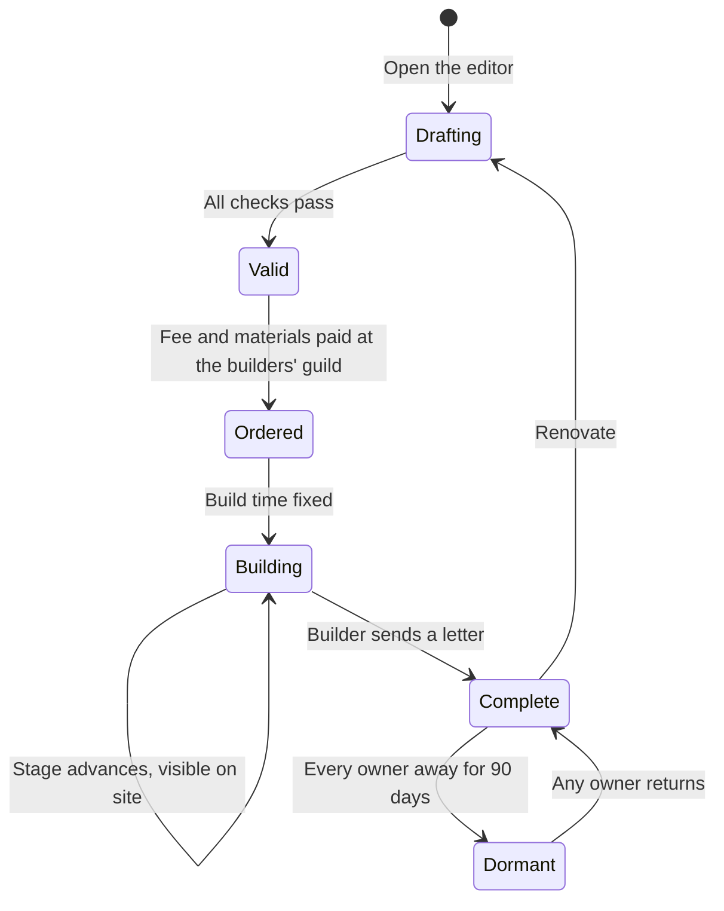

# Housing

How every Returner gets a home: a guaranteed plot in a Ward, a house they design, NPC builders who raise it over real hours, and rare open-world Holdings earned through deeds.

> **Version:** v0.1 · **Updated:** 10-10-2026 · **Owner:** Systems Design
>
> **Horizons:** H0 one test plot for the builder flow · H1 Wards in every capital and major town, the blueprint editor, NPC builders, visiting · H2 Holdings, clan halls, Frame hangars, Wards on Lumen, more culture kits, Stewardship décor · H3 VR house tours
>
> **Related:** [D-035](../../DECISIONS.md#d-035) · [D-045](../../DECISIONS.md#d-045) · [Economy and Crafting](economy-and-crafting.md) · [World Model](../07-multiplayer/world-model.md) · [Peoples and Factions](../02-world/peoples-and-factions.md)

## 1. Player experience

> *Priya spends an evening in the blueprint editor, pulling Cairnfolk stone pieces into a two-storey house with a rope-bridge balcony. The editor flags a floating stair. She fixes it, pays the builders' guild in Highcairn and goes out climbing. Two hours later a courier finds her on the cliffs with a letter: "Your roof is on. Come and see." She flies back to watch the last scaffold come down.*

> *Jun and his sister co-own a seaside cottage in the Lowhaven Ward. When Jun stops playing for a year, the cottage drops out of strangers' view. His sister still visits it. When he comes back it is exactly as he left it, and the neighbours' fishing nets still hang by his door.*

The system must create three feelings: **a home is guaranteed**; **it is mine because I designed it**; **waiting for the builders is anticipation, not friction**.

## 2. Scope

**Covers:** Wards, plots and tiers; the blueprint editor; construction by NPC builders; décor; what a house does; visiting and permissions; co-ownership; clan halls; inactivity; Patron décor; Holdings; Archive Mode.

**Leaves to other specs:** construction prices ([Economy and Crafting](economy-and-crafting.md)); companions and Frames ([Mechs, Robots and Companions](mechs-robots-and-companions.md)); clan structure and roles ([Social, Voice and Clans](../07-multiplayer/social-voice-and-clans.md)); Ward layer capacity ([World Model](../07-multiplayer/world-model.md#62-layers-capacity-assignment-split-and-merge)).

## 3. Inspirations

| Source | What we take | What we change |
| --- | --- | --- |
| *FFXIV* housing [G16] | Wards as social neighbourhoods | Plot scarcity there led to a 5-day lottery. We guarantee a plot to everyone, with no lottery ([D-035](../../DECISIONS.md#d-035)). |
| *Animal Crossing: New Horizons* [G16] | A house that appears the next morning: waiting for the builder can feel like anticipation | A few real hours, with a site you can visit and a letter when it's done |
| *Elder Scrolls Online*, Homestead [G16] | Housing as a long-term way to express yourself | NPCs build every structure; nothing is placed instantly |
| *Roblox* [G13] | Creation draws people together at scale | Creation through modular kits and validity checks, with no uploaded assets or scripts |

## 4. Terms

| Term | Meaning |
| --- | --- |
| **Ward instance** | One copy of a Ward's streets, with a fixed set of plots and residents |
| **Address** | A Returner's permanent plot: settlement, Ward, instance and plot number |
| **Plot tier** | The plot's size class, unlocked by Player Rank |
| **Blueprint** | A saved house design built from kit pieces |
| **Kit** | A culture's set of modular pieces: walls, roofs, stairs, fixtures |
| **Pattern Book** | A Ward's moderated library of shared blueprints |
| **Dormant** | A house whose owners have all been away a long time; hidden from public view |

Ward and Holding are defined in the [Glossary](../../GLOSSARY.md).

## 5. Entities and state

| Entity | Data | Authority |
| --- | --- | --- |
| Address | Owners, Ward instance, plot tier, permissions, guest and ban lists, dormant flag | Server |
| Blueprint | Pieces, positions, kit IDs, validation result, author, share code | Edited on the client; validated and stored by the server on save |
| Build order | Blueprint hash, builders' guild, start time, fixed duration, stage | Server |
| Décor layout | Item instances with positions; each item stays owned by whoever placed it | Server |
| Builder NPC | A Mind from the Artisan Guilds, with a schedule; dialogue through the Loom under rule zero ([D-042](../../DECISIONS.md#d-042)) | Server simulation |

## 6. Rules

### 6.1 Wards, plots and tiers

- **HSG-001 [H1]** Every Returner is guaranteed one plot ([D-035](../../DECISIONS.md#d-035)). Claiming it is free, from Avatar Level 1, at the end of the first hour ([Core Loops](../04-gameplay/core-loops.md#3-the-first-hour-h1)).
- **HSG-002 [H1]** Wards are attached to Halcyon, every Domain capital and selected towns, with at least two per region at H1. A Returner chooses their Ward. Moving costs the builders' fee and has a 7-day cooldown.
- **HSG-003 [H1]** Wards are layered: new Ward instances open whenever needed, so there is never a land shortage or a lottery. Each instance holds 60 plots.
- **HSG-004 [H1]** Plot tiers are unlocked by Player Rank, never by money, whether Omnis or real money:

| Tier | Unlock | Footprint | Height limit |
| --- | --- | --- | --- |
| Cottage | PR 1 | 12 × 12 m | 2 storeys |
| House | PR 20 | 18 × 18 m | 3 storeys |
| Manor | PR 50 | 26 × 26 m | 3 storeys and a tower |
| Estate | PR 80 | 36 × 36 m | 4 storeys and a tower |

Upgrading a tier keeps the Address. The plot grows into space reserved in the same instance, which is why plots are spaced for the largest tier.

### 6.2 The blueprint editor

- **HSG-010 [H1]** The editor works anywhere, including on the Skyferry. Pieces snap to a grid, and fixtures rotate freely. Touch, controller, and keyboard and mouse are all fully supported ([Controls, Camera and Accessibility](../09-platforms/controls-camera-and-accessibility.md)).
- **HSG-011 [H1]** **Culture kits** at H1: Hearthfolk timber, Cairnfolk stone, Pelagian coral (for Drowned Reach Wards), Caravan sandstone, Meridian steel and Northfolk longhouse. A Returner unlocks a kit through faction reputation or quests in its region. Kits follow the cultural care rules ([WLD-050](../02-world/peoples-and-factions.md#1-cultural-care-rules) to [WLD-054](../02-world/peoples-and-factions.md#1-cultural-care-rules)), so sacred architecture is never a kit piece.
- **HSG-012 [H1]** **Validity checks** run live and on save:

| Check | Example failure |
| --- | --- |
| Structure | A floating stair or an unsupported floor |
| Footprint and height | Beyond the tier's footprint or height limit |
| Access | No reachable entrance, or rooms that can't be reached on foot |
| Neighbours | Inside the 2 m setback, or blocking a neighbour's entrance or the Ward path |
| Budget | Over the piece and draw-call budget for the lowest supported platform tier ([Platform Support](../09-platforms/platform-support.md)) |
| Kit | A piece from a kit the Returner hasn't unlocked (shown as a placeholder that can't be built) |

- **HSG-013 [H1]** **Sharing:** a blueprint can be shared with friends by code, or published to the Ward's Pattern Book after moderation ([Safety and abuse](#9-safety-and-abuse)). Copying copies the design, not décor items or kit unlocks. The author is credited on every copy.
- **HSG-014 [H2]** Lumen gets Wards in Seren, and the Lumenari kit unlocks through Lumenari reputation.

### 6.3 Construction by NPC builders

- **HSG-020 [H1]** The builders' guild (part of the Artisan Guilds) builds every house, renovation and tier upgrade. Players never place structures instantly.
- **HSG-021 [H1]** Build time scales with size and complexity: about 1 hour for a simple cottage, up to about 6 hours for a full Estate. A renovation takes time in proportion to the pieces changed, at least 10 minutes. Placing décor inside a finished house is instant.
- **HSG-022 [H1]** **Speed can't be bought** with real money, Omnis, Patron status, trust or titles. The time is fixed when the order is placed and shown up front.
- **HSG-023 [H1]** The cost is the builders' fee in Omnis plus kit materials (gathered, bought or traded). Fees scale with tier and piece count ([Economy and Crafting](economy-and-crafting.md#61-sources-and-sinks)).
- **HSG-024 [H1]** The site can be seen and visited during construction. It moves through foundation, frame, walls, roof and finishing. Builders work on the scaffolds on their own schedules, and they talk about the job.
- **HSG-025 [H1]** When the house is done, the builder sends an in-world letter, delivered by courier wherever the Returner is, plus a platform notification if the player has opted in. Work continues while the player is offline.

A house moves through these states, from first sketch to dormancy.

### 6.4 What a house does

- **HSG-030 [H1]** **Equal storage:** every house gets the same Vault and wardrobe capacity, whatever its tier, Patron status or Holding. A bigger home gives more space to decorate, never more storage ([D-045](../../DECISIONS.md#d-045)).
- **HSG-031 [H1]** **Crafting stations** at home (kitchen, alchemy table, fletching bench, repair bench) match those in towns ([ECO-060](economy-and-crafting.md#67-field-crafting-and-artisans), [ECO-061](economy-and-crafting.md#67-field-crafting-and-artisans)). No home station is better than a public one.
- **HSG-032 [H1]** **Displays:** titles, Chronicle mementos, Convergence keepsakes and world-firsts can be put on show. They are bound and show their real provenance ([ECO-030](economy-and-crafting.md#64-bound-items)).
- **HSG-033 [H1]** **Gardens:** plants follow the Ward's regional season ([Time and Calendar](../02-world/time-and-calendar.md#4-regional-seasons-driven-by-the-moons)). They yield small, capped amounts of basic cooking ingredients, so gardens add charm without becoming an economic engine.
- **HSG-034 [H1]** **Companion lodging:** companion Automata and mounts rest at home to recover ([Mechs, Robots and Companions](mechs-robots-and-companions.md)).
- **HSG-035 [H2]** **Frame hangar:** an add-on for House tier and above, once Frame ownership widens ([D-036](../../DECISIONS.md#d-036)).
- **HSG-036 [H1]** A house is not a Hearth or a Wayshrine. Wayshrines are found, never built ([Cosmology](../02-world/cosmology.md#5-veil-wayshrines-and-returners)). Resting at home gives the same "rested" bonus as an inn.

### 6.5 Visiting and layering

- **HSG-040 [H1]** Each house has a permission setting: **Private**, **Friends**, **Clan** or **Public**, plus a guest list and a ban list. The default is Friends. For under-18 accounts, Public needs a parent's opt-in, following high-privacy defaults [L9].
- **HSG-041 [H1]** Each Address lives in exactly one Ward instance, so neighbours stay the same and a street becomes a community. A visitor who arrives with an Address (from the Ward Registry, a friend's card or a Pattern Book link) is placed in that instance. Parties are always placed together ([D-028](../../DECISIONS.md#d-028)).
- **HSG-042 [H1]** A Private or Friends house shows strangers a closed gate and the outside of the house. Interiors load only for permitted visitors.

### 6.6 Co-ownership and clan halls

- **HSG-050 [H1]** A house can have up to 4 co-owners. Each co-owner still keeps their own guaranteed plot.
- **HSG-051 [H1]** Co-owners can arrange décor and order renovations. Only the deed holder can change permissions or remove co-owners. Décor stays owned by whoever placed it and returns to their Vault if they leave.
- **HSG-052 [H2]** **Clan halls:** a clan may commission one clan hall in a Ward. It has its own Address, a Manor-sized footprint and the same editor and builders. Clan roles set who can edit it ([Social, Voice and Clans](../07-multiplayer/social-voice-and-clans.md)). It has no shared storage and no stations better than a town's, so a clan gains no gameplay advantage from it.

### 6.7 Inactivity, Patron décor and Archive Mode

- **HSG-060 [H1]** A house is never deleted for inactivity. Once all its owners have been away for 90 days, it becomes Dormant. Strangers see a tended empty plot behind a hedge. Permitted friends still see and visit the house. Any owner's return restores it at once.
- **HSG-061 [H1]** The Patron décor allowance is cosmetic décor only ([D-045](../../DECISIONS.md#d-045)). It never adds storage, plot size, build speed or function.
- **HSG-062 [H2]** Archive Mode keeps houses ([D-047](../../DECISIONS.md#d-047)): every built house, blueprint and décor layout is exported with the avatar.

### 6.8 Holdings [H2]

- **HSG-070 [H2]** Holdings are rare open-world sites, a few dozen per region, earned through Stewardship ([D-038](../../DECISIONS.md#d-038)) or specific authored titles. They are never bought with Omnis or real money ([D-035](../../DECISIONS.md#d-035)).
- **HSG-071 [H2]** A Holding uses the same blueprint editor with a larger footprint, and may add a Frame hangar or a licensed launch pad ([Spaceflight and Moon Travel](spaceflight-and-moon-travel.md#62-personal-ships-h2)). Storage stays equal ([HSG-030](#64-what-a-house-does)).
- **HSG-072 [H2]** A Holding is kept while its holder is active. After 180 days of inactivity the site reopens. The holder's structure is saved as a blueprint, and they keep a **Holding Deed** that lets them claim any vacant site when they return.

## 7. Edge cases

| Case | Rule |
| --- | --- |
| A colossus damages the builders' settlement ([WLD-063](../02-world/machines-and-colossi.md#3-colossi)) | Construction pauses. The finish time moves by the same amount, and the Returner gets a letter explaining why. Fees are never charged twice. |
| An owner deletes their account | The house is removed after the legal retention period. Co-owners keep the deed and their own décor. |
| A Ward instance is overcrowded with visitors | Extra visitors go to a copy of the instance with the same houses, where décor can't be changed |
| A patch changes a kit used in a blueprint | The house keeps its built pieces, and the editor offers a migration |
| A Holding's holder returns after the site reopened | They use their Holding Deed on any vacant site, and the saved blueprint rebuilds there through the builders ([HSG-072](#68-holdings-h2)) |

## 8. Multiplayer and platforms

All platforms share the same Wards. Blueprints are validated against the lowest supported tier's budget ([HSG-012](#62-the-blueprint-editor)), so every house renders on every device. Lower tiers may stream interiors with simpler décor detail, never with missing pieces.

## 9. Safety and abuse

- **HSG-080 [H1]** **Anti-grief:** Wards are lawful zones with no PvP, and Banner duels are disabled inside houses. Visitors can't move, take or drop items. Visitors pass through each other at doors and on paths. Owners can remove a visitor instantly.
- **HSG-081 [H1]** **Text:** house names, signs, notes and Pattern Book descriptions pass the text filter and can be reported ([Safety and Moderation](../07-multiplayer/safety-and-moderation.md)). Blocked text is shown only to its author, a technique from Club Penguin [G12].
- **HSG-082 [H1]** **Designs:** Pattern Book submissions and Public houses are screened automatically for shapes that spell words or form symbols, and reviewed by people when reported. A reported Public house drops to Friends-only during review. It is never demolished without notice and the right to appeal.
- **HSG-083 [H1]** No uploaded images or custom scripts. Paintings and banners use preset patterns and palettes.

## 10. Performance

Each tier has a fixed budget for pieces, lights and décor, so a 60-plot instance fits the lowest tier's memory. Interiors stream in as a visitor approaches. Dormant houses cost nothing to render for the public.

## 11. Examples

| Allowed | Not allowed |
| --- | --- |
| A PR 22 Returner upgrades to a House tier plot | A Returner buys a Manor plot for real money or Omnis |
| A builder's letter arrives after 3 h 40 m, as quoted | A "rush build" button for Patrons |
| A Patron hangs exclusive lanterns | A Patron house with double Vault space |
| A friend copies Priya's blueprint, credited to her | A copied blueprint that also copies her décor items |
| A clan hall with a war-banner display | A clan hall with a shared bank that members' own Vaults lack |

## 12. Acceptance criteria

| ID | Test |
| --- | --- |
| [HSG-001](#61-wards-plots-and-tiers), [HSG-003](#61-wards-plots-and-tiers) | Load test: 1,000,000 new accounts claim plots in one Ward; 100% get an Address; 0 lottery or queue states |
| [HSG-004](#61-wards-plots-and-tiers) | Store and Exchange audit: 0 ways to change plot tier other than Player Rank |
| [HSG-012](#62-the-blueprint-editor) | 1,000 deliberately invalid blueprints: 100% refused with a specific reason |
| [HSG-022](#63-construction-by-npc-builders) | Configuration audit: build time depends only on blueprint measures; no account flag changes it |
| [HSG-025](#63-construction-by-npc-builders) | Order 500 builds and log out: on completion, 100% send an in-world letter and, where opted in, a notification |
| [HSG-030](#64-what-a-house-does) | Storage is identical across every tier, Patron and non-Patron account, and clan hall |
| [HSG-040](#65-visiting-and-layering) | New under-18 account: house defaults to Friends; Public is locked |
| [HSG-060](#67-inactivity-patron-décor-and-archive-mode) | Simulate 90 days of owner inactivity: house Dormant to strangers, visible to friends; owner login restores it in under 5 s |
| [HSG-080](#9-safety-and-abuse) | Bot visitors try to move, take or drop décor: 0 successes |

<!-- citation links: generated, do not edit by hand -->

[G12]: ../../references/games.md
[G13]: ../../references/games.md
[G16]: ../../references/games.md
[L9]: ../../references/legal-and-policy.md
