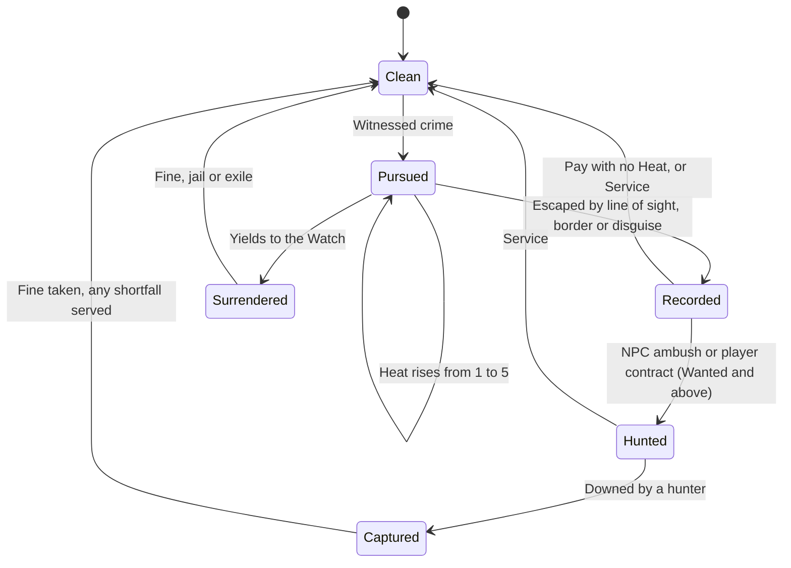
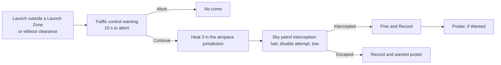

# Law, Crime and Bounties

One law and bounty system for every jurisdiction in the Oasis: what counts as a crime, how pursuit works and can be escaped, how a Record follows a Returner, and how anyone can clear it without real money.

> **Version:** v0.1 · **Updated:** 10-10-2026 · **Owner:** Systems Design
>
> **Horizons:** H0 Heat 1 and 2 and witnesses in one town · H1 the full system in every jurisdiction, NPC and player hunters, wanted posters · H2 the unauthorised launch flow (personal ships), Steward pardons and bounty priorities
>
> **Related:** [D-034](../../DECISIONS.md#d-034) · [D-025](../../DECISIONS.md#d-025) · [D-032](../../DECISIONS.md#d-032) · [World Laws](../02-world/world-laws.md#5-civic-law-jurisdictions) · [PvP and Protection](pvp-and-protection.md) · [Economy and Crafting](economy-and-crafting.md)

## 1. Player experience

> *Two friends cut across Halcyon's market roofs without a flight licence. A Watch whistle: Heat 1. They drop into the canal, swap hoods and come up in a crowd. The search fades. That evening a poster in Hearthwick shows Sam's face and a small fine. Sam pays it at the Watch post. Their friend, still being chased, can't pay until the patrols lose interest.*

> *Ilse holds a Hunter licence. She takes a contract on a Returner who robbed a caravan twice, tracks them from a sighting in the Ember Wastes, and brings them in at dusk. The fine comes out of the robber's own purse, and the Record is cleared. Nobody spent a cent of real money.*

The system must create three feelings: **the law is readable and fair**; **getting away is a thrill**; **paying your debt is always possible**.

## 2. Scope

**Covers:** jurisdictions, the crime list, witnesses, Heat 1 to 5, escape, the Record, wanted posters, Bounties, NPC and player hunters, clearing a Record, pardons, the unauthorised launch flow, protections and anti-exploit rules.

**Leaves to other specs:** consensual PvP (the Banner, the Lawless Reaches, arenas) in [PvP and Protection](pvp-and-protection.md); what each jurisdiction's code says ([World Laws](../02-world/world-laws.md#5-civic-law-jurisdictions)); launch zones and traffic control ([Spaceflight and Moon Travel](spaceflight-and-moon-travel.md)); airspace corridors ([Traversal and Flight](../04-gameplay/traversal-and-flight.md)); teleport and Hearth limits under Heat ([Waypoints and Healing](waypoints-and-healing.md)).

## 3. Inspirations

| Source | What we take | What we change |
| --- | --- | --- |
| *Grand Theft Auto V* [G1] | A 1 to 5 pursuit meter; police search the last known area; Heat cools once line of sight breaks | Responders are factions in the world, and Heat never crosses a jurisdiction border |
| *Red Dead Redemption 2* [G2] | Witnesses report crimes and can be stopped first; bounties are paid at a post office, by surrender or by jail; no paying while hunted | A service route, so clearing a Record is never only a matter of money ([D-034](../../DECISIONS.md#d-034)) |
| *Kingdom Come: Deliverance* [G3] | NPCs report crimes within a simulated society | A witness's memory is Mind state, decided by deterministic rules under rule zero ([D-042](../../DECISIONS.md#d-042)) |
| *Elite Dangerous* [G15] | Trespass and loitering on landing pads bring fines that become bounties | The model for the unauthorised launch flow |
| *Ultima Online*, Trammel and Felucca [M14] [M15] | Most players prefer protection by default | New and under-18 Returners can't be hunted by players |

## 4. Terms

| Term | Meaning |
| --- | --- |
| **Jurisdiction** | An area with its own Civic Law code: a settlement, a road network, an airspace volume, a spaceport or a moon city |
| **Record tier** | Clean, Noted, Wanted or Notorious, per jurisdiction |
| **Sky patrol** | The Watch's aerial officers: riders, gliders and patrol craft |
| **Hunter licence** | Permission for a Returner to take bounty contracts on other Returners |
| **Captured** | Downed by a hunter: taken to a Watch post instead of falling |

Heat, Record, Bounty, the Watch and Watch post are defined in the [Glossary](../../GLOSSARY.md). The Watch are civic law-keepers; they have nothing to do with the ancient Warden Automata.

## 5. Entities and state

| Entity | Data | Authority |
| --- | --- | --- |
| Crime event | Type, jurisdiction, position, time, victim, witnesses | Server; created only by the law evaluator ([WLD-010](../02-world/world-laws.md#3-the-evaluation-model)) |
| Witness | Mind memory of the face and outfit, report state | Server simulation ([NPC Minds and Conversation](../06-ai/npc-minds-and-conversation.md)) |
| Heat | Level, last known position, search timer | Server, per Returner per jurisdiction |
| Record | Points, tier, crime list, poster portrait | Server, persistent |
| Bounty | Amount, funding split, open contracts, claim cooldowns | Server |

## 6. Rules

### 6.1 Jurisdictions

- **LAW-001 [H1]** Every point on the Oasis and on Lumen lies inside exactly one jurisdiction, or in a Lawless Reach, where there is no Heat and no Record. Veil and Hollow (H2) have no jurisdiction at all, and their Natural Law forbids player-against-player harm ([World Laws](../02-world/world-laws.md), [D-025](../../DECISIONS.md#d-025)). Entering a jurisdiction shows its banner ([WLD-020](../02-world/world-laws.md#5-civic-law-jurisdictions)).
- **LAW-002 [H1]** Crimes come only from the world-laws evaluator returning **Restricted** ([World Laws](../02-world/world-laws.md#3-the-evaluation-model)). AI can't declare a crime or waive one ([D-042](../../DECISIONS.md#d-042)).

### 6.2 Crime list

| Crime | Examples | Base severity | Player hunters? |
| --- | --- | --- | --- |
| Trespass | Restricted grounds, a closed vault, a monastery at night | 1 | No |
| Airspace violation | Flying above a city ceiling or outside its corridors; flying without a licence ([TRV-004](../04-gameplay/traversal-and-flight.md#63-flight-tiers-and-rules)) | 1–2 | No |
| Smuggling | Contraband through a checkpoint; undeclared Lumen cargo | 2 | No |
| Theft | Pickpocketing, burglary, taking from stalls or caravans | 2 | Yes, if from players or repeated |
| Unauthorised launch [H2] | Spaceflight outside a Launch Zone or without clearance | 3 | No |
| Vandalism of protected or sacred sites | Attacking shrines, monuments or the Library. Sacred elements can never be destroyed ([WLD-052](../02-world/peoples-and-factions.md#1-cultural-care-rules)); the attempt is the crime. | 3 | No |
| Assault | Attacking an NPC, or a non-consenting Returner in a lawful zone, including at their Echo ([DTH-010](../04-gameplay/death-and-return.md#64-anti-griefing)) | 3–4 | Yes |

- **LAW-010 [H1]** Severity converts to Record points and a fine. Only crimes that harmed others can draw player hunters. A Returner who only trespassed, flew or smuggled faces NPC hunters, never players.
- **LAW-011 [H1]** An NPC civilian attacked in a lawful zone is Downed and recovers. Players can never kill them ([D-032](../../DECISIONS.md#d-032)).

### 6.3 Witnesses

- **LAW-020 [H1]** The law knows about a crime only if it is **witnessed** (an NPC sees or hears it, a Watch officer is present, or an alarm bell rings) or if it leaves evidence found later. Unwitnessed crimes add no Heat [G2] [G3].
- **LAW-021 [H1]** A witness runs to report, or rings a bell, after 3 to 8 seconds. The player can stop the report by reaching the witness first, or by persuading, intimidating or bribing them in conversation. The witness's Mind decides with deterministic rules on typed speech acts ([D-042](../../DECISIONS.md#d-042)). Intimidation is itself a severity-1 crime if someone else sees it.
- **LAW-022 [H1]** Witnesses remember the face and outfit. A disguise (a hood, mask or outfit change made out of sight) breaks recognition by anyone who didn't see the change.

### 6.4 Heat 1–5

| Heat | Trigger | Responders | Restrictions |
| --- | --- | --- | --- |
| 1 | A minor witnessed crime | Local Watch officers investigate and call a warning | None |
| 2 | Resisting, a repeat offence, or severity 2 | Watch patrols give chase | No Wayshrine travel and no escape by Return ([DTH-011](../04-gameplay/death-and-return.md#64-anti-griefing)) |
| 3 | Severity 3, or fleeing at Heat 2 | Sky patrols join; checkpoints close | Lawful Hearths refuse service ([Waypoints and Healing](waypoints-and-healing.md#65-sanctuary-and-anti-escape)) |
| 4 | Assaulting Watch officers, or evading by sustained flight | Enforcement Frames where Natural Law allows them (none anywhere in the Verdant Spine); NPC bounty hunters sent out | Gates locked |
| 5 | Repeated severity-4 crimes in one pursuit | Elite responders; an alert across the jurisdiction | As Heat 4 |

- **LAW-030 [H1]** Responders and their abilities are authored per jurisdiction and obey Natural Law ([WLD-013](../02-world/world-laws.md#3-the-evaluation-model)). Heat never makes enemies invincible or all-knowing.
- **LAW-031 [H1]** A Returner escapes Heat by:
  - **breaking line of sight:** responders then search around the last known position, and Heat drops one level for every 30 to 60 seconds unseen [G1];
  - **disguise** ([LAW-022](#63-witnesses));
  - **hiding** in crowds, haystacks, water, canopy or interiors;
  - **leaving the jurisdiction:** Heat drops to 0 at the border unless a responder can see them.
- **LAW-032 [H1]** The HUD shows Heat, and shows responders only once they are within sight or hearing. The search area is shown from Heat 2.

### 6.5 Record and wanted posters

- **LAW-040 [H1]** The Record is persistent and kept per jurisdiction: Clean, Noted, Wanted, Notorious. It never fades with time; it must be cleared ([Clearing a Record](#67-clearing-a-record)).
- **LAW-041 [H1]** From Wanted upward, wanted posters appear on notice boards, Watch posts and gates in that jurisdiction. They show the avatar's portrait and name, the crimes and the Bounty, an exception to private-by-default visibility ([PRG-003](../04-gameplay/avatar-and-progression.md#61-the-avatar)). They never show account data or level.
- **LAW-042 [H1]** Shops in that jurisdiction may refuse service at Notorious. Essential services (healing, repair, Exchanges in capitals, [TIM-005](../02-world/time-and-calendar.md#5-what-time-changes)) never refuse service unless Heat is active.

### 6.6 Bounty and hunters

- **LAW-050 [H1]** A Bounty equals the outstanding fines plus a top-up from an NPC fund. It is always in Omnis, never real money.
- **LAW-051 [H1]** **NPC hunters** pursue Wanted Returners anywhere in the jurisdiction's lands, through telegraphed ambushes scheduled by the Weaver ([The Weaver](../06-ai/director-and-world-events.md)), at most once every 2 hours per Returner.
- **LAW-052 [H1]** **Player hunters** need a Hunter licence: Avatar Level 5 or more, Player Rank 25 or more, a Clean Record in the issuing jurisdiction, and the licence quest. Contracts are taken at bounty boards. A contract gives the poster and the region of the target's last sighting, never a live map position.
- **LAW-053 [H1]** The target is told when a player takes a contract on them ("A hunter carries your poster"). At most 3 player contracts can be open on one target.
- **LAW-054 [H1]** A hunter claims a contract by Downing the target in a lawful open-world area. The target is **Captured**, not Fallen: no Echo, no loot, no wear. They are taken to the nearest Watch post, where the fine is taken from their Vault and Purse. Any shortfall becomes a short service task. Their Record in that jurisdiction returns to Clean.
- **LAW-055 [H1]** **No-claim zones:** every sanctuary ([PVP-030](pvp-and-protection.md#64-protected-places-and-players) in [PvP and Protection](pvp-and-protection.md#64-protected-places-and-players)), settlement interiors, and every Convergence activity space.

### 6.7 Clearing a Record

| Route | Rule | Time |
| --- | --- | --- |
| **Pay** | Pay the fine at any Watch post in that jurisdiction | Seconds |
| **Surrender** | Yield to any Watch officer, even with Heat active. Then pay the fine, or serve a short jail term with an optional jail activity. | Jail up to 10 minutes |
| **Service** | A service quest: repair, escort, patrol or Convergence Prepare work | 15 to 40 minutes, by severity |

- **LAW-060 [H1]** **No paying while hunted:** Pay is unavailable with any Heat, and for 2 minutes after an NPC or player hunter last engaged the Returner [G2]. Surrender stays available.
- **LAW-061 [H1]** **Not only money:** the Service route always exists and clears the same Record as paying. Fines scale with severity and Record tier, not with the offender's wealth, and are capped.
- **LAW-062 [H2]** **Pardons:** a Steward may declare an amnesty on festival days, within published limits ([D-038](../../DECISIONS.md#d-038)). It covers non-violent crimes only, never crimes against other Returners, and never the Steward's own Record.
- **LAW-063 [H2]** Stewards may set bounty priorities (raising the NPC top-up for certain crimes) within limits. They can't create crimes or target named Returners.
- **LAW-064 [H1]** In Lumenari cities, Surrender leads to exile instead of jail: the Returner is escorted out and can't re-enter that city for 10 minutes. Pay and Service work as everywhere else.

A Record moves through these states, and every path leads back to Clean.

### 6.8 Licences and crime

- **LAW-070 [H1]** A crime of severity 3 or more committed through a licensed activity (reckless sustained flight, for example) suspends that licence in the jurisdiction until the Record is cleared. Heat alone never revokes a licence for good.

### 6.9 Unauthorised launch flow [H2]

The project owner confirmed this flow ([D-034](../../DECISIONS.md#d-034)). It needs personal ships, which arrive at the third Long Night, so it is H2. Each step can be escaped.

- **LAW-080 [H2]** Every step can be escaped, and every outcome can be cleared through the routes in [Clearing a Record](#67-clearing-a-record). An intercepted ship is towed to the spaceport impound (a release fee or service), never destroyed by the law ([D-039](../../DECISIONS.md#d-039)).

## 7. Edge cases

| Case | Rule |
| --- | --- |
| Logging out with Heat | The avatar stays in the world for 30 s. On return, Heat resumes at its last level ([Waypoints and Healing](waypoints-and-healing.md#64-login-logout-and-spawn-choice)). |
| A crime committed in a temporary quest form | The quest declares its law overrides ([WLD-014](../02-world/world-laws.md#3-the-evaluation-model)); no Record outside them |
| The witness is a companion or a party member | They are never witnesses |
| A jurisdiction changes hands in a world event | Records move to the new jurisdiction |
| A party member helps a fleeing friend against the Watch | That is assault, and earns its own Heat |

## 8. Multiplayer and platforms

Heat is per Returner: a party member who didn't offend gets none. Posters and Records are global canonical state, the same in every layer ([D-028](../../DECISIONS.md#d-028)). Capture rules are identical for every input, including touch.

## 9. Safety and abuse

- **LAW-090 [H1]** **Protected Returners:** new Returners (Avatar Level 1 to 3) and under-18 accounts can't be targeted by player hunters ([D-025](../../DECISIONS.md#d-025)). They face NPC hunters only.
- **LAW-091 [H1]** **No harassment loops:** a hunter can claim the same target at most once every 7 days. After any capture, the target is immune to player hunters for 2 hours. A target can block a hunter, which cancels that hunter's open contract on them.
- **LAW-092 [H1]** **Bounty farming:** hunters can't take contracts on friends, clan-mates, recent party members (within 30 days) or accounts linked by device or payment signals. The payout from the target's Omnis counts against the Transfer Allowance ([ECO-024](economy-and-crafting.md#63-exchanges-and-direct-trade)). The NPC top-up shrinks with each repeated claim between the same pair, and anywhere in a linked cluster. Flags go to [anomaly detection](economy-and-crafting.md#9-safety-and-abuse).
- **LAW-093 [H1]** **Funding:** a Bounty is paid for by the offender's own Omnis (through the fine) plus an NPC fund capped per jurisdiction per day. Players can never add to a Bounty, with Omnis or real money.
- **LAW-094 [H1]** Poster portraits show the avatar only. Names on posters pass the name filter. Any poster can be reported.
- **LAW-095 [H1]** Under-18 accounts can hold a Hunter licence, but their bounty boards list contracts on NPC outlaws only, never on other Returners.

## 10. Performance

Witness checks use cheap perception queries (sight cones, hearing radii) on Mass crowds [T7]. Each offender has at most one server-side search group. Poster boards update every 60 seconds or faster in each region.

## 11. Examples

| Allowed | Not allowed |
| --- | --- |
| A thief bribes a witness, who accepts by rule and doesn't report | An NPC's generated text adds a crime the evaluator didn't flag |
| A Returner with no Omnis clears a Record by repairing the Hearthwick bridge | A Record that can only be cleared with Omnis |
| An enforcement Frame chases an offender through the Iron Meridian | An enforcement Frame deployed in the Verdant Spine |
| A 15-year-old with a Record is ambushed by NPC hunters | A player hunter targeting that 15-year-old |
| A 16-year-old hunter brings in an NPC outlaw | A 16-year-old hunter taking a contract on another Returner |

## 12. Acceptance criteria

| ID | Test |
| --- | --- |
| [LAW-002](#61-jurisdictions) | AI proposal fuzzing: 100% of proposals to add or waive a crime are rejected by the validator |
| [LAW-020](#63-witnesses) | 1,000 unwitnessed scripted crimes: 0 Heat events |
| [LAW-031](#64-heat-15) | A bot breaking line of sight at Heat 3 reaches Heat 0 within 3 minutes in at least 95% of runs |
| [LAW-060](#67-clearing-a-record) | Pay attempts with any Heat, or within 2 minutes of hunter engagement: 100% refused |
| [LAW-061](#67-clearing-a-record) | For every crime type, the Service route exists and clears the same Record |
| [LAW-080](#69-unauthorised-launch-flow-h2) | 200 scripted unauthorised launches: the warning always comes before Heat; the impound never destroys a ship |
| [LAW-090](#9-safety-and-abuse), [LAW-095](#9-safety-and-abuse) | Audit 100,000 boards: no player hunter ever sees an under-18 or Level 1 to 3 target, and no under-18 hunter ever sees a Returner contract |
| [LAW-092](#9-safety-and-abuse) | Two linked accounts trading crimes and claims for 7 days: flagged, and the NPC top-up falls to 10% or less of the first claim by day 3 |

<!-- citation links: generated, do not edit by hand -->

[G1]: ../../references/games.md
[G2]: ../../references/games.md
[G3]: ../../references/games.md
[G15]: ../../references/games.md
[M14]: ../../references/industry-and-live-service.md
[M15]: ../../references/industry-and-live-service.md
[T7]: ../../references/technology-and-ai.md
