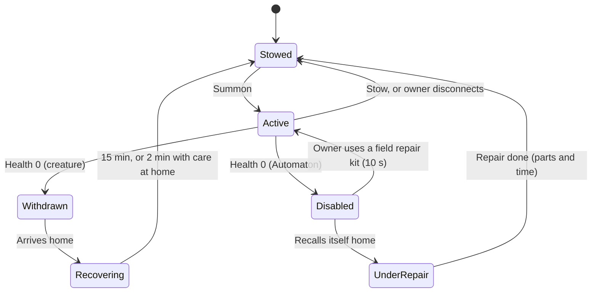

# Mechs, Robots and Companions

How Returners get, bond with, command, maintain and recover companions and piloted Frames, and why machines never dominate the world.

> **Version:** v0.1 · **Updated:** 10-10-2026 · **Owner:** Systems design
>
> **Horizons:** H0 one companion Automaton (follow, assist, scout) · H1 companion and utility Automata, bonded creatures and mounts, Frames in the Iron Meridian and inside Convergences, Piloting Mastery 1–10 · H2 broad Frame ownership and multi-crew Colossal Frames from the sixth Long Night, the Wardens wake · H3 remote cockpit control from VR
>
> **Related:** [D-036](../../DECISIONS.md#d-036) · [D-039](../../DECISIONS.md#d-039) · [D-025](../../DECISIONS.md#d-025) · [D-042](../../DECISIONS.md#d-042) · [Machines and Colossi](../02-world/machines-and-colossi.md) · [World Laws](../02-world/world-laws.md) · [Combat and Abilities](../04-gameplay/combat-and-abilities.md) · [Death and Return](../04-gameplay/death-and-return.md)

## 1. Player experience

> *Pip was a heap of brass in a Sennight cellar until Lena found its Spark-socket and coaxed it awake. Three weeks later it scouts ahead of her through the Verdant Spine, chirping twice for wolves and once for a ledge. When a Gravemaw's tail clips it, Pip doesn't die. It folds up, beeps an apology, and limps home to her Ward workshop to be repaired. That evening it remembers the cave where they nearly lost each other, and refuses to go near it.*
>
> *Ilyas has Piloting Mastery 6 and an Engine House Frame he rebuilt with a tinkerer's reverse-joint legs. In a league trial on a Meridian freight avenue he leaps between rail gantries that tread Frames can't reach. A rival's Spark-break round fries his core. He ejects, glides to a rooftop and files a claim on his Frame Writ. The Frame will be back in his hangar in a couple of hours, minus a deductible, plus a lesson.*
>
> *In Convergence V, four strangers crew one Colossal Frame. The spotter calls a Warden's weak plate, the engineer routes power to the arm, the pilot braces, and the gunner fires inside the sync window. The Frame's Sync gauge flares. None of them could have done it alone.* [H2]

The system must make companions feel like partners who remember, make Frames feel like a separate craft worth mastering, and make sure a player on foot never feels outclassed by one.

## 2. Scope

- **Covers:** companion and utility Automata; bonded creatures, pets and mounts; Companion Bond; autonomy and commands; companion memory; loss and recovery; Frames (getting one, licence, Piloting Mastery, parts, maintenance, Spark-cells, hangars, insurance, law, reputation); Colossal Frames and crews [H2]; ejection; friendly fire; damage to settlements; presence rules and anti-botting; scale rules for cities and dungeons; Warden behaviour [H2]; the rules that stop machines dominating.
- **Leaves to other specs:** machine history, machine classes and colossus species ([Machines and Colossi](../02-world/machines-and-colossi.md)); Natural and Civic Law ([World Laws](../02-world/world-laws.md)); aircraft and spaceships ([Spaceflight and Moon Travel](spaceflight-and-moon-travel.md)); recipes and prices ([Economy and Crafting](economy-and-crafting.md)); how Minds work ([NPC Minds and Conversation](../06-ai/npc-minds-and-conversation.md)).
- **Never:** companions, Frames or parts sold for real money ([D-045](../../DECISIONS.md#d-045)); anything owned lost for good ([D-039](../../DECISIONS.md#d-039)); a Frame that acts without a pilot.

## 3. Inspirations

| Source | What we take | What we change |
| --- | --- | --- |
| *Armored Core VI* [N13] | Parts change how a machine moves, not just its numbers | Parts are capped at item level 10 ([D-021](../../DECISIONS.md#d-021)) |
| *Gundam* [J5] | Machines need a physical reason for how they fight; they are mass-produced, maintained and regulated | Our reason is Natural Law and logistics, not a jamming particle |
| *Horizon* [G6] | Readable machine anatomy, detachable parts, machines as ecology | Applied to Wardens and wild Automata |
| *Pacific Rim* [J6] | A machine too big for one person, so it needs a crew; scale that is staged | None of its terms, designs or the mind-link idea [L5]. Crews coordinate through skill, not telepathy. |
| *Titanfall 2* [N12] | Pilot and machine as two separate kinds of mastery | The pilot keeps the avatar's own Arts outside the Frame, and Frame mastery is its own 1–10 track |

## 4. Terms

Automaton, Frame, Colossal Frame, Warden, Companion Bond, Piloting Mastery, Spark-cell and Frame Writ are defined in the [Glossary](../../GLOSSARY.md). Terms used only here:

| Term | Meaning |
| --- | --- |
| **Berth** | A safe parking spot for Frames at the entrance to a space they can't enter |
| **Companion** | An Automaton or creature bonded to one Returner |
| **Crew Sync** [H2] | A Colossal Frame's shared coordination gauge |
| **Frame Licence** | Civic permission to pilot a Frame class |
| **Loyalty** | A companion's short-term mood, 0–100, shaped by care, rest and treatment. It affects obedience, never Bond. |
| **Safe-stop** | A Frame without a working pilot kneels and powers down |
| **Withdrawal** | A defeated creature companion leaves the field and recovers at home |

## 5. Entities and state

All state is server-authoritative. Ownership is G-class ([World Model](../07-multiplayer/world-model.md#5-state-classes-and-authority)).

```yaml
Companion:
  id: CMP.8812
  owner: player_id
  kind: automaton | creature
  class: companion | utility | mount
  size: S | M | L                  # sets city, interior and dungeon access (MCH-030)
  bond_level: 1..10                # MCH-002
  loyalty: 0..100
  training: [scout.tracks, carry.pack2, assist.revive]
  autonomy: passive | assist | guard | free
  memory: { places: [...], events: [...<=20], prefs: {...} }   # MCH-010
  state: active | stowed | disabled | withdrawn | recovering | under_repair
Frame:
  id: FRM.3301
  owner: player_id | clan_id        # Colossal Frames: clan or guild only
  class: frame | colossal
  parts: { chassis, locomotion, core, systems[], armament[] }   # each part has an item level 1..10
  condition: { per_part: 0..100 }
  sparkcells: { capacity, charge }
  writ: { issuer, deductible, expiry } | null
  location: hangar_id | world_pos | wreck_pos
PilotProfile:
  player_id
  piloting_mastery: 1..10
  licences: [FRAME.M, COLOSSAL.CREW]   # COLOSSAL.CREW is H2
  league_rep: -100..100
```

## 6. Rules

### 6.1 Getting a companion

| Route | Automata | Creatures |
| --- | --- | --- |
| **Buy** | Engine House showrooms (Omnis only) | Stables and kennels (Omnis only) |
| **Build** | Free-tinkerer blueprints, built with an Engineer Artisan from materials | None |
| **Adopt** | Reactivate a derelict found in ruins (an exploration reward) | Befriend one in the wild (food, patience, Domain-specific behaviour) or take in a rescued animal |
| **Quest** | Gifted by NPCs at high trust ([NPC Bonds and Help-Calls](npc-bonds-and-help-calls.md)) | Hatchlings and foundlings from character quests |

- **MCH-001 [H1]** No companion, Frame or Frame part is ever sold for real money. Store skins change appearance only ([D-045](../../DECISIONS.md#d-045)).
- **MCH-002 [H1]** Each companion has its own Companion Bond, 1–10, separate from avatar progression ([D-036](../../DECISIONS.md#d-036)). Bond rises through time together, training and shared deeds. Bond 8–10 needs a Mastery Trial, such as "your creature leads you blind through the Hush mist".
- **MCH-003 [H1]** A Returner has one companion in the field plus one callable mount. The rest wait at home (Ward house, stable or hangar). *Why:* the field stays readable, and the server budget holds ([Performance](#10-performance)).

### 6.2 What companions do

| Role | What it does | Limit |
| --- | --- | --- |
| **Scouting** | Marks creatures and hazards, follows tracks, finds resources | Never reveals Egg solutions or puzzle answers |
| **Carrying** | Extra carrying capacity | Goods in a companion's pack count as carried for Echo rules ([Death and Return](../04-gameplay/death-and-return.md#61-the-return-sequence)) |
| **Quests** | Authored companion moments; fetching within reach; letter delivery by trained couriers ([NPC Bonds and Help-Calls](npc-bonds-and-help-calls.md#63-letters-and-messages)) | No quest objective completes without the owner present |
| **Crafting** | Utility Automata sort, refine and queue low-tier work at home | Never replaces Artisans for high-tier work ([Economy and Crafting](economy-and-crafting.md#67-field-crafting-and-artisans)) |
| **Combat** | Distract, pressure Poise, revive the owner once per encounter | At most 20% of the owner's combined damage output ([MCH-008](#62-what-companions-do)) |
| **Transport** | Mounts (land, sea, sky); cargo Automata | Flight law applies to sky-mounts ([D-023](../../DECISIONS.md#d-023)) |

- **MCH-004 [H1]** A companion can revive its Downed owner once per encounter ([DTH-001](../04-gameplay/death-and-return.md#61-the-return-sequence)). *Why:* rescue is cooperative play, not an extra life bar.
- **MCH-008 [H1]** A companion's damage is at most 20% of its owner's combined damage output over an encounter.

### 6.3 Autonomy and commands

| Setting | Behaviour |
| --- | --- |
| **Passive** | Follows and never acts |
| **Assist** | Acts only on targets the owner marks |
| **Guard** | Defends the owner or a point |
| **Free** | Takes the initiative within its trained roles |

- **MCH-005 [H1]** Commands come by ping wheel, hotkey, touch gesture or voice. Voice and text are parsed into typed commands. A companion's chirps and lines may be generated, but no model output changes game state ([D-042](../../DECISIONS.md#d-042)). Game data is the companion's ground truth, as in PUBG Ally [A3].
- **MCH-006 [H1]** Natural Law applies. In the Iron Meridian, Automata can use one extra trained role at once; some sacred sites hold Automata to Passive ([World Laws](../02-world/world-laws.md#4-natural-law-by-domain)).
- **MCH-007 [H1]** Below 25 Loyalty, a companion refuses risky orders (Free and Guard), and after 3 days of neglect it drifts home. It is never hostile to its owner.

### 6.4 Companion memory

- **MCH-010 [H1]** A companion keeps a small structured memory: places visited, up to 20 notable events, its owner's habits (favourite targets, routes) and named friends. It uses the storage and validation rules of NPC Minds at a smaller scale ([NPC Minds and Conversation](../06-ai/npc-minds-and-conversation.md#64-memory-and-reflection)). It can recall ("we found the shrine here") and react (it avoids the place it was hurt). It never knows anything its owner hasn't seen.

### 6.5 Loss and recovery

This diagram shows what happens when a companion is defeated, and how it comes back.



- **MCH-011 [H1]** Companions never permanently die ([D-039](../../DECISIONS.md#d-039)). Creatures withdraw and recover at home; Automata are repaired. No player action, PvP outcome or Natural Law can destroy or steal a companion.
- **MCH-012 [H1]** Repeated reckless losses (3 in one Oasis day) cost Loyalty, never Bond.

### 6.6 Frames: getting one, licence and mastery

- **MCH-020 [H1]** There are two routes to a Frame, echoing the theme of given against taken ([Machines and Colossi](../02-world/machines-and-colossi.md#1-machines-a-history)):
  - **Engine Houses** sell or lease complete Frames: quick, reliable and expensive, with locked part slots.
  - **Free-tinkerer blueprints** (Vantor's open designs) are built with an Engineer Artisan: slower and cheaper, with every slot open. Collecting blueprints is an exploration and faction storyline.
- **MCH-021 [H1]** Piloting an owned Frame needs a Frame Licence. A Returner becomes eligible at Avatar Level 7 ([Avatar and Progression](../04-gameplay/avatar-and-progression.md#63-avatar-level-110)), earns it through a licence quest and a piloting test, and loses it for serious crime ([LAW-070](law-crime-and-bounties.md#68-licences-and-crime)).
- **MCH-022 [H1]** Piloting Mastery 1–10 is its own track. It unlocks manoeuvres (boost-cancel, brace-turn, eject-grab), never raw stats. Levels 8–10 need Mastery Trials (league trials, colossus grapples). Frame parts carry their own item levels, 1–10.
- **MCH-023 [H1]** On foot, the pilot is the avatar. Arts, Oaths and Avatar Level are untouched by the Frame, and the Frame is untouched by them ([WLD-013](../02-world/world-laws.md#3-the-evaluation-model)).
- **MCH-024 [H1]** At H1, an owned Frame is hangared in the Iron Meridian and can be used only there. No other exception exists at H1, including for couriers.
- **MCH-033 [H1]** Inside a Convergence, Frame fronts issue Frames to any Returner, with no licence needed. An issued Frame works only on its front and returns to the quartermaster when the phase ends.
- **MCH-034 [H2]** Broad Frame ownership arrives at the sixth Long Night: Frames can be hangared at Ward houses ([HSG-035](housing.md#64-what-a-house-does)) and Holdings ([HSG-071](housing.md#68-holdings-h2)), and used wherever law allows.
- **MCH-035 [H1]** A Convergence front that uses Frames where Natural Law forbids them declares that override on its quest card ([WLD-014](../02-world/world-laws.md#3-the-evaluation-model)). Orun's knee-bracing front, before the Verdant Spine's era shift, is the first example.

### 6.7 Parts change how a Frame moves

| Locomotion part | New verbs | Trade-off |
| --- | --- | --- |
| **Biped** | Walk, boost-dash, climb assist | Baseline |
| **Reverse-joint** | Leap, wall-kick off structures | Low stability; knocked down easily |
| **Quad** | Brace on slopes; stable on root-roads; hauls cargo | Slow turns; no leap |
| **Tread** | Brace (immune to knockback while braced); tow wrecks | No jump; blocked by stairs and rubble |
| **Thruster pack** | Short powered flight | Flight tiers and airspace law apply ([D-023](../../DECISIONS.md#d-023)); triple drain at Ember noon |
| **Hover-skirt** [H2] | Crosses water and glass sand | Fragile; fails under heavy fire; not allowed under the canopy |

- **MCH-025 [H1]** Every locomotion, core and systems part adds or changes at least one movement or control verb, following *Armored Core VI* [N13]. Content lint rejects pure-stat parts in those slots.

### 6.8 Maintenance, Spark-cells, hangars and insurance

- **MCH-026 [H1]** Parts lose condition with use and damage. Below 25% a part degrades (slower, misfires); at 0% it fails. Repairs happen at hangars, by Engineer Artisans, or partly in the field with a kit.
- **MCH-027 [H1]** Frames run on Spark-cells: finite charge, swappable, recharged at stations (twice as fast in the Iron Meridian). An empty Frame walks at a crawl and can't fire.
- **MCH-028 [H1]** Frames live in hangars: league hangars in the Iron Meridian at H1, then the House-tier add-on ([HSG-035](housing.md#64-what-a-house-does)) and Holding hangars ([HSG-071](housing.md#68-holdings-h2)) at H2. Companions rest in home lodging ([HSG-034](housing.md#64-what-a-house-does)). Calling a Frame to the field takes delivery time from the nearest hangar; a Frame is never summoned from nothing.
- **MCH-029 [H1]** An owned Frame is never permanently lost ([D-039](../../DECISIONS.md#d-039)). A destroyed Frame becomes a wreck. The owner can tow it, or claim on a Frame Writ: the Frame is rebuilt in its hangar after 2 hours, for a deductible of at most 10% of its value. An uninsured wreck is recovered for a fee after 12 hours. In the Lawless Reaches, others can strip a wreck's carried cargo, never its parts ([PvP and Protection](pvp-and-protection.md)).
- **MCH-036 [H1]** A Frame Writ costs a premium each Oasis season, set as a share of the Frame's value. Engine House writs cover locked-slot parts in full. Tinkerer co-op writs cost half as much and pay out custom parts at their material value, so the owner rebuilds them with an engineer.

### 6.9 Law, scale and reputation

The laws themselves are owned by [World Laws](../02-world/world-laws.md). This table shows what they mean for machines.

| Place | What it means for machines |
| --- | --- |
| Cities | Size S and M companions allowed (at heel in markets); Frames only on designated avenues (the Iron Meridian's freight avenues) |
| Verdant Spine | Medium and larger Frames can't operate anywhere in the Spine; after Orun's era shift, medium Frames may use marked root-roads |
| Drowned Reach | Frames submerge only with pressure-rated parts; firearms are weakened |
| Stormcrown | Lightning seeks metal: Frames at high altitude draw strikes |
| Ember Wastes | Noon heat drains Spark-cells and overheats cores |
| Iron Meridian | Fully permitted; Spark-cells recharge twice as fast |
| Lumen | No Frames anywhere on the moon. Lumenari law forbids them, and the Skyferry won't carry them. |

- **MCH-030 [H1]** Frames can't enter interiors or dungeons unless the space is built at Frame scale. At the entrance they park in a berth and stay safe. Size L companions wait outside size S interiors. Every dungeon declares which companion sizes it admits.
- **MCH-031 [H1]** Piloting where it is forbidden is a crime (Heat, then a Record), never a silent block ([WLD-011](../02-world/world-laws.md#3-the-evaluation-model)).
- **MCH-032 [H1]** Pilots earn league reputation (−100 to +100) and titles through races, trials and colossus defence. Standing with the Engine Houses and the tinkerers changes which parts each sells or shares. Frame paint and heraldry are a creative outlet ([Core Loops](../04-gameplay/core-loops.md#2-every-motivation-has-a-home)).

### 6.10 Colossal Frames [H2]

- **MCH-040 [H2]** Colossal Frames are 30–60 m tall and crewed by 3–6: a **pilot** (movement, bracing), **gunners** (weapons), an **engineer** (power routing, heat, damage control) and a **spotter** (sensors, weak points, calls to ground teams). Clans and guilds own them through sponsorship and hangar-yards. They are legal only in sanctioned battle zones and Convergences.
- **MCH-041 [H2]** Actions taken together inside shared timing windows (brace and fire, route power and boost) raise Crew Sync, and high Sync unlocks linked manoeuvres. A machine this size is too much for one person, as *Pacific Rim* showed [J6]; here the bond is plain crew skill.
- **MCH-042 [H2]** NPC crew can fill any seat ([D-024](../../DECISIONS.md#d-024)). They are competent but weaker than a skilled human.
- **MCH-043 [H2]** Scale is staged through camera distance, low-end sound and ground shake, within the comfort settings ([Traversal and Flight](../04-gameplay/traversal-and-flight.md#66-comfort)).

### 6.11 Ejection, friendly fire and collateral damage

- **MCH-050 [H1]** Ejection is available at any time, and automatic when the core goes critical. The pilot exits with a glide and 3 seconds of invulnerability, and the Frame becomes a wreck.
- **MCH-051 [H1]** A cockpit breach exposes the pilot to attack ([Combat and Abilities](../04-gameplay/combat-and-abilities.md#67-aerial-and-scale-combat)). A Downed pilot puts the Frame into safe-stop. No Frame acts without a pilot. On a Colossal Frame, another crew member can take the pilot's seat in 3 seconds [H2].
- **MCH-052 [H1]** Frame weapons, stomps and splash never damage party, clan or Convergence allies, except in arena rulesets that say so. Collision pushback still applies.
- **MCH-053 [H1]** Near settlements, collateral damage affects only tagged props that recovery events repair ([WLD-063](../02-world/machines-and-colossi.md#3-colossi)). Player machines knock NPCs down and never kill them ([D-032](../../DECISIONS.md#d-032)). Deliberate damage in a lawful zone is a crime; damage during a sanctioned event (colossus defence, a Convergence) is not.

### 6.12 Presence and anti-botting

- **MCH-060 [H1]** Every Automaton and Frame action needs its owner online and present: within 150 m for a companion, and in the seat for a Frame. Only Wardens and NPC machines act without a pilot.
- **MCH-061 [H1]** After 10 minutes without meaningful input from the owner, companions stop gathering and return to heel. Companion gathering in the field is capped per Oasis day, with diminishing returns, and yields nothing while the owner is offline.
- **MCH-062 [H1]** Home crafting queues run offline, but only for low-tier recipes and up to a fixed daily capacity.
- **MCH-063 [H1]** A companion's Convergence contribution counts only during its owner's active play, and is credited to the owner ([Celestial Convergence](celestial-convergence.md)).

### 6.13 Wardens [H2]

Where Wardens come from is told in [Machines and Colossi](../02-world/machines-and-colossi.md#1-machines-a-history) and [Celestials](../03-narrative/celestials.md#7-v--vantor-the-first-engineer-ingenuity).

- **MCH-070 [H2]** Wardens (40–80 m) are NPC-controlled and can never be owned or piloted. They wake in the Age of Engines under Vantor's corrupted command and fight Returners in Convergence V.
- **MCH-071 [H2]** After Vantor's release, Wardens protect settlements from colossi of Category II and above. They brace, hold and shield, and Returners finish the fight. A Warden deals at most 30% of a colossus's Poise damage.
- **MCH-072 [H2]** Returners can repair Wardens (an engineer contribution) and petition Meridian guilds for patrol routes. A Warden attacks a Returner only if that Returner attacks a settlement it guards.

### 6.14 Why machines don't dominate

| Lever | Rule |
| --- | --- |
| **Natural Law** | Domain limits ([Law, scale and reputation](#69-law-scale-and-reputation)); era shifts soften them but never remove them |
| **Logistics** | Licence, Spark-cells, condition, hangar delivery, insurance |
| **Counterplay** | Spark-break tools and Ember Arts (Ember overpowers Spark, [Combat and Abilities](../04-gameplay/combat-and-abilities.md#63-arts)); climbing onto Frames to sabotage them; exposed cockpits |
| **Scale damage** | **MCH-080 [H1]** No single Frame hit removes more than 40% of a full-Health player's Health on foot. Stomps are telegraphed and can be dodged. |
| **Balance target** | **MCH-081 [H1]** Three equally skilled players on foot with anti-Frame kit beat one Frame at least 50% of the time |

## 7. Edge cases

| Case | What happens |
| --- | --- |
| Owner disconnects | The companion stows at once. A Frame enters safe-stop, then returns to its hangar after 5 minutes. |
| Owner Downed | A companion on Assist or Guard defends, then tries its once-per-encounter revive |
| Frame wreck in a place where Natural Law disables Frames | Towing is allowed, and the wreck never despawns before it is recovered |
| A quest needs a Frame the player can't use | The quest card declares an issued Frame or a law override ([WLD-014](../02-world/world-laws.md#3-the-evaluation-model)) |
| Companion in a phased quest space | It joins if the quest card allows; otherwise it waits at the boundary |
| Trading companions to stack them | Not possible: companions are bound to their owner and can't be traded |

## 8. Multiplayer and platforms

- Frame physics is server-authoritative with client prediction, following Rocket League's approach to vehicle networking [M35] and Glenn Fiedler's work on networked physics [M37]. Seat inputs on Colossal Frames are merged on the server.
- Touch controls get assisted piloting (auto-brace, aim assist), normalised in competitive pools ([PvP and Protection](pvp-and-protection.md#68-arenas)).
- Companions are visible to everyone in the layer. Their names pass the same text filter as player names.

## 9. Safety and abuse

- Companions and mounts don't collide with other players in lawful zones, so they can't be used to body-block or harass.
- Players can hide other players' companions, for performance or comfort.
- Commands are validated on the server; client claims of companion damage are rejected.

## 10. Performance

| Budget | Target |
| --- | --- |
| Active companions per layer | At most 1 per player, with simpler AI beyond 60 m |
| Frames per streaming cell | At most 24 active; past the cap, hangar deliveries queue |
| Colossal Frames per Convergence front | At most 4 [H2] |
| Companion memory | At most 4 KB of structured state per companion |

## 11. Examples

| Allowed | Not allowed |
| --- | --- |
| A creature withdraws after a colossus hit and recovers at home | A pet dies for good, or is looted in PvP |
| A medium Frame stops working on entering the Verdant Spine, with a reason and a hint | A Frame vanishes from the hangar list |
| A utility Automaton refines ore at home while its owner sleeps, up to its daily cap | A companion farms resource nodes for 8 hours while its owner is away |
| An NPC engineer fills a Colossal Frame seat | One player runs every seat of a Colossal Frame at once |
| A first-time player takes an issued Frame on Orun's knee-bracing front | A player flies an owned Frame across the Hearthlands at H1 |

## 12. Acceptance criteria

| ID | Test |
| --- | --- |
| [MCH-002](#61-getting-a-companion) | Data audit: Companion Bond and Avatar Level are stored and progressed separately; Bond 8 can't be reached without a Mastery Trial flag |
| [MCH-008](#62-what-companions-do) | Combat simulation, 10,000 encounters: companion damage never exceeds 20% of the owner's output |
| [MCH-011](#65-loss-and-recovery) | 10,000 simulated companion defeats (PvE, PvP, law zones): no deletions; every companion reaches `stowed` within the published time |
| [MCH-024](#66-frames-getting-one-licence-and-mastery), [MCH-034](#66-frames-getting-one-licence-and-mastery) | Before the sixth Long Night, an owned Frame can't be deployed outside the Iron Meridian or a Convergence; after it, it can be deployed wherever law allows |
| [MCH-025](#67-parts-change-how-a-frame-moves) | Content lint: no locomotion, core or systems part without a verb change |
| [MCH-029](#68-maintenance-spark-cells-hangars-and-insurance) | 1,000 Frame wrecks across all zones: every one is recoverable; in Lawless Reaches only cargo can be looted |
| [MCH-052](#611-ejection-friendly-fire-and-collateral-damage) | Arena bot test: 10,000 Frame splash events on allies cause no damage outside declared rulesets |
| [MCH-060](#612-presence-and-anti-botting), [MCH-061](#612-presence-and-anti-botting) | Owner idle for 10 minutes: companion gathering stops within 30 seconds; offline field yield is zero |
| [MCH-080](#614-why-machines-dont-dominate) | Weapon audit: no single hit deals more than 40% of a full-Health player's Health on foot |
| [MCH-081](#614-why-machines-dont-dominate) | Simulation, 1,000 engagements: three equally skilled anti-Frame players on foot win at least 50% |

<!-- citation links: generated, do not edit by hand -->

[A3]: ../../references/technology-and-ai.md
[G6]: ../../references/games.md
[J5]: ../../references/anime-and-manga.md
[J6]: ../../references/anime-and-manga.md
[L5]: ../../references/legal-and-policy.md
[M35]: ../../references/industry-and-live-service.md
[M37]: ../../references/industry-and-live-service.md
[N12]: ../../references/film-literature-and-music.md#n-series-sources
[N13]: ../../references/film-literature-and-music.md#n-series-sources
