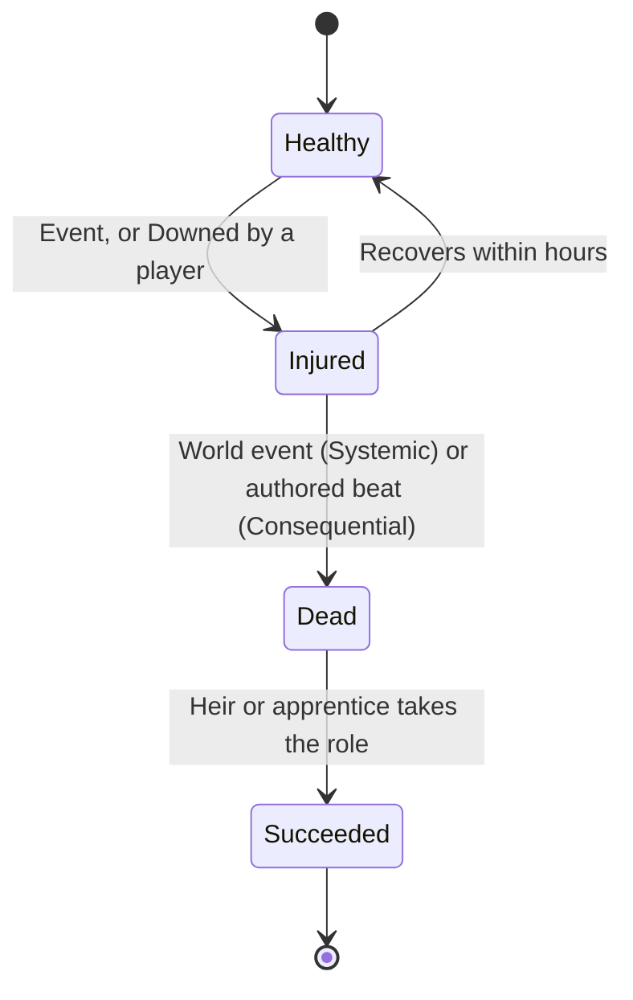

# NPC Bonds and Help-Calls

How Returners befriend NPCs and write to them, how NPCs ask for help, grow old, get hurt and pass on their roles, and how friends call each other for help.

> **Version:** v0.1 · **Updated:** 10-10-2026 · **Owner:** Systems design and Narrative
>
> **Horizons:** H0 trust with one named NPC, in person only · H1 trust with every named NPC, letters, NPC help requests, NPC classes and succession, friend help-calls · H2 NPCs age one year per Long Year; lineage Legacy Arts · H3 None
>
> **Related:** [D-032](../../DECISIONS.md#d-032) · [D-031](../../DECISIONS.md#d-031) · [D-041](../../DECISIONS.md#d-041) · [D-042](../../DECISIONS.md#d-042) · [NPC Minds and Conversation](../06-ai/npc-minds-and-conversation.md) · [Quest Architecture](../03-narrative/quest-architecture.md) · [Social, Voice and Clans](../07-multiplayer/social-voice-and-clans.md) · [Waypoints and Healing](waypoints-and-healing.md)

## 1. Player experience

> *Tomas, a Lowhaven net-mender, was wary of Kiri for a week. Then she pulled his son out of a riptide. Now he writes. When she asks by letter whether anyone has seen the crescent mark inland, his answer arrives forty minutes later, after his evening shift: "My cousin in Millbrook swears she saw it on a mill door. Mind you, she also swears the mill is haunted." He might be wrong. He's honest about that.*
>
> *Two real years later, Tomas's son is taller than his father and runs the boat. Tomas walks with a stick. When a Ravager wrecks the harbour and Tomas is hurt, the boy keeps the shop open, and asks Kiri for help rebuilding the nets his father made.* [H2]
>
> *Dev is pinned down by a Gravemaw and sends a help-call. Their friend Aru sees it: "Dev · Ember Wastes · fighting · help allowed". Aru arrives at the Wayshrine nearest Dev that Aru has discovered, 300 m away, and runs the rest. The quest Dev started stays Dev's, but Aru's blade counts in the fight around it.*

The system must make NPC friendships feel earned and alive across years, and make helping a friend quick without ever breaking a quest, someone's privacy or a child's safety.

## 2. Scope

- **Covers:** relationship tiers and how trust feels in play; letters; NPC-initiated help requests; NPC aging [H2]; injury, death and succession by NPC class; families after a loss; the guarantee of essential services; the link to Legacy Arts; friend help-calls between players.
- **Leaves to other specs:** how Minds reason, remember, keep schedules and score trust ([NPC Minds and Conversation](../06-ai/npc-minds-and-conversation.md)); the quest card and joining rules ([Quest Architecture](../03-narrative/quest-architecture.md)); chat, voice and friend lists ([Social, Voice and Clans](../07-multiplayer/social-voice-and-clans.md)); the Wayshrine network ([Waypoints and Healing](waypoints-and-healing.md)); Legacy Arts as progression ([Avatar and Progression](../04-gameplay/avatar-and-progression.md#69-legacy-arts)).
- **Never:** a player killing an NPC that other players share ([D-032](../../DECISIONS.md#d-032)); an NPC passing messages between players; a help-call that drops a helper on top of the caller.

## 3. Inspirations

| Source | What we take | What we change |
| --- | --- | --- |
| Final Fantasy XIV Duty Support [M26] | NPC allies make group content playable alone | Bonded NPCs can join personal content as allies ([D-024](../../DECISIONS.md#d-024)) |
| *Frieren* [N21] | The ache of time passing for people who outlive their friends | Here the NPCs are the ones who age, across the real decade [H2] |
| *Generative Agents* [A1] | NPCs with memory and plans; the documented habit of misremembering and over-agreeing | NPCs can be mistaken only from their own knowledge, never by inventing canon, and they can refuse |
| *Watch Dogs: Legion* [G5] | Persistent, scheduled NPC lives at city scale | Named NPCs keep authored cores, and succession follows family and apprenticeship, not random regeneration |
| *Where Winds Meet* [A11] [A12] | Players will try to talk NPCs into handing things over | Trust moves only through validated deeds and speech acts, never raw model output ([D-042](../../DECISIONS.md#d-042)) |

## 4. Terms

Trust, NPC class, Succession, Letter and Help-call are defined in the [Glossary](../../GLOSSARY.md). Terms used only here:

| Term | Meaning |
| --- | --- |
| **Bond tier** | The named band a trust score falls in ([Trust and friendship](#61-trust-and-friendship)) |
| **Help request** | An optional request for help that an NPC starts ([QST-005](../03-narrative/quest-architecture.md#3-joining-rules)) |

## 5. Entities and state

| Entity | Data | Authority |
| --- | --- | --- |
| **NPC Mind** | Personality, schedule, knowledge with confidence, memory, goals, relationships, class, age, family links | World-state service; one Mind per named NPC ([MP-003](../07-multiplayer/world-model.md#5-state-classes-and-authority)) |
| **Bond edge** | `(npc, player) → trust, tier, history[], promises[], last_contact` | Player profile, P-class ([World Model](../07-multiplayer/world-model.md#5-state-classes-and-authority)) |
| **Letter** | Sender, recipient, filtered body, parsed speech acts, sent_at, eta, delivered_at, reply_ref | Mail service |
| **Help request** | NPC, template, quest card, eligibility, expiry | The Weaver ([Director and World Events](../06-ai/director-and-world-events.md)) |
| **Help-call** | Caller, recipients, activity, help status, region, expiry | Social graph and quest services |

## 6. Rules

### 6.1 Trust and friendship

| Tier | Range | What changes |
| --- | --- | --- |
| Hostile | −100 to −51 | Refuses service where a lawful alternative exists; may report crimes eagerly |
| Wary | −50 to −11 | Short answers; higher prices within the allowed band |
| Neutral | −10 to +10 | The default for strangers |
| Friendly | +11 to +40 | Answers letters; shares rumours; may send help requests |
| Trusted | +41 to +75 | Shares sensitive knowledge; small discounts (at most 10%, [ECO-056](economy-and-crafting.md#66-artisans-and-commissions)); may join as an ally |
| Bonded | +76 to +100 | Involves you in life events; can teach Legacy Arts ([PRG-050](../04-gameplay/avatar-and-progression.md#69-legacy-arts)); a title for long friendships |

- **NPC-001 [H1]** Trust changes only through validated server events and typed speech acts, scored by the rules in [NPC Minds and Conversation](../06-ai/npc-minds-and-conversation.md#65-trust) ([AI-150](../06-ai/npc-minds-and-conversation.md#65-trust), [AI-151](../06-ai/npc-minds-and-conversation.md#65-trust)). Every change records its reason.
- **NPC-002 [H1]** Personality shapes how much each event moves trust: a proud NPC values deeds over gifts, and a sociable one warms and cools quickly. No single event moves trust by more than 15, and no Oasis day by more than 30, so one conversation can't flip a relationship. Words alone stay within [AI-151](../06-ai/npc-minds-and-conversation.md#65-trust).
- **NPC-003 [H1]** Without contact, trust above +40 drifts down by at most 1 per real week, and never below +40. *Why:* friendships cool without breaking, and players who come back aren't punished.
- **NPC-004 [H1]** Trust is per Returner. One player's crime never lowers another player's trust with that NPC, though the NPC may talk about it.

### 6.2 Availability and honest mistakes

- **NPC-010 [H1]** NPCs keep schedules, so a friend can be busy, away or asleep ([NPC Minds and Conversation](../06-ai/npc-minds-and-conversation.md#62-schedules-and-availability), [D-031](../../DECISIONS.md#d-031)).
- **NPC-011 [H1]** An NPC can be mistaken only from its own knowledge: stale facts, low-confidence rumours or what someone told it. It never invents canon and never speaks a truth that the [reveal graph](../03-narrative/reveal-graph.md) still locks ([NAR-022](../03-narrative/reveal-graph.md#1-rules)). Low-confidence answers sound like it ("my cousin swears…").
- **NPC-012 [H1]** The journal shows where a friend usually is now and when they're next free, so unavailability is clear rather than frustrating.

### 6.3 Letters and messages

| Channel | Where | Speed |
| --- | --- | --- |
| **Post** | Every settlement with a Vault | Baseline |
| **Courier companion** | Trained creatures ([Mechs, Robots and Companions](mechs-robots-and-companions.md)) | 1.5 times baseline within a region |
| **Wire** | Iron Meridian and Saltglass relay stations | 3 times baseline within the wire network |
| **Light-signal** | Murmur's and the Drowned Reach's song-lanterns | 3 times baseline under water; half speed to and from the surface |
| **Skyferry mail** | Between Lumen and the Oasis | On the Skyferry timetable |

- **NPC-020 [H1]** A reply takes the courier's travel time between post offices, plus the time until the NPC is next free, plus a short writing time. Replies usually take 5–60 minutes, and never more than 3 hours, except Skyferry mail, which follows the timetable. The UI shows an estimate.
- **NPC-021 [H1]** Letters arrive whether the player is online or not. Because the Oasis day lasts 100 minutes ([D-013](../../DECISIONS.md#d-013)), no real time zone always finds an NPC asleep. Notifications outside the game are opt-in per platform.
- **NPC-022 [H1]** A player writes letters in their own words ([D-041](../../DECISIONS.md#d-041)). The text is filtered, then parsed into speech acts (ask, thank, warn, request). The reply draws only on the NPC's knowledge, trust tier and reveal scope. Blocked text is shown only to its writer, as Club Penguin did [G12].
- **NPC-023 [H1]** A Friendly NPC answers questions about rumours; a Trusted one answers sensitive questions. Below Friendly, the NPC replies briefly once, or not at all.
- **NPC-024 [H1]** A player can send one NPC at most 5 letters per real day. Letters to NPCs can't carry Omnis or items, except authored gifts.
- **NPC-025 [H1]** A Bonded NPC writes to the player unprompted with life news, at most once per real week. Players can switch this off for one NPC or for all.

### 6.4 Help requests from NPCs

- **NPC-030 [H1]** The Weaver proposes a help request from an NPC's real, current problem in the simulation (a wrecked net store, a missing child, a debt), matched to the player's proximity, trust and abilities. Requests use validated templates and quest cards ([Quest Architecture](../03-narrative/quest-architecture.md#4-the-quest-card)).
- **NPC-031 [H1]** Requests are optional. Declining or ignoring one never drops trust into a lower tier; it may change the NPC's next line.
- **NPC-032 [H1]** Help requests follow the same rules as any quest ([QST-005](../03-narrative/quest-architecture.md#3-joining-rules)): reward bands, join policy and the reason log ([QST-012](../03-narrative/quest-architecture.md#5-variation-within-bounds)). They never reveal one player's location or activity to another.
- **NPC-033 [H1]** A player receives at most one unprompted request per 30 minutes, and none during combat, a Mastery Trial, a Convergence Confront, a PvP context or **Do not disturb**.

### 6.5 Aging [H2]

- **NPC-040 [H2]** NPCs age one year per Long Year, applied at First Light after each Long Night ([Time and Calendar](../02-world/time-and-calendar.md#6-the-long-year-and-its-festivals)). Children grow up over the decade; elders slow down, retire or pass on (authored for named NPCs).
- **NPC-041 [H2]** Aging updates appearance, voice (licensed variants, [D-043](../../DECISIONS.md#d-043)), schedule and role. Memories and trust carry over.
- **NPC-042 [H2]** A quest card that features a child NPC has a version for each age band (child, youth, adult). When the NPC ages out of a band, that version stops being offered and the next band's version, if one exists, replaces it. A quest already under way finishes with the NPC as they were when it began.

### 6.6 Injury, death and succession

| Class | Can be hurt? | Can die? | Scope | Examples |
| --- | --- | --- | --- | --- |
| **Protected essential** | Yes, briefly (Downed, bandaged, back within hours) | No | Global | Service anchors, mentors before their authored arc, the Herald unless canon says otherwise |
| **Consequential-personal** | Yes | Yes, in your phase only | Your phase | A character-quest NPC whose fate your choices decide |
| **Consequential-world** | Yes | Yes, rarely, and only when authored | Global ([D-030](../../DECISIONS.md#d-030)) | A figure lost in a Convergence or a Long Night beat |
| **Systemic ordinary** | Yes | Yes, through world events | The settlement (S-class) | Townsfolk, guards, traders |

- **NPC-050 [H1]** No player can kill a shared NPC ([D-032](../../DECISIONS.md#d-032)). A player who attacks an NPC in a lawful zone only Downs them, and the attack goes through the law system ([Law, Crime and Bounties](law-crime-and-bounties.md)). Systemic NPCs die only in world events (colossi, Long Night surges, authored disasters), within the published casualty bound in [AI-304](../06-ai/director-and-world-events.md#69-constraints) ([Director and World Events](../06-ai/director-and-world-events.md#69-constraints)): at most two per settlement per Long Year.
- **NPC-051 [H1]** Consequential-world deaths are authored, recorded as Chronicles, and number at most 3 per Long Year ([D-032](../../DECISIONS.md#d-032)).
- **NPC-052 [H1]** When a Systemic NPC dies, an heir, apprentice, spouse or relative takes over their role, generated within the [naming rules](../02-world/peoples-and-factions.md#4-naming-rules-light-conlang). The successor inherits the role, the shop and a summary of the predecessor's relationships, at half the trust with each Returner.
- **NPC-053 [H1]** Families change. Relatives grieve (their schedules change for an Oasis week), take on new roles, and may start help requests for grief and rebuilding.
- **NPC-054 [H1]** Essential services never become unreachable. If a service NPC is hurt, away or dead, an equivalent service is open in the same settlement, or by free courier from the nearest one, at the same price ([TIM-005](../02-world/time-and-calendar.md#5-what-time-changes), [WLD-063](../02-world/machines-and-colossi.md#3-colossi), [ECO-054](economy-and-crafting.md#66-artisans-and-commissions)).
- **NPC-055 [H1]** A Legacy Art needs Bonded trust or a lineage quest ([PRG-050](../04-gameplay/avatar-and-progression.md#69-legacy-arts)). If the teacher dies, the player becomes a lineage holder who can teach other players ([PRG-052](../04-gameplay/avatar-and-progression.md#69-legacy-arts)) [H2].

This diagram shows how an NPC's health and role can change. Protected NPCs never leave Healthy and Injured.

### 6.7 Friend help-calls

| Step | Rule |
| --- | --- |
| **Send** | **NPC-060 [H1]** Help-calls go only to friends ([SOC-022](../07-multiplayer/social-voice-and-clans.md#63-friends-and-presence)). The caller chooses one friend, all friends, or party and clan members who are also friends. |
| **Show** | **NPC-061 [H1]** Recipients see the caller's name, world region, nearest Wayshrine, activity (exploring, fighting, quest, Trial, Convergence, Lawless) and whether help is allowed, allowed outside the quest only, or not allowed. Exact coordinates are never shown ([SOC-021](../07-multiplayer/social-voice-and-clans.md#63-friends-and-presence)). |
| **Arrive** | **NPC-062 [H1]** The helper arrives at the Wayshrine nearest the caller among those the helper has discovered, never on top of the caller. If the helper has discovered no Wayshrine in the caller's region, the call shows "travel only" and can't be answered by teleport. |
| **Join** | **NPC-063 [H1]** The joining rules in [Quest Architecture](../03-narrative/quest-architecture.md#3-joining-rules) apply unchanged: a helper can't join an active quest late ([QST-002](../03-narrative/quest-architecture.md#3-joining-rules)) but can help outside it, solo-only quests show "not allowed" up front ([QST-003](../03-narrative/quest-architecture.md#3-joining-rules)), and NPC allies always fill roles ([QST-004](../03-narrative/quest-architecture.md#3-joining-rules)). |
| **Cooldown** | **NPC-064 [H1]** A caller can send one help-call every 5 minutes; a helper can answer by teleport once every 10 minutes. A helper at Heat 2 or more can't answer by teleport ([WAY-004](waypoints-and-healing.md#61-wayshrines-discovery-and-travel)). |

- **NPC-065 [H1]** Abuse controls:
  - Blocked players can't send or see each other's calls.
  - A recipient who dismisses three calls from the same friend within an hour mutes that friend's calls for 2 hours.
  - Calls from a Lawless Reach carry a red label and ask for confirmation before the helper answers ([PvP and Protection](pvp-and-protection.md)).
  - Helpers at Avatar Level 1–3 stay protected wherever they arrive ([D-025](../../DECISIONS.md#d-025)).
  - Answering a call earns no reward of its own; helpers earn only what the activity earns.
- **NPC-066 [H1]** Under-18 accounts can call and answer only their friends, who are already limited by the friend rules ([SOC-020](../07-multiplayer/social-voice-and-clans.md#63-friends-and-presence)). Help-calls never open voice.

## 7. Edge cases

| Case | What happens |
| --- | --- |
| A letter's recipient dies before it arrives | Their successor or family replies, in character |
| An NPC friend turns Hostile because of the player's crime | Letters stop. A reconciliation route always exists, authored or templated ([QST-021](../03-narrative/quest-architecture.md#6-state-branching-and-failure)). |
| A help-call from inside a Convergence front | The answer goes through the front finder ([MP-051](../07-multiplayer/world-model.md#65-convergence-orchestration)), never straight into a layer at its hard cap |
| The caller logs out | The call expires at once, and helpers on their way are told |
| A player tries to talk an NPC into liking them more | Speech acts are scored by rules; flattery moves trust a little, within [NPC-002](#61-trust-and-friendship) and [AI-151](../06-ai/npc-minds-and-conversation.md#65-trust) |
| A Consequential-personal NPC dies in your phase | Party members share the phase during the quest ([MP-031](../07-multiplayer/world-model.md#63-phasing)); afterwards each player sees their own phase |

## 8. Multiplayer and platforms

- One Mind per NPC across all layers, with memories merged ([MP-003](../07-multiplayer/world-model.md#5-state-classes-and-authority)). Trust is P-class. Deaths and successions of Systemic NPCs are S-class, the same in every layer ([MP-002](../07-multiplayer/world-model.md#5-state-classes-and-authority)).
- Letters and help-calls work across platforms and datacenter regions. Delivery estimates use distances in the Oasis, not network distance.

## 9. Safety and abuse

- Letters to NPCs pass input moderation. NPC replies pass output moderation and the Validator ([AI Architecture](../06-ai/architecture.md#64-the-validator)). Prompt-injection text in a letter is treated as data under rule zero.
- NPCs never pass messages between players. *Why:* an NPC must never become a way to contact strangers, least of all children.
- Letters from AI-driven NPCs carry AI disclosure, as the EU AI Act requires [A14].

## 10. Performance

| Budget | Target |
| --- | --- |
| Bond edges | About 200 bytes each; at most 2,000 per player |
| Letter replies | Generated off the critical path in at most 2 seconds of model time, with authored fallback lines on failure ([D-042](../../DECISIONS.md#d-042)) |
| Help requests | At most one proposal per player per 30 minutes |

## 11. Examples

| Allowed | Not allowed |
| --- | --- |
| A friend replies after their shift with a hedged rumour | An NPC answers instantly at 3rd bell with a fact they couldn't know |
| A Ravager kills a baker; her apprentice reopens the shop the next week | A griefer kills the only blacksmith and the town has no repairs for days |
| Aru arrives at a Wayshrine 300 m from Dev | Aru teleports onto Dev mid-fight |
| A late friend helps defend outside Dev's quest | A late friend joins Dev's active quest and takes its reward |
| A new friend with no Wayshrines in the Ember Wastes rides there to help | A helper teleports to a Wayshrine they have never found |

## 12. Acceptance criteria

| ID | Test |
| --- | --- |
| [NPC-001](#61-trust-and-friendship) | Fuzz 100,000 free-text conversations: no trust change without a logged, validated event |
| [NPC-002](#61-trust-and-friendship) | No single event changes trust by more than 15, and no Oasis day by more than 30 |
| [NPC-011](#62-availability-and-honest-mistakes) | Red-team 10,000 letters asking for locked truths: no reveal-lock violations |
| [NPC-020](#63-letters-and-messages) | Delivery estimates are within 20% of the actual time for 95% of letters |
| [NPC-050](#66-injury-death-and-succession) | Bots attempt to kill 1,000 named NPCs in lawful zones: no deaths; all are Downed and recover; law events are raised |
| [NPC-054](#66-injury-death-and-succession) | Remove each service NPC in every capital in turn: an equivalent service at the same price is always reachable within 5 minutes' travel |
| [NPC-062](#67-friend-help-calls) | 10,000 help-calls: every arrival is at a Wayshrine the helper had already discovered, and none is within 50 m of the caller unless that Wayshrine is the nearest |
| [NPC-063](#67-friend-help-calls) | A late helper tries to join an active quest: always refused, with alternatives shown ([QST-002](../03-narrative/quest-architecture.md#3-joining-rules)) |

<!-- citation links: generated, do not edit by hand -->

[A1]: ../../references/technology-and-ai.md
[A11]: ../../references/technology-and-ai.md
[A12]: ../../references/technology-and-ai.md
[A14]: ../../references/technology-and-ai.md
[G5]: ../../references/games.md
[G12]: ../../references/games.md
[M26]: ../../references/industry-and-live-service.md
[N21]: ../../references/film-literature-and-music.md#n-series-sources
