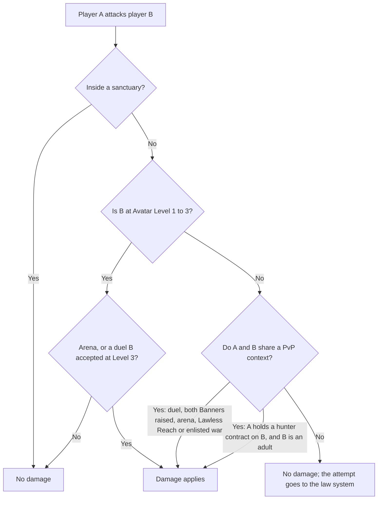
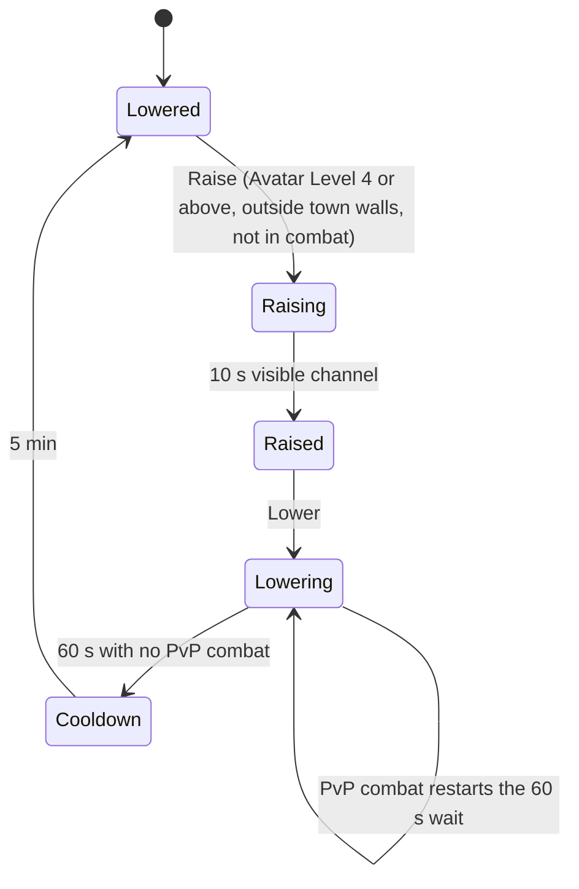

# PvP and Protection

How fighting other players stays opt-in, readable and fair, and which players and places are always protected.

> **Version:** v0.1 · **Updated:** 10-10-2026 · **Owner:** Combat and systems design
>
> **Horizons:** H0 None · H1 duels and the Banner, the Lawless Reaches, arenas (Even Ground, input pools, perspective ladders), every protection · H2 clan wars and Outposts, rollback duel arenas · H3 None
>
> **Related:** [D-025](../../DECISIONS.md#d-025) · [D-022](../../DECISIONS.md#d-022) · [D-034](../../DECISIONS.md#d-034) · [D-039](../../DECISIONS.md#d-039) · [Death and Return](../04-gameplay/death-and-return.md) · [Law, Crime and Bounties](law-crime-and-bounties.md) · [World Laws](../02-world/world-laws.md) · [Social, Voice and Clans](../07-multiplayer/social-voice-and-clans.md) · [Waypoints and Healing](waypoints-and-healing.md)

## 1. Player experience

> *Noor has never raised her Banner. She has crossed half the Oasis and fought colossi beside strangers, and no other player has ever been able to hurt her. When she walks toward the Glass Badlands by mistake, a red border banner and a plain question stop her: "Beyond this point, other Returners can attack you and take what you carry. Bank first?" She turns back.*
>
> *Jun lives for duels. He raises his Banner outside Hearthwick and accepts a challenge from a stranger whose Banner is also raised; both see the glow, and both chose it. Later, in an Even Ground arena, his level-9 sword fights at the same item level as a level-3 newcomer's. He loses to her deflects and laughs about it.*
>
> *Two clans agree to a war over an Outpost in the Sennight Marches. Forty enlisted members a side, a seven-day window, and for the winner a crest and a line in the War Ledger, nothing more. A clan-mate who didn't enlist gathers ore nearby all week, and the war's rules never make her a target.* [H2]

The system must let players who want PvP find it easily, and make sure players who don't want it never have it forced on them.

## 2. Scope

- **Covers:** PvP contexts; duels and the Banner; warnings and tells; protected places and players; hostile acts in lawful zones; anti-griefing; licensed bounty hunting as a PvP context; clan wars and Outposts [H2]; arenas.
- **Leaves to other specs:** Heat, Record and Bounty mechanics ([Law, Crime and Bounties](law-crime-and-bounties.md)); what a fall costs in each context ([Death and Return](../04-gameplay/death-and-return.md#62-rules-by-activity)); combat rules ([Combat and Abilities](../04-gameplay/combat-and-abilities.md)); where the Lawless Reaches are and why ([Geography and Domains](../02-world/geography-and-domains.md#6-the-lawless-reaches)); arena matchmaking ([World Model](../07-multiplayer/world-model.md#610-arena-matchmaking)); clan structure ([Social, Voice and Clans](../07-multiplayer/social-voice-and-clans.md#65-clans-and-alliances)).
- **Never:** damage to a player who has no PvP context; loss of equipped gear, bound items, companions, Frames or ships ([D-039](../../DECISIONS.md#d-039)); a reward that gives power, resources or Omnis for winning a clan war.

## 3. Inspirations

| Source | What we take | What we change |
| --- | --- | --- |
| *New World* [M11] | The move from open PvP to opt-in PvP before launch | Opt-in from day one, so there is no late pivot |
| *Ready Player One* [R1] | The OASIS flags PvP zone by zone, and the school world Ludus is PvP-free | Our zones have in-world causes (law and lawlessness), not admin flags, and protection follows the player (new and under-18 Returners) as well as the place |
| *Red Dead Redemption 2* [G2] | Crime has a readable, payable consequence | A Record makes a criminal huntable by licensed players: the crime is the consent |
| *Ultima Online*'s Trammel and Felucca [M14] [M15] | Most players choose protection when offered it; the protected world reportedly doubled the player base | One world, not mirrored copies: PvP depends on places and consent |

## 4. Terms

PvP context, Lawless Reaches, Sanctuary, Banner, Even Ground, Reaver mark and Outpost are defined in the [Glossary](../../GLOSSARY.md). Terms used only here:

| Term | Meaning |
| --- | --- |
| **Duel** | A one-on-one fight that both players accept, ending when one is Downed |
| **War Ledger** [H2] | The public record of clan-war outcomes, beside the Chronicle Board |

## 5. Entities and state

Records and clan wars are G-class. Banner state belongs to the player's profile and applies in whatever layer they are in ([World Model](../07-multiplayer/world-model.md#5-state-classes-and-authority)).

```yaml
PvpState:            # per player, server-authoritative
  banner: lowered | raising | raised | lowering | cooldown
  banner_changed_at: ts
  protected_reason: [new_returner, under_18, sanctuary, spawn, echo_bubble, repeat_kill_immunity]
  reaver_mark: 0..5
  enlisted_war: war_id | null       # H2
  hunter_licence: bool              # LAW-052
ClanWar:             # H2
  id, attacker_clan, defender_clan, status: declared | accepted | active | ceasefire | ended
  window: { start, end }            # at most 7 days
  cap_per_side: int                 # equal on both sides; default 40
  objectives: [OUTPOST.LR.04]
  enlisted: { clan_a: [...], clan_b: [...] }
```

## 6. Rules

### 6.1 Where PvP can happen

| Context | Who can be hurt | How they consent |
| --- | --- | --- |
| **Lawful open world** | Only duellists, Banner-raised players fighting each other, and a licensed hunter's contract target | Accepting a duel; raising the Banner; committing a player-huntable crime |
| **Lawless Reaches** (the Sennight Marches, the Glass Badlands, the Undercity Depths, the Outer Isles) | Anyone inside except protected players | Entering, after a confirmation |
| **Arenas** | Arena participants | Queueing |
| **Clan war** [H2] | Enlisted members of the two warring clans | Clan acceptance and individual enlistment |
| **Sanctuaries** | Nobody | None |

- **PVP-001 [H1]** In a lawful zone, a player with no PvP context can't be damaged by another player ([D-025](../../DECISIONS.md#d-025)).
- **PVP-002 [H1]** Hostile acts in lawful zones go through the law system: attempted attacks on unflagged players, attacks on NPCs, luring monsters onto others, property damage, theft and interfering with an Echo. They raise Heat and a Record, and never get around [PVP-001](#61-where-pvp-can-happen).
- **PVP-003 [H1]** Equipped gear and bound items are never lost in any context ([ECO-031](economy-and-crafting.md#64-bound-items)). Companions, Frames and ships are never destroyed for good or looted ([D-039](../../DECISIONS.md#d-039)).

This diagram shows how the server decides whether an attack on another player does damage.



### 6.2 Duels and the Banner

The Banner moves through these states.



- **PVP-010 [H1]** A raised Banner makes a player attackable, without law consequences, by other Banner-raised players in the lawful open world outside town walls. Inside town walls, Banner combat is a crime, because weapons stay holstered there ([World Laws](../02-world/world-laws.md#5-civic-law-jurisdictions)).
- **PVP-011 [H1]** Raising the Banner takes a visible 10-second channel. Lowering it takes 60 seconds free of PvP combat, during which the player can still be attacked, and it can't be raised again for 5 minutes. *Why:* nobody can flip the flag to ambush someone.
- **PVP-012 [H1]** Two players can agree to a duel when both accept a challenge. A duel doesn't need a raised Banner, can't be joined by anyone else, and ends at Downed with no Echo and no wear. Duels, like Banner combat, happen only outside town walls and outside sanctuaries.
- **PVP-013 [H1]** The Banner menu opens at Avatar Level 3 with duels only. The full Banner opens at Level 4 ([D-025](../../DECISIONS.md#d-025); [Avatar and Progression](../04-gameplay/avatar-and-progression.md#63-avatar-level-110)).

### 6.3 Warnings and awareness

- **PVP-020 [H1]** Jurisdiction banners mark every border ([WLD-020](../02-world/world-laws.md#5-civic-law-jurisdictions)). Entering a Lawless Reach for the first time, or while carrying unbanked goods above a published value, asks for confirmation and points to the nearest Vault.
- **PVP-021 [H1]** Signs of hostile intent are visible at gameplay range on every capability tier ([MP-081](../07-multiplayer/world-model.md#69-simulation-parity-across-platforms)): a raised Banner glows; a Banner raised within the last 5 minutes flickers; drawn weapons are visible; licensed hunters carry a hunter's mark; wanted Returners show their Record ([Law, Crime and Bounties](law-crime-and-bounties.md#65-record-and-wanted-posters)).
- **PVP-022 [H1]** Others can see only that a player has Oaths, never which ones ([CMB-023](../04-gameplay/combat-and-abilities.md#65-oaths)).
- **PVP-023 [H1]** A pulse at the minimap's edge warns when a Banner-raised or Lawless player targets you from out of view.
- **PVP-024 [H1]** Reaver marks show on a player's nameplate to everyone inside the Lawless Reaches, and are hidden everywhere else.

### 6.4 Protected places and players

- **PVP-030 [H1]** Sanctuaries are:
  - a 50 m radius around every lawful Wayshrine and lawful Hearth ([WAY-040](waypoints-and-healing.md#65-sanctuary-and-anti-escape));
  - Ward housing districts ([HSG-080](housing.md#9-safety-and-abuse));
  - the Grand Library;
  - Skyferry vessels and ports, and the moon packet ([SPC-004](spaceflight-and-moon-travel.md#61-the-skyferry-h1));
  - Convergence staging areas;
  - Lumenari cities (the Stillness).

  Wayshrines in the Lawless Reaches keep a reduced 30 m sanctuary ([WAY-042](waypoints-and-healing.md#65-sanctuary-and-anti-escape)). Hearths in the Lawless Reaches have none ([WAY-025](waypoints-and-healing.md#63-hearths)).
- **PVP-031 [H1]** New Returners (Avatar Level 1–3) can't be attacked outside arenas in any context, including the Lawless Reaches and clan wars, except in a duel they accepted at Level 3 ([D-025](../../DECISIONS.md#d-025)). Their Echo is never lootable.
- **PVP-032 [H1]** Under-18 accounts can opt into PvP. Their Echo is never lootable, and they can't be hunted by player bounty hunters ([D-025](../../DECISIONS.md#d-025)). Their voice defaults don't change in any PvP context ([SOC-001](../07-multiplayer/social-voice-and-clans.md#61-defaults-by-age-band)).
- **PVP-033 [H1]** After a Return, a player is untargetable for 10 seconds, or until they attack ([DTH-012](../04-gameplay/death-and-return.md#64-anti-griefing)).

### 6.5 Anti-griefing

| Pattern | Rule |
| --- | --- |
| **Repeat kills** | **PVP-040 [H1]** If one player Downs the same victim 3 times within 30 minutes outside arenas, the victim becomes immune to that attacker for 60 minutes, and the attacker gains a Reaver mark. In a Lawless Reach, the victim may also Return free to any lit Wayshrine outside that Reach ([WAY-044](waypoints-and-healing.md#65-sanctuary-and-anti-escape)). |
| **Spawn and Echo camping** | **PVP-041 [H1]** Sanctuaries ([PVP-030](#64-protected-places-and-players)), spawn protection ([DTH-012](../04-gameplay/death-and-return.md#64-anti-griefing)) and the 5-second Echo bubble ([DTH-010](../04-gameplay/death-and-return.md#64-anti-griefing)) apply. Downing a player within 60 seconds of their Return gives no loot and adds a Reaver mark. |
| **Ganking** | **PVP-042 [H1]** In the Lawless Reaches, Downing a player 3 or more Avatar Levels below you, or while outnumbering them 3 to 1 or more, gives no loot from their Echo (it stays owner-only) and adds a Reaver mark. |
| **Flag baiting** | The Banner timers ([PVP-011](#62-duels-and-the-banner)); help-calls from the Lawless Reaches are labelled and confirmed ([NPC-065](npc-bonds-and-help-calls.md#67-friend-help-calls)) |
| **Griefer records** | **PVP-043 [H1]** Reaver marks (0–5) fade by one per real day. At 3 or more, the Reaches' NPC bounty hunters pursue the player inside the Reaches, and opted-in players can claim a prestige bounty on them. Hostile acts in lawful zones keep producing normal Records ([PVP-002](#61-where-pvp-can-happen)). |
| **Harassment** | Block and report work everywhere ([Social, Voice and Clans](../07-multiplayer/social-voice-and-clans.md#610-block-mute-and-report)); blocked players are kept out of each other's layers ([MP-026](../07-multiplayer/world-model.md#62-layers-capacity-assignment-split-and-merge)); moderators review Reaver patterns ([Safety and Moderation](../07-multiplayer/safety-and-moderation.md)) |
| **Combat logging** | An avatar stays in the world for 60 seconds after logging out in a Lawless Reach, with Heat or in combat ([MP-071](../07-multiplayer/world-model.md#68-persistence-disconnect-and-reconnect)) |

### 6.6 Licensed bounty hunting

- **PVP-050 [H1]** A licensed player hunter ([LAW-052](law-crime-and-bounties.md#66-bounty-and-hunters)) may attack a Returner they hold a contract on, for a player-huntable crime ([LAW-010](law-crime-and-bounties.md#62-crime-list)), in the lawful open world outside no-claim zones ([LAW-055](law-crime-and-bounties.md#66-bounty-and-hunters)). A successful claim Captures the target: no Echo, no loot, no wear ([LAW-054](law-crime-and-bounties.md#66-bounty-and-hunters)). The crime is the consent, and the wanted poster says so. New Returners ([PVP-031](#64-protected-places-and-players)) and under-18 accounts ([PVP-032](#64-protected-places-and-players)) can carry Records but are pursued only by NPC hunters.

### 6.7 Clan wars [H2]

| Step | Rule |
| --- | --- |
| **Declare** | **PVP-060 [H2]** A clan member with the "declare clan war" permission ([Social, Voice and Clans](../07-multiplayer/social-voice-and-clans.md#65-clans-and-alliances)) declares a war, naming the objective, a window of at most 7 days, and the cap per side. |
| **Accept** | **PVP-061 [H2]** The defending clan must accept explicitly, and refusing costs nothing. No war is ever forced. |
| **Enlist** | **PVP-062 [H2]** Each member enlists individually. Members of either clan who don't enlist are unaffected. Protected players ([PVP-031](#64-protected-places-and-players)) can't enlist. |
| **Limits** | **PVP-063 [H2]** Caps are equal on both sides (default 40, at most 100). A clan fights one war at a time, and the same two clans can't declare again for 14 days after a war ends. |
| **Objectives** | **PVP-064 [H2]** Outposts in the Lawless Reaches (scored by time held), or a booked war arena. An Outpost never blocks anyone's access to resources, routes, Wayshrines or services. |
| **Ceasefire** | **PVP-065 [H2]** Either side can propose a ceasefire, and mutual acceptance ends the war at once. The end of the window ends it automatically. |
| **Rewards** | **PVP-066 [H2]** Prestige and cosmetics only: banners, heraldry on the Outpost, a War Ledger entry and titles. No resources, taxes, stats or other advantage ([SOC-040](../07-multiplayer/social-voice-and-clans.md#65-clans-and-alliances), [SOC-042](../07-multiplayer/social-voice-and-clans.md#65-clans-and-alliances)). |
| **Bystanders** | **PVP-067 [H2]** Players outside the war take no damage from war rules beyond normal Lawless Reach rules, and are never the target of a war objective. |

### 6.8 Arenas

- **PVP-070 [H1]** Even Ground normalises Avatar Level, item levels and Art levels. Oaths are allowed only where the ruleset says so. Equally skilled bots at levels 1 and 10 win 50% ± 3 of bouts, matching the combat balance test in [Combat and Abilities](../04-gameplay/combat-and-abilities.md).
- **PVP-071 [H1]** Ranked play uses input pools (controller, keyboard and mouse, touch), as Fortnite does [M39] ([MP-090](../07-multiplayer/world-model.md#610-arena-matchmaking)). Aim assist is normalised per pool ([CMB-033](../04-gameplay/combat-and-abilities.md#66-weapons-and-ranged-combat)), and PvE assists are off in ranked play ([CMB-042](../04-gameplay/combat-and-abilities.md#68-enemies-bosses-and-difficulty)).
- **PVP-072 [H1]** First-person and third-person play have separate ladders ([MP-091](../07-multiplayer/world-model.md#610-arena-matchmaking)), as PUBG separates them [G14] ([D-020](../../DECISIONS.md#d-020)).
- **PVP-073 [H2]** One-on-one duel arenas may use rollback netcode ([CMB-051](../04-gameplay/combat-and-abilities.md#610-authority), [MP-093](../07-multiplayer/world-model.md#610-arena-matchmaking)), as GGPO does [M36].
- **PVP-074 [H1]** Matchmaking weighs skill rating, input pool, perspective ladder and round-trip time, with Player Rank bands used only as an arena entry gate ([PRG-041](../04-gameplay/avatar-and-progression.md#67-player-rank-and-adventure-rank-1100), [MP-092](../07-multiplayer/world-model.md#610-arena-matchmaking)). Arena rewards are cosmetics and titles.

## 7. Edge cases

| Case | What happens |
| --- | --- |
| A Banner-raised player walks into a town | Banner combat stops at the wall; attacks inside are crimes |
| A Level 3 player enters a Lawless Reach | They can enter, and nobody can hurt them ([PVP-031](#64-protected-places-and-players)) |
| A Frame pilot attacks an unflagged player in a lawful zone | No damage ([PVP-001](#61-where-pvp-can-happen)); Heat for the attempt ([PVP-002](#61-where-pvp-can-happen)) |
| Disconnect while Downed in a Lawless Reach | The Downed window runs out as usual ([Death and Return](../04-gameplay/death-and-return.md#7-edge-cases)); the Echo stays lootable for carried materials only |
| A war Outpost sits on a resource node | Nodes are gathered per player ([MP-028](../07-multiplayer/world-model.md#62-layers-capacity-assignment-split-and-merge)), so the war can't deny them |
| Two clans collude to farm war cosmetics | Cosmetics need a minimum enlisted turnout and real contested time; suspicious patterns go to review |

## 8. Multiplayer and platforms

- Lower-tier clients always draw hostile players within 50 m as full, targetable characters ([MP-081](../07-multiplayer/world-model.md#69-simulation-parity-across-platforms)).
- Ranked pools never use platform alone as a pool ([MP-092](../07-multiplayer/world-model.md#610-arena-matchmaking)). Touch players join cross-input play only if they opt in.

## 9. Safety and abuse

- PvP never requires voice ([SOC-004](../07-multiplayer/social-voice-and-clans.md#61-defaults-by-age-band)). Under-18 voice defaults stay the same in every PvP context.
- Kill feeds show avatar names only. Text taunts pass the filter, and emotes after a kill have a cooldown.
- Hits are validated on the server with bounded lag compensation ([CMB-050](../04-gameplay/combat-and-abilities.md#610-authority)). Behavioural anti-cheat runs on the server first, in the style of Valve's VACnet [T27].

## 10. Performance

| Budget | Target |
| --- | --- |
| Lawless Reach layer cap | The wilderness soft cap ([World Model](../07-multiplayer/world-model.md#62-layers-capacity-assignment-split-and-merge)) |
| Clan-war battle | At most 100 enlisted per side per Outpost, in raid-group blocks |
| Arena tick rate | 30–60 Hz ([Server and Backend](../08-technology/server-and-backend.md#3-netcode)) |

## 11. Examples

| Allowed | Not allowed |
| --- | --- |
| A Banner fight outside town between two raised Banners | Ambushing someone in a lawful field who never raised a Banner |
| A Lawless kill drops the victim's carried ore | A Lawless kill drops the victim's equipped sword |
| A war Outpost earns a crest and a Ledger line | A war Outpost taxes every Exchange sale in a region |
| A level-2 explorer walks safely through the Undercity Depths | A level-2 explorer is camped at a Lawless Wayshrine |
| A 15-year-old with a Record is chased by NPC hunters | A player hunter takes a contract on a 15-year-old |

## 12. Acceptance criteria

| ID | Test |
| --- | --- |
| [PVP-001](#61-where-pvp-can-happen) | Bot fuzz: 1 million damage events between unflagged players in lawful zones; none applied |
| [PVP-003](#61-where-pvp-can-happen) | 10,000 Lawless deaths: equipped and bound item counts unchanged; only carried materials move |
| [PVP-011](#62-duels-and-the-banner) | 10,000 flag-flip attempts: no Banner change faster than the published timers |
| [PVP-013](#62-duels-and-the-banner) | A Level 3 player can send and accept duels but can't raise the full Banner; at Level 4 they can |
| [PVP-031](#64-protected-places-and-players) | Attacks on Level 1–3 avatars in every context except arenas and accepted Level 3 duels: no damage |
| [PVP-032](#64-protected-places-and-players), [PVP-050](#66-licensed-bounty-hunting) | Player hunters try to take contracts on under-18 accounts: always refused |
| [PVP-040](#65-anti-griefing) | Scripted repeat kills: immunity applies on the third Down every time |
| [PVP-062](#67-clan-wars-h2) | A war between two clans: no war-rule damage events involve non-enlisted members |
| [PVP-066](#67-clan-wars-h2) | Reward-table audit: no war reward has stat, resource or Omnis value |
| [PVP-070](#68-arenas) | Even Ground, equally skilled bots at level 1 and level 10: 50% ± 3 over 10,000 bouts |

<!-- citation links: generated, do not edit by hand -->

[G2]: ../../references/games.md
[G14]: ../../references/games.md
[M11]: ../../references/industry-and-live-service.md
[M14]: ../../references/industry-and-live-service.md
[M15]: ../../references/industry-and-live-service.md
[M36]: ../../references/industry-and-live-service.md
[M39]: ../../references/industry-and-live-service.md
[R1]: ../../references/ready-player-and-lifecycle.md
[T27]: ../../references/technology-and-ai.md
