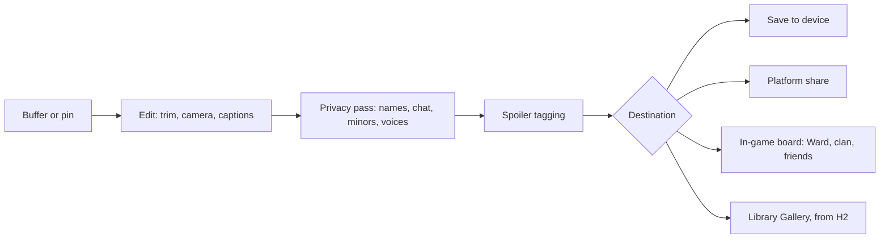

# Recording and Replays

How players capture, relive, reframe and share their moments through server-side replays rather than raw video, within platform rules, privacy law and spoiler courtesy, and how the decade's great nights can be watched.

> **Version:** v0.1 · **Updated:** 10-10-2026 · **Owner:** Technical design and UX
>
> **Horizons:** H0 None (left out of the first playable, [Scope and Horizons](../11-production/scope-and-horizons.md)) · H1 the server replay buffer, re-rendering from any camera, clip export, platform capture integration, the spoiler shield, privacy defaults, streaming through platform features · H2 the Library Gallery, broadcast Watch mode for the Long Nights and the Conjunction · H3 live spectating of any Convergence front, VR replay viewing
>
> **Related:** [D-037](../../DECISIONS.md#d-037) · [D-020](../../DECISIONS.md#d-020) · [D-008](../../DECISIONS.md#d-008) · [D-030](../../DECISIONS.md#d-030) · [Server and Backend](../08-technology/server-and-backend.md) · [Platform Support](../09-platforms/platform-support.md) · [Safety and Moderation](../07-multiplayer/safety-and-moderation.md) · [Reveal Graph](../03-narrative/reveal-graph.md)

## 1. Player experience

> *Rafi lands a perfect deflect on a Gravemaw and doesn't think to press anything. Back at their Ward, they open the replay: the last thirty minutes are there. They scrub to the moment, swing the camera low behind the colossus, then switch to their own eyes for the instant of the clang. They trim twelve seconds, add a slow-motion ramp and export. The strangers who fought beside them show up as "Returner", and nobody's voice is in it.*
>
> *Leila records her climb up Orun on a Steam Deck. The game drops timeline markers at the first stone, the fall and the heart. When she posts the clip, the game notices it contains a reveal and offers a spoiler card. Her friend, who hasn't seen that Chronicle, sees the card and a blur until he chooses to watch.*
>
> *The tenth Long Night. A player on a phone too old to join the fronts opens Watch and sees the broadcast: a camera flying between fronts, the Rite roll scrolling, Solace swelling. Millions are watching, a minute behind the world.* [H2]

The system must let anyone keep and share a great moment without thinking about it in advance, and never expose another player's voice, name or secrets in doing so.

## 2. Scope

- **Covers:** server-side replay capture and retention; re-rendering and camera tools; clip export; platform capture rules; the spoiler shield; privacy (names, voices, minors); live streaming through platform features; storage and performance budgets; sharing and moderation; the broadcast Watch mode [H2].
- **Leaves to other specs:** AI decision replay for debugging ([AI Architecture](../06-ai/architecture.md#68-decision-records-and-replay)); moderation case handling ([Safety and Moderation](../07-multiplayer/safety-and-moderation.md)); Chronicle authoring and name inscriptions ([Celestial Convergence](celestial-convergence.md#69-chronicles-and-the-chronicle-board)); replay storage services ([Server and Backend](../08-technology/server-and-backend.md)).
- **Never:** other players' voices in a server replay; minors' names in anyone else's export or broadcast; a replay camera that shows what the player's client was never sent.

## 3. Inspirations

| Source | What we take | What we change |
| --- | --- | --- |
| *Fortnite*'s "The End" [R24] [G17] | A world-ending event that millions watched live, as culture | The Conjunction is designed as a broadcast from the start [H2] |
| *Ready Player Two*'s ONI headset [R4] | Reliving a moment through a character's own eyes | We record game state, not senses. Replays show only what you could have seen, and never carry other people's voices without consent. |

## 4. Terms

Replay buffer, Pin, Clip and Spoiler shield are defined in the [Glossary](../../GLOSSARY.md). Terms used only here:

| Term | Meaning |
| --- | --- |
| **Re-render** | Playing a replay back in the engine, with a free choice of camera |
| **Streamer mode** | A presentation mode that hides names, chat and sensitive UI for live streams |
| **Watch mode** [H2] | The in-game view of an official broadcast |

## 5. Entities and state

```yaml
CellStream:            # one replicated-state stream per cell server per layer
  cell_id, layer_id, build_id, t_start, t_end, chunks[]
ReplayIndex:           # per player: which streams, and which relevance set
  player_id, ranges: [{cell_stream_id, t0, t1, relevance_radius_m}]
  pins: [{t0, t1, label, auto_marker?, expires}]
REPLAY_REF:            # the server and backend data model
  storage_uri, time_range, retention_class, voice_consent_flags   # voice flags apply only to local captures (REC-031)
ClipExport:
  owner, source_ref, duration_s, camera_track, privacy_pass: {names, chat, minors}, reveal_tags: [RV-xx], destination
```

Replays and indexes are server-authoritative. Exports are rendered on the device on tiers A and B, and in the cloud on tiers C and X ([Platform Support](../09-platforms/platform-support.md#62-capability-tiers)).

## 6. Rules

### 6.1 Capture

- **REC-001 [H1]** Capture is replay-first ([D-037](../../DECISIONS.md#d-037)). Every cell server records its replicated state stream through the engine's replay system with a custom streamer [S11] [T30]. Each player gets an index into the streams they were part of, limited to their relevance set.
- **REC-002 [H1]** We record replicated state, as Rocket League does [T29], not inputs, as StarCraft does [T28], because our simulation isn't deterministic across builds or AI output [A24]. NPC dialogue and other model output are stored as they were delivered and never regenerated.
- **REC-003 [H1]** Capture never blocks play. If storage degrades, cell servers buffer up to 30 minutes ([TEC-061](../08-technology/server-and-backend.md#6-graceful-degradation)).
- **REC-004 [H1]** Each player has a rolling 30-minute buffer and up to 20 pins, each kept for 30 rt days, the same on every capability tier ([TEC-093](../08-technology/server-and-backend.md#9-observability)). Auto-markers for world-firsts, Mastery Trial completions, Releases and Long Night beats are pinned automatically and count toward the 20. The Chronicle service keeps Convergence and Long Night streams permanently ([Celestial Convergence](celestial-convergence.md#69-chronicles-and-the-chronicle-board)). Moderation evidence copies follow [Safety and Moderation](../07-multiplayer/safety-and-moderation.md#611-privacy-and-data).

### 6.2 Re-rendering and cameras

- **REC-010 [H1]** Players re-render any moment in their buffer or pins from any camera: the original view, a free camera, orbit, tracking, or first person through the eyes of any avatar in the scene ([D-020](../../DECISIONS.md#d-020), [UX-012](../09-platforms/controls-camera-and-accessibility.md#62-camera)). Tools include scrubbing, speed from 0.1× to 2×, camera keys, depth of field, letterbox and captions.
- **REC-011 [H1]** The free camera stays within 50 m of the recording player's position at that instant, respects collision, and shows only what the server sent that player's client at the time. *Why:* a replay camera must never become a way to find Eggs through walls or scout PvP positions.
- **REC-012 [H1]** A replay is bound to the build it was recorded on. After a patch, unexported replays stay viewable for at least 30 days through a compatibility asset manifest. If that fails, they can be cloud-rendered to video before they expire, and are never silently lost.

### 6.3 Export

- **REC-020 [H1]** Clips can be up to 5 minutes long, at the tier's resolution: up to 4K on tier A, 1080p on tier B, and cloud-rendered on tiers C and X. Every export runs the [privacy pass](#65-privacy) and the [spoiler check](#64-spoiler-shield).
- **REC-021 [H1]** Exported clips with synthetic NPC voices carry metadata that says so ([AI-402](../06-ai/safety-and-evaluation.md#64-moderation-and-personal-data)).

### 6.4 Spoiler shield

- **REC-025 [H1]** The server knows which [reveal graph](../03-narrative/reveal-graph.md) nodes a stream contains, so every clip is tagged with its RV IDs automatically.
- **REC-026 [H1]** In the game, a viewer who hasn't reached a tagged node sees a spoiler card ("Contains a reveal from the Age of …") and a blur until they choose to watch. The shield is on by default and can be turned off.
- **REC-027 [H1]** When a reveal-tagged clip is exported to another platform, it gets a spoiler title card, on by default for 30 days after the reveal's world date. Reveals that the server holds back under a hard lock (such as RV-07) can't be exported at all from internal or pre-release builds.

### 6.5 Privacy

- **REC-030 [H1]** Server replays never contain voice. Player voice is stored on the server only as report evidence ([SAF-022](../07-multiplayer/safety-and-moderation.md#63-voice-moderation), [SAF-023](../07-multiplayer/safety-and-moderation.md#63-voice-moderation)), and other players' voices are never captured without consent ([D-037](../../DECISIONS.md#d-037), [SOC-082](../07-multiplayer/social-voice-and-clans.md#69-identity)). The on-device voice clip used for reports follows Xbox's approach [T37].
- **REC-031 [H1]** A player can include their own voice in a local capture. Including another player's voice needs that player's explicit consent for the session, recorded in `voice_consent_flags`. An under-18 player's voice can never be consented into someone else's capture.
- **REC-032 [H1]** By default, exported clips replace the names of non-friends with "Returner" and hide text chat. The exporter can show a friend's name only if that friend allows it in their own settings.
- **REC-033 [H1]** Under-18 accounts' names never appear in anyone else's exports or broadcasts, and their avatars appear only as unlabelled figures. Their own sharing to public surfaces in the game is off by default and follows platform parental controls, in line with "high privacy" defaults [L9] [L10] [L11].
- **REC-035 [H1]** Any player can choose to appear in other players' exports and broadcasts as an unlabelled figure, the same way under-18 accounts always do.
- **REC-034 [H1]** Sensitive screens (account settings, purchases, report forms, parental controls, real names from platform friend lists) are never rendered into replays. On platforms that support capture blocking, those screens are also blocked from system capture.

### 6.6 Platform capture rules

| Platform | What it offers | How we use it |
| --- | --- | --- |
| PlayStation [S22] | Some scenes can be blocked from system capture | Block sensitive screens ([REC-034](#65-privacy)) and pre-release reveal content |
| Xbox [S23] | `XAppCaptureDisableRecord` disables system recording | The same as PlayStation |
| Steam [S24] | The Game Recording timeline API | Timeline markers for world-firsts, falls, Releases and Trials, matching our auto-markers |
| iOS and iPadOS [S25] | ReplayKit needs system consent | Our own export doesn't use ReplayKit; any ReplayKit capture or broadcast goes through the system prompt |
| Meta Quest [S26] | Capture can be disabled; secure layers | Secure layers for sensitive screens [H3] |

- **REC-040 [H1]** Where a platform's capture rule is stricter than ours, the platform's rule wins, and the UI says which rule is in force (as in [SOC-061](../07-multiplayer/social-voice-and-clans.md#67-cross-platform-communication)).
- **REC-041 [H1]** Capture restrictions are part of certification ([PLT-023](../09-platforms/platform-support.md#64-cross-play-cross-progression-and-certification)).

### 6.7 Live streaming

- **REC-050 [H1]** Live streaming goes through each platform's own streaming and broadcast features ([D-037](../../DECISIONS.md#d-037)). We run no streaming service of our own at H1.
- **REC-051 [H1]** Streamer mode hides other players' names, text chat, party invites, friend codes and precise map coordinates, and mutes other players' voices in the game's output unless they have agreed to be streamed. It is one toggle, reachable in two steps ([SOC-005](../07-multiplayer/social-voice-and-clans.md#61-defaults-by-age-band)).

### 6.8 Sharing and moderation

This diagram shows the path every clip takes from the buffer to where it is shared.



- **REC-060 [H1]** At H1, clips can be shared in the game only to Ward boards, clan boards and friends; there are no public galleries at H1 ([SAF-060](../07-multiplayer/safety-and-moderation.md#67-user-generated-content)). Shared clips pass image and text classifiers, have other players' voices removed unless they consented, and carry a report action ([SAF-050](../07-multiplayer/safety-and-moderation.md#66-reporting-sanctions-appeals-and-escalation)).
- **REC-061 [H2]** The **Library Gallery** is a public, moderated gallery in the game. A clip is hidden automatically at a report threshold until it is reviewed, and taken down on request by any identifiable player shown in it.
- **REC-062 [H1]** Moderators can view a case's replay ([SAF-043](../07-multiplayer/safety-and-moderation.md#65-human-moderation-and-wellbeing)). When a player reports someone, the relevant replay window is attached as evidence, with state only.

### 6.9 Broadcast Watch mode [H2]

- **REC-070 [H2]** For each Long Night and for the Conjunction, a standing broadcast team in live operations directs an official broadcast, composed from live replay streams with a 60-second delay. It goes out through platform streaming and the in-game Watch mode.
- **REC-071 [H2]** Watch mode is available on every tier, including devices below the requirements for the fronts, and to people who choose not to play.
- **REC-072 [H2]** Broadcasts follow the same privacy pass. Names appear only where players opted into Chronicle inscription ([CEL-080](celestial-convergence.md#69-chronicles-and-the-chronicle-board)), and never for under-18 accounts, even if they opted in. Voices never appear.
- **REC-073 [H3]** Players can spectate any Convergence front live, with the same camera bounds as [REC-011](#62-re-rendering-and-cameras).

## 7. Edge cases

| Case | What happens |
| --- | --- |
| A player wants to keep a moment from yesterday | Only pins outlast the 30-minute buffer; auto-markers cover major moments |
| A replay crosses a cell boundary | The index stitches the neighbouring cell streams together |
| Phased content in a replay | The re-render uses the recording player's phase; other players' phases are never shown |
| A stranger in a clip asks to be removed | In the game, the clip comes off boards on request. Once exported it is outside our control, which is why names are hidden by default. |
| Storage outage | Play continues; cell servers buffer up to 30 minutes ([TEC-061](../08-technology/server-and-backend.md#6-graceful-degradation)) |

## 8. Multiplayer and platforms

- Everyone in a layer shares the same cell streams, so storage cost grows with active cells, not with the number of players.
- Re-rendering works on every tier, on the device or in the cloud, so recording features are the same on every platform even where performance differs ([MP-080](../07-multiplayer/world-model.md#69-simulation-parity-across-platforms)).

## 9. Safety and abuse

- Replays can't reveal anything the player's client wasn't sent ([REC-011](#62-re-rendering-and-cameras)), so they can't be used to see through walls or to mine reveals the server holds back ([NAR-021](../03-narrative/reveal-graph.md#1-rules)).
- Clips with performer-derived NPC voices carry synthetic-voice metadata. Making an NPC say offensive lines is blocked earlier, by moderation before speech synthesis ([AI-402](../06-ai/safety-and-evaluation.md#64-moderation-and-personal-data), threat TH-09).
- Each account can export at most 30 clips per day, to protect the cloud renderer from abuse.

## 10. Performance

| Budget | Target |
| --- | --- |
| Server capture overhead | At most 3% of cell-server CPU |
| Cell stream size | 50–200 KB/s per busy cell after compression, mostly players and NPCs in relevance |
| Per-player index | At most 1 KB per minute |
| Hot storage | Active cell-minutes × 30 minutes, plus pins (at most 20 × 5 minutes per player) |
| Re-rendering on the device | Same assets and budgets as gameplay; on lower tiers, exports render offline, slower than real time |
| Re-rendering in the cloud | A 1-minute clip at 1080p within 10 minutes of queueing |

An H1 prototype measures replay size per player-hour to confirm these numbers ([Engine and Stack](../08-technology/engine-and-stack.md)).

## 11. Examples

| Allowed | Not allowed |
| --- | --- |
| A clip shows the player's deflect from a low free camera within 50 m | A free camera flies through a sealed Lowhaven cottage to film an Egg |
| Strangers appear as "Returner" in an exported clip | A clip exports with a 14-year-old's avatar name on screen |
| A streamer's broadcast mutes proximity voice from players who didn't agree | A server replay quietly stores a party's voice chat |
| A clip containing RV-03 shows a spoiler card to viewers who haven't reached it | A reveal plays unblurred in a friend's feed by default |

## 12. Acceptance criteria

| ID | Test |
| --- | --- |
| [REC-001](#61-capture) | 1,000 bot sessions: every player-minute in the last 30 minutes can be re-rendered |
| [REC-003](#61-capture) | Cut replay storage for 20 minutes under load: no gameplay stalls, and no capture lost after recovery |
| [REC-004](#61-capture) | Retention audit on every tier: buffers hold 30 minutes; pins expire at 30 rt days; no account holds more than 20 pins |
| [REC-011](#62-re-rendering-and-cameras) | 10,000 camera-path fuzz tests: no frame beyond 50 m or inside collision, and no entity outside the recorded relevance set |
| [REC-025](#64-spoiler-shield) | Every stream containing a reveal beat carries its RV tag (content audit, 100%) |
| [REC-030](#65-privacy) | Network and storage audit: no voice data in server replay storage outside moderation evidence |
| [REC-032](#65-privacy), [REC-033](#65-privacy), [REC-035](#65-privacy) | 1,000 exports: no non-friend names, no under-18 names, no names of players who chose to be unlabelled, and no unconsented voices |
| [REC-034](#65-privacy) | Capture-block audit on each platform: every sensitive screen is flagged, and none appears in replays |
| [REC-051](#67-live-streaming) | Streamer mode on: no names, codes or coordinates in the output across 100 scripted scenes |

<!-- citation links: generated, do not edit by hand -->

[A24]: ../../references/technology-and-ai.md
[G17]: ../../references/games.md
[L9]: ../../references/legal-and-policy.md
[L10]: ../../references/legal-and-policy.md
[L11]: ../../references/legal-and-policy.md
[R4]: ../../references/ready-player-and-lifecycle.md
[R24]: ../../references/ready-player-and-lifecycle.md
[S11]: ../../references/technology-and-ai.md
[S22]: ../../references/technology-and-ai.md
[S23]: ../../references/technology-and-ai.md
[S24]: ../../references/technology-and-ai.md
[S25]: ../../references/technology-and-ai.md
[S26]: ../../references/technology-and-ai.md
[T28]: ../../references/technology-and-ai.md
[T29]: ../../references/technology-and-ai.md
[T30]: ../../references/technology-and-ai.md
[T37]: ../../references/technology-and-ai.md
