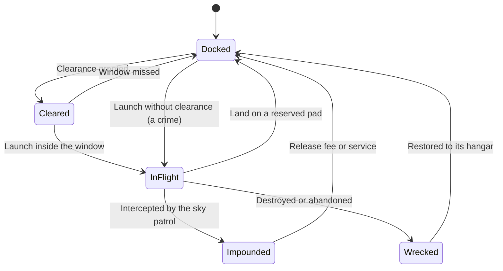

# Spaceflight and Moon Travel

How Returners travel between the Oasis and its moons, by the public Skyferry or in their own ship, under launch and landing law.

> **Version:** v0.1 · **Updated:** 10-10-2026 · **Owner:** Systems design
>
> **Horizons:** H0 a streaming prototype of the ascent only · H1 the Skyferry to Lumen, the city of Seren and Lumen's quests · H2 personal ships from the third Long Night, Holding pads, the moon packet, Veil from the fifth Long Night, Hollow from the eighth · H3 a VR cockpit mode; travel beyond the Wanderers in Oasis 2.0
>
> **Related:** [D-033](../../DECISIONS.md#d-033) · [D-034](../../DECISIONS.md#d-034) · [D-039](../../DECISIONS.md#d-039) · [Cosmology](../02-world/cosmology.md) · [Traversal and Flight](../04-gameplay/traversal-and-flight.md) · [Law, Crime and Bounties](law-crime-and-bounties.md) · [Housing](housing.md)

## 1. Player experience

> *Every eight minutes a bell rings over Halcyon Ascent. Lena boards the Skyferry with two strangers and a Pelagian merchant arguing about fish prices. On the observation deck the Hearthlands shrink, the sky goes indigo, then black, and the Oasis turns below them. Ten minutes later the ferry glides into Seren between crystal spires. A Lumenari steward bows and reminds everyone: no drawn weapons in the city.*
>
> *Three years later, Lena owns a small courier ship. She calls Halcyon Ascent Control, gets pad 4 and a two-minute window, and climbs through cloud into orbit herself. Halfway to Lumen a solar flare warning flashes. She tucks into Lumen's shadow and waits it out, sharing the dark with another pilot who flashes her running lights in greeting.*

The system must make the journey feel real and short, make space feel shared and courteous, and make each moon feel like a world rather than a menu.

## 2. Scope

- **Covers:** the Skyferry; personal ships [H2]; the pilot licence; hangars; Launch and Landing Zones; traffic control; the flight model and the climb from atmosphere to space; compressed distances; hazards; no-fire rules; the hand-off to the law for unauthorised launches; the moons and how each is reached.
- **Leaves to other specs:** the Heat, Record and Bounty ladder ([Law, Crime and Bounties](law-crime-and-bounties.md)); flight tiers and airspace law below orbit ([Traversal and Flight](../04-gameplay/traversal-and-flight.md)); Natural Law on Lumen ([World Laws](../02-world/world-laws.md#4-natural-law-by-domain)); moon lore ([Cosmology](../02-world/cosmology.md#8-the-moons-as-places)); Holding pads ([Housing](housing.md#68-holdings-h2)).
- **Never:** travel beyond the moons before Oasis 2.0 [H3], because the moons are the only off-world destinations ([D-033](../../DECISIONS.md#d-033)); ships or ship parts sold for real money ([D-045](../../DECISIONS.md#d-045)).

## 3. Inspirations

| Source | What we take | What we change |
| --- | --- | --- |
| Elite Dangerous [G15] | Docking needs permission; loitering and trespass bring fines, then bounties | The law fines a pilot and posts wanted posters. Ports never open fire on a pilot who can still comply. |
| No Man's Sky [G15] | Flying from a planet's surface into space with no loading screen | Our distances are short and every destination is hand-made |
| Star Citizen [G15] | Landing through air traffic control; armistice zones that disable weapons | No-fire zones cover every port, every lane and the Skyferry |
| Star Wars: Squadrons [M40] | VR and flat-screen players share the same cockpit play | A cockpit-first VR mode at H3 |

## 4. Terms

Skyferry, Launch Zone and Landing Zone are defined in the [Glossary](../../GLOSSARY.md). Terms used only here:

| Term | Meaning |
| --- | --- |
| **Clearance** | Permission from traffic control to launch, enter a lane or land |
| **Halcyon Ascent** | Halcyon's Skyferry port and spaceport ([Geography and Domains](../02-world/geography-and-domains.md#3-the-hearthlands-centre)) |
| **Moon packet** [H2] | The Skyferry Company's smaller scheduled vessel from Seren to Veil and Hollow |
| **Pad reservation** | A timed claim on a landing pad |
| **Seren** | The Lumenari city on Lumen and the Skyferry's destination |
| **Traffic lane** | A marked corridor from a port to orbit, and between the Oasis and a moon |

## 5. Entities and state

| Entity | Key state | Authority |
| --- | --- | --- |
| Skyferry | Route, timetable, deck layer, passengers | Server. Each departure is a moving shared space, layered as needed. |
| Ship [H2] | Class, owner, condition, insurance, location, impound state | Server. Ownership is G-class; position is L-class ([World Model](../07-multiplayer/world-model.md#5-state-classes-and-authority)). |
| Port | Pads, reservations, lanes, no-fire volume | Server |
| Traffic control | Clearance queue per pad (pads queue, people never do), NPC controller voice | Server |
| Hazard field | Type, volume, intensity, schedule | Server. The Weaver schedules it within authored bounds. |

## 6. Rules

### 6.1 The Skyferry [H1]

- **SPC-006 [H1]** The Skyferry runs only between Halcyon Ascent on the Oasis and Seren on Lumen. Travel between the Oasis's capitals uses Wayshrines, mounts, roads and vehicles ([Traversal and Flight](../04-gameplay/traversal-and-flight.md#65-fast-travel)).
- **SPC-001 [H1]** A ferry leaves each port every 2 Oasis hours (about 8 minutes), around the clock ([Time and Calendar](../02-world/time-and-calendar.md#2-units)).
- **SPC-002 [H1]** The fare is less than the Wayshrine fee for one hop to an adjacent region ([WAY-003](waypoints-and-healing.md#61-wayshrines-discovery-and-travel)). Returners below Player Rank 10 ride free.
- **SPC-003 [H1]** The ride takes about 10 minutes and is a real flight: the ferry climbs through the atmosphere, crosses to Lumen and lands at Seren ([Cosmology](../02-world/cosmology.md#7-scale)).
- **SPC-004 [H1]** The social deck is a lawful sanctuary with an observation gallery, a galley, a Lumenari reading room, NPC travellers with Minds, notice boards and access to the housing blueprint editor. Parties and friends are always placed on the same ferry layer ([D-028](../../DECISIONS.md#d-028)).
- **SPC-005 [H1]** Missing a departure costs at most one interval. There is no booking and no seat limit: each departure is layered as needed.
- **SPC-007 [H1]** The Skyferry's helm is NPC-only at H1. From H2, the first step of the flight-school chain ([SPC-011](#62-personal-ships-h2)) is a supervised turn at the helm inside the lane.

### 6.2 Personal ships [H2]

- **SPC-015 [H2]** Personal ships arrive at the third Long Night. The date is fixed and doesn't depend on the progress of any Convergence ([Ten-Year Live Plan](../11-production/ten-year-live-plan.md#4-year-by-year)).

| Class | Crew | Role | Notes |
| --- | --- | --- | --- |
| **Skiff** | 1–2 | Entry ship; agile | Fits the smallest pads |
| **Courier** | 1–2 | Fastest; small cargo hold | Best at handling hazards |
| **Hauler** | 1–3 | Cargo for trade and Convergence Prepare logistics | Slow; large pads only |
| **Yacht** | 1 pilot and 5 passengers | Social travel with friends | Lounge interior |

- **SPC-010 [H2]** A ship costs a very large sum of Omnis (a savings goal of several weeks), and needs a pilot licence and a hangar. The store sells only cosmetic paint and trim for ships ([D-045](../../DECISIONS.md#d-045)).
- **SPC-011 [H2]** The **pilot licence** needs Avatar Level 7 and Player Rank 40, the Skyferry Company's flight-school quest chain and a practical test (launch, lane flight, hazard evasion, landing). Serious crimes suspend it ([LAW-070](law-crime-and-bounties.md#68-licences-and-crime)).
- **SPC-012 [H2]** A **hangar** is either a berth at a spaceport (a one-time licence fee) or a licensed pad at a Holding ([HSG-071](housing.md#68-holdings-h2)).
- **SPC-013 [H2]** Ship condition wears with flights and hazards, and Engineer Artisans repair it ([Economy and Crafting](economy-and-crafting.md#66-artisans-and-commissions)). Low condition reduces performance. It never strands a pilot in space: a limp-home mode always works.
- **SPC-014 [H2]** A destroyed or abandoned ship is never permanently lost ([D-039](../../DECISIONS.md#d-039)). An insured ship is restored to its hangar after 2 hours. An uninsured ship is restored after 12 hours, or after 2 hours for a salvage-tow fee.

This diagram shows the states a personal ship moves through.

### 6.3 Launch, landing and traffic control

- **SPC-020 [H1]** Spaceflight starts and ends only in Launch and Landing Zones ([D-033](../../DECISIONS.md#d-033)). At H1 these are Halcyon Ascent and Seren, used only by the Skyferry. At H2 they add spaceports in Domain capitals, licensed pads at Holdings and one Landing Zone on each moon when it opens. Natural Law still applies: where a Domain forbids large machines in a band (above the Verdant Spine's canopy), its spaceport sits where the law allows, or the Domain has none.
- **SPC-021 [H2]** Clearance happens in the world. The pilot hails control with one button or by voice, and an NPC controller assigns a pad, a lane and a time window within 5 seconds.
- **SPC-022 [H2]** A pad is held for 3 minutes. Staying on a pad past the window brings a warning, then a fine. Reservations release on timeout or departure.
- **SPC-023 [H2]** Launching outside a zone or without clearance starts the [unauthorised launch flow](law-crime-and-bounties.md#69-unauthorised-launch-flow-h2): a warning, a patrol interception, a fine, then a wanted poster. Every step can be escaped and every outcome cleared ([D-034](../../DECISIONS.md#d-034)).

### 6.4 Flight model

- **SPC-030 [H2]** The ship is actually flown ([D-033](../../DECISIONS.md#d-033)). Atmospheric flight (lift, drag, weather) blends into orbital flight (inertia, thrust) with no loading screen. The Skyferry uses the same transition at H1.
- **SPC-031 [H1]** Distances are compressed: ground to low orbit takes about 2–3 minutes; the Oasis to Lumen takes about 5–8 minutes by personal ship and about 10 by Skyferry ([Cosmology](../02-world/cosmology.md#7-scale)).
- **SPC-032 [H1]** One coordinate space covers the Oasis and its moons, using Large World Coordinates [S6] with server-side origin management. The approach to a moon uses authored levels of detail, from a distant silhouette down to street level.

### 6.5 Hazards

| Hazard | Behaviour | Counterplay |
| --- | --- | --- |
| **Debris fields** | Rock and ice shed by the three moons drift in fixed bands and damage condition. They are scenery, not a story hook. | Lanes route around them; skilled pilots cut through |
| **Solar flares** | Announced 60 seconds ahead; damage ship systems in sunlight. They grow more frequent and stronger each Long Year, as Solace heats up ([WLD-002](../02-world/cosmology.md#2-the-sky-as-a-clock)). | Shelter in the shadow of a moon or the Oasis; shielding upgrades |
| **Long Night tides** | During the 24-hour Long Night, the aligned moons pull ships off course | The Skyferry runs a tide-rated timetable; pilots fight the drift |

- **SPC-040 [H1]** Hazards never destroy the Skyferry. Passengers see flares and tides as spectacle, with a delay of 2 minutes at most.
- **SPC-041 [H2]** Hazard schedules are global, published in the world as observatory bulletins, and the same in every layer.

### 6.6 Sharing space with other pilots

- **SPC-050 [H1]** Ships pass through each other, and through the Skyferry, inside traffic lanes and port volumes (as [TRV-005](../04-gameplay/traversal-and-flight.md#63-flight-tiers-and-rules) does for flyers).
- **SPC-051 [H1]** Every port, every lane and the Skyferry sit inside a no-fire zone: weapons are disabled, and aggression is fined.
- **SPC-052 [H2]** Lanes have speed bands, and overtaking passes through. Ramming outside lanes in lawful space is assault ([Law, Crime and Bounties](law-crime-and-bounties.md#62-crime-list)).

### 6.7 The moons

Moon lore lives in [Cosmology](../02-world/cosmology.md) and [Geography and Domains](../02-world/geography-and-domains.md#5-off-world-the-moons). This table covers access only.

| Moon | Opens | Public transport | Personal ships |
| --- | --- | --- | --- |
| **Lumen** | Launch day [H1] | Skyferry from Halcyon Ascent | From the third Long Night [H2] |
| **Veil** | Fifth Long Night [H2] | Moon packet from Seren | To Veil's Landing Zone |
| **Hollow** | Eighth Long Night at the earliest, once its entrance is revealed [H2] | Moon packet from Seren | To Hollow's Landing Zone |

- **SPC-060 [H1]** Lumen's Civic Law, the Stillness, forbids drawn weapons in Lumenari cities and is enforced through the law system. Drawing a weapon in Seren brings an NPC warning first, then Heat 1.
- **SPC-061 [H2]** Every moon has scheduled public transport from the day it opens. No story or Convergence content ever needs a ship of your own ([D-033](../../DECISIONS.md#d-033), [D-024](../../DECISIONS.md#d-024)).
- **SPC-062 [H2]** The moon packet leaves Seren for each open moon every 4 Oasis hours (about 17 minutes). The ride takes about 10 minutes and follows the Skyferry's deck rules ([SPC-004](#61-the-skyferry-h1)).
- **SPC-063 [H1]** Moving between worlds is always a flight. Wayshrines on a moon link only to Wayshrines on the same moon ([WAY-008](waypoints-and-healing.md#61-wayshrines-discovery-and-travel)).

## 7. Edge cases

| Case | What happens |
| --- | --- |
| Disconnect aboard the Skyferry | On reconnect, the Returner resumes at the destination port if the ride finished, otherwise at the departure port |
| Disconnect while piloting | Autopilot holds the lane for 60 seconds, then flies to the nearest Landing Zone. Ship and cargo are safe. |
| Port full | Pads are layered with the port. A reservation never waits for another player. |
| Hazard spike during a Convergence | Convergence staging transport is exempt ([Celestial Convergence](celestial-convergence.md)) |
| Ship wrecked with cargo aboard | Cargo follows the Echo rules for carried goods ([Death and Return](../04-gameplay/death-and-return.md#62-rules-by-activity)); the ship follows [SPC-014](#62-personal-ships-h2) |

## 8. Multiplayer and platforms

- Ships can be flown with a controller (twin-stick), keyboard and mouse (mouse-flight), a HOTAS on PC, or touch with assists (lane autopilot, auto-level, docking assist). Every ship can be flown with assists on ([Controls, Camera and Accessibility](../09-platforms/controls-camera-and-accessibility.md)).
- Competitive ship content pools players by input, as Fortnite does [M39].
- The VR cockpit mode [H3] follows Meta's comfort guidance [S27].

## 9. Safety and abuse

- **SPC-070 [H1]** Ship position, velocity and damage are server-authoritative. Speed and teleport anomalies are flagged.
- **SPC-071 [H1]** The Skyferry deck follows the voice and chat defaults in [Social, Voice and Clans](../07-multiplayer/social-voice-and-clans.md) ([D-008](../../DECISIONS.md#d-008)).
- **SPC-072 [H2]** Squatting on pads, blocking lanes and ramming are crimes. Repeated griefing escalates to a licence suspension ([LAW-070](law-crime-and-bounties.md#68-licences-and-crime)).

## 10. Performance

The ascent streams terrain at falling detail while the sky shader carries the view. The server hands a ship from the surface mesh to the space mesh to the moon mesh inside a lane, with the destination predicted in advance ([Server and Backend](../08-technology/server-and-backend.md#2-meshing)). The Skyferry's 10-minute ride gives streaming a known window. Microsoft Flight Simulator 2024's launch, when streaming caches were overwhelmed, shows the risk [S29]. World Partition's server streaming settings [S8] are tested in the H0 prototype.

## 11. Examples

| Allowed | Not allowed |
| --- | --- |
| A Returner reaches Lumen on launch day by Skyferry | A quest that needs a personal ship |
| A flare forces a pilot into Lumen's shadow | An unannounced flare that destroys the Skyferry |
| Two ships pass through each other in a lane | A player parks a ship across a lane to block others |
| An unlicensed launch is warned, chased, fined and posted | An unlicensed launch silently blocked with no reason ([WLD-011](../02-world/world-laws.md#3-the-evaluation-model)) |
| A wrecked ship is back in its hangar the same day | A ship lost for good after a crash |

## 12. Acceptance criteria

| ID | Test |
| --- | --- |
| [SPC-001](#61-the-skyferry-h1) | Over 24 hours, Skyferry departures from Halcyon Ascent occur every 8 minutes ± 30 seconds |
| [SPC-003](#61-the-skyferry-h1), [SPC-030](#64-flight-model) | The Skyferry ride from Halcyon Ascent to Seren finishes with no loading screens on every capability tier, in 10 ± 1 minutes |
| [SPC-005](#61-the-skyferry-h1) | 5,000 bots board one departure: all leave on time, layered |
| [SPC-014](#62-personal-ships-h2) | 1,000 scripted ship destructions: every ship is back in its hangar after the stated delay |
| [SPC-015](#62-personal-ships-h2) | Calendar test with every Convergence behind schedule: personal ships still open at the third Long Night |
| [SPC-050](#66-sharing-space-with-other-pilots) | 1,000 forced collisions in lanes: no damage events |
| [SPC-051](#66-sharing-space-with-other-pilots) | Weapon use attempted in port volumes: every attempt is disabled or fined |
| [SPC-061](#67-the-moons) | Content lint: no story or Convergence step requires owning a ship |
| [SPC-063](#67-the-moons) | No teleport route exists between a Wayshrine on the Oasis and one on a moon |
| Streaming | Climbing at top ship speed on the reference console tier: no visible pop-in of gameplay-relevant objects within 300 m |

<!-- citation links: generated, do not edit by hand -->

[G15]: ../../references/games.md
[M39]: ../../references/industry-and-live-service.md
[M40]: ../../references/industry-and-live-service.md
[S6]: ../../references/technology-and-ai.md
[S8]: ../../references/technology-and-ai.md
[S27]: ../../references/technology-and-ai.md
[S29]: ../../references/technology-and-ai.md
