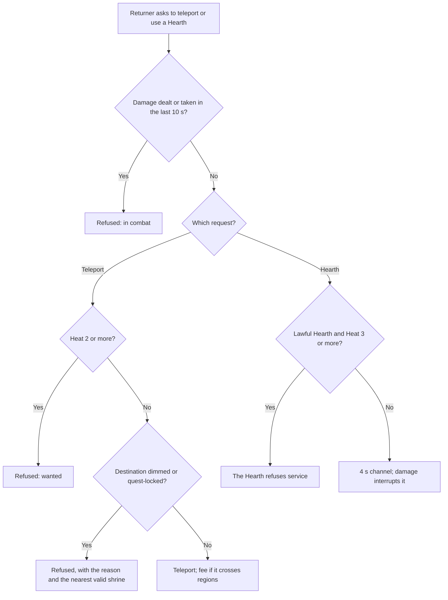

# Waypoints and Healing

Where Returners travel, heal and reappear (Wayshrines, Hearths and login), and the rules that stop any of them being used to escape a fair fight or the law.

> **Version:** v0.1 · **Updated:** 10-10-2026 · **Owner:** Systems design
>
> **Horizons:** H0 Wayshrine discovery, teleport and Return; one Hearth · H1 the full network on the Oasis and Lumen, fees, Long Night dimming, contested Hearths, login choice · H2 Wayshrines on Veil and Hollow; Return at the Echo in the Veil era · H3 None
>
> **Related:** [D-022](../../DECISIONS.md#d-022) · [D-025](../../DECISIONS.md#d-025) · [D-034](../../DECISIONS.md#d-034) · [D-012](../../DECISIONS.md#d-012) · [Death and Return](../04-gameplay/death-and-return.md) · [Traversal and Flight](../04-gameplay/traversal-and-flight.md) · [PvP and Protection](pvp-and-protection.md) · [Law, Crime and Bounties](law-crime-and-bounties.md) · [Cosmology](../02-world/cosmology.md)

## 1. Player experience

> *Kofi reaches a cracked Wayshrine at the top of a Frostmarch pass. It wakes under his hand with a sound like a held breath, and a new point lights on his map. Below, a Hearth glows in a ruined chapel. He kneels there for a few seconds while the warmth closes his wounds and thaws the frostbite. His arrows are still spent, though; for that he'll need a town.*
>
> *During the Long Night, half the Wayshrines in the Ember Wastes go dark. Kofi's party has to walk the last stretch to the lit shrine at Lanternfall, lanterns raised, while something large moves under the dunes.*

The system must make finding a shrine feel like a reward, make healing and resupply separate trips, and make sure nobody can hide behind a shrine to dodge a fair fight or the law.

## 2. Scope

- **Covers:** Wayshrine discovery, teleport, fees, restrictions, party travel and Long Night dimming; Wayshrines on the moons; Hearths; login and spawn choice; logout rules; sanctuaries and anti-escape rules at shrines; changes in the Veil era.
- **Leaves to other specs:** the Downed, Return and Echo rules ([Death and Return](../04-gameplay/death-and-return.md)); Heat and Records ([Law, Crime and Bounties](law-crime-and-bounties.md)); the full sanctuary list and anti-griefing rules ([PvP and Protection](pvp-and-protection.md#64-protected-places-and-players)); help-calls ([NPC Bonds and Help-Calls](npc-bonds-and-help-calls.md#67-friend-help-calls)); avatar persistence after logout ([World Model](../07-multiplayer/world-model.md#68-persistence-disconnect-and-reconnect)); what Wayshrines truly are ([Cosmology](../02-world/cosmology.md#5-veil-wayshrines-and-returners)).
- **Never:** a Wayshrine that players build or buy; a teleport that links the Oasis and a moon; a Hearth that resupplies.

## 3. Inspirations

| Source | What we take | What we change |
| --- | --- | --- |
| *Ghost of Tsushima* [N17] | Navigation that belongs to the place and its culture | Each Domain's Wayshrines and Hearths look and sound different |
| *Grand Theft Auto V* [G1] | Escaping the law is earned through play, not a menu | Teleport and Return are locked at Heat 2 and above |
| *Red Dead Redemption 2* [G2] | Being hunted limits what you can do | Applied to fast travel and healing as Heat rises |
| *Ultima Online*'s Trammel and Felucca [M14] [M15] | Protection by default for most players | Lawful Wayshrines have a full sanctuary, Lawless ones a reduced one, and Lawless Hearths none |

## 4. Terms

Wayshrine, Hearth, Return and Sanctuary are defined in the [Glossary](../../GLOSSARY.md). Terms used only here:

| Term | Meaning |
| --- | --- |
| **Dimmed** | A Wayshrine that can't be used during the Long Night |
| **Guest pass** | A one-trip pass that lets a party member follow a teleport to a Wayshrine they haven't discovered |
| **Safe logout spot** | An inn, a Ward house, a settlement interior, a Skyferry deck or a lit Wayshrine |

## 5. Entities and state

| Entity | Key state | Authority |
| --- | --- | --- |
| Wayshrine | ID, world (Oasis or a moon), region, jurisdiction or Lawless, sanctuary radius, Long Night dim flag, quest locks | Server content data |
| Hearth | ID, region, contested flag, cure list, channel time, keeper NPC | Server content data |
| Discovery set | The Wayshrines and Hearths each Returner has found | Server, persistent, G-class |
| Spawn record | Last position, safe-spot flag, hazard flag, combat flag | Server |

## 6. Rules

### 6.1 Wayshrines: discovery and travel

- **WAY-001 [H1]** A Wayshrine is discovered only by physically reaching it, on foot, by mount or in flight ([WLD-043](../02-world/geography-and-domains.md#7-content-density-rules)). Discovery is permanent and raises Adventure Rank ([Avatar and Progression](../04-gameplay/avatar-and-progression.md#67-player-rank-and-adventure-rank-1100)).
- **WAY-002 [H1]** Wayshrines are spaced so that every point in a region is within about 5 minutes of one ([WLD-042](../02-world/geography-and-domains.md#7-content-density-rules)).
- **WAY-003 [H1]** Teleport links discovered Wayshrines. It is free within a region, and costs a distance fee in Omnis between regions, which is one of the economy's sinks:

| Hop | Fee |
| --- | --- |
| Same region | Free |
| Adjacent region | Base fee B, about five minutes of typical quest earnings |
| Across the Oasis | Up to 3 × B |
| Returners below Player Rank 10 | Free everywhere |

- **WAY-004 [H1]** Teleport is unavailable in combat (any damage dealt or taken in the last 10 seconds) and at Heat 2 or more in any jurisdiction ([Law, Crime and Bounties](law-crime-and-bounties.md#64-heat-15)). The UI always gives the reason ([WLD-011](../02-world/world-laws.md#3-the-evaluation-model)).
- **WAY-005 [H1]** A quest card can mark certain Wayshrines as unavailable destinations during the quest ([WLD-014](../02-world/world-laws.md#3-the-evaluation-model)). Some sacred sites forbid arrival by teleport ([World Laws](../02-world/world-laws.md#5-civic-law-jurisdictions)), so their nearest Wayshrine stands outside the grounds.
- **WAY-006 [H1]** Party members can follow the leader's teleport. Each member must have discovered the destination or accept a guest pass for that one trip. Each traveller pays their own fee. Members in combat or at Heat 2 or more stay behind, and the UI says why.
- **WAY-007 [H1]** A helper answering a help-call arrives at the Wayshrine nearest the caller among those the helper has discovered, never on top of the caller. Help-calls never use guest passes ([NPC-062](npc-bonds-and-help-calls.md#67-friend-help-calls)).
- **WAY-008 [H1]** Each moon has its own Wayshrines, which link only to Wayshrines on the same moon. A Returner who falls on a moon Returns to a Wayshrine there. Travel between worlds is always by Skyferry, moon packet or ship ([Spaceflight and Moon Travel](spaceflight-and-moon-travel.md#67-the-moons)).

### 6.2 Long Night dimming

- **WAY-010 [H1]** During the 24-hour Long Night ([Cosmology](../02-world/cosmology.md#3-the-long-night)), half of each region's open-country Wayshrines dim. A dimmed shrine can't be a teleport destination or a Return point.
- **WAY-011 [H1]** Every settlement Wayshrine stays lit, and so does at least one Wayshrine within every 10 minutes of travel. A Returner who falls near a dimmed shrine Returns to the nearest lit one.
- **WAY-012 [H1]** Dimming patterns are authored for each year and are the same in every layer. Players can learn them from the "lamp-lists" kept by Wayshrine keepers, so the change is part of the world, not a surprise penalty.

### 6.3 Hearths

- **WAY-020 [H1]** A Hearth is a place with its own identity: a living fire, a spring, a coral glow or a star-wheel lamp, in its Domain's culture, tended by a keeper NPC where one fits. A Hearth is never at a Wayshrine, though it may be within sight of one.
- **WAY-021 [H1]** A Hearth restores Health fully after a 4-second channel, and cures lasting ailments that natural regeneration doesn't clear, such as frostbite, deep burns, venom and Veil-sickness. Otherwise Health regenerates slowly out of combat or through consumables ([Combat and Abilities](../04-gameplay/combat-and-abilities.md)).
- **WAY-022 [H1]** A Hearth doesn't refill consumables, ammunition or Resonance, and doesn't repair gear. Those need towns, field crafting or Artisans ([Economy and Crafting](economy-and-crafting.md)). *Why:* healing and resupply are separate decisions, so expeditions have a shape.
- **WAY-023 [H1]** A Hearth can't be used in combat (as in [WAY-004](#61-wayshrines-discovery-and-travel)), and taking damage interrupts the channel. At Heat 3 or more, a lawful Hearth refuses service.
- **WAY-024 [H1]** Hearths are discovered the same way as Wayshrines ([WAY-001](#61-wayshrines-discovery-and-travel)) and appear on the map once found.
- **WAY-025 [H1]** Hearths in the Lawless Reaches are contested: anyone can use them, they have no sanctuary, and damage interrupts the channel. No player or clan can lock, claim or charge for one. *Why:* a Lawless Hearth is worth fighting near, and a safe bubble there would become a camping fortress.
- **WAY-026 [H1]** A Hearth keeper who trusts a Returner at the Trusted tier shares local rumours and gives a cosmetic Hearth-flame token for their home. Trust with a keeper never speeds healing or adds cures.

### 6.4 Login, logout and spawn choice

- **WAY-030 [H1]** On login, a Returner chooses to resume where they logged out (if it was a safe logout spot), to start at any discovered Wayshrine in their current region, or to start at their Ward house. New Returners always have the arrival Wayshrine above Halcyon ([D-027](../../DECISIONS.md#d-027)).
- **WAY-031 [H1]** Logging out at a safe logout spot is instant and resumes exactly there. Anywhere else, the avatar stays in the world for the time set by [MP-071](../07-multiplayer/world-model.md#68-persistence-disconnect-and-reconnect) (10 seconds in a lawful zone outside combat; 60 seconds with Heat, in combat or in a Lawless Reach). If the resume position has become dangerous (a world event, a colossus, the tide), the Returner is offered the nearest lit Wayshrine instead.
- **WAY-032 [H1]** Logging in at the Ward house places the Returner at their front door. It isn't a Return and doesn't clear Heat: logging in with active Heat resumes the pursuit at the logout position.
- **WAY-033 [H1]** Return after a fall follows [DTH-002](../04-gameplay/death-and-return.md#61-the-return-sequence): any discovered Wayshrine in the current region, or the region's nearest one.

### 6.5 Sanctuary and anti-escape

- **WAY-040 [H1]** Lawful Wayshrines and Hearths sit inside a 50 m sanctuary ([PVP-030](pvp-and-protection.md#64-protected-places-and-players)): no PvP, no bounty claims ([LAW-055](law-crime-and-bounties.md#66-bounty-and-hunters)), and no duels can start there.
- **WAY-041 [H1]** A Returner is untargetable for 10 seconds after waking or teleporting in, or until they attack ([DTH-012](../04-gameplay/death-and-return.md#64-anti-griefing)).
- **WAY-042 [H1]** Wayshrines in the Lawless Reaches keep a reduced 30 m sanctuary plus spawn protection. Each Lawless Reach has at least two Wayshrines at least 2 minutes apart, so a Returner can always arrive away from a camp.
- **WAY-043 [H1]** A Returner who falls at Heat 2 or more Returns at the jurisdiction's Watch post, not at a Wayshrine of their choice ([DTH-011](../04-gameplay/death-and-return.md#64-anti-griefing)).
- **WAY-044 [H1]** Repeatedly attacking Returners as they arrive at a lawful Wayshrine is assault (Heat and a Record). In a Lawless Reach, a Returner Downed 3 times by the same player within 30 minutes may Return free to any lit Wayshrine outside that Reach ([PVP-040](pvp-and-protection.md#65-anti-griefing)).

This diagram shows how a request to teleport or to use a Hearth is checked.

### 6.6 The Veil era [H2]

- **WAY-050 [H2]** Once Veil opens, a fallen Returner can choose to Return at their Echo for a Resonance cost instead of at a Wayshrine ([Death and Return](../04-gameplay/death-and-return.md#65-return-at-the-echo-h2)).
- **WAY-051 [H2]** Return at the Echo is unavailable at Heat 2 or more, inside the Lawless Reaches (it would turn Echo defence into instant respawning), during Convergences (which leave no Echo), and within 60 seconds of PvP damage.
- **WAY-052 [H2]** Wayshrines visibly change in the Veil era, with mist at the base and a faint sound of voices, as foreshadowing in the [reveal graph](../03-narrative/reveal-graph.md). Public text never says what they truly are ([D-012](../../DECISIONS.md#d-012)).

## 7. Edge cases

| Case | What happens |
| --- | --- |
| Disconnect mid-teleport | The teleport completes on the server, and the Returner resumes at the destination |
| A colossus event overruns a Wayshrine | The shrine stays a destination only if the event declares it safe; otherwise it shows as "threatened" and Return uses the next nearest |
| Every discovered shrine in a region is dimmed or locked | The region's settlement Wayshrine is always offered ([WAY-011](#62-long-night-dimming)) |
| A party member can't pay the fee | They stay behind; nobody else pays for them automatically |

## 8. Multiplayer and platforms

Discovery sets and dimming are global. Parties always arrive in the same layer at the destination ([D-028](../../DECISIONS.md#d-028)). The fast-travel map supports touch selection and controller snapping ([Controls, Camera and Accessibility](../09-platforms/controls-camera-and-accessibility.md)).

## 9. Safety and abuse

- **WAY-060 [H1]** Teleport requests, discovery and combat flags are server-authoritative. A client that claims to have discovered a shrine it never visited is rejected and flagged.
- **WAY-061 [H1]** Guest passes can't be sold or traded for Omnis, and never grant discovery or Adventure Rank.

## 10. Performance

Destinations are streamed in during a short travel effect, within 5 seconds on the reference console tier. Busy Wayshrines such as Halcyon's are layered with the city around them ([D-028](../../DECISIONS.md#d-028)).

## 11. Examples

| Allowed | Not allowed |
| --- | --- |
| A Returner at Heat 1 teleports home after breaking line of sight | A Returner at Heat 3 teleports away mid-chase |
| A Hearth cures frostbite in 4 seconds | A Hearth refills arrows and repairs a cracked shield |
| A friend joins a party teleport with a one-trip guest pass | A guest pass that permanently unlocks the shrine |
| Logging out at an inn and resuming there the next day | Logging out mid-duel to vanish instantly |
| Taking the Skyferry to Lumen, then teleporting between Lumen's Wayshrines | Teleporting from Halcyon straight to a Wayshrine on Lumen |

## 12. Acceptance criteria

| ID | Test |
| --- | --- |
| [WAY-001](#61-wayshrines-discovery-and-travel) | Discovery only on physical arrival: no discoveries from map clicks, party travel or guest passes |
| [WAY-003](#61-wayshrines-discovery-and-travel) | 10,000 same-region teleports: all cost 0 Omnis |
| [WAY-004](#61-wayshrines-discovery-and-travel), [WAY-023](#63-hearths) | Teleport and Hearth attempts in combat or above the Heat limits: all refused, with a reason |
| [WAY-008](#61-wayshrines-discovery-and-travel) | No teleport route exists between Wayshrines on different worlds |
| [WAY-011](#62-long-night-dimming) | Long Night simulation: every point in every region is within 10 minutes of a lit Wayshrine |
| [WAY-022](#63-hearths) | Hearth use never changes consumable counts, Resonance or durability |
| [WAY-025](#63-hearths) | Lawless Hearths have no sanctuary volume, damage always interrupts the channel, and no API path lets a player or clan lock or charge for one |
| [WAY-031](#64-login-logout-and-spawn-choice) | 1,000 logouts away from safe spots in Lawless Reaches: the avatar stays 60 ± 1 seconds every time |
| [WAY-040](#65-sanctuary-and-anti-escape) | 10,000 attack attempts inside lawful sanctuary radii: no damage events |
| [WAY-043](#65-sanctuary-and-anti-escape) | 1,000 falls at Heat 2 or more: every Return is at the Watch post |
| [WAY-051](#66-the-veil-era-h2) | Return at the Echo is never offered in the Lawless Reaches, during Convergences or at Heat 2 or more |

<!-- citation links: generated, do not edit by hand -->

[G1]: ../../references/games.md
[G2]: ../../references/games.md
[M14]: ../../references/industry-and-live-service.md
[M15]: ../../references/industry-and-live-service.md
[N17]: ../../references/film-literature-and-music.md#n-series-sources
