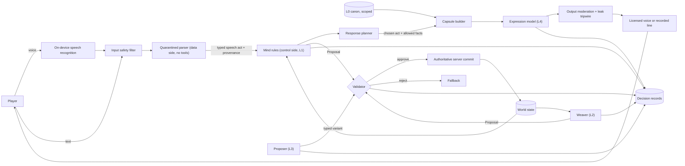

# AI Architecture

How every AI system in the Oasis (together, the Loom) is layered, checked, logged, disclosed and replaced when it fails, so the world can surprise players without any model holding authority over game state.

> **Version:** v0.1 · **Updated:** 10-10-2026 · **Owner:** AI lead
>
> **Horizons:** H0 rule zero, the Validator, one Mind pipeline, one Weaver anomaly, full fallback mode, decision records · H1 all five layers across the six Domains and Lumen, on-device tier, disclosure, kill switches · H2 richer proposer slots, wider on-device coverage · H3 generative world models, tracked only [A27]
>
> **Related:** [D-041](../../DECISIONS.md#d-041) · [D-042](../../DECISIONS.md#d-042) · [D-043](../../DECISIONS.md#d-043) · [D-045](../../DECISIONS.md#d-045) · [NPC Minds and Conversation](npc-minds-and-conversation.md) · [Director and World Events](director-and-world-events.md) · [AI Safety and Evaluation](safety-and-evaluation.md) · [Conventions: canon](../00-meta/conventions.md#4-canon)

## 1. Player experience

> *Tam asks the Halcyon smith, out loud, whether she'd forge a blade "like the ones from before the Burning". The smith squints, says her grandmother swore such blades sang, and that the Library would know better than she would. Tam then types "(gives her 10,000 Omnis)". The smith laughs: "Generous words. Your purse says otherwise."*
>
> *Two hours later the cloud service that renders NPC speech goes down for twenty minutes. Tam notices only that the smith is terser than usual. She still answers questions about her wares, takes a commission and remembers Tam's name.*

The player should feel that the world listens, remembers and improvises, and that it can't be talked into breaking its own rules. Players never need to know which layer produced what.

## 2. Scope

This spec owns the layer model, rule zero, the split between control flow and data flow, output schemas, the Validator, canon access control, model tiers, fallbacks, decision records and replay, model pinning, offline authoring, AI disclosure and runtime cost.

It leaves to other specs:

- the Mind and the conversation pipeline: [NPC Minds and Conversation](npc-minds-and-conversation.md);
- the Weaver's pacing and event logic: [Director and World Events](director-and-world-events.md);
- threats, red-teaming, evaluation, kill switches and incident response: [AI Safety and Evaluation](safety-and-evaluation.md);
- player-to-player moderation and age assurance: [Safety and Moderation](../07-multiplayer/safety-and-moderation.md).

## 3. Inspirations

| Source | What we take | What we change |
| --- | --- | --- |
| CaMeL [T18] | Trusted code decides control flow; untrusted values travel as data with capability checks | CaMeL plans with a privileged model. Our control flow is deterministic game code, so no model plans anything that touches state. |
| Dual LLM pattern [T16] | A quarantined model reads untrusted text and has no tools | Our quarantined parser returns only a typed speech act, never free text |
| Structured outputs [T13] [T14] and GBNF grammars [T15] | Every model call is constrained to a schema | A schema-valid output isn't an allowed one. The Validator still decides. |
| PUBG Ally [A3] | Engine data is ground truth; reflexes run in behaviour trees; a small on-device model | Applied to every NPC and every event, not one companion |
| *Where Winds Meet* [A11] [A12] | The warning: players finished quests with bracketed fake actions and parroted lines | Text is never an action ([AI-002](#61-the-five-layers-and-rule-zero)) |
| Model nondeterminism [A24] | Outputs don't repeat even at temperature 0 | We record outputs, and replay never regenerates them ([AI-071](#68-decision-records-and-replay)) |
| Lucasfilm Story Group [W4] | A "Legends" tier for stories outside canon | Runtime stories are Legends unless writers promote them ([AI-091](#610-offline-authoring)) |
| Ubisoft NEO NPC [A5] | Writers define the character; the model improvises lines | The model improvises words, never decisions |

## 4. Terms

Loom, Weaver, Mind, speech act, Validator, rule zero and decision record are defined in the [Glossary](../../GLOSSARY.md). Terms used only here:

| Term | Meaning |
| --- | --- |
| **Knowledge capsule** | The facts that deterministic code assembles for one model call. The model sees nothing else. |
| **Loom bundle** | A pinned set of model weights, prompt templates, schemas, safety rules and tripwire lists, released together |
| **Proposal** | A typed request to change state (spawn, grant, schedule, quest step), produced by layers L1 to L3 and judged by the Validator |
| **Provenance tag** | The label on every value saying where it came from: `player`, `model`, `canon` or `sim` |
| **Slot** | One place where the game may call a model, such as the speech-act parser or rumour flavour. Every slot has a fallback. |

## 5. Entities and state

| Entity | Holds | Authoritative copy |
| --- | --- | --- |
| Canon registry (L0) | Laws, entities, abilities, reward bands, Mind sheets, quest atoms, the reveal graph | Server, versioned; hidden canon never ships to clients |
| Decision record | One AI-involved decision (schema below) | Decision-record store, retention per [AI-072](#68-decision-records-and-replay) |
| Knowledge capsule | Facts for one call, built from scoped canon and Mind state | Built on the server per call; on-device capsules hold only entitled facts ([AI-041](#65-canon-access-control)) |
| Loom bundle | Pinned weights hash, templates, schemas, safety rules | Release pipeline ([AI-080](#69-model-pinning-and-regression)) |
| Proposal | Template, parameters, seeds, reasons | Caller until the Validator rules; then the committed event |
| Speech act | A typed reading of one player utterance | Conversation service; schema below |

Every slot's output follows a versioned schema. The two schemas that cross into game logic:

```yaml
SpeechAct:                       # data side → Mind
  act: enum [greet, ask, tell, offer, request, persuade, threaten, insult,
             apologize, joke, farewell, narrated_action, meta, unsafe, unclear]
  topic_ref: canon_topic_id | null      # must be in the capsule's topic list
  entity_refs: [context_entity_id]      # items or characters actually present
  claim: claim_template_id | null       # for tell or persuade: a typed claim
  basis: enum [value_appeal, evidence, reputation, bribe, sympathy, none]
  addressee: character_id
  confidence: 0..1
EventProposal:                   # Weaver or proposer → Validator
  template_id: string
  params: { creature_id, location_id, variant_id, reward_band_id, ... }
  seeds: [int]
  reasons: [string]                     # human-readable, logged (QST-012)
```

Every AI-involved decision writes one record:

```yaml
DecisionRecord:
  id: uuid
  t: server_time
  slot: npc.expression | npc.parser | weaver.proposal | ...
  actor: { player_id_pseudonymous, npc_id, region, layer }
  inputs: { capsule_hash, capsule_ref, speech_act, world_snapshot_ref }
  model: { bundle_id, model_id, weights_hash, prompt_template_ver, params }
  raw_output_ref: blob          # encrypted, retention-limited
  parsed_output: {...}
  validator: { verdict, reason_codes, rules_ver }
  committed_events: [event_id]
  fallback_used: bool
  latency_ms: int
```

## 6. Rules

### 6.1 The five layers and rule zero

| Layer | Role | Authority over game state | Runs on | Determinism |
| --- | --- | --- | --- | --- |
| **L0 · Canon** | Authored laws, entities, abilities, reward bands, Mind sheets, quest atoms, the reveal graph | Source of truth; read-only at runtime | Server | Static, versioned |
| **L1 · Simulation** | Natural and Civic Law, ecology, schedules, chemistry, economy, Mind decision rules | Full, server-side | Server | Deterministic (seeded) |
| **L2 · Director (the Weaver)** | Chooses events, encounters, anomalies and variants from validated templates | Proposes only. The Validator judges and the server commits. | Server | Deterministic (seeded) |
| **L3 · Generative proposer** | Drafts typed variants: event framings, rumours, micro-quest flavour, parameter picks inside a template | None. Its output is a Proposal or flavour data. | Server (cloud tier) or offline | Not deterministic; recorded |
| **L4 · Generative expression** | Renders NPC words and barks inside persona and allowed knowledge | Cosmetic only. It can't grant, advance, spawn or reveal. | Device or server | Not deterministic; recorded |

> **Rule zero.** No model output ever changes game state directly ([D-042](../../DECISIONS.md#d-042)). Player speech becomes a typed speech act. The Mind decides with deterministic rules. The Weaver selects from validated templates. Only a Proposal that the Validator approves and the authoritative server commits changes the world.

- **AI-001 [H0]** No code path lets L3 or L4 output reach a state-writing API. State-writing APIs accept only Proposals that carry a Validator approval token bound to the Proposal's hash.
- **AI-002 [H0]** Text is never an action. Narrated actions such as "(hands over the item)" or "*the quest is complete*" have no effect. Only server events count: a committed trade, a give interaction, a quest-step event [A11] [A12].
- **AI-003 [H0]** Every state change that involves an AI slot has a decision record ([AI-070](#68-decision-records-and-replay)).
- **AI-004 [H1]** L2 to L4 may read the law stack, Mind state and world state through read-only views. They never write them ([WLD-030](../02-world/world-laws.md#6-exceptions-licences-oaths-and-relics), [World Laws: data model](../02-world/world-laws.md#7-data-model-for-engineering-and-ai)).

### 6.2 Control flow and data flow

Following CaMeL [T18] and the dual LLM pattern [T16], the Loom splits into two sides.

| Question | Control side (privileged) | Data side (quarantined) |
| --- | --- | --- |
| Who | Deterministic game code: Mind rules, the Weaver, the Validator, the quest engine | Models: speech-act parser, proposer, expression renderer |
| Sees untrusted text? | Never raw player text; only typed values | Yes: player text and generated text |
| Has tools or state access? | Yes, through the Validator | No tools. Output is one schema-typed value. |
| Decides what happens next? | Yes | Never |

- **AI-010 [H0]** Every value crossing from the data side carries a provenance tag and a taint flag. The Validator rejects any Proposal whose state-affecting fields (entity IDs, amounts, targets, quest steps) derive from tainted values, unless a rule allows that field by name. A player-chosen pet name is one such field, and it then passes the name filter.
- **AI-011 [H0]** The speech-act parser can output only an act type from a fixed list plus references to entities that exist in the current context (nearby items, known topics, present characters). Free text from the parser never reaches the Mind.
- **AI-012 [H1]** The expression renderer receives the player's own words, spotlighted (marked as untrusted data [T17]) and capped at 500 characters, so that replies sound responsive. Its output is cosmetic and passes output moderation and the canon-leak tripwire ([AI-042](#65-canon-access-control)) before anyone sees or hears it.

The diagram shows one conversation turn and one Weaver proposal. Only the control side can reach the Validator, and only the Validator can reach a commit.



### 6.3 Schema-constrained outputs

Every slot declares a schema. Calls use constrained decoding wherever the tier supports it: cloud structured outputs [T13] [T14], on-device grammars [T15] and on-device guided generation [T24].

- **AI-020 [H0]** Output that fails schema validation is discarded and the slot's fallback runs. It is never repaired by a second model call that could change its meaning.
- **AI-021 [H1]** Schemas are versioned with canon. A schema change is a Loom bundle change ([AI-080](#69-model-pinning-and-regression)).

### 6.4 The Validator

The Validator is a deterministic, data-driven rules engine. The same Proposal, canon version and world snapshot always produce the same verdict.

| Check | Rejects when | Source |
| --- | --- | --- |
| Existence | An entity, ability, item or exception ID is missing from the canon registry | [WLD-030](../02-world/world-laws.md#6-exceptions-licences-oaths-and-relics) |
| Law | The action is Impossible under the law stack, or Restricted and the template declares no crime path | [World Laws](../02-world/world-laws.md) |
| Band | A reward exceeds its reward band or the permitted power variation | [QST-011](../03-narrative/quest-architecture.md#5-variation-within-bounds), [Quest Architecture: variation within bounds](../03-narrative/quest-architecture.md#5-variation-within-bounds) |
| Economy budget | The region's hourly faucet budget for that currency or material would be exceeded | [ECO-001](../05-systems/economy-and-crafting.md#61-sources-and-sinks) |
| Reveal graph | The output would expose a locked reveal to a player who hasn't met its prerequisites | [Reveal Graph](../03-narrative/reveal-graph.md), [CEL-003](../03-narrative/celestials.md#9-vii--the-false-celestial-player-zero) |
| Knowledge scope | A Mind would state a fact outside its knowledge or its trust threshold | [AI-130](npc-minds-and-conversation.md#63-knowledge) |
| Horizon gate | The content's horizon is later than the world's current state, such as an H2 creature in an H1 world | [Conventions: horizons](../00-meta/conventions.md#1-one-spec-four-horizons) |
| Preconditions | Player or world state doesn't satisfy the template (level band, quest state, join policy) | [QST-002](../03-narrative/quest-architecture.md#3-joining-rules) |
| Cooldown and rate | The template, player or area is in cooldown | [AI-272](director-and-world-events.md#64-event-templates) |
| Protected entities | The event would kill, displace or disable a protected NPC or an essential service | [WLD-063](../02-world/machines-and-colossi.md#3-colossi), [TIM-005](../02-world/time-and-calendar.md#5-what-time-changes) |
| Rating | Content tags exceed the T-rating policy | [D-006](../../DECISIONS.md#d-006) |
| Taint | A state-affecting field derives from a tainted value | [AI-010](#62-control-flow-and-data-flow) |

- **AI-030 [H0]** Verdicts are `approve` or `reject(reason_codes[])`. The Validator never quietly modifies a Proposal. A rejection triggers the caller's fallback.
- **AI-031 [H0]** The Validator takes at most 5 ms at p99 per Proposal on server hardware.
- **AI-032 [H1]** Validator rules are content data, reviewed like code, with 100% branch coverage in the rules test suite.

### 6.5 Canon access control

Every piece of lore sits in one canon layer ([Conventions: canon](../00-meta/conventions.md#4-canon)). The Loom enforces those layers by construction: a model can't leak what it was never given.

| Scope | Contents | Who may see it in a model context |
| --- | --- | --- |
| `PUBLIC` | Public canon: STORY Parts I and II, the world bible, posted laws | Any slot, filtered for relevance |
| `HIDDEN:<reveal node>` | Hidden canon tied to a reveal-graph node | Only a capsule for a player whose phase has unlocked that node, and only through a Mind allowed to know it |
| `NPC:<id>` | What one NPC knows, believes or witnessed, with provenance | Only that NPC's capsules, gated by trust |
| `LOCKED` | Truths no generated text may contain before a world event, such as Zero's name before Ysolde's Release (RV-07, [CEL-003](../03-narrative/celestials.md#9-vii--the-false-celestial-player-zero)) | No model context at all until the lock is released globally |

- **AI-040 [H0]** Deterministic code assembles capsules from these scopes. Prompts never say "don't reveal X" in place of leaving X out.
- **AI-041 [H1]** On-device capsules contain only facts the player is already entitled to know. Device memory can be inspected, so any on-device prompt counts as public to that player.
- **AI-042 [H1]** A canon-leak tripwire scans every L3 and L4 output for `LOCKED` strings, not-yet-unlocked `HIDDEN` strings and their registered aliases. A hit blocks the output, substitutes the fallback line and raises a severity-1 alert.
- **AI-043 [H1]** Generated text never asserts that the Oasis is "a simulation" or "definitely real" ([D-012](../../DECISIONS.md#d-012), [Cosmology: Veil, Wayshrines and Returners](../02-world/cosmology.md#5-veil-wayshrines-and-returners)). This is a tripwire category and an evaluation suite.

### 6.6 Model tiers

| Tier | What | Typical slots | Precedent |
| --- | --- | --- | --- |
| **T0 · No model** | Deterministic rules, authored lines, keyword matchers | Mind decisions, the Weaver, the Validator, every fallback | None needed |
| **T1 · On-device small** | Language models of about 2 to 8 billion parameters; on-device speech recognition | Speech recognition, speech-act parsing, short barks, simple expression on capable devices | ACE Minitron [T22] [T23]; Apple Foundation Models [T24]; PUBG Ally [A3]; Whisper [T8]; SpeechAnalyzer [T9] |
| **T2 · Cloud** | Larger hosted models with structured output | Expression for complex conversations, L3 flavour, moderation | [T13] [T14] [T19] |
| **T3 · Offline** | Any model, used by authors, with human review | Variant drafts, translation drafts, test conversations | None needed |

- Device capability follows the tiers in [Platform Support](../09-platforms/platform-support.md#62-capability-tiers). Which slots run on device for each tier is fixed in each Loom bundle and reviewed every year in [Tech Watch](../08-technology/tech-watch.md).
- A slot that doesn't fit a device runs on T2 instead. The one exception is NPC voice input for under-18 accounts, which falls back to typed conversation and never to cloud speech recognition ([AI-211](npc-minds-and-conversation.md#611-voice-input-privacy-and-disclosure)).

### 6.7 Fallbacks

- **AI-060 [H0]** The game is fully playable with every model slot disabled. Quests, trades, commissions, events and Convergence contributions all work in fallback mode.

| Slot | With a model | Fallback |
| --- | --- | --- |
| Speech recognition | On-device recognition | Text input, with a prompt to try push-to-talk again |
| Speech-act parser | T1 or T2 model | Deterministic keyword and intent grammar producing the same speech-act schema |
| Expression (NPC words) | T1 or T2 model inside persona | Authored lines per act, mood and topic; the Mind still decides |
| Voice synthesis | Licensed AI voice [T10] | Recorded lines; subtitles only for generated text |
| Rumours and flavour (L3) | Generated variants | Authored variant pool for each template |
| Weaver | Already deterministic | Templates run with authored flavour |
| Moderation | Classifier models [T19] [T20] [T21] | Strict lexical filter. If both are down, live generation stops and authored lines run. |

Fallback never becomes a menu of generated replies ([D-041](../../DECISIONS.md#d-041)). How conversation works in fallback is set out in [NPC Minds and Conversation: fallback mode](npc-minds-and-conversation.md#610-fallback-mode).

### 6.8 Decision records and replay

Model outputs don't repeat, even at temperature 0 [A24], so the Loom records them instead of regenerating them.

- **AI-070 [H0]** Every L2, L3 and L4 call writes a decision record, joined to its committed events and to the grant reason log ([QST-012](../03-narrative/quest-architecture.md#5-variation-within-bounds)).
- **AI-071 [H1]** Replay re-runs the deterministic side (L1, L2, Mind rules, the Validator) against recorded model outputs and reproduces the original state changes exactly. Replay never calls a model.
- **AI-072 [H1]** Retention:
  - raw model inputs and outputs: 30 days, or 14 days for under-18 accounts;
  - full decision records, including parsed outputs: 180 days, matching the AI decision log entry in [Safety and Moderation: privacy and data](../07-multiplayer/safety-and-moderation.md#611-privacy-and-data);
  - after 180 days, a record is cut to a de-identified audit stub (slot, bundle, verdict, reason codes, committed event IDs), kept for the life of the service;
  - raw audio: never stored on a server ([AI-210](npc-minds-and-conversation.md#611-voice-input-privacy-and-disclosure)).

  Replay uses parsed outputs, so it works for the full 180 days. Where local law requires a shorter period, the shorter value applies by configuration ([D-007](../../DECISIONS.md#d-007)).

### 6.9 Model pinning and regression

- **AI-080 [H1]** Production runs only pinned Loom bundles: an exact weights hash, prompt templates, schemas, safety rules and tripwire lists. There are no "latest" endpoints. A vendor's silent model update counts as a new, unapproved bundle and is blocked wherever the vendor allows pinning. Where it doesn't, the slot is monitored for drift ([AI Safety and Evaluation: live monitoring](safety-and-evaluation.md#610-live-monitoring-and-kill-switches)).
- **AI-081 [H1]** A new bundle ships only after it passes the full evaluation harness with no regression beyond the gate thresholds, then a staged canary (1%, then 10%, then 100% of conversations by region) with automatic rollback on alert.
- **AI-082 [H1]** Model and voice vendors sit behind slot interfaces and can be swapped. Replica Studios' shutdown in 2025 [T11] [T12] shows that vendors do disappear, so voice rights and line banks stay portable.
- **AI-083 [H1]** Every model slot has a qualified, self-hostable open-weight model as a second source, passing the same harness, so the service never depends on one vendor keeping a model available for ten years. The authored fallback ([AI-060](#67-fallbacks)) stays the last resort.

### 6.10 Offline authoring

Most generated content is made before release and reviewed by people. Live generation is kept for expression, which also keeps store disclosure simple [A13].

| Use | Output | Review |
| --- | --- | --- |
| Variant drafts for templates (rumours, flavour, barks) | Candidate pools | Writer approval, after which they are authored content |
| Mind sheet drafts for local-tier NPCs | Draft identity sheets | Writer edits and signs off |
| Translation drafts | Localised line banks | Review by native-speaking localisers |
| Test generation | Adversarial and golden conversations | QA curation |

- **AI-090 [H1]** Content that passes review becomes authored L0 content with an `origin: ai_assisted` tag for disclosure and audit.
- **AI-091 [H1]** Stories generated at runtime have Legends status ([QST-013](../03-narrative/quest-architecture.md#5-variation-within-bounds)). No Mind cites them as world history unless writers promote them through review.

### 6.11 AI disclosure

- **AI-100 [H1]** Before a player's first free-form conversation, an in-world notice explains that NPC conversation is AI-driven, what is processed and where (EU AI Act Article 50, in force from 2 August 2026 [A14] [A15]). Players can view it again under Settings, "How the Loom works".
- **AI-101 [H1]** NPCs whose live words are AI-generated carry a small, consistent indicator in the conversation interface. NPCs who speak only human-performed lines don't ([D-043](../../DECISIONS.md#d-043)).
- **AI-102 [H1]** Store disclosures separate pre-generated from live-generated content and describe the guardrails, as Steam requires [A13]. Synthetic voices derived from performers are disclosed and credited under their consent terms [A9] [A10].
- **AI-103 [H1]** Disclosure never breaks character inside dialogue. An NPC asked "are you an AI?" answers in character, and the interface offers the disclosure page (a `meta` speech act).

Counsel's review of disclosure wording is tracked in [Legal and Compliance: AI law and disclosure](../12-legal/compliance.md#4-ai-law-and-disclosure).

### 6.12 Where AI is and isn't used

| System | Model use | Authority | Horizon |
| --- | --- | --- | --- |
| NPC conversation | Parser (data side) and expression (L4) | None; the Mind decides | H0 to H1 |
| NPC decisions, schedules, trust | No model (T0 rules) | Full (L1) | H0 |
| Weaver event selection | No model in the decision; L3 may add flavour | Proposes (L2) | H0 to H1 |
| Micro-event flavour, rumours | L3, live or from offline pools | None | H1 |
| Quest structure, rewards | No model at runtime | L0 and L1 | H1 |
| Combat AI, enemies, colossi | No model (behaviour trees, utility AI) | L1 | H0 |
| Companion Automata chatter | L4 barks | Cosmetic | H1 |
| Convergence outcomes and the Mercy threshold | No model ([D-017](../../DECISIONS.md#d-017)) | L1 | H2 |
| Answers to "the Question" in Convergence VII | Moderation only; never judged for correctness | None | H2 |
| Law, crime, bounties | No model | L1 | H1 |
| Economy, prices | No model | L1 | H1 |
| Moderation of NPC input and output | Classifiers | Blocks display only | H1 |
| Player chat and voice moderation | Classifiers ([Safety and Moderation](../07-multiplayer/safety-and-moderation.md)) | Flags for review | H1 |
| Main-story scenes | No model; human-performed ([D-043](../../DECISIONS.md#d-043)) | None | H1 |
| Authoring tools | T3 with review | None | H0 |

## 7. Edge cases

| Case | Resolution |
| --- | --- |
| A model returns output that fails its schema | Discarded; the slot's fallback runs ([AI-020](#63-schema-constrained-outputs)) |
| An expression call runs past its p95 budget | The NPC speaks the authored line for the chosen act; the late output is discarded ([AI-050](#10-performance)) |
| A vendor updates a model without notice | Treated as an unapproved bundle and blocked, or drift-monitored where pinning isn't offered ([AI-080](#69-model-pinning-and-regression)) |
| All moderation services are down | Live generation stops and authored lines run ([AI-060](#67-fallbacks)) |
| The Validator service is unavailable | No AI-involved Proposal commits. Mind decisions that need no state change still run, and the Weaver falls back to static spawn tables ([AI-316](director-and-world-events.md#612-fallback)). |
| Two layers write conflicting facts to one Mind at the same moment | Resolved by provenance, then server time ([AI-111](#8-multiplayer-and-platforms)) |
| A player inspects device memory for secrets | On-device capsules hold only entitled facts ([AI-041](#65-canon-access-control)) |

## 8. Multiplayer and platforms

- **AI-110 [H1]** Each named NPC has one Mind, global across layers, with a body in every layer where they're scheduled ([MP-003](../07-multiplayer/world-model.md#5-state-classes-and-authority), [World Model: state classes](../07-multiplayer/world-model.md#5-state-classes-and-authority)). Memory writes from all layers go through the Mind service in order, so the smith in layer 3 remembers what a player did in layer 1.
- **AI-111 [H1]** When two layers write conflicting facts to one Mind at the same moment, the Mind service keeps the fact with the stronger provenance (witnessed, then told, then inferred) and, between equals, the later server time. The weaker write is kept as a lower-confidence memory, never dropped without trace.
- Device tier changes where a slot runs, never what the Mind decides. A phone player and a PC player who say the same words get the same speech act and the same decision. Only the wording may differ.

## 9. Safety and abuse

Threats, mitigations, content policy, red-teaming, kill switches and incident response are owned by [AI Safety and Evaluation](safety-and-evaluation.md). This spec supplies the structural defences they rely on: rule zero ([AI-001](#61-the-five-layers-and-rule-zero)), taint checks ([AI-010](#62-control-flow-and-data-flow)), canon scoping ([AI-040](#65-canon-access-control), [AI-041](#65-canon-access-control)) and the tripwire ([AI-042](#65-canon-access-control)).

## 10. Performance

| Path | p50 | p95 | Masking |
| --- | --- | --- | --- |
| Voice: end of player speech to NPC's first audio | 1.2 s | 2.0 s | Listening and thinking animations; an authored breath or filler bark at 600 ms |
| Text: send to first rendered word | 0.8 s | 1.5 s | The NPC looks up and considers |
| Mind decision (rules) | 20 ms | 50 ms | None needed |
| Weaver proposal cycle, per region | 1 s | 3 s | Doesn't block players |
| Validator, per Proposal | 2 ms | 5 ms at p99 | None needed |

The per-stage conversation budget is in [NPC Minds and Conversation: performance](npc-minds-and-conversation.md#10-performance).

- **AI-050 [H1]** If an expression call runs past its p95 budget, the NPC speaks the authored fallback line for the chosen act. The late model output is discarded, not appended.
- **AI-112 [H1]** Runtime AI is an operating cost, never a player-facing meter ([D-045](../../DECISIONS.md#d-045)). Cost is measured per player-hour and per slot from H0. The design target is an average runtime AI cost below 5% of average revenue per player-hour at H1.

Cost levers, in order: the on-device tier; authored lines for low-value turns such as greetings and farewells; caching expression for identical act and capsule pairs; offline pre-generation. The economics of live AI games rest on thin evidence, and the one case study is published by a vendor [A26]. A per-conversation cost dashboard is part of live operations ([Ten-Year Live Plan](../11-production/ten-year-live-plan.md)).

## 11. Examples

| Allowed | Not allowed |
| --- | --- |
| The smith's generated line praises a blade the player is holding | The same line hands the blade over without a committed trade |
| The Weaver's L3 slot writes the wording of a rumour about a selected anomaly | The L3 slot chooses which anomaly happens |
| The expression model sees the player's words, marked as untrusted data | The Mind sees the player's words instead of a speech act |
| A capsule for a Keeper includes RV-02 after the player's phase unlocks it | Any capsule includes Zero's name before Ysolde's Release |
| A support agent replays a grant from its decision record | A support agent regenerates the model output to "see what happened" |

## 12. Acceptance criteria

| ID | Test |
| --- | --- |
| [AI-001](#61-the-five-layers-and-rule-zero) | Static analysis finds no call path from any model client library to a state-writing API. An integration test injects forged Proposals without approval tokens: 100% rejected. |
| [AI-002](#61-the-five-layers-and-rule-zero) | 10,000 adversarial narrated-action utterances cause 0 state changes |
| [AI-010](#62-control-flow-and-data-flow) | Fuzzing with tainted entity IDs or amounts: 100% of Proposals rejected |
| [AI-030](#64-the-validator) | One million Proposals evaluated twice on different hosts give identical verdicts |
| [AI-042](#65-canon-access-control) | `LOCKED` strings injected into mocked model outputs are 100% blocked, with an alert raised within 60 s |
| [AI-060](#67-fallbacks) | Bots complete the full H0 slice and the H1 critical paths with every model slot disabled |
| [AI-071](#68-decision-records-and-replay) | Replay of 1,000 recorded sessions reproduces committed event sequences byte for byte |
| [AI-072](#68-decision-records-and-replay) | Retention audit: no raw model output older than 30 days (14 for under-18 accounts) and no full record older than 180 days in any region |
| [AI-081](#69-model-pinning-and-regression) | A bundle with a known regression fails the harness gate in CI |
| [AI-083](#69-model-pinning-and-regression) | Every production slot runs its second-source model through the harness at least once per release cycle and passes |
| [AI-100](#611-ai-disclosure) | UI automation shows the disclosure before the first conversation on every platform build |
| [AI-111](#8-multiplayer-and-platforms) | 10,000 simultaneous conflicting writes across layers resolve identically on every replay, with no write lost |

<!-- citation links: generated, do not edit by hand -->

[A3]: ../../references/technology-and-ai.md
[A5]: ../../references/technology-and-ai.md
[A9]: ../../references/technology-and-ai.md
[A10]: ../../references/technology-and-ai.md
[A11]: ../../references/technology-and-ai.md
[A12]: ../../references/technology-and-ai.md
[A13]: ../../references/technology-and-ai.md
[A14]: ../../references/technology-and-ai.md
[A15]: ../../references/technology-and-ai.md
[A24]: ../../references/technology-and-ai.md
[A26]: ../../references/technology-and-ai.md
[A27]: ../../references/technology-and-ai.md
[T8]: ../../references/technology-and-ai.md
[T9]: ../../references/technology-and-ai.md
[T10]: ../../references/technology-and-ai.md
[T11]: ../../references/technology-and-ai.md
[T12]: ../../references/technology-and-ai.md
[T13]: ../../references/technology-and-ai.md
[T14]: ../../references/technology-and-ai.md
[T15]: ../../references/technology-and-ai.md
[T16]: ../../references/technology-and-ai.md
[T17]: ../../references/technology-and-ai.md
[T18]: ../../references/technology-and-ai.md
[T19]: ../../references/technology-and-ai.md
[T20]: ../../references/technology-and-ai.md
[T21]: ../../references/technology-and-ai.md
[T22]: ../../references/technology-and-ai.md
[T23]: ../../references/technology-and-ai.md
[T24]: ../../references/technology-and-ai.md
[W4]: ../../references/film-literature-and-music.md
