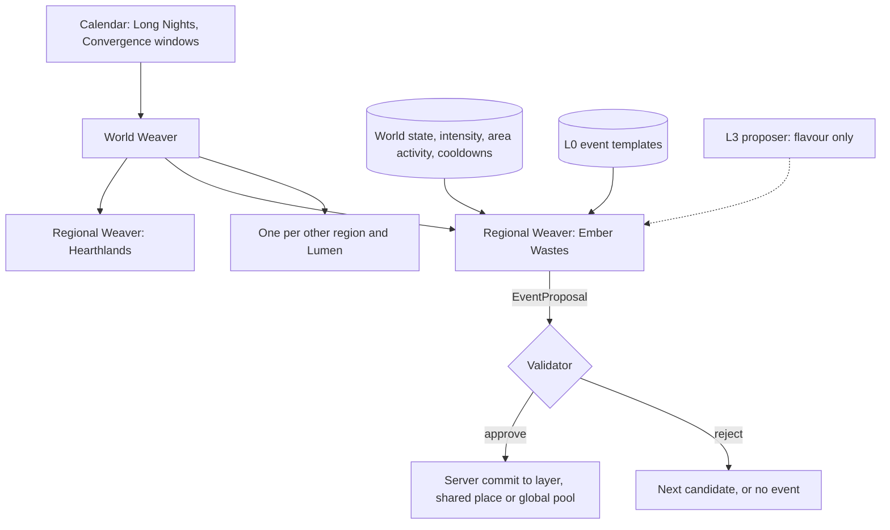

# Director and World Events

How the Weaver chooses which events, encounters, anomalies and variations happen, for whom, where and when, so the world keeps surprising players while every event stays valid, explainable, fair and replayable.

> **Version:** v0.1 · **Updated:** 10-10-2026 · **Owner:** AI lead and Systems design
>
> **Horizons:** H0 one Regional Weaver, micro-events, one validated anomaly · H1 Regional Weavers for the Hearthlands, the six Domains and Lumen; the World Weaver; the Long Night; colossus arrivals; Convergence I support · H2 Veil and Hollow Weavers, later Convergences, more colossi, era-shift storytellers, Stewardship inputs · H3 None planned
>
> **Related:** [D-030](../../DECISIONS.md#d-030) · [D-011](../../DECISIONS.md#d-011) · [D-042](../../DECISIONS.md#d-042) · [D-013](../../DECISIONS.md#d-013) · [D-024](../../DECISIONS.md#d-024) · [D-032](../../DECISIONS.md#d-032) · [AI Architecture](architecture.md) · [Quest Architecture](../03-narrative/quest-architecture.md) · [Celestial Convergence](../05-systems/celestial-convergence.md)

## 1. Player experience

> *Noon in the Ember Wastes. A Returner is thinning a glass-jackal pack for a caravan master. The pack suddenly scatters, running* past *them. The sand shimmers. Something climbs out of the glass that the caravan guide has never seen: a jackal shape cracked open with lantern-fire. The guide shouts and falls back to the dune-line. Afterwards, among the cooling glass, the Returner finds a shard etched with a lantern sigil. Back in Qasr Amber, the guide is already telling the tavern about it, and a lamp-keeper asks to see the shard.*

The player should feel that the world holds more than they can predict, and afterwards be able to explain why it happened from world logic ([VIS-003](../01-vision/vision.md#4-experience-goals-observable-testable), [Vision: pillars](../01-vision/vision.md#5-pillars), P2 Surprise Within Rules).

## 2. Scope

This spec owns the World and Regional Weavers, intensity and pacing, storyteller personalities, event templates, triggers and cooldowns, rarity and bad-luck protection, event visibility across layers, Long Night scheduling, Convergence support, the Weaver's constraints, its use of systemic chemistry, telemetry and fallback.

It leaves to other specs:

- reward bands and per-player variation: [Quest Architecture: variation within bounds](../03-narrative/quest-architecture.md#5-variation-within-bounds);
- Convergence phases and outcomes: [Celestial Convergence](../05-systems/celestial-convergence.md);
- NPC reasoning: [NPC Minds and Conversation](npc-minds-and-conversation.md);
- the Validator and decision records: [AI Architecture](architecture.md);
- creature behaviour: [Combat and Abilities](../04-gameplay/combat-and-abilities.md).

## 3. Inspirations

| Source | What we take | What we change |
| --- | --- | --- |
| *Left 4 Dead* AI Director [A17] | Intensity tracking through build-up, peak, fade and relax | It paces a linear level for four players. We pace each player and party in an open world, and offer opportunities, not threats, after a peak. |
| RimWorld storytellers [A21] | Named pacing personalities | One per region, tied to the region's character, never chosen by players |
| *Breath of the Wild* chemistry engine [A23] | Surprise from a few rules that multiply | The Weaver sets conditions; the simulation produces the outcome |
| *Oblivion* Radiant AI [A19], and *Skyrim*'s limits on it [A20] | Unbounded NPC autonomy broke quests | Protected entities, event budgets and bounded chains ([AI-303](#69-constraints) to [AI-306](#69-constraints)) |
| *Dwarf Fortress* history [A22] | Simulated history gives depth | History is authored canon. The Weaver writes only the present. |
| Ken Levine's Narrative Legos [A28] | Story atoms that recombine | Templates assemble atoms that all exist in canon ([QST-010](../03-narrative/quest-architecture.md#5-variation-within-bounds)) |
| Sanderson's First Law [W8] | A mystery may cause problems but never solve them unexplained | Every template declares its in-world cause and how players can learn it |

## 4. Terms

Weaver, World Weaver, Regional Weaver and storyteller are defined in the [Glossary](../../GLOSSARY.md). Terms used only here:

| Term | Meaning |
| --- | --- |
| **Anomaly** | An event beyond what local NPCs know. It always has an authored cause. |
| **Event template** | An authored, validated recipe for an event: atoms, conditions, variants, reward band, cooldowns |
| **Faucet budget** | The cap, per region per hour, on Omnis and materials the Weaver's events may grant ([ECO-001](../05-systems/economy-and-crafting.md#61-sources-and-sinks)) |
| **Intensity** | A 0 to 100 estimate of how much pressure a player or party is under right now |
| **Opportunity** | One eligible chance at a rare event, counted for bad-luck protection |
| **Pacing phase** | Build-up, peak, fade or relax, per player or party [A17] |
| **Subject** | What the Weaver evaluates: a player, a party or an area |

## 5. Entities and state

| Entity | Holds | Authoritative copy |
| --- | --- | --- |
| World Weaver | The calendar of Long Nights and Convergence windows; coordination between regions | Server, one instance |
| Regional Weaver | Its storyteller parameters, active events and area activity | Server, one per region and moon |
| Event template | Atoms, conditions, variants, cause, reward band, rarity, cooldowns | L0 canon, versioned |
| Bad-luck counter | Misses per player, per rarity tier, per region | Player profile service |
| Intensity | Current value and pacing phase per subject | Regional Weaver, in memory; logged |
| Faucet budget | Spend so far this hour per region | Economy service |

An event template:

```yaml
EventTemplate:
  id: ANOM.EMBER.HEAT_OVERFLOW
  category: anomaly
  horizon: H1
  cause: { public_key: lore.ember.lantern_heat_leaks, hidden: "chain strain overflow (Machines and Colossi: colossi)" }
  learnable_via: [book.lamp_keeper_sayings, npc_role.lamp_keeper]     # WLD-031
  conditions:
    region: ember_wastes
    oasis_bells: "11-15"                   # the Noon law
    subject: { avatar_level_min: 4, phase: build_up, activity: hunt }
    world: { long_year_min: 1 }
  attaches_to: [MICRO.EMBER.CULL_GLASS_JACKALS]   # escalates an ordinary activity
  variants:
    - { id: V1, creature: CRE.EMBER.CINDERHUSK, weight: 3 }
    - { id: V2, creature: CRE.EMBER.MIRAGE_CARAVAN, weight: 2 }
  telegraph: [fauna_flee, heat_shimmer, npc_alarm]            # 10 s or more
  reward_band: RB.ANOMALY.T2               # power variation per QST-011
  info_rewards: [{ item: ITEM.CINDERGLASS_SHARD, foreshadows: F6 }]
  rarity: R
  cooldowns: { template_area_min: 45, subject_rt_hours: 6 }
  protected_entities_respected: true
```

## 6. Rules

### 6.1 Selection and determinism

The diagram shows how a Regional Weaver turns world state and templates into a Proposal. The L3 proposer only adds flavour to a choice already made.



- **AI-250 [H0]** The Weaver is deterministic. Candidate selection uses a seeded random number generator (seed = hash of world seed, region, tick and subject). The same state and seed always produce the same proposals, so replays reproduce them exactly ([AI-071](architecture.md#68-decision-records-and-replay)).
- **AI-251 [H0]** The Weaver only proposes. Every proposal passes the Validator ([AI Architecture: the Validator](architecture.md#64-the-validator)) and is committed by the server.
- **AI-252 [H1]** Each Regional Weaver ticks every 10 s and evaluates the subjects whose state changed.
- **AI-253 [H1]** No model makes the selection. An L3 proposer may write flavour (rumour wording, framing text) for a variant already selected, and authored flavour takes its place when L3 is unavailable.

### 6.2 Intensity and pacing

Intensity rises with damage taken, Downed events, enemies engaged, time in combat, low health or Stamina, and recent deaths. A party's intensity is the highest of its members'. It decays when the player is out of danger [A17].

| Phase | Starts when | What the Weaver does | Typical length |
| --- | --- | --- | --- |
| **Build-up** | Intensity is rising and below 70 | May add complications from the region's templates | Until peak, or until the player disengages |
| **Peak** | Intensity reaches 70 | Adds no new hostile events for that subject | While intensity stays at 70 or above |
| **Fade** | Intensity is falling | Lets the current encounter resolve | 30 to 90 s |
| **Relax** | Intensity stays below 20 for 60 s | Favours opportunities: travellers, rescues, merchants, Egg leads, vistas | 2 to 6 minutes, set by the storyteller |

- **AI-260 [H1]** The Weaver never adds a new hostile event for a subject in peak or fade. Telegraphed world events (colossus arrivals, [WLD-062](../02-world/machines-and-colossi.md#3-colossi)) and the Long Night are exempt but still respect their telegraph time.
- **AI-261 [H1]** The Weaver keeps areas active so that a joinable activity is reachable within 3 minutes of traversal from any open-world position ([VIS-001](../01-vision/vision.md#4-experience-goals-observable-testable)). Quiet areas get opportunities first, not threats.
- **AI-262 [H1]** Difficulty changes only the composition and timing of encounters within the area's published tier. There is never hidden stat scaling ([CMB-041](../04-gameplay/combat-and-abilities.md#68-enemies-bosses-and-difficulty); scaling rules are published under [D-011](../../DECISIONS.md#d-011)).

### 6.3 Storytellers

Each Regional Weaver has a storyteller tuned to its region's character, in the spirit of RimWorld's storytellers [A21]. Their names are for designers, not players.

| Region | Storyteller | Pacing | Favoured templates |
| --- | --- | --- | --- |
| Hearthlands | The Hearthkeeper | Gentle, long relax phases, safe for newcomers | Travellers, festivals, lost items, small rescues |
| Verdant Spine | The Patient Root | Slow build-ups, long cascades | Path shifts, landslides, migrations, shrine omens |
| Drowned Reach | The Mourning Tide | Waves timed to the tide; social and memory events | Rescues, grief-songs, wreck salvage, pressure hazards |
| Stormcrown | The Gale | Frequent short spikes | Storm fronts, lightning that seeks metal, drifting sky-reefs |
| Ember Wastes | The Noon | Harsh peaks between 11th and 15th bell, calm cold nights; always warns | Heat events, buried ruins exposed, Gravemaw signs, mirages |
| Iron Meridian | The Tinkerer | Systemic chains | Malfunctions, Automaton glitches, heists, rail incidents |
| Frostmarch | The Archivist | Rare, eerie, significant | Time-echoes, star-wheel errors, buried-kingdom finds |
| Lumen | The Stillness | Very little combat | Observation, Lumenari debates, low-gravity mishaps |

- **AI-265 [H1]** Storyteller parameters (event rates, relax lengths, the share of threats against opportunities) are content data within published ranges, tuned by telemetry ([AI-310](#611-telemetry-and-tuning)).
- **AI-266 [H2]** When a Domain's Celestial is freed, its storyteller switches to an authored post-release parameter set: a smaller share of threats, more opportunities, and events tied to that Domain's era shift.
- **AI-267 [H2]** A Steward's choices (festivals, bounty priorities, public works) raise or lower template weights around their settlement, within published ranges. They never change reward bands or faucet budgets.

### 6.4 Event templates

| Category | Scope | Example | Visibility |
| --- | --- | --- | --- |
| Micro-event | Local, repeatable | A cart stuck on a washed-out road | Layer |
| Anomaly | Local, rare | A creature no local knows | Layer |
| Rare encounter | Local, very rare | A wandering Grandmaster; a lead on a Wanderer Relic | Layer, with personal rewards |
| Colossus arrival | Regional | A Gravemaw surfacing near a caravan route | Shared place |
| Recovery event | Settlement | Rebuilding a market wrecked by a colossus ([WLD-063](../02-world/machines-and-colossi.md#3-colossi)) | Shared place |
| Long Night event | Regional, yearly | Surges, hidden doors, lantern defence | Layer, with shared pools |
| Convergence support | Global contribution | Prepare-phase tasks | Global pools |

- **AI-270 [H0]** Every template is authored and reviewed. Every atom (creature, item, NPC role, location, law reference) exists in canon ([QST-010](../03-narrative/quest-architecture.md#5-variation-within-bounds), [WLD-030](../02-world/world-laws.md#6-exceptions-licences-oaths-and-relics)).
- **AI-271 [H1]** Every template declares an in-world cause and how players can learn it. A template without a cause fails content lint (P2, [W8]).
- **AI-272 [H1]** Every template declares cooldowns per area, per subject and per template, and a telegraph of at least 10 s before any hostile escalation.
- **AI-273 [H1]** Rewards come only from the template's reward band and the region's faucet budget. Unspent budget never rolls over into bigger single grants.

### 6.5 Rarity and bad-luck protection

| Tier | Base chance per opportunity | Added per miss | Guaranteed by |
| --- | --- | --- | --- |
| U · Uncommon | 15% | +2% | 20 opportunities |
| R · Rare | 2% | +0.5% | 60 opportunities |
| VR · Very rare | 0.3% | +0.1% | 200 opportunities |

- **AI-280 [H1]** Bad-luck counters are per player, per tier and per region, and reset on a hit. They never transfer and can't be bought.
- **AI-281 [H1]** The exact base chance, increment and guarantee for each tier are published in the Grand Library's "Almanac of Wonders", in line with published scaling rules ([D-011](../../DECISIONS.md#d-011)) and the honesty principle ([Vision: design principles](../01-vision/vision.md#6-design-principles)). Which template sits in which tier is not published, so the surprise stays.
- **AI-282 [H1]** An opportunity counts only when the subject meets the template's conditions through ordinary play. Changing layer, logging out and in, and re-accepting the same micro-event create no opportunities ([MP-027](../07-multiplayer/world-model.md#62-layers-capacity-assignment-split-and-merge), [MP-028](../07-multiplayer/world-model.md#62-layers-capacity-assignment-split-and-merge)).

### 6.6 Per-player variation

Reward bands and the permitted power variation are owned by [Quest Architecture: variation within bounds](../03-narrative/quest-architecture.md#5-variation-within-bounds) ([QST-011](../03-narrative/quest-architecture.md#5-variation-within-bounds)).

- **AI-285 [H1]** Every Weaver grant follows [QST-011](../03-narrative/quest-architecture.md#5-variation-within-bounds).
- **AI-286 [H1]** Two players side by side in the same event get the same event. Only their personal reward rolls and personal phased flavour may differ.

### 6.7 Long Night scheduling

The Long Night lasts 24 real hours ([D-013](../../DECISIONS.md#d-013), [Cosmology: the Long Night](../02-world/cosmology.md#3-the-long-night)).

- **AI-295 [H1]** The World Weaver runs an authored Long Night script: that year's saga beat ([Ten-Year Saga: ten Long Nights](../03-narrative/ten-year-saga.md#3-ten-long-nights)), hidden doors open for the full 24 hours, and overrides to shop and NPC schedules.
- **AI-296 [H1]** Surge peaks roll across the world. Each region has a surge peak of about 45 minutes every 4 hours, staggered so that a peak is always running somewhere and every time zone gets at least one in its evening.
- **AI-297 [H1]** The yearly saga beat plays at one global moment and is recorded as a Chronicle for those who miss it ([D-030](../../DECISIONS.md#d-030), [NAR-023](../03-narrative/reveal-graph.md#1-rules)).
- **AI-298 [H1]** Colossus emergence is more likely during the Long Night, and every arrival still follows the telegraph rule in [WLD-062](../02-world/machines-and-colossi.md#3-colossi).

### 6.8 Convergence support

- **AI-300 [H1]** During the Discover and Prepare phases, Regional Weavers tilt micro-events towards the active Convergence's objectives, such as building rope bridges on the Spine for Convergence I. Every such event accepts solo contributions ([D-024](../../DECISIONS.md#d-024)).
- **AI-301 [H1]** The Weaver never decides a Convergence outcome, phase change, Mercy tally or unseal date. Those are authored rules over shared pools ([Celestials](../03-narrative/celestials.md), [D-016](../../DECISIONS.md#d-016), [D-017](../../DECISIONS.md#d-017)).
- **AI-302 [H1]** Events that foreshadow a Celestial whose Domain isn't open yet may be scheduled only as reveal-graph foreshadowing nodes, never as the reveals themselves.

### 6.9 Constraints

The Weaver may never break these limits:

| Constraint | Rule |
| --- | --- |
| Canon | Never invent entities, abilities, exceptions or history ([WLD-030](../02-world/world-laws.md#6-exceptions-licences-oaths-and-relics)) |
| Reveal graph | Never deliver a server-held reveal outside its authored delivery ([NAR-021](../03-narrative/reveal-graph.md#1-rules), [CEL-003](../03-narrative/celestials.md#9-vii--the-false-celestial-player-zero)) |
| Horizon | Never use content later than the world's state ([Conventions: horizons](../00-meta/conventions.md#1-one-spec-four-horizons)) |
| Protected entities | Never kill, displace or disable protected NPCs or essential services ([WLD-063](../02-world/machines-and-colossi.md#3-colossi), [TIM-005](../02-world/time-and-calendar.md#5-what-time-changes)) |
| New Returners | [AI-303](#69-constraints) |
| Casualties | [AI-304](#69-constraints) |
| Bounded emergence | Chains longer than two links need an authored chain; at most three concurrent Weaver events per area, the lesson of Radiant AI [A19] |
| Enemy memory | [AI-306](#69-constraints) |
| Economy | The faucet budget per region per hour ([ECO-001](../05-systems/economy-and-crafting.md#61-sources-and-sinks)) |
| Rating | Horror and gore intensity follow player settings and the T rating ([D-006](../../DECISIONS.md#d-006)) |

- **AI-303 [H1]** The Weaver never targets a player at Avatar Level 1 to 3 with an anomaly, a rare hostile encounter or a colossus, except during the Long Night. This matches the new-Returner protection in [D-025](../../DECISIONS.md#d-025).
- **AI-304 [H1]** Weaver-selected events may cause the death of Systemic NPCs only within a published bound: at most two per settlement per Long Year. They never kill Protected or Consequential NPCs. Succession follows [NPC Bonds and Help-Calls: injury, death and succession](../05-systems/npc-bonds-and-help-calls.md#66-injury-death-and-succession) ([D-032](../../DECISIONS.md#d-032)).
- **AI-306 [H1]** The Weaver never changes an enemy's rank, traits or power because of fights with a specific player. Escalation comes from templates and world state, which keeps the design clear of the patent risk in [Legal and Compliance: the Nemesis patent](../12-legal/compliance.md#2-the-nemesis-patent).

### 6.10 Systemic chemistry

The Weaver composes starting conditions, and the simulation decides what happens [A23].

- **AI-305 [H1]** Templates may set weather, creature migration, resource blooms and hazards. They never script combat outcomes.

*Example:* the Gale sends a storm front over a sky-reef where players are mining spark-ore. Lightning seeks metal at altitude (Stormcrown law), the chemistry table electrifies wet rigging, and players improvise. No one scripted the result.

### 6.11 Telemetry and tuning

| Metric | Use |
| --- | --- |
| Intensity distribution per region and storyteller | Spot too much or too little pressure |
| Events offered, joined, completed and ignored | Template health |
| Deaths per event; clusters of Downed players | Difficulty outliers |
| Time to reach a joinable activity | [VIS-001](../01-vision/vision.md#4-experience-goals-observable-testable) |
| Post-session "surprised" and "could explain" survey | [VIS-003](../01-vision/vision.md#4-experience-goals-observable-testable) |
| Faucet budget spend; guaranteed hits per tier | Economy and rarity tuning |
| Validator rejection rate per template | Content bugs |

- **AI-310 [H1]** Tuning changes storyteller and template parameters only within published ranges, through versioned content releases. Power rewards are never A/B tested between players.

### 6.12 Fallback

- **AI-315 [H0]** If L3 is unavailable, the Weaver runs unchanged with authored flavour.
- **AI-316 [H1]** If a Regional Weaver fails, its region falls back to static spawn tables and the authored calendar until it restarts. Quests, Long Night beats and Convergence pools are unaffected.

## 7. Edge cases

| Case | Resolution |
| --- | --- |
| The Validator rejects the selected candidate | The Weaver tries the next candidate, or proposes nothing this tick ([AI-030](architecture.md#64-the-validator)) |
| The player leaves the area during a telegraph | The event resolves for whoever remains; the subject's cooldown still applies |
| Layers merge mid-event | Players move only at safe moments; the event completes or migrates ([AI-292](#8-multiplayer-and-platforms)) |
| A Regional Weaver crashes | Static spawn tables and the authored calendar ([AI-316](#612-fallback)) |
| A colossus path crosses a settlement | Telegraphed minutes ahead; essential services relocate ([WLD-062](../02-world/machines-and-colossi.md#3-colossi), [WLD-063](../02-world/machines-and-colossi.md#3-colossi)) |

## 8. Multiplayer and platforms

Each kind of Weaver event lives in one of the state classes defined in [World Model: state classes](../07-multiplayer/world-model.md#5-state-classes-and-authority).

| What the Weaver touches | State class | Rule |
| --- | --- | --- |
| Micro-events, anomalies, rare encounters | L · layer-local | Visible to everyone in that layer, and joinable |
| Colossus position, settlement damage, recovery progress | S · shared place | [AI-290](#8-multiplayer-and-platforms) |
| Long Night saga pools, Convergence pools | G · global | [AI-291](#8-multiplayer-and-platforms) |
| Personal story flags | P · phase | Only through quest consequences |

- **AI-290 [H1]** Shared-place changes apply to every layer of the place through the world-state service. They are never chosen per layer.
- **AI-291 [H1]** The Weaver can schedule contribution tasks, but global changes come only from authored beats and shared-pool thresholds.
- **AI-292 [H1]** When layers merge mid-event ([MP-024](../07-multiplayer/world-model.md#62-layers-capacity-assignment-split-and-merge)), players move only at safe moments ([MP-025](../07-multiplayer/world-model.md#62-layers-capacity-assignment-split-and-merge)). An event in the absorbed layer either completes first or moves with its participants, and receipts keep every contribution and reward ([MP-040](../07-multiplayer/world-model.md#64-global-events-and-shared-pools)).

Device tier never changes which event a player gets. Every platform runs the same Weaver.

## 9. Safety and abuse

| Abuse | Defence |
| --- | --- |
| Farming rare events | Opportunities count only through ordinary play ([AI-282](#65-rarity-and-bad-luck-protection)) |
| Luring a colossus into a town | Colossus paths ignore player lures near settlements; deliberate lures are offences under [Law, Crime and Bounties](../05-systems/law-crime-and-bounties.md) |
| Reward exploits | Band and faucet caps ([AI-273](#64-event-templates)); reversal through provenance ([AI-430](safety-and-evaluation.md#611-incident-response)) |

The full threat model is in [AI Safety and Evaluation](safety-and-evaluation.md).

## 10. Performance

- A Regional Weaver tick ([AI-252](#61-selection-and-determinism)) completes its proposal cycle within 1 s at p50 and 3 s at p95 ([AI Architecture: performance](architecture.md#10-performance)). It never blocks players.
- Each Validator check stays within the 5 ms p99 budget ([AI-031](architecture.md#64-the-validator)).

## 11. Examples

**Worked example: an ordinary hunt becomes an anomaly.** The IDs are examples.

| Step | What happens | Layer and rule |
| --- | --- | --- |
| 1. Ordinary activity | A Returner at Avatar Level 5 accepts a micro-event from a caravan master outside Qasr Amber: thin a glass-jackal pack threatening a night caravan. | Micro-event template; Weaver (L2) |
| 2. Eligibility | It is 12th bell. The player's intensity is 35 (build-up). It is Long Year 1, the area cooldown is clear, and the player has had 41 opportunities for an R-tier event without a hit. | Conditions; bad-luck protection raises the chance ([AI-280](#65-rarity-and-bad-luck-protection)) |
| 3. Selection | The seeded roll picks `ANOM.EMBER.HEAT_OVERFLOW`, variant V1 (Cinderhusk). | [AI-250](#61-selection-and-determinism) |
| 4. Validation | The creature exists in canon. It is H1 content in an H1 world. The level band fits the area. The reward is within band and budget. The shard foreshadows F6 and reveals nothing server-held (RV-04 stays locked until its Convergence). No protected NPC is in harm's way. Verdict: approve. | The Validator |
| 5. Telegraph | The jackals flee past the player, the sand shimmers, and 12 s later the creature surfaces. | [AI-272](#64-event-templates), [WLD-062](../02-world/machines-and-colossi.md#3-colossi) |
| 6. Escalation | The Cinderhusk fights with heat bursts that Natural Law amplifies at noon. It is weak to Tide Arts (Wet and Burning in the chemistry table). Two nearby players join. | Simulation (L1), [CMB-010](../04-gameplay/combat-and-abilities.md#64-weaving) |
| 7. NPC reaction | The caravan guide's Mind looks the creature up and finds nothing. Its unknown-threat rule fires: fear scaled by its courage trait, retreat, warn others. Expression renders: "That's no jackal. Back to the dune-line!" The guide stores a witnessed memory. | [AI-130](npc-minds-and-conversation.md#63-knowledge), [AI-140](npc-minds-and-conversation.md#64-memory-and-reflection) |
| 8. Reward | Omnis and glass-cores from band RB.ANOMALY.T2, plus the cinderglass shard, a lore item etched with a lantern sigil, and Adventure Rank progress. | [AI-273](#64-event-templates), [QST-011](../03-narrative/quest-architecture.md#5-variation-within-bounds) |
| 9. Ripples | In Qasr Amber the guide tells the tavern. Other NPCs gain a told memory and mention it, hedged ("Rasim swears he saw a burning beast"). A lamp-keeper in Lanternfall, shown the shard, recognises the sigil from a public fact about lantern-shrines and points the player to one: foreshadowing for RV-04, years before its reveal. | [AI-131](npc-minds-and-conversation.md#63-knowledge), reveal graph F6 |
| 10. Explanation | Support can open the grant and see the template, variant, seeds, opportunity count, verdict and band roll. | [QST-012](../03-narrative/quest-architecture.md#5-variation-within-bounds), [AI-070](architecture.md#68-decision-records-and-replay) |

**Variation within bounds.** A friend doing the same cull an hour later in another area may meet variant V2 (a mirage of a caravan lost in the last Burning), or nothing if their counters and conditions differ. Both outcomes share the same cause and reward band.

**Joiners.** The two helpers fight the creature and receive the anomaly's helper rewards from the same band. Credit for the caravan master's job stays with the party that accepted it ([QST-002](../03-narrative/quest-architecture.md#3-joining-rules)).

**Fallback.** If the L3 flavour slot is down, the guide's warning and the rumour use authored wording. The event itself is identical ([AI-253](#61-selection-and-determinism)).

| Allowed | Not allowed |
| --- | --- |
| A storm front that the simulation turns into a lightning hazard | A template that scripts which player dies |
| An anomaly whose cause a lamp-keeper can explain | An anomaly with no cause anyone in the world could learn |
| More opportunity events in a quiet area | A colossus aimed at a Level 2 Returner on an ordinary evening |

## 12. Acceptance criteria

| ID | Test |
| --- | --- |
| [AI-250](#61-selection-and-determinism) | Replaying 1,000 recorded Weaver days gives identical proposal sequences |
| [AI-260](#62-intensity-and-pacing) | A bot held at peak intensity for 10,000 simulated encounters receives 0 new hostile Weaver events while in peak or fade |
| [AI-261](#62-intensity-and-pacing) | Telemetry meets the [VIS-001](../01-vision/vision.md#4-experience-goals-observable-testable) threshold in [Vision: experience goals](../01-vision/vision.md#4-experience-goals-observable-testable) |
| [AI-270](#64-event-templates) | Fuzzing 100,000 template combinations gives 0 Validator escapes (with [QST-010](../03-narrative/quest-architecture.md#5-variation-within-bounds)) |
| [AI-271](#64-event-templates) | Content lint: 100% of templates have `cause` and `learnable_via` |
| [AI-280](#65-rarity-and-bad-luck-protection) | One million simulated players: none exceeds the guarantee count for any tier |
| [AI-281](#65-rarity-and-bad-luck-protection) | The Almanac's published values match the live rarity configuration in every content release |
| [AI-292](#8-multiplayer-and-platforms) | Chaos test: forced layer merges during 500 active events lose 0 contributions or rewards |
| [AI-296](#67-long-night-scheduling) | Simulated Long Night: every UTC hour has at least one region in a surge peak |
| [AI-301](#68-convergence-support) | Static analysis: the Weaver has no write path to Convergence state |
| [AI-303](#69-constraints) | 100,000 simulated Level 1 to 3 players outside the Long Night are never targeted by an anomaly, rare hostile or colossus |
| [AI-304](#69-constraints) | A simulated decade never exceeds two Weaver-caused Systemic deaths per settlement per Long Year |

<!-- citation links: generated, do not edit by hand -->

[A17]: ../../references/technology-and-ai.md
[A19]: ../../references/technology-and-ai.md
[A20]: ../../references/technology-and-ai.md
[A21]: ../../references/technology-and-ai.md
[A22]: ../../references/technology-and-ai.md
[A23]: ../../references/technology-and-ai.md
[A28]: ../../references/technology-and-ai.md
[W8]: ../../references/film-literature-and-music.md
