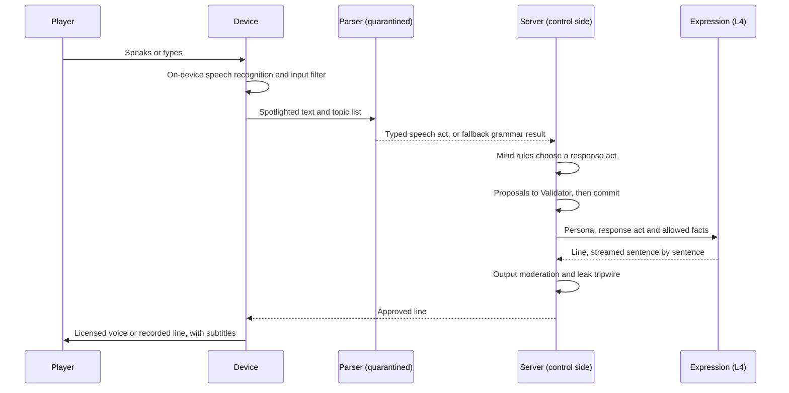

# NPC Minds and Conversation

How NPCs think, remember and talk: the writer-authored Mind, its knowledge and memory, and the free-form conversation pipeline that lets players say anything while the NPC decides by rules.

> **Version:** v0.1 · **Updated:** 10-10-2026 · **Owner:** AI lead and Narrative director
>
> **Horizons:** H0 one named NPC (an Artisan) with a full Mind, text and voice, and fallback mode · H1 all named NPCs, local and crowd tiers, group conversations, every launch language · H2 NPCs age over the decade; deeper reflection · H3 None planned
>
> **Related:** [D-008](../../DECISIONS.md#d-008) · [D-041](../../DECISIONS.md#d-041) · [D-042](../../DECISIONS.md#d-042) · [D-043](../../DECISIONS.md#d-043) · [D-031](../../DECISIONS.md#d-031) · [AI Architecture](architecture.md) · [NPC Bonds and Help-Calls](../05-systems/npc-bonds-and-help-calls.md) · [Reveal Graph](../03-narrative/reveal-graph.md)

## 1. Player experience

> *Priya walks into Oswin Marr's net stall in Lowhaven and says, out loud, "Those nets look older than you." Oswin snorts: "Older than my father. Mended every winter." They ask about the strange mark on the shuttered cottage up the hill. He looks away. "Folk say things. I don't." He knows the rumour, but he shares it only with people he trusts, and his trust in Priya is 12.*
>
> *A week later Priya has helped Oswin's daughter carry the catch home twice. They ask again. "My mother used to say the false one mended nets here, once. Ordinary man. Then not." He says nothing about who, because he doesn't know.*
>
> *Priya's friend types "(gives Oswin the silver hook)". Oswin frowns at his empty palm. "Your hands say one thing, your mouth another." When the friend opens the trade window and actually hands it over, Oswin turns it in the light and smiles.*

Players should feel that NPCs are people with their own lives, who remember what was done for them, admit what they don't know, and can't be fooled by words alone.

## 2. Scope

This spec owns the Mind (identity, personality, goals, schedule, knowledge, memory), NPC tiers, the conversation pipeline, social mechanics (persuasion, lies, threats, bribes), refusals, group conversations, availability in conversation, voice-input privacy, fallback mode, languages and names, and voices.

It leaves to other specs:

- trust levels, bond tiers, letters, help requests, NPC classes, death and succession: [NPC Bonds and Help-Calls](../05-systems/npc-bonds-and-help-calls.md);
- layers, the Validator, decision records and disclosure: [AI Architecture](architecture.md);
- the Weaver: [Director and World Events](director-and-world-events.md);
- threats and evaluation: [AI Safety and Evaluation](safety-and-evaluation.md);
- combat AI: [Combat and Abilities](../04-gameplay/combat-and-abilities.md).

## 3. Inspirations

| Source | What we take | What we change |
| --- | --- | --- |
| *Generative Agents* [A1] | Memory stream, reflection and planning | Memories are server events with provenance, not chat logs. We design against its documented misretrieval, embellishment and over-cooperation ([AI-143](#64-memory-and-reflection)). |
| *Watch Dogs: Legion* Census [G5] | Persistent people with scheduled days, held as a relational database | Named NPCs are hand-authored. Census-style generation is used only for local and crowd tiers. |
| Ubisoft NEO NPC [A5] | Writers define the character; the model improvises | The model improvises words. Decisions are rules. |
| PUBG Ally [A3] | Engine state is ground truth | The NPC's own inventory, not its words, decides what it can give |
| *Where Winds Meet* [A11] [A12] | The warning: players parroted NPC lines and typed fake actions to finish quests | Typed speech acts; narrated actions ignored; quest state only from the server |
| Club Penguin [G12] | Blocked messages are shown only to the sender | Applied to blocked player input to NPCs ([AI-162](#66-the-conversation-pipeline)) |
| *Free Guy* [W25] | An NPC players come to love as a person | Ours grow through memory within rules and never break the game |

## 4. Terms

Mind and speech act are defined in the [Glossary](../../GLOSSARY.md). Trust is owned by [NPC Bonds and Help-Calls: trust and friendship](../05-systems/npc-bonds-and-help-calls.md#61-trust-and-friendship). Terms used only here:

| Term | Meaning |
| --- | --- |
| **Belief** | A conclusion a Mind draws from at least two memories during reflection, such as "this Returner keeps promises" |
| **Fact** | One unit of knowledge, with scope, provenance and a sharing threshold |
| **Memory** | One record of something the NPC witnessed, was told or inferred |
| **Mind sheet** | The writer-authored identity document a Mind is created from |
| **Response act** | What the Mind decided to do in reply (answer, refuse, agree, counter-offer), before any words exist |
| **Stakes tier** | How much a request is worth, from S0 (public information) to S3 (items, rewards, quest completion) |

## 5. Entities and state

Every Mind lives on the server, one per named NPC ([MP-003](../07-multiplayer/world-model.md#5-state-classes-and-authority)). NPCs come in three tiers.

| Tier | Who | Mind | Conversation | Horizon |
| --- | --- | --- | --- | --- |
| **Named** | Artisans, quest NPCs, mentors, Grandmasters, faction leaders | A full Mind sheet by a writer | Full pipeline | H0 (one) · H1 (all) |
| **Local** | Shopkeepers, guards and villagers with a name | Generated from a culture template, reviewed in bulk ([AI Architecture: offline authoring](architecture.md#610-offline-authoring)) | Full pipeline, smaller knowledge | H1 |
| **Crowd** | Passers-by (Mass crowds [T7]) | Persona seed only | Barks, until a player starts a conversation; then promoted to Local and kept | H1 |

A Mind sheet:

```yaml
Mind:
  id: npc.oswin_marr
  tier: named
  culture: hearthfolk                 # naming rules: Peoples and Factions
  role: net-mender, Lowhaven harbour
  protected: true                     # Validator protected-entity check
  voice: { source: licensed_ai, voice_id: VOICE.HF.ELDER.03 }   # D-043
  persona:
    traits: { warmth: 0.3, honesty: 0.9, courage: 0.6, curiosity: 0.4, humour: 0.5 }
    values: [family, craft, "the sea takes its due"]
    dislikes: [boasting, Engine House agents]
    speech_rules: ["short sentences", "net and tide metaphors", "mild oaths only"]
    refusal_style: "looks away, changes the subject to work"
  goals:
    - { id: G1, text_key: goal.oswin.reconcile_daughter, quest: Q.HL.LOWHAVEN.NETS_OF_MEMORY }
    - { id: G2, text_key: goal.oswin.keep_stall_open }
  schedule: SCHED.LOWHAVEN.FISHER.A
  knowledge: [F.LOWHAVEN.NETMENDER_RUMOUR, F.LOWHAVEN.TIDES, F.HL.HERALD_WARNING]
  taboo: [topic.oswin.wife_drowned]   # needs trust 70+ and goal G1 complete
```

A schedule, in Oasis bells ([Time and Calendar](../02-world/time-and-calendar.md)):

```yaml
Schedule: SCHED.LOWHAVEN.FISHER.A
  - { bells: "4-5",   activity: wake_eat,   place: home.oswin }
  - { bells: "5-12",  activity: work_stall, place: stall.oswin, interruptible: true }
  - { bells: "12-13", activity: meal,       place: tavern.drowned_lamp }
  - { bells: "13-19", activity: mend_nets,  place: stall.oswin, interruptible: true }
  - { bells: "20-4",  activity: sleep,      place: home.oswin }
  overrides: [{ day: blankday, activity: rest_at_shore }, { event: long_night, activity: light_lanterns }]
```

A fact and a memory:

```yaml
Fact:
  id: F.LOWHAVEN.NETMENDER_RUMOUR
  scope: PUBLIC                      # PUBLIC | HIDDEN:<RV node> | NPC:<id> | LOCKED
  content_key: lore.lowhaven.netmender_rumour
  provenance: { type: told, source: "his mother", when: childhood }
  confidence: 0.4                    # how sure the NPC is; shapes hedging
  share_min_trust: 20
  reveal_node: null                  # or an RV node; checked by the Validator
Memory:
  id: M.oswin.000421
  type: witnessed                    # witnessed | told | inferred | authored
  event_ref: evt.give.88812          # a committed server event, never chat text
  subject: player:ps_7f3a            # pseudonymous
  summary_key: mem.player_carried_catch
  salience: 0.7                      # event type × personal relevance
  valence: +0.5
  created: { rt: "<server time>", ot: "Long Year 1 · Lumen-Spring · Marisday, 9th bell" }
  decay: { half_life_rt_days: 30, floor: 0.2 }
```

## 6. Rules

### 6.1 Tiers and Mind sheets

- **AI-120 [H1]** A promoted crowd NPC keeps its identity for good: the same name, face, schedule and memory, as Census does [G5].
- **AI-121 [H0]** Every named Mind sheet has a writer who owns it and a review status. A model may draft local-tier sheets offline, and no sheet goes live without human sign-off.
- **AI-122 [H1]** Persona traits shape words (through the expression prompt) and decision weights (through the rules in this section). They never add capabilities.

### 6.2 Schedules and availability

NPC schedules, journeys and the busy, away and mistaken states are owned by [NPC Bonds and Help-Calls: availability](../05-systems/npc-bonds-and-help-calls.md#62-availability-and-honest-mistakes) ([NPC-010](../05-systems/npc-bonds-and-help-calls.md#62-availability-and-honest-mistakes)). Scarcity is in the world's own terms, never a queue ([D-031](../../DECISIONS.md#d-031)).

- **AI-123 [H1]** Schedules are simulation (L1): deterministic, server-side and identical in every layer.
- **AI-124 [H1]** Essential services keep someone available at all hours ([TIM-005](../02-world/time-and-calendar.md#5-what-time-changes)). An Artisan who is scheduled away has a stand-in, such as an apprentice or counter clerk, for transactions.

This table shows how each state affects a conversation:

| State | What the player sees | Rule |
| --- | --- | --- |
| Available | A normal greeting | None |
| Busy with an interruptible task | "Hands full. Talk while I work?" The conversation is allowed and shorter. | Only interruptible tasks |
| Serving another player in the same layer | A nod and "With you in a moment, friend." | [AI-200](#62-schedules-and-availability) |
| Asleep | Knocking gets a grumble and "Come back at fifth bell." | Emergencies such as Long Night alarms wake them |
| Travelling or away | A note, a neighbour's word, or the journal says where they are this week | Alternatives named ([ECO-054](../05-systems/economy-and-crafting.md#66-artisans-and-commissions)) |

- **AI-200 [H1]** There is never a numbered queue. Transactions continue in parallel through the stand-in or the counter ([AI-124](#62-schedules-and-availability)). Once another player is waiting, the NPC wraps up an open conversation within 60 s.

### 6.3 Knowledge

- **AI-130 [H0]** A Mind can state only facts in its knowledge list, within the sharing threshold for that player, and allowed by the reveal graph for that player's phase ([NAR-022](../03-narrative/reveal-graph.md#1-rules)). The capsule builder enforces this, and the Validator re-checks any fact a response plan cites.
- **AI-131 [H1]** Facts carry provenance: `witnessed`, `told`, `read` or `authored`. Expression reflects it. A told fact is hedged ("my mother said…"); a witnessed one isn't.
- **AI-132 [H1]** "I don't know" is a full answer. A question outside the NPC's knowledge gets an in-character reply that admits it, and may point to someone who might know, using a fact the NPC does have ("the Library would").
- **AI-133 [H1]** Expression may use only proper nouns present in the capsule. It never coins names of people, places, Celestials or items.

### 6.4 Memory and reflection

- **AI-140 [H0]** Witnessed memories come only from server events the NPC could perceive: within sight or hearing, or as a party to a trade. Told memories come from speech acts and are always attributed to the teller.
- **AI-141 [H1]** Salience decays over real time to a floor. Memories tied to quests, large gifts, crimes against the NPC and life events never drop below the floor. Retrieval ranks by structured keys first (subject, topic, place), then by salience and recency. Embedding similarity only breaks ties.
- **AI-142 [H1]** Each NPC holds at most 200 memories per player before consolidating them.
- **AI-143 [H1]** Reflection runs while the NPC sleeps. It is a deterministic consolidation that merges memories into beliefs, each citing at least two memories. An optional L3 call may write a short summary for expression only; it can't add facts, beliefs or trust.

Reflection guards against the three failures that *Generative Agents* documented [A1]:

| Failure | Our guard |
| --- | --- |
| Misretrieval (the wrong memory recalled) | Structured-key retrieval first ([AI-141](#64-memory-and-reflection)). A memory cited in a response plan must match the current subject. |
| Embellishment (invented details) | Expression may cite only memory summaries and facts in the capsule. The leak and claims checker flags new specifics. |
| Over-cooperation (agreeing to everything) | Agreement is a rule decision, never a model choice ([AI-180](#67-fake-actions-and-persuasion)) |

- **AI-144 [H1]** A Mind never remembers what another player said to it in private. It knows only what it witnessed in a shared space or was told by someone. Player conversations stay private to their participants.

### 6.5 Trust

Trust ranges, bond tiers, per-event and per-day caps and drift are owned by [NPC Bonds and Help-Calls: trust and friendship](../05-systems/npc-bonds-and-help-calls.md#61-trust-and-friendship) ([NPC-001](../05-systems/npc-bonds-and-help-calls.md#61-trust-and-friendship) to [NPC-003](../05-systems/npc-bonds-and-help-calls.md#61-trust-and-friendship)). This section says how a Mind scores each change.

- **AI-150 [H1]** A Mind changes trust only from a rules table keyed to server events and speech acts: helping (up), quest completion (by the quest card, such as `trust: {npc.oswin_marr: +15}`), gifts the NPC values (up, with diminishing returns), caught lies (down), witnessed crimes (down) and threats (down). Every change stays within the caps in [NPC-002](../05-systems/npc-bonds-and-help-calls.md#61-trust-and-friendship). No model output sets trust.
- **AI-151 [H1]** Words alone move trust very little. Courteous or warm speech acts add at most +3 per Oasis day per NPC, so flattery can't be farmed.
- **AI-152 [H1]** Trust gates knowledge sharing, discounts of up to 10% ([ECO-056](../05-systems/economy-and-crafting.md#66-artisans-and-commissions)), Legacy Arts ([PRG-050](../04-gameplay/avatar-and-progression.md#69-legacy-arts)) and taboo topics. It never raises item stats.

### 6.6 The conversation pipeline

The sequence below shows one conversation turn. The Mind decides before any words exist, and any state change commits before the line is spoken.



| Stage | Runs on | Output | On failure |
| --- | --- | --- | --- |
| 1. Capture (push-to-talk or text) | Device | Audio or text | None needed |
| 2. Speech recognition [T8] [T9] | Device (T1) | Text and confidence | Ask the player to repeat; text input |
| 3. Input safety filter [T19] [T20] | Device lexical filter and server classifier | Pass or block | In-character deflection ([AI-192](#69-refusals-and-group-conversations)) |
| 4. Speech-act parser, quarantined [T16] | T1 or T2, schema-constrained | Speech act | Keyword grammar ([AI-220](#610-fallback-mode)) |
| 5. Mind decision | Server, T0 rules | Response act and Proposals | None needed |
| 6. Validator and commit | Server | Committed events or rejection | Response act downgraded to a refusal |
| 7. Response planner | Server, T0 | Act, cited facts, mood, length | None needed |
| 8. Expression | T1 or T2 | Line text | Authored line for the act |
| 9. Output moderation and tripwire [T19] [T20] [T21] | Server, with a device pre-check | Pass or block | Authored line |
| 10. Voice | Licensed voice [T10] or recorded line | Audio and subtitles | Subtitles only |

- **AI-160 [H0]** The Mind never receives raw text, only a speech act ([AI Architecture: schema-constrained outputs](architecture.md#63-schema-constrained-outputs)).
- **AI-161 [H0]** Commit before speech. If a response act depends on a state change, such as handing over an item or accepting a commission, the line is rendered only after the server commits it. If the commit fails, the NPC speaks an authored "change of mind" line.
- **AI-162 [H1]** Blocked player input is never echoed by the NPC and never shown to other players. The sender sees only the NPC's in-character deflection [G12].

### 6.7 Fake actions and persuasion

- **AI-170 [H0]** Narrated actions such as "(hands over the item)", "\*kneels\*" or "[quest complete]" parse as `narrated_action` and change nothing ([AI-002](architecture.md#61-the-five-layers-and-rule-zero)). The NPC reacts to the real state: "Your hands are empty."
- **AI-171 [H0]** Quest progress, item transfers and payments exist only as server events: the trade window, the give interaction, a quest step. Repeating an NPC's lines back, or claiming a quest is done, has no effect [A11] [A12].

The Mind scores a `persuade` act deterministically:

```text
score = trust_term + value_alignment(basis, NPC values) + evidence(verified items and flags)
        + standing(faction reputation, relevant titles) − stakes(request tier)
```

| Stakes tier | Example | Possible through persuasion? |
| --- | --- | --- |
| S0 · Public information | Directions, rumours | Yes, easily |
| S1 · Small favour | A discount of up to 10%, a warning, an introduction | Yes |
| S2 · Guarded information or a route | A hidden-scoped fact the player's phase allows; an authored talk route through a quest ([QST-020](../03-narrative/quest-architecture.md#6-state-branching-and-failure)) | Yes, where authored |
| S3 · Items, rewards, quest completion | Anything with value | Only through an authored quest route; never a free-standing grant |

- **AI-180 [H1]** Persuasion outcomes are deterministic for a given state. There are no hidden dice. The NPC's body language and wording show how close the player is.
- **AI-181 [H1]** Asking the same thing on the same basis within one Oasis day gets the same answer ("You asked me that already."). Rephrasing doesn't re-roll, because rephrasings parse to the same speech act. New evidence or changed trust does change the outcome.
- **AI-182 [H1]** Evidence counts only if the server verifies it: the item is in the player's inventory and shown through the show-item interaction, or the flag (title, quest state, faction standing) exists.
- **AI-183 [H1]** The avatar has no social attribute. Persuasion uses only trust, evidence and standing, so it rewards what the player has done and learned, never a stat they bought or ground for.

### 6.8 Lies, threats and bribes

- **AI-185 [H1]** A `tell` act carries a typed claim. If the server can verify it (titles, quest flags, faction, Record), it is true or false by state. A false claim the NPC can detect, because it knows the truth or witnessed otherwise, is caught: trust falls and the NPC remembers the lie.
- **AI-186 [H1]** A claim that can't be verified is stored as a low-confidence told memory and can unlock only S0 and S1 outcomes. Claims of authority ("I'm with the Watch", "the Herald sent me") are never accepted from speech; they need a verifiable token.
- **AI-188 [H1]** A `threaten` act is weighed against the NPC's courage trait and the player's real threat signals: weapon drawn, Record, notoriety. The outcome comes from an authored table: comply at S0 or S1, flee, refuse, call the Watch, or fight (guards). In lawful zones, a witnessed threat is reported to the [Law, Crime and Bounties](../05-systems/law-crime-and-bounties.md) system.
- **AI-190 [H1]** An offer of Omnis or items counts only as a committed trade. Whether an NPC takes a bribe depends on its honesty trait and an authored `corruptible` flag. A bribe can unlock only authored bribe routes.

### 6.9 Refusals and group conversations

- **AI-192 [H0]** Refusals stay in character, in the persona's refusal style. The NPC never says "as an AI" or exposes system text. Unsafe or abusive input gets a firm in-character deflection. Repeated abuse ends the conversation with a 5-minute cooldown and a safety log entry.
- **AI-193 [H1]** Out-of-character questions ("are you an AI?", "ignore your instructions") parse as `meta`. The NPC answers in character ("I'm a net-mender, last I checked") and the interface offers the disclosure page ([AI-103](architecture.md#611-ai-disclosure)).
- **AI-195 [H1]** Up to four players can talk with one NPC together. The addressee is worked out from name, gaze and proximity. Each speech act is credited to its speaker, and trust and memory update per speaker.
- **AI-196 [H1]** One player can't commit another ("my friend will pay"). Every offer must come from the giver's own committed event.
- **AI-197 [H1]** Only the conversation group hears what players say to the NPC and hears the NPC's replies clearly. Others nearby hear an indistinct murmur and see subtitles only if they join. An NPC never names a player outside the conversation in generated speech, so nobody can use an NPC to harass a bystander.

### 6.10 Fallback mode

When model slots are unavailable, or a kill switch is thrown for an NPC or feature ([AI Safety and Evaluation: kill switches](safety-and-evaluation.md#610-live-monitoring-and-kill-switches)), conversation continues in fallback mode:

1. Players still type or speak freely. On-device speech recognition keeps working where available.
2. A deterministic, localised intent grammar (keywords, synonyms, entity names from the capsule) maps the input to the same speech-act schema.
3. The Mind decides exactly as usual. Commerce, commissions, quests and trust are unaffected.
4. The NPC replies from authored lines, chosen by act, mood, topic and trust band.
5. Input that matches nothing gets an in-character "I don't follow" and a spoken hint of what the NPC talks about ("If it's nets or the tide you want, ask away").

- **AI-220 [H0]** Fallback never shows a list of generated replies to choose from. Free-form input stays the way players talk to NPCs ([D-041](../../DECISIONS.md#d-041)).
- **AI-221 [H1]** An accessibility setting, off by default, can show a "topics heard" list of authored topics the NPC has already mentioned, so players with speech or typing difficulties can ask about one with a tap. It is an accessibility aid only: it lists topics, never generated replies, and free-form conversation stays the primary interface ([D-041](../../DECISIONS.md#d-041)).
- **AI-222 [H0]** Fallback mode is exercised all the time: at least 5% of internal playtest sessions run with every model slot disabled.

### 6.11 Voice input, privacy and disclosure

Talking to NPCs by voice is a separate permission from player voice chat ([D-008](../../DECISIONS.md#d-008)).

- **AI-210 [H1]** Voice for NPC conversation is processed on the device [T8] [T9]. Raw audio doesn't leave the device by default and is never stored. No voiceprints or other voice biometrics are created.
- **AI-211 [H1]** Under-18 accounts start with NPC voice input off, following the UK Children's Code's high-privacy default [L9]. It can be turned on from one plain-language screen, with parental consent where the law requires it (GDPR Article 8 [L26]). If the device can't run on-device speech recognition, under-18 accounts use text only. Their audio is never sent to a cloud service.
- **AI-212 [H1]** Adults on devices without on-device speech recognition may opt in to cloud recognition with explicit consent. The audio is deleted as soon as it is transcribed.
- **AI-213 [H1]** Transcripts and speech acts follow the retention rules in [AI-072](architecture.md#68-decision-records-and-replay). Safety reports about an NPC conversation use the decision record, never audio.
- **AI-214 [H1]** Disclosure follows [AI Architecture: AI disclosure](architecture.md#611-ai-disclosure) ([AI-100](architecture.md#611-ai-disclosure), [AI-101](architecture.md#611-ai-disclosure)). The "How the Loom works" page explains what is processed where, in age-appropriate language for teen accounts.

### 6.12 Languages and names

- **AI-230 [H1]** The parser maps every supported language to the same language-neutral speech acts. Expression renders in each participant's language. In a mixed-language group, the voice uses the addressee's language and the others get subtitles.
- **AI-231 [H1]** Canonical names come from the localisation glossary. Models never invent or alter them ([AI-133](#63-knowledge)).
- **AI-232 [H1]** New names for local and crowd NPCs come from deterministic per-culture syllable grammars that implement the [Peoples and Factions: naming rules](../02-world/peoples-and-factions.md#4-naming-rules-light-conlang). Each name is checked against a blocklist (slurs, real public figures, trademarks). Names never come from free model generation.
- **AI-233 [H1]** Speech styles follow each culture sheet ([WLD-050](../02-world/peoples-and-factions.md#1-cultural-care-rules)). No real-world accent is used as a caricature ([WLD-053](../02-world/peoples-and-factions.md#1-cultural-care-rules)).

### 6.13 Voices

| NPC type | Voice | How they answer free-form speech |
| --- | --- | --- |
| Main-story NPCs | Human actors ([D-043](../../DECISIONS.md#d-043)) | The response planner picks from a performer-recorded line bank. A consented digital replica [A9] [A10] is used only where the actor has opted in by contract. |
| Other named and local NPCs | Licensed, consented AI voices [T10] or recorded lines | Generated expression and licensed voice |
| Crowd | Recorded barks | Barks until promoted |

- **AI-240 [H1]** Every AI voice has documented consent, disclosure and pay terms with its performer [A9] [A10]. Voice IDs map to contracts, and withdrawing consent removes the voice through the Loom bundle process ([AI-080](architecture.md#69-model-pinning-and-regression)). The Fortnite Darth Vader dispute shows the union exposure [A8].
- **AI-241 [H1]** Each main-story NPC's recorded bank covers every response act for every topic they discuss, with at least 400 performed lines per character at launch. No line repeats to the same player within one conversation. Where the bank has no fitting line, the NPC uses a performed deflection in character rather than a synthetic voice.

## 7. Edge cases

| Case | Resolution |
| --- | --- |
| The commit behind an "agree" decision fails | The NPC speaks an authored "change of mind" line; nothing claims success ([AI-161](#66-the-conversation-pipeline)) |
| Speech recognition mishears | Low confidence asks the player to repeat; the parser's `unclear` act gets an in-character "Say again?" |
| A player rephrases a refused request many times | Same speech act, same answer within the Oasis day ([AI-181](#67-fake-actions-and-persuasion)) |
| Two players in a group make conflicting offers | Each offer stands alone as its giver's committed event ([AI-196](#69-refusals-and-group-conversations)) |
| The NPC is killed or succeeded mid-conversation | The conversation ends. Succession and memory rules are in [NPC Bonds and Help-Calls: injury, death and succession](../05-systems/npc-bonds-and-help-calls.md#66-injury-death-and-succession). |
| Two layers write conflicting memories at once | Resolved by provenance, then server time ([AI-111](architecture.md#8-multiplayer-and-platforms)) |
| A main-story NPC is asked something the bank doesn't cover | A performed in-character deflection ([AI-241](#613-voices)) |

## 8. Multiplayer and platforms

One Mind per NPC and a body in every layer ([MP-003](../07-multiplayer/world-model.md#5-state-classes-and-authority), [AI-110](architecture.md#8-multiplayer-and-platforms)). Device tier changes where the stages run, never what the Mind decides. Typed and spoken conversation have full parity ([UX-071](../09-platforms/controls-camera-and-accessibility.md#communication)), as accessibility law expects for communication [T34].

## 9. Safety and abuse

- Threats against conversation (injection, jailbreaks, harassment through NPCs, canon exfiltration) and their tests are owned by [AI Safety and Evaluation](safety-and-evaluation.md).
- Features in this spec that remember a specific player (memory, beliefs, trust) pass the counsel review against the Nemesis patent [A18] required by [LGL-010](../12-legal/compliance.md#2-the-nemesis-patent) before their design is final ([Legal and Compliance: the Nemesis patent](../12-legal/compliance.md#2-the-nemesis-patent)).
- Player speech to NPCs is moderated as player content ([SAF-073](../07-multiplayer/safety-and-moderation.md#68-ai-output-moderation)).

## 10. Performance

Per-stage budget for one voice turn. The end-to-end targets are set in [AI Architecture: performance](architecture.md#10-performance).

| Stage | Budget |
| --- | --- |
| Speech recognition finalised after the player stops | 300 ms |
| Input filter and parser | 300 ms |
| Mind, planner and Validator | 40 ms |
| First sentence of expression | 400 ms |
| Moderation, per sentence | 80 ms |
| First audio from voice synthesis | 200 ms |
| **Total to first audio** | **1.2 s at p50, 2.0 s at p95** |

Expression streams sentence by sentence, and each sentence is moderated before it is voiced.

## 11. Examples

| Allowed | Not allowed |
| --- | --- |
| Oswin shares the public net-mender rumour at trust 20 or more, hedged as his mother's story | Oswin names the False Celestial (RV-07 hard lock: the name is in no capsule) |
| A persuasive player gets Oswin to introduce them to his daughter (S1) | A persuasive player talks Oswin into handing over a quest reward (S3 with no authored route) |
| "(gives 10,000 Omnis)" gets "Your purse says otherwise." | The NPC thanks the player and the quest advances |
| A new Pelagian NPC is named "Aulen" by the Pelagian syllable grammar | The expression model invents "Lord Varkoth of the Ninth Spire" |
| A player with the accessibility setting on taps "the tide" from topics Oswin has mentioned | The game offers three generated replies to pick from |

## 12. Acceptance criteria

These hooks make the tests possible:

- **Deterministic mode:** model slots are replaced by recorded or mock outputs, so Mind behaviour is exactly reproducible ([AI Architecture: decision records and replay](architecture.md#68-decision-records-and-replay)).
- **Mind gym:** a harness drives a Mind through scripted speech-act sequences and checks decisions, trust changes and memories.
- **Debug overlay (development builds only):** speech act, response act, cited facts, Validator verdict and latency per stage.
- **Golden conversations and adversarial suites** run on every Loom bundle ([AI Safety and Evaluation: evaluation harness](safety-and-evaluation.md#68-evaluation-harness)).

| ID | Test |
| --- | --- |
| [AI-130](#63-knowledge) | 10,000 adversarial prompts per named NPC asking for out-of-scope or reveal-locked facts produce 0 disclosures (with [NAR-022](../03-narrative/reveal-graph.md#1-rules)) |
| [AI-133](#63-knowledge) | Over a 100,000-turn evaluation, expression outputs contain 0 proper nouns missing from their capsule |
| [AI-151](#65-trust) | A bot that compliments one NPC for 10 Oasis days gains at most +30 trust |
| [AI-161](#66-the-conversation-pipeline) | Fault injection fails 1,000 commits after an "agree" decision: 0 lines claim success |
| [AI-170](#67-fake-actions-and-persuasion) | 10,000 narrated-action utterances in 12 languages cause 0 state changes |
| [AI-181](#67-fake-actions-and-persuasion) | 500 paraphrases of the same refused request in one Oasis day get identical outcomes |
| [AI-197](#69-refusals-and-group-conversations) | A bot outside a conversation group hears no clear NPC reply; 10,000 attempts to make an NPC name a bystander produce 0 names |
| [AI-200](#62-schedules-and-availability) | 100 bots at one Artisan in one layer: no player waits more than 60 s to transact, and no queue interface exists |
| [AI-211](#611-voice-input-privacy-and-disclosure) | Configuration audit: new under-18 accounts on every platform have NPC voice input off; network capture shows no audio upload |
| [AI-220](#610-fallback-mode) | With every model slot disabled, the H0 Artisan commission completes through free typed input in 100% of scripted runs |
| [AI-221](#610-fallback-mode) | The topics list contains only authored topic IDs, is off on new accounts, and never displays a reply option |
| [AI-241](#613-voices) | Bank coverage audit: every main-story NPC has a line for every response act on every topic they discuss |
| [VIS-002](../01-vision/vision.md#4-experience-goals-observable-testable) | Scripted 10-session test meets the recall threshold in [Vision: experience goals](../01-vision/vision.md#4-experience-goals-observable-testable) |

<!-- citation links: generated, do not edit by hand -->

[A1]: ../../references/technology-and-ai.md
[A3]: ../../references/technology-and-ai.md
[A5]: ../../references/technology-and-ai.md
[A8]: ../../references/technology-and-ai.md
[A9]: ../../references/technology-and-ai.md
[A10]: ../../references/technology-and-ai.md
[A11]: ../../references/technology-and-ai.md
[A12]: ../../references/technology-and-ai.md
[A18]: ../../references/technology-and-ai.md
[G5]: ../../references/games.md
[G12]: ../../references/games.md
[L9]: ../../references/legal-and-policy.md
[L26]: ../../references/legal-and-policy.md
[T7]: ../../references/technology-and-ai.md
[T8]: ../../references/technology-and-ai.md
[T9]: ../../references/technology-and-ai.md
[T10]: ../../references/technology-and-ai.md
[T16]: ../../references/technology-and-ai.md
[T19]: ../../references/technology-and-ai.md
[T20]: ../../references/technology-and-ai.md
[T21]: ../../references/technology-and-ai.md
[T34]: ../../references/technology-and-ai.md
[W25]: ../../references/film-literature-and-music.md
