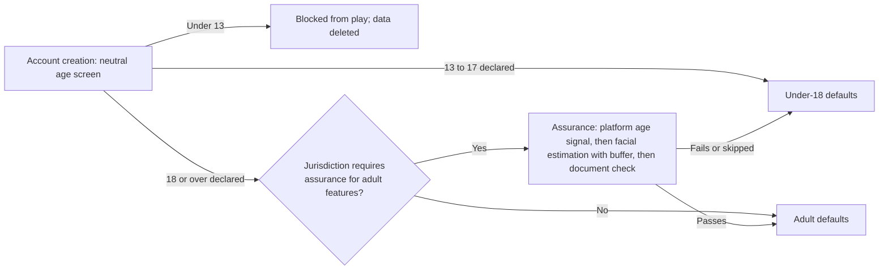
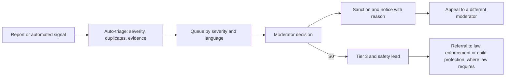

# Safety and Moderation

How the Oasis keeps a global 13+ community safe: age assurance, protective defaults, moderation of voice, text, user content and AI output, anti-cheat, exploit handling, privacy and transparency.

> **Version:** v0.1 · **Updated:** 10-10-2026 · **Owner:** Trust and Safety
>
> **Horizons:** H0 internal reporting, text filter, server authority · H1 full age assurance, voice moderation, 24/7 human moderation, anti-cheat, transparency reports · H2 moderation for Stewardship notices and clan halls, more languages · H3 VR safety (personal space, gesture moderation)
>
> **Related:** [D-006](../../DECISIONS.md#d-006) · [D-007](../../DECISIONS.md#d-007) · [D-008](../../DECISIONS.md#d-008) · [D-042](../../DECISIONS.md#d-042) · [Social, Voice and Clans](social-voice-and-clans.md) · [AI Safety and Evaluation](../06-ai/safety-and-evaluation.md) · [Legal and Compliance](../12-legal/compliance.md)

## 1. Player experience

- **A teen is pestered.** A stranger keeps pinging a 13-year-old at a Hearth. The teen taps the stranger's name and chooses *Block*. The stranger vanishes from their chat and invites, and soon from their layer. A report takes two more taps. Two days later the teen gets a notice: "Thanks. We took action."
- **An adult is abused by voice.** In proximity voice someone shouts slurs. The adult reports the speaker, and the last 60 seconds of that speaker's audio, kept only on the adult's own device, are attached. A moderator reviews it within hours, and the abuser loses voice for a week.
- **A cheater teleports.** The server refuses the move. A behaviour model flags the account's movement for review, the account is suspended, and the replay is kept as evidence.
- **A dupe is found.** A player reports a duplication bug through the security programme. The ledger finds the affected items within an hour. Only those items are frozen, and nobody else's trading stops.

The system must make players feel protected without feeling watched.

## 2. Scope

- **Covers:** age assurance, protective defaults, moderation of voice, text, user content and AI output, human moderation, reports, sanctions, appeals and escalation to authorities, anti-cheat and anti-bot, exploit reporting, privacy and data retention, transparency.
- **Leaves to other specs:** the communication features themselves ([Social, Voice and Clans](social-voice-and-clans.md)); AI guardrail design ([AI Safety and Evaluation](../06-ai/safety-and-evaluation.md)); in-world crime, which is gameplay, not misconduct ([Law, Crime and Bounties](../05-systems/law-crime-and-bounties.md)); the legal analysis behind these rules ([Legal and Compliance: Children, age and online safety](../12-legal/compliance.md#3-children-age-and-online-safety)); service security ([Server and Backend: Security](../08-technology/server-and-backend.md#7-security)).

## 3. Inspirations

| Source | What we take | What we change |
| --- | --- | --- |
| Call of Duty's use of ToxMod [L14] [L15] | Real-time voice moderation | Proactive only on public (proximity) voice; private voice is checked only after a report |
| Club Penguin: about 70 of 100 staff were moderators in 2007; sender-only blocking [G12] | Safety is staffing and design, not just filters | A staffing model from day one |
| FTC v. Epic, a $275M COPPA penalty with chat off by default for minors [L6] | Protective defaults are a legal floor | Applied worldwide ([D-007](../../DECISIONS.md#d-007)) |
| New World disabled all wealth transfers over a dupe [M12] | Server-held items and audits | Targeted freezes through the ledger instead of global shutdowns |
| Ofcom on highly effective age assurance [T42]; facial estimation error of about 2.5 years near ages 16 to 18 [T43] | Self-declaration is not enough for adult features | A buffer age and a fallback route |
| UK Children's Code high privacy by default [L9]; Ofcom's Online Safety Act scope for games with chat [L8] | Private-by-default settings and risk assessments | The risk assessment is a launch gate ([SAF-090](#611-privacy-and-data)) |
| VACnet server-side detection [T27]; kernel anti-cheat (Vanguard, EAC) [T25] [T26]; Windows moving security vendors out of the kernel [T46] | Server-side behaviour detection first | Kernel anti-cheat only for PC ranked play, and the design survives without it |
| Xbox's on-device 60 s voice clip [T37]; Riot's report-triggered review [T38] | Voice evidence that respects privacy | Both, combined |

## 4. Terms

| Term | Meaning |
| --- | --- |
| **Age assurance** | Any method that sets an account's age with a stated confidence: a platform age signal, facial age estimation or a document check |
| **Age band** | 13 to 15, 16 to 17, or 18 and over (assured or self-declared) |
| **Case** | One unit of moderation: the reports, evidence, decision and any appeal |
| **Sender-only block** | A filtered message that its sender sees as sent and nobody else receives [G12] |
| **Severity tier** | S0 imminent harm or child safety · S1 serious (threats, hate, sexual content) · S2 harassment, cheating · S3 spam, minor rule breaks |

## 5. Entities and state

| Actor | Role |
| --- | --- |
| Automated systems | Text filter, voice classifier, user-content scanners, cheat models, bot detection, economy anomaly detection |
| Moderators, tiers 1 to 3 | Review, act and escalate; tier 3 handles S0 cases and contact with law enforcement |
| Parent or guardian | Consent and controls where law requires them |
| Player (reporter or reported) | Reports and appeals; never sees the other side's identity data |
| Safety lead on call | Owns escalation, 24 hours a day |

All cases, evidence and actions are held on the server, with controlled and audited access.

## 6. Rules

### 6.1 Age assurance

The flow shows how an account's age band and defaults are set.

- **SAF-001 [H1]** The age screen is neutral: no hint of the minimum age and no pre-filled year. A declared age under 13 blocks the account, and the same device can't try again for 24 hours.
- **SAF-002 [H1]** Where self-declaration is not enough for adult features (for example in the UK [T42]), an account gets adult defaults only after highly effective age assurance. Until then it keeps under-18 defaults ([SOC-003](social-voice-and-clans.md#61-defaults-by-age-band)). Basic play, quests and Convergences never need assurance.
- **SAF-003 [H1]** Facial age estimation passes an account as adult only if the estimate is 21 or over, a buffer set because the mean error near ages 16 to 18 is about 2.5 years [T43]. Estimates from 18 to 21 fall back to a platform verified-age signal or a document check. The vendor processes and deletes the image at once; we keep only the outcome and the method.
- **SAF-004 [H1]** If evidence suggests an under-13 got through (their own statement, a parent's report, strong signals), the account is suspended pending verification, and its data is handled under COPPA rules where they apply [L7].
- **SAF-005 [H1]** Parental consent flows exist wherever the digital age of consent is above 13 (GDPR Art. 8 lets member states set it between 13 and 16 [L26]) and wherever law requires consent for a minor's voice or open-text opt-in ([D-008](../../DECISIONS.md#d-008)).
- **SAF-006 [H1]** An under-18 account opting into voice or open text needs no age assurance, because it is already treated as under 18. Where law requires verified parental consent, that verification is the gate.

### 6.2 Defaults by age

| Area | Under 18 | Adult | Basis |
| --- | --- | --- | --- |
| Voice and text | [Social, Voice and Clans: Defaults by age band](social-voice-and-clans.md#61-defaults-by-age-band) | Same table | [D-008](../../DECISIONS.md#d-008), [L6] |
| Profile and presence | High privacy; presence for friends only | Presence for friends only | [L9] |
| Store spending | Off by default; a parent or platform family settings can turn it on ([Economy and Crafting](../05-systems/economy-and-crafting.md#69-the-store-and-the-patron-subscription)) | On, with optional spending limits | [L20]; [D-045](../../DECISIONS.md#d-045) |
| Personalised recommendations | No profiling beyond what gameplay needs | Can be switched off | [L10] [L11] |
| Telemetry | The minimum needed for operation, safety and balance | Same, plus optional research | [L9] |
| PvP | Echoes never lootable; never hunted by player bounty hunters ([D-025](../../DECISIONS.md#d-025)) | Normal opt-in rules | [D-025](../../DECISIONS.md#d-025) |
| Intensity options | Available to everyone ([D-006](../../DECISIONS.md#d-006)) | Same | [D-006](../../DECISIONS.md#d-006) |

- **SAF-010 [H1]** Every platform build passes a settings audit that proves these defaults ([VIS-006](../01-vision/vision.md#4-experience-goals-observable-testable)).
- **SAF-011 [H1]** Communication limits keep the game clear of the PEGI 2026 "unrestricted communication" trigger for an 18 rating [L20], and every rating submission includes the default-settings audit as evidence.

### 6.3 Voice moderation

- **SAF-020 [H1]** Proximity voice (public) is analysed in real time by a toxicity classifier [L14] [L15] for players who have it on, and the opt-in screen says so. Classifier hits create cases and don't sanction on their own, except a 10-minute proximity mute for a high-confidence S1 hit.
- **SAF-021 [H1]** Party and clan voice (private) is analysed only after a report, as Riot does [T38].
- **SAF-022 [H1]** Every client keeps a rolling 60 s voice buffer on the device [T37]. Reporting a speaker uploads only that speaker's audio from the buffer. Nothing else leaves the device.
- **SAF-023 [H1]** Voice audio is never stored on our servers except as report evidence, kept as set in [Privacy and data](#611-privacy-and-data).
- **SAF-024 [H1]** The voice classifier runs on our own voice relays inside each DC region. A vendor model may be used only if it runs inside our infrastructure and the vendor keeps no audio.

### 6.4 Text filtering

- **SAF-030 [H1]** All player text (chat, names, signs, boards, clan text) passes a multilingual filter with strictness set by age band and severity tier.
- **SAF-031 [H1]** Blocked messages are shown only to the sender [G12]. Repeated attempts open a case.
- **SAF-032 [H1]** Personal-information filters block phone numbers, addresses, email addresses and off-platform handles in any message to or from an under-18 account, and in every open channel.
- **SAF-033 [H1]** Grooming signals (an adult repeatedly contacting minors, moving them to private channels, unusual gifting) open S0 or S1 cases for human review. These signals never ban anyone automatically.

### 6.5 Human moderation and wellbeing

- **SAF-040 [H1]** Moderation runs 24 hours a day, following the sun, in every launch language. Response targets: S0 triage within 15 minutes, S1 within 4 hours, S2 within 24 hours, S3 within 72 hours.
- **SAF-041 [H1]** Staffing is planned from forecast report volume (reports per 1,000 daily players, measured in betas), plus 30% surge headroom for launch and for every Convergence and Long Night. Club Penguin's ratio shows the order of effort, not a target [G12].
- **SAF-042 [H1]** Moderator wellbeing: review tools blur, greyscale and mute by default; daily exposure limits for S0 and S1 material; mandatory rotation; counselling on demand; no individual quota on S0 work.
- **SAF-043 [H1]** Moderators can view a case's replay ([D-037](../../DECISIONS.md#d-037)) and the AI decision record ([D-042](../../DECISIONS.md#d-042)). They never see payment data or real identity unless a case needs it and a tier-3 lead approves.

### 6.6 Reporting, sanctions, appeals and escalation

The flow shows how a report becomes a decision, and when it goes outside the company.

- **SAF-050 [H1]** Every surface where a player or their content appears has a report action ([Social, Voice and Clans: Block, mute and report](social-voice-and-clans.md#610-block-mute-and-report)).
- **SAF-051 [H1]** The sanction ladder is: warning, then a feature restriction (such as voice or text off for 24 hours to 30 days), then temporary suspension, then permanent ban. S0 and serious S1 cases may skip steps.
- **SAF-052 [H1]** Every sanction notice states the rule broken and how to appeal. A different moderator reviews each appeal within 7 days.
- **SAF-053 [H1]** Tier 3 escalates imminent risk to life and child sexual exploitation to law enforcement or the relevant national body, as law requires, with evidence preserved.
- **SAF-054 [H1]** Reporters receive an outcome notice ("action taken" or "no violation found") without details of the sanction.
- **SAF-055 [H1]** Bans apply to the account and its avatar. Cosmetics bought by a banned account are not refunded, except where local consumer law requires it, which is set per jurisdiction as configuration.

### 6.7 User-generated content

| Content | Check before others see it | After |
| --- | --- | --- |
| Avatar, clan, house and Frame names | Filter, plus a reserved-name list (Celestial names, staff, real people) | Report |
| Clan crests | Built from an approved component library; free-drawn parts reviewed | Report |
| House exteriors and decor ([D-035](../../DECISIONS.md#d-035)) | Rule checks on composition, such as symbol detection in decals and block patterns | Report; a moderator can revert an exterior to its last approved state |
| Shared clips and photos on in-game boards ([D-037](../../DECISIONS.md#d-037)) | Image and text classifiers; other players' voices removed unless they consented | Report |
| Signs, board posts, clan boards | Text filter ([SAF-030](#64-text-filtering)) | Report; hidden automatically at a report threshold until reviewed |

- **SAF-060 [H1]** Exported clips leave our platform, and there are no public galleries at H1. Clips shared in the game are moderated as above.
- **SAF-061 [H1]** Builder NPCs refuse designs that fail the checks, in-world ("The guild won't raise that"), so houses are moderated before they are built.

### 6.8 AI output moderation

- **SAF-070 [H1]** All generated NPC speech and text passes input and output moderation before players see or hear it ([AI Safety and Evaluation](../06-ai/safety-and-evaluation.md)). Fortnite's AI Darth Vader saying slurs after launch is the warning [A7].
- **SAF-071 [H1]** Players are told when they are talking to an AI-driven NPC (EU AI Act Art. 50 [A14] [A15]; Steam disclosure [A13]).
- **SAF-072 [H1]** Players can report an NPC line, and the report attaches the AI decision record ([D-042](../../DECISIONS.md#d-042)).
- **SAF-073 [H1]** Player speech to NPCs is moderated as player content. Abuse aimed at an NPC is not sanctioned unless it targets real people or groups; it may change how the NPC treats the player in-world.

### 6.9 Anti-cheat and anti-bot

Server authority and server-side detection are the foundation. Client-side anti-cheat applies only to ranked play.

- **SAF-080 [H1]** The server is authoritative for movement, combat, inventory, economy and quest state. The client sends inputs and requests only ([Server and Backend: Security](../08-technology/server-and-backend.md#7-security)), so speed, teleport, cooldown and resource cheats fail by design.
- **SAF-081 [H1]** Server-side behaviour models (aim, movement and input timing, as VACnet does [T27]) flag accounts for review. A model's output alone never bans anyone.
- **SAF-082 [H1]** Bot and farm detection uses gathering paths, session patterns and economy flows, and its findings go to the economy team ([D-046](../../DECISIONS.md#d-046)).
- **SAF-083 [H1]** Ranked arenas require each family's integrity layer: kernel-level anti-cheat on PC (EAC-class [T26] or Vanguard-class [T25]), platform integrity on consoles, and device attestation on mobile. Outside ranked arenas no client-side anti-cheat is installed. If Windows kernel access becomes unavailable [T46], PC ranked play moves to user-mode anti-cheat plus server detection.
- **SAF-084 [H1]** A device that fails its family's integrity check can play everything except ranked arenas.

### 6.10 Exploit reporting and bug bounty

- **SAF-085 [H1]** A public vulnerability and exploit programme offers safe harbour for good-faith research. Rewards are real money or cosmetics, never Omnis or power.
- **SAF-086 [H1]** The exploit playbook is: find the affected ledger entries; freeze only the affected items and accounts; hotfix; reverse the illegitimate entries; publish a short notice. A world-wide trade freeze is a last resort and needs a director's sign-off [M12].

### 6.11 Privacy and data

| Data | Kept for | Notes |
| --- | --- | --- |
| Age-assurance images | Not kept; the vendor deletes them on result | Outcome and method only |
| AI decision records | Full records 180 days; raw model input and output 30 days (14 for under-18 accounts); a de-identified audit stub afterwards | Needed for support and QA; raw audio is never stored on a server ([AI Architecture](../06-ai/architecture.md), [D-042](../../DECISIONS.md#d-042)) |
| Chat logs | 30 days, rolling; cases keep excerpts | Minimised |
| Server replays | A 30-minute rolling buffer; 20 pins kept 30 days; evidence copies stay with cases | Set in [Recording and Replays](../05-systems/recording-and-replays.md) |
| Telemetry | Aggregated after 13 months | Children's Code minimisation [L9] |
| Voice report clips | 90 days after the case closes; longer only for S0 legal holds | Never used to train models without explicit consent |

- **SAF-090 [H1]** A children's risk assessment (UK Online Safety Act [L8]; DSA Art. 28 [L10] [L11]) and a data protection impact assessment are completed and signed off before launch and before any new communication feature ships.
- **SAF-091 [H1]** Parental consent under GDPR Art. 8 [L26], and COPPA handling for any under-13 who slips through [L7], are configured per jurisdiction ([D-007](../../DECISIONS.md#d-007)).
- **SAF-092 [H1]** Players can download and delete their data. Deletion keeps only what law or open safety cases require.

### 6.12 Transparency

- **SAF-095 [H1]** A transparency report every 6 months covers reports received, actions by category, response times, appeals and reversals, age-assurance statistics, AI output incidents, cheat bans and exploit fixes.
- **SAF-096 [H1]** The community rules are short, written in plain language a 13-year-old understands, localised, and linked from every report screen.

## 7. Edge cases

| Case | Behaviour |
| --- | --- |
| The age-assurance vendor is down | Accounts keep their current defaults; nothing changes until the vendor returns |
| The moderation backlog grows during a Convergence | Surge staffing ([SAF-041](#65-human-moderation-and-wellbeing)); S0 and S1 always come first; automatic actions on S3 are limited to temporary mutes |
| Mass reporting by a group | Reports are grouped by reporter cluster; mass reports alone never sanction anyone |
| The voice classifier makes a false positive | The automatic mute is short and reversible; a successful appeal restores the player and the case is used to retrain |
| An under-13 is found after making purchases | The account is suspended, a parent is contacted, and purchases are refunded to the payer |

## 8. Multiplayer and platforms

Sanctions apply to the one account across every platform. Platform-holder sanctions and parental controls are honoured, and the strictest setting wins ([SOC-061](social-voice-and-clans.md#67-cross-platform-communication)).

## 9. Safety and abuse

This whole document. Service security is specified in [Server and Backend: Security](../08-technology/server-and-backend.md#7-security).

## 10. Performance

Text filtering adds no more than 50 ms to delivery. Voice classification runs on relay servers, never on low-end clients. Moderation is a large operating cost, and it is budgeted from H0.

## 11. Examples

| Allowed | Not allowed |
| --- | --- |
| A short automatic proximity mute after a high-confidence slur, reviewed later | A permanent ban by classifier alone |
| Uploading only the reported speaker's 60 s clip | Recording all voice traffic "just in case" |
| Kernel anti-cheat for PC ranked arenas only | Kernel anti-cheat required to enter the open world |
| Freezing the 300 duplicated items | Stopping all trading worldwide for a week by default |

## 12. Acceptance criteria

| ID | Test |
| --- | --- |
| [SAF-001](#61-age-assurance) | Age-screen audit: no minimum-age hint, and every under-13 entry is blocked |
| [SAF-002](#61-age-assurance) | UK-flagged test accounts that declare 18 or over without assurance all get under-18 defaults |
| [SAF-003](#61-age-assurance) | Vendor integration test: every estimate from 18.0 to 20.9 goes to the fallback, and a storage scan finds no kept image |
| [SAF-006](#61-age-assurance) | An under-18 opt-in completes without an assurance step, and with a verified parental consent step in every flagged jurisdiction |
| [SAF-010](#62-defaults-by-age) | The settings audit on every platform build passes the [defaults by age](#62-defaults-by-age) matrix |
| [SAF-022](#63-voice-moderation) | Network capture: no voice audio leaves a client except on report |
| [SAF-031](#64-text-filtering) | In 10,000 cases, a filtered message is visible to its sender and delivered to nobody |
| [SAF-040](#65-human-moderation-and-wellbeing) | Launch-readiness drill: synthetic S0 cases are triaged within 15 minutes at p95 in every launch language |
| [SAF-080](#69-anti-cheat-and-anti-bot) | Cheat-client suite (speed, teleport, cooldown, item injection): no action is accepted |
| [SAF-083](#69-anti-cheat-and-anti-bot) | A device failing its integrity check is refused entry to ranked arenas and can enter every other mode |
| [SAF-086](#610-exploit-reporting-and-bug-bounty) | Exploit drill: 500 injected duplicate items are found and frozen within 1 hour, and no unaffected account is frozen |
| [SAF-090](#611-privacy-and-data) | The signed risk assessment and data protection impact assessment are in the launch checklist |

<!-- citation links: generated, do not edit by hand -->

[A7]: ../../references/technology-and-ai.md
[A13]: ../../references/technology-and-ai.md
[A14]: ../../references/technology-and-ai.md
[A15]: ../../references/technology-and-ai.md
[G12]: ../../references/games.md
[L6]: ../../references/legal-and-policy.md
[L7]: ../../references/legal-and-policy.md
[L8]: ../../references/legal-and-policy.md
[L9]: ../../references/legal-and-policy.md
[L10]: ../../references/legal-and-policy.md
[L11]: ../../references/legal-and-policy.md
[L14]: ../../references/legal-and-policy.md
[L15]: ../../references/legal-and-policy.md
[L20]: ../../references/legal-and-policy.md
[L26]: ../../references/legal-and-policy.md
[M12]: ../../references/industry-and-live-service.md
[T25]: ../../references/technology-and-ai.md
[T26]: ../../references/technology-and-ai.md
[T27]: ../../references/technology-and-ai.md
[T37]: ../../references/technology-and-ai.md
[T38]: ../../references/technology-and-ai.md
[T42]: ../../references/technology-and-ai.md
[T43]: ../../references/technology-and-ai.md
[T46]: ../../references/technology-and-ai.md
