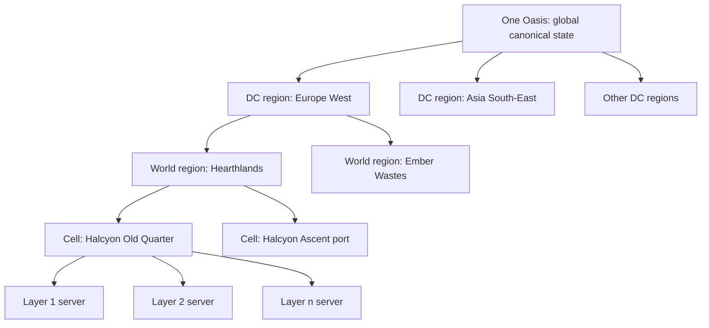
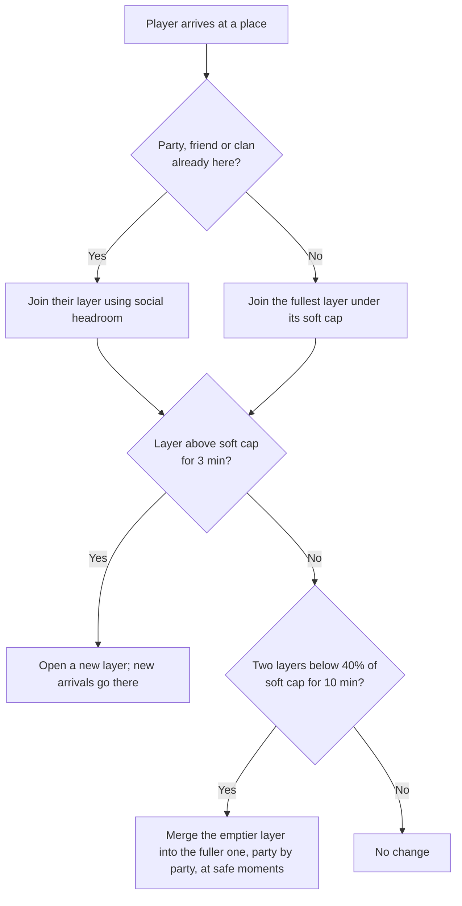

# World Model

How one global, canonical Oasis is simulated for every player on every platform, using layers for crowds and phases for personal story.

> **Version:** v0.1 · **Updated:** 10-10-2026 · **Owner:** Multiplayer team
>
> **Horizons:** H0 one world region, static cells, layering prototype, two DC regions · H1 the full Oasis and Lumen, city layers of 150 to 200, shared pools for global events · H2 dynamic cells, 500 to 1,000 in a dense place · H3 thousands visible in one place
>
> **Related:** [D-028](../../DECISIONS.md#d-028) · [D-029](../../DECISIONS.md#d-029) · [D-030](../../DECISIONS.md#d-030) · [D-024](../../DECISIONS.md#d-024) · [Server and Backend](../08-technology/server-and-backend.md) · [Social, Voice and Clans](social-voice-and-clans.md) · [Celestial Convergence](../05-systems/celestial-convergence.md)

## 1. Player experience

- **Arrival.** A new Returner wakes above Halcyon at evening. The square below is busy: about 150 other Returners, on phones, consoles, handhelds and PCs, crowd the Skyferry port and the Chronicle Board. The World Clock shows the same number for everyone on Earth. There is no server list, no world select and no realm name. There is only the Oasis.
- **Friends, always together.** Two friends, one in Jakarta and one in Lisbon, meet at a Wayshrine in the Ember Wastes. Whatever layer each was in, the party puts them in the same one. The friend in Lisbon has a little more latency than usual, and nothing else changes.
- **One moment, for everyone.** On the first Long Night, Orun's six resting stones must be lit ([Celestials](../03-narrative/celestials.md)). Thousands of Returners fight in hundreds of layers, but the stones fill from one shared pool. When the last stone lights, it lights in every layer within seconds, and the Chronicle records every name.
- **Personal story, shared street.** A player who made peace with Oswin in Lowhaven sees him smile at his stall. Their friend, who hasn't done that quest, sees the old scowl. They stand side by side in the same layer, and each sees their own story ([Quest Architecture](../03-narrative/quest-architecture.md)).

The system must make the world feel single, busy and fair: nobody is ever separated from their friends, and nobody's fight feels small or private.

## 2. Scope

- **Covers:** world topology (world regions, cells, mesh), layers, phases, state classes and their authority, data centre regions as players experience them, population targets, global event aggregation, Convergence orchestration, persistence, disconnects, simulation parity across platforms and arena matchmaking.
- **Leaves to other specs:** server implementation, meshing internals, the ledger and deployment ([Server and Backend](../08-technology/server-and-backend.md)); chat, voice and clans ([Social, Voice and Clans](social-voice-and-clans.md)); moderation ([Safety and Moderation](safety-and-moderation.md)); PvP rules ([PvP and Protection](../05-systems/pvp-and-protection.md)); Convergence stage design ([Celestial Convergence](../05-systems/celestial-convergence.md)).
- **Never:** host-world co-op ([D-029](../../DECISIONS.md#d-029)); named realms or servers whose canonical state diverges; paid priority in layers or queues ([D-045](../../DECISIONS.md#d-045)).

## 3. Inspirations

| Source | What we take | What we change |
| --- | --- | --- |
| Destiny's shared-world architecture [M42]; all activities on Bungie servers [M43] | Public and private spaces that overlap; full server hosting | Personal content is phased inside the shared world wherever possible, not sent to separate mission instances |
| EVE Time Dilation [M7]; EVE's record battles [M8] | Slowing down under load beats crashing | Used only in Convergence front layers, with a floor, and shown in-world |
| PlanetSide 2's 1,158-player battle [M41]; Morpheus and Hadean claims [T3] [T4] | The real ceiling for action combat today, and how headline counts include bots | H3 "thousands visible" is a goal, never a launch promise [M32] |
| SpatialOS: Worlds Adrift closed, Improbable sold its games unit, Unity's terms change [M1] [M2] [M3] | Persistent-world middleware is commercially fragile | We own the mesh, the layer service and the world-state service |
| Star Citizen static meshing with a 500-player shard target [M5]; dynamic meshing still in progress [T1] | Static meshing ships; dynamic meshing is frontier work | H1 uses static cells; dynamic cells are H2 and per-entity authority is H3 |
| WoW phasing and sharding [M18]; WoW Classic layering [M19] | Per-player world state; copies of crowded places | A phase changes what you see, never whom. Layers are per place and much smaller, and there is no realm to choose. |

## 4. Terms

Layer, phase and mesh are defined in the [Glossary](../../GLOSSARY.md). Terms used only here:

| Term | Meaning |
| --- | --- |
| **Cell** | A fixed simulation area inside a world region, run by one server process per layer. Cells are static at H1 and resize at H2. |
| **Data centre region (DC region)** | A cloud geography, such as Europe West, that runs a full mesh of the Oasis. Every DC region simulates the same world; its layers are simply more layers. |
| **Front** | One concurrent battle area of a Convergence Confront, such as Orun's knees or his forest-heads. Each front runs as many layers as it needs. |
| **Home simulation region** | The DC region a player's layers run in, chosen by latency. |
| **Safe moment** | A moment when a player can be moved between layers without noticing: not in combat, not with Heat, not mid-dialogue, mid-trade, mid-quest step or in flight above 50 m. |
| **Shared pool** | A global, server-held quantity (contribution, the Returners' Resolve, a stone's light) that every layer adds to. |
| **World region** | One of the seven surface regions (the Hearthlands and six Domains) or a moon ([Geography and Domains](../02-world/geography-and-domains.md)). A unit of fiction and content. |

## 5. State classes and authority

Every piece of world state belongs to exactly one of four classes. The class decides who owns it and how fast it converges. Every system spec that introduces state declares its class.

| Class | Examples | Authority | Consistency |
| --- | --- | --- | --- |
| **G · Global canonical** | World Clock, Celestial status, era flags, statutes, Stewardships, Omnis and item ledger, Records and Bounties, Chronicle Board, house ownership | Global services ([Server and Backend](../08-technology/server-and-backend.md#1-architecture-overview)) | Strong. One value worldwide. |
| **S · Shared place** | A rebuilt bridge, a damaged market, a built Ward house, a lit resting stone, a colossus's position on its migration route, the weather | World-state service, mirrored into every layer of the place | Converges in every layer of every DC region within 5 s |
| **L · Layer-local** | Player and NPC positions, combat, small events, creature spawns, dropped loot | The cell server for that layer | Authoritative per layer, never merged |
| **P · Phase** | Quest flags, an NPC's attitude to one player, personal Eggs | Player profile service | Per player |

- **MP-001 [H1]** No layer, cell or DC region can hold a different value of any G-class state. A network partition delays G-class writes; it never forks them ([edge cases](#7-edge-cases)).
- **MP-002 [H1]** An S-class change caused in one layer (a recovery event rebuilds a bridge) applies to every layer of that place. Rewards for causing it go only to the players who took part.
- **MP-003 [H1]** A named NPC has one Mind (memory, relationships, goals) and a body in every layer where their schedule places them. Memories formed in any layer merge into the one Mind ([NPC Minds and Conversation](../06-ai/npc-minds-and-conversation.md)).
- **MP-004 [H1]** A migrating colossus is S-class. The world-state service holds its route position and mirrors it to every DC region, and each layer simulates the creature locally from that shared position. Its effects on the place (trampled roads, moved herds) are S-class changes.

## 6. Rules

### 6.1 Topology: world regions, cells and the mesh

The diagram shows how one canonical world is split into DC regions, world regions, cells and layer servers.

- **MP-010 [H1]** The Oasis surface and Lumen are divided into static cells. Cell boundaries sit at natural seams (passes, gates, shorelines, Skyferry docks) and are invisible to players. Crossing a boundary hands the player to the neighbouring cell server of the same layer in 250 ms or less, with no loading screen.
- **MP-011 [H1]** If a boundary handoff fails, the player is held at the seam for up to 2 s with a short in-world hesitation (a gust, a stumble) and the handoff is retried. After three failures, the player moves to the matching layer through the normal layer transfer. A failed handoff never disconnects anyone.
- **MP-012 [H2]** Cells resize with load (busy cells split, quiet cells merge) without moving players between layers.
- **MP-013 [H3]** Authority is handed off per entity group rather than per area, so thousands of players can share one place.
- **MP-014 [H1]** The mesh and boundary handoff are custom systems ([Server and Backend: Meshing](../08-technology/server-and-backend.md#2-meshing)).

### 6.2 Layers: capacity, assignment, split and merge

Each place type has a soft cap, where new layers open, and a hard cap, which no layer exceeds.

| Place type | Soft cap | Hard cap | Social headroom | Notes |
| --- | --- | --- | --- | --- |
| City (Halcyon, Pelagia, Qasr Amber and others) | 150 | 200 | 10% above the soft cap, kept for party, friend and clan joins | [D-028](../../DECISIONS.md#d-028) |
| Ward (housing district) | 80 | 120 | 10% | Ward layers are how every plot is guaranteed ([D-035](../../DECISIONS.md#d-035)) |
| Wilderness cell | 60 | 100 | 10% | Lower density keeps the world wild |
| Skyferry in flight | 60 | 80 | 10% | A social space aboard ([Cosmology: Scale](../02-world/cosmology.md#7-scale)) |
| Convergence front | 200 by default, set per front | 250 | Party-sized blocks only | [Convergence orchestration](#65-convergence-orchestration) |

The flow below shows when layers open, fill and merge.

- **MP-020 [H1]** A party always shares one layer. Joining a party moves the new member into the leader's layer at the next safe moment.
- **MP-021 [H1]** "Join friend" always succeeds while the target layer is under its hard cap, using social headroom. If the layer is at its hard cap, the friend's whole party moves with the joiner to a new or emptier layer. Without a request, the assigner prefers layers with friends.
- **MP-022 [H1]** Clan members in the same place share the clan's layer until it reaches its hard cap. Further members go to one linked overflow layer, and the UI says so ("Your clan is spread over 2 layers in Halcyon"). Party and friend rules always take priority over clan placement.
- **MP-023 [H1]** When a layer stays above its soft cap for 3 minutes, a new layer opens and new arrivals go there. Existing players stay unless the hard cap is exceeded.
- **MP-024 [H1]** When two layers of the same place both stay below 40% of the soft cap for 10 minutes, the emptier one merges into the fuller one, party by party.
- **MP-025 [H1]** Players change layer only at safe moments. Distant players fade out and in; nearby friends and party members never flicker.
- **MP-026 [H1]** The assigner avoids placing a player in a layer with someone they have blocked, unless a party, friend or clan rule requires it.
- **MP-027 [H1]** A voluntary layer change has a 10-minute cooldown and is unavailable in combat, with Heat of 1 or more, or within 60 s of harvesting a resource node. It can't be used to escape the law, PvP or someone waiting by an Echo ([Death and Return](../04-gameplay/death-and-return.md)).
- **MP-028 [H1]** Resource nodes and chests in shared spaces are gathered per player, so there is no node-sniping and nothing to gain from changing layer.
- **MP-029 [H1]** A party leader can move the whole party to a quieter layer of the same place (for photography, a festival or a quiet evening) through the voluntary layer change, under the [MP-027](#62-layers-capacity-assignment-split-and-merge) limits.

### 6.3 Phasing

- **MP-030 [H1]** A phase can change NPC attitudes, dialogue, quest objects, personal Eggs and how personal places look. It never changes S- or G-class state, terrain collision that others use, or whether other players are visible.
- **MP-031 [H1]** Party members are never phased apart. When a party quest needs a shared phase, that phase applies to all its participants for the quest's duration.
- **MP-032 [H1]** A phased object that blocks movement exists for everyone or for no one. Personal blockers are shown as non-solid (a memory, a mist, a ghostly figure).

### 6.4 Global events and shared pools

Global moments run in many layers at once and merge into one shared result through shared pools held by the world-state service.

| Event | Simulated per layer | Shared across all layers |
| --- | --- | --- |
| **Long Night** (24 hours rt, [Cosmology: The Long Night](../02-world/cosmology.md#3-the-long-night)) | Surges, Long Night events and hidden doors, per layer and per world region | Saga pools (such as resting stones lit), the Long Night Chronicle, global omens |
| **Convergence Discover and Prepare** | Quests and world crafting in any layer, solo or grouped ([D-024](../../DECISIONS.md#d-024)) | Contribution pools per objective; S-class constructions (root-roads, song-lanterns) |
| **Convergence Unseal** | Ritual actions in many layers | One beat clock, kept in step across layers and DC regions |
| **Convergence Confront** | Fronts, each running many layers | The Returners' Resolve pool, phase changes and the Mercy tally ([D-017](../../DECISIONS.md#d-017)) |
| **Release** | Every layer plays the Release at the same moment | The Chronicle inscription of every participant |

- **MP-040 [H1]** Contributions are commutative: the order in which layers report never changes the result. Each contribution carries a signed receipt, so a player's credit survives a disconnect.
- **MP-041 [H1]** When a shared pool crosses a threshold (a stone lights, a Celestial changes phase), every affected layer in every DC region hears about it within 2 s at p95.
- **MP-042 [H1]** Every layer shows the size of the whole effort: global progress, how many layers and players are fighting, and named highlights from other layers.
- **MP-043 [H1]** Pool scaling rules are published and never secretly adjusted ([D-011](../../DECISIONS.md#d-011)).

### 6.5 Convergence orchestration

- **MP-050 [H1]** The Convergence service pre-warms mesh capacity for each scheduled Unseal and Confront window at 1.5 times the forecast peak, using registrations and past events.
- **MP-051 [H1]** Players gather at staging Wayshrines. The front finder places whole parties, never splitting them, into fronts by role band and player choice (the visibility exception in [PRG-003](../04-gameplay/avatar-and-progression.md#61-the-avatar), [Avatar and Progression](../04-gameplay/avatar-and-progression.md)).
- **MP-052 [H1]** Solo players are always placed. NPC allies fill any role a front requires ([D-024](../../DECISIONS.md#d-024)).
- **MP-053 [H1]** When a front layer's server runs over its tick budget, it slows its simulation clock, down to a floor of 50% speed. Below the floor, the layer splits by party blocks. Contributions from slowed layers are scaled by the slowdown, so nobody earns less for being in a crowded layer. The slowdown is shown in-world ("the air grows thick") and in the HUD. Only Confront front layers slow down; every other layer, including Prepare-phase world crafting, splits instead.
- **MP-054 [H1]** A failed Confront can be retried until the Conjunction ([D-011](../../DECISIONS.md#d-011)). Orchestration supports a re-run window within 7 rt days.

### 6.6 Data centre regions and latency

Every DC region runs the same canonical world. The list of launch DC regions is set in [Server and Backend: Multi-region deployment](../08-technology/server-and-backend.md#8-multi-region-deployment).

- **MP-060 [H1]** At login, a player's home simulation region is the DC region with the lowest measured round-trip time. G-class state is global, and S-class state is mirrored into every DC region's layers.
- **MP-061 [H1]** A party is simulated in one DC region, chosen to keep the highest member round-trip time as low as possible. If any member would exceed 150 ms, the UI warns before moving the party, and the party chooses.
- **MP-062 [H1]** At least 90% of players in launch markets get a round-trip time of 80 ms or less. Lag compensation is bounded ([TEC-040](../08-technology/server-and-backend.md#3-netcode)).
- **MP-063 [H1]** Oasis time, the World Clock and global beats are identical in every DC region ([TIM-001](../02-world/time-and-calendar.md#2-units)).

### 6.7 Population targets by horizon

| Horizon | Visible together in one place | Mesh | Evidence |
| --- | --- | --- | --- |
| H0 | 50 per layer, one world region | Static cells, two DC regions | Warframe Relays hold up to 50 [M44] |
| H1 | 150 to 200 per city layer; 60 to 100 in the wilderness | Static cells, every launch DC region | [D-028](../../DECISIONS.md#d-028); [M5] |
| H2 | 500 to 1,000 in a dense place | Dynamic cells | [M41]; [T40] |
| H3 | Thousands in one place | Per-entity authority | [M8]; [T3] and [T4] show how far claims run ahead of results |

### 6.8 Persistence, disconnect and reconnect

- **MP-070 [H1]** Ledger operations (trades, crafting, grants, purchases) commit before the client shows success. Position and other non-ledger state are saved every 30 s and on every layer or cell transfer.
- **MP-071 [H1]** Logging out in a lawful zone outside combat removes the avatar after 10 s. With Heat, in combat or in a Lawless Reach, the avatar stays for 60 s, so nobody escapes a fight by logging out.
- **MP-072 [H1]** A disconnected player's layer slot is held for 5 minutes. Reconnecting within that time returns them to the same layer, party and quest step.
- **MP-073 [H1]** Disconnecting while Downed or during a Convergence follows [Death and Return: Edge cases](../04-gameplay/death-and-return.md#7-edge-cases): contribution is saved, and the player rejoins the same layer if the phase is still running.

### 6.9 Simulation parity across platforms

- **MP-080 [H1]** Simulation is identical on every platform: the same tick, rules and hit validation. Capability tiers change presentation only ([Platform Support](../09-platforms/platform-support.md#62-capability-tiers)).
- **MP-081 [H1]** A lower tier may draw distant players as simplified stand-ins, but it always draws every hostile player, threat, Bounty hunter and interactable within 50 m as a full, targetable character.

### 6.10 Arena matchmaking

- **MP-090 [H1]** Competitive arenas use input pools (controller, keyboard and mouse, touch), as Fortnite does [M39]. A mixed party goes to the pool of its most precise input. Touch players may opt into the controller pool ([CMB-033](../04-gameplay/combat-and-abilities.md#66-weapons-and-ranged-combat)).
- **MP-091 [H1]** Competitive rulesets lock the camera perspective, with separate first-person and third-person ladders ([D-020](../../DECISIONS.md#d-020), [G14]).
- **MP-092 [H1]** Matchmaking weighs skill rating, input pool, perspective ladder and round-trip time (100 ms or less for ranked). Platform is never a pool by itself.
- **MP-093 [H2]** One-on-one duels may use rollback netcode ([CMB-051](../04-gameplay/combat-and-abilities.md#610-authority), [M36]).

## 7. Edge cases

| Case | Behaviour |
| --- | --- |
| A DC region loses contact with global services | Layers keep simulating. G-class writes queue with signed receipts. Actions that move value (trades, the Exchange) pause with an in-world reason ("the Exchange couriers are delayed"). Canonical state never forks. |
| A global beat arrives late in one DC region | The beat plays late; it never plays twice. Contributions after the threshold count towards the next objective. |
| A layer server crashes | Players reconnect into a fresh layer of the same place at their last save: at most 30 s of position lost and no ledger loss. |
| Launch-day crowd | Layers split freely. If mesh capacity runs out, an honest entry queue shows an estimated wait. Paid priority never exists. |
| A party spans DC regions with very high latency | The [MP-061](#66-data-centre-regions-and-latency) warning appears; the party can split or accept the latency. |
| Someone changes layer to farm, escape Heat or grief | [MP-027](#62-layers-capacity-assignment-split-and-merge) and [MP-028](#62-layers-capacity-assignment-split-and-merge) make it impossible or pointless. |

## 8. Multiplayer and platforms

This document is the multiplayer contract for every other spec. Cross-play and cross-progression are on for every platform family ([Platform Support](../09-platforms/platform-support.md)).

## 9. Safety and abuse

The assigner keeps blocked players apart ([MP-026](#62-layers-capacity-assignment-split-and-merge)). Paid queue priority never exists. Under-18 protections apply in every layer ([Safety and Moderation](safety-and-moderation.md)). Clients never hold authority over G-, S- or L-class state ([Server and Backend: Security](../08-technology/server-and-backend.md#7-security)).

## 10. Performance

Tick rates, replication budgets and scale targets for the mesh are set in [Server and Backend: Scale targets](../08-technology/server-and-backend.md#5-scale-targets).

## 11. Examples

| Allowed | Not allowed |
| --- | --- |
| Two layers of Halcyon show the same rebuilt bridge | A bridge rebuilt in one layer but broken in another (breaks [MP-002](#5-state-classes-and-authority)) |
| A player sees Oswin forgive them while their friend sees him scowl | The friend can't see the player because of a phase (breaks [MP-031](#63-phasing)) |
| A crowded Confront front slows to 70% and shows it | A front silently slows to 10% for an hour |
| A clan of 300 in Halcyon spread over two layers, with a clear notice | A party of four split across two layers |

## 12. Acceptance criteria

| ID | Test |
| --- | --- |
| [MP-001](#5-state-classes-and-authority) | Chaos test: partition a DC region for 30 minutes under bot load. After healing, no G-class value differs anywhere, and every queued contribution is applied exactly once. |
| [MP-002](#5-state-classes-and-authority) | Complete a recovery event in layer 1. The bridge state is identical in every layer of every DC region within 5 s at p95. |
| [MP-010](#61-topology-world-regions-cells-and-the-mesh) | 10,000 scripted boundary crossings at sprint, glide and flight speed: at least 99.9% complete in 250 ms or less, with no disconnects. |
| [MP-020](#62-layers-capacity-assignment-split-and-merge) | 100,000 party joins under load: no party has members in different layers of the same place after 30 s. |
| [MP-021](#62-layers-capacity-assignment-split-and-merge) | "Join friend" into a layer at its soft cap succeeds every time while the layer is under its hard cap. |
| [MP-025](#62-layers-capacity-assignment-split-and-merge) | Bot fuzzing: no layer transfer happens during combat, Heat, dialogue, trade or a quest step. |
| [MP-040](#64-global-events-and-shared-pools) | Replay the same contribution stream in 1,000 random orders: pool totals are identical. |
| [MP-041](#64-global-events-and-shared-pools) | A shared-pool threshold reaches every DC region within 2 s at p95. |
| [MP-053](#65-convergence-orchestration) | Overload a front layer: it never runs below 50% speed, it splits, and contribution per player-minute stays within 2% across slowed and normal layers. |
| [MP-072](#68-persistence-disconnect-and-reconnect) | Disconnect and reconnect within 5 minutes: the player returns to the same layer, party and quest step in at least 99% of trials. |
| [MP-081](#69-simulation-parity-across-platforms) | A tier C client in a 200-player layer draws every hostile within 50 m as a full, targetable character. |
| H1 scale | Load test with 200 bot clients per city layer and 50 layers per city: server frame time stays within budget at p99. |

<!-- citation links: generated, do not edit by hand -->

[G14]: ../../references/games.md
[M1]: ../../references/industry-and-live-service.md
[M2]: ../../references/industry-and-live-service.md
[M3]: ../../references/industry-and-live-service.md
[M5]: ../../references/industry-and-live-service.md
[M7]: ../../references/industry-and-live-service.md
[M8]: ../../references/industry-and-live-service.md
[M18]: ../../references/industry-and-live-service.md
[M19]: ../../references/industry-and-live-service.md
[M32]: ../../references/industry-and-live-service.md
[M36]: ../../references/industry-and-live-service.md
[M39]: ../../references/industry-and-live-service.md
[M41]: ../../references/industry-and-live-service.md
[M42]: ../../references/industry-and-live-service.md
[M43]: ../../references/industry-and-live-service.md
[M44]: ../../references/industry-and-live-service.md
[T1]: ../../references/technology-and-ai.md
[T3]: ../../references/technology-and-ai.md
[T4]: ../../references/technology-and-ai.md
[T40]: ../../references/technology-and-ai.md
