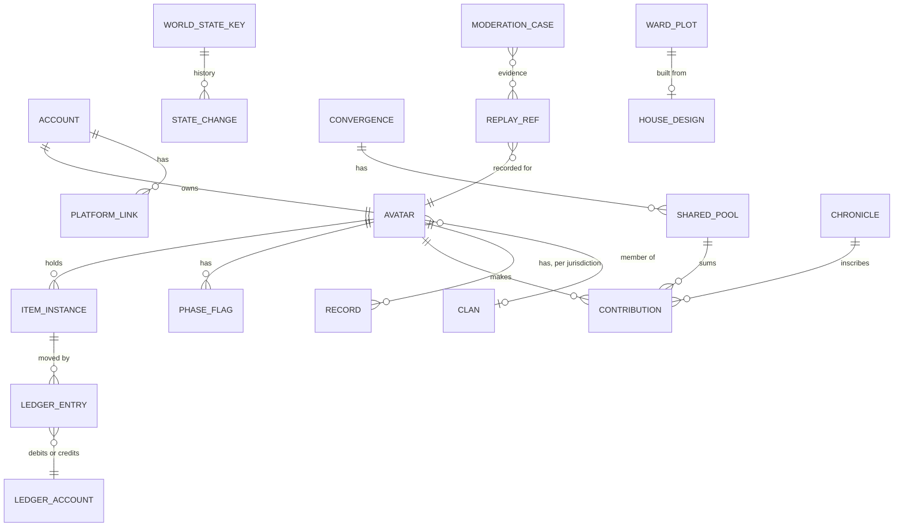

# Server and Backend

The server architecture that makes One Oasis real: the services, the meshing path, netcode, the economy ledger, scale targets, degradation, security, deployment and observability.

> **Version:** v0.1 · **Updated:** 10-10-2026 · **Owner:** Server team
>
> **Horizons:** H0 two DC regions, static cells, ledger version 1, local Loom · H1 every launch DC region, full global services, shared pools, replay storage · H2 dynamic cells, rollback for duels · H3 per-entity authority, thousands visible
>
> **Related:** [D-028](../../DECISIONS.md#d-028) · [D-042](../../DECISIONS.md#d-042) · [D-046](../../DECISIONS.md#d-046) · [D-047](../../DECISIONS.md#d-047) · [World Model](../07-multiplayer/world-model.md) · [Engine and Stack](engine-and-stack.md) · [Safety and Moderation](../07-multiplayer/safety-and-moderation.md)

## 1. Architecture overview

The diagram shows how clients reach the regional simulation mesh and the global services behind it.

```mermaid
flowchart LR
    C1["Clients: PC, console, handheld, mobile"] --> E["Edge: DDoS protection, TLS, gateway, session routing"]
    C1 --- OD["On-device Loom tier"]
    subgraph SIM["Regional simulation mesh, one per DC region"]
        CS1["Cell server: layer 1"]
        CS2["Cell server: layer n"]
        FR["Convergence front servers"]
        AR["Arena servers"]
        LS["Layer service and handoff coordinator"]
    end
    subgraph GS["Global services"]
        ID["Identity and cross-platform accounts"]
        WS["Canonical world-state service"]
        LED["Economy ledger"]
        LAW["Law service"]
        CONV["Convergence and shared pools"]
        LOOM["Loom inference, cloud tier"]
        WV["Weaver"]
        CHAT["Chat and voice relays"]
        MM["Matchmaking"]
        TEL["Telemetry"]
        CHR["Chronicle service and replay storage"]
        MOD["Moderation and cases"]
        DB[("Persistence database")]
    end
    E --> SIM
    E --> GS
    SIM --> GS
```

Each DC region runs the full simulation mesh. Global services write strongly consistent data (world state, ledger, law Records) in one primary region and keep read replicas in every DC region.

| Component | Responsibility | Consistency |
| --- | --- | --- |
| Edge and gateway | Auth tokens, routing to the home simulation region, rate limits, DDoS absorption | Stateless |
| Cell servers (UE dedicated servers [S9]) | Authoritative L-class simulation for one cell in one layer | Per layer |
| Layer service | Layer assignment, split and merge, party co-layering, handoff coordination ([World Model: Layers](../07-multiplayer/world-model.md#62-layers-capacity-assignment-split-and-merge)) | Per DC region, backed by the global social graph |
| World-state service | G-class and S-class state, pushed to every layer | G strong; S converges within 5 s |
| Economy ledger | Every movement of Omnis and items | Strong, serialisable |
| Law service | Records, Bounties and statutes; serves the Law evaluator | Strong for Records |
| Convergence service | Shared pools, beat clock, front orchestration | Commutative counters with strongly consistent thresholds |
| Loom inference | Cloud tier for Minds and generation; on-device tier where supported ([AI Architecture](../06-ai/architecture.md)) | Stateless; every decision recorded |
| Weaver | Schedules events from validated templates ([Director and World Events](../06-ai/director-and-world-events.md)) | Its proposals are committed by servers only |
| Chat and voice relays | Text routing, filtering, voice relays | Ephemeral |
| Matchmaking | Arenas and the front finder | Per DC region |
| Telemetry | Events, metrics, traces | Asynchronous |
| Chronicle service and replay storage | Compact replays [S11] [T30] and curated Chronicles | Durable |
| Moderation and cases | Reports, evidence, actions | Durable, access-controlled |

- **TEC-083 [H1]** The primary write region for global services is Europe West, with a synchronous replica in a second zone there and a warm standby in North America East. A ledger write from the most distant DC region commits within 400 ms at p95; ledger actions are never on the combat path, and in-world animations (a handshake, a stamp) cover the wait.

## 2. Meshing

| Horizon | Model | Notes |
| --- | --- | --- |
| H0 and H1 | Static cells, with boundary handoff between neighbouring cell servers of the same layer | Comparable to shipped static meshing [M5]; handoff within 250 ms ([MP-010](../07-multiplayer/world-model.md#61-topology-world-regions-cells-and-the-mesh)) |
| H2 | Dynamic cell resizing: busy cells split and quiet cells merge without moving players between layers | Builds on the H1 handoff |
| H3 | Per-entity authority handoff for dense crowds | Frontier work: Star Citizen's dynamic meshing is still in progress [T1], and 10,000-player claims are unproven [T3] [T4] |

- **TEC-030 [H1]** The engine's experimental multi-server replication plugin [T6] is not on the H1 critical path. Handoff uses our own protocol: the source server freezes the entity and serialises its authoritative state, the target acknowledges, and clients are re-pointed. On timeout the source keeps authority ([MP-011](../07-multiplayer/world-model.md#61-topology-world-regions-cells-and-the-mesh)).
- **TEC-031 [H1]** Players near a boundary receive read-only copies of entities from the neighbouring cell, so they can see across seams up to view distance.
- **TEC-032 [H1]** An interaction across a boundary (a spell cast over a seam) is resolved by the caster's server, which sends a request to the target's server. No entity is ever under the authority of two servers at once.
- **TEC-033 [H1]** Cell servers run on generic containers under an open-source game-server orchestration layer, so the same setup runs on any cloud and in Archive Mode ([D-047](../../DECISIONS.md#d-047)).

## 3. Netcode

| Activity | Model | Evidence |
| --- | --- | --- |
| On-foot combat and Arts | Server-authoritative; the client predicts its own movement and actions; bounded lag compensation for hit validation ([CMB-050](../04-gameplay/combat-and-abilities.md#610-authority)) | Overwatch's architecture [M34]; For Honor's move to dedicated servers [M38] |
| Frames, vehicles, gliding and flight | Server-authoritative physics; the client predicts its own vehicle; others are interpolated from snapshots | Rocket League [M35]; Gaffer on Games [M37] |
| Colossi and other large actors | Server-authoritative state at low frequency and high priority; cosmetic animation layers on the client | None |
| Destruction | Discrete server states; cosmetic fracture on the client | [S10] |
| Duel arenas [H2] | Rollback ([CMB-051](../04-gameplay/combat-and-abilities.md#610-authority)) | GGPO [M36] |

- **TEC-040 [H1]** Lag compensation rewinds at most 200 ms. Beyond that, the shooter's view is corrected rather than the target being hit behind cover.
- **TEC-041 [H1]** Deflect and Poise windows are checked on the server using compensated timestamps, with the same window on every platform.
- **TEC-042 [H1]** Each cell has a cap on simultaneous large actors (colossi, and Colossal Frames from H2), set by tier budget and enforced by the Weaver.

## 4. Economy ledger

A double-entry ledger is the only path by which value moves.

- **TEC-050 [H1]** Every movement of Omnis or of an item is a balanced pair of entries: one account is debited and another credited, and sinks and sources are accounts too. Every item has a globally unique ID and exists in exactly one container.
- **TEC-051 [H1]** Every ledger request carries an idempotency key, so a retry never duplicates value.
- **TEC-052 [H1]** Reconciliation runs every 5 minutes: total Omnis must equal sources minus sinks, and item counts per type must balance. Any deviation pages on-call and names the entries involved, as the New World dupe showed is needed [M12].
- **TEC-053 [H1]** Daily transfer limits and bound-item rules ([D-046](../../DECISIONS.md#d-046)) are enforced inside the ledger, never in clients or cell servers.
- **TEC-054 [H1]** The ledger supports reversing identified fraudulent entries and freezing only the affected items ([SAF-086](../07-multiplayer/safety-and-moderation.md#610-exploit-reporting-and-bug-bounty)).

## 5. Scale targets

Visible players per place are set in [World Model: Population targets](../07-multiplayer/world-model.md#67-population-targets-by-horizon). The targets below cover the services.

| Metric | H0 | H1 | H2 |
| --- | --- | --- | --- |
| Concurrent players worldwide | 1,000 in tests | Built for a peak of 1 million or more | Grows with the [Ten-Year Live Plan](../11-production/ten-year-live-plan.md) |
| Convergence Confront participants across all layers | Not applicable | 250,000 or more at once | Same or higher |
| Server tick | 30 Hz | 30 Hz in cities and wilderness; 30 to 60 Hz on Convergence fronts and in arenas | Same |
| Shared-pool update latency, p95 | Not applicable | 2 s or less ([MP-041](../07-multiplayer/world-model.md#64-global-events-and-shared-pools)) | 1 s or less |

- **TEC-034 [H1]** Each client's replication budget goes to the most relevant entities first, using Iris filtering and prioritisation [S7] or the classic path's equivalent ([TEC-003](engine-and-stack.md#2-ue-58-baseline)).

Bot-driven load tests check every target ([Testing and Acceptance](../10-testing/testing-and-acceptance.md)). Public messaging uses only verified H1 numbers [M32].

## 6. Graceful degradation

Under load, a cell server steps down this ladder one step at a time, and recovers in reverse.

| Step | Action | Visible to players? |
| --- | --- | --- |
| 1 | Drop cosmetic replication (distant emotes, cloth detail) | Barely |
| 2 | Update distant and less relevant entities less often ([TEC-034](#5-scale-targets)) | Slightly |
| 3 | Split the layer ([MP-023](../07-multiplayer/world-model.md#62-layers-capacity-assignment-split-and-merge)) | A brief transition for new arrivals |
| 4 | Slow the simulation, on Convergence fronts only, to no less than 50% ([MP-053](../07-multiplayer/world-model.md#65-convergence-orchestration); EVE Time Dilation [M7]) | Yes, and disclosed |
| 5 | Queue entry to the place, with an honest estimated wait | Yes |

- **TEC-060 [H1]** Every AI-driven slot has a fallback ([D-042](../../DECISIONS.md#d-042)). If Loom inference degrades, NPCs use authored and procedural lines and the game stays fully playable.
- **TEC-061 [H1]** If replay storage degrades, cell servers buffer replays for up to 30 minutes. Capture never blocks play.

## 7. Security

- **TEC-070 [H1]** Clients are untrusted. They send inputs and requests only ([SAF-080](../07-multiplayer/safety-and-moderation.md#69-anti-cheat-and-anti-bot)), and the server validates every state change.
- **TEC-071 [H1]** Hidden information (Egg clues, hidden canon, unrevealed quest outcomes) stays on the server and reaches a client only when the player is entitled to it.
- **TEC-072 [H1]** Traffic between services is mutually authenticated. Secrets live in a managed vault. Production access is least-privilege and audited.
- **TEC-073 [H1]** AI services follow rule zero: model output is data, never a command, and capability checks keep control flow apart from data flow (the CaMeL model [T18]; [AI Safety and Evaluation](../06-ai/safety-and-evaluation.md)).
- **TEC-074 [H1]** Chat, trade, Exchange, report and NPC conversation endpoints are rate-limited per account and per IP address.

## 8. Multi-region deployment

- **TEC-080 [H1]** Launch DC regions are North America (two), South America, Europe (two), the Middle East, India, South-East Asia, East Asia and Oceania, so that at least 90% of players get a round-trip time of 80 ms or less ([MP-062](../07-multiplayer/world-model.md#66-data-centre-regions-and-latency)). Mainland China is not an H1 DC region. Any later entry must keep one canonical world ([D-028](../../DECISIONS.md#d-028)); a separate, diverging realm is never an option.
- **TEC-081 [H1]** Cell servers scale on demand, with capacity pre-warmed for scheduled events ([MP-050](../07-multiplayer/world-model.md#65-convergence-orchestration)). Global services run across several zones with automatic failover, and login and world state reach 99.95% monthly availability.
- **TEC-082 [H1]** Deployments roll out region by region with automatic rollback. Nothing deploys within 48 hours before a Convergence window or a Long Night.

## 9. Observability

- **TEC-090 [H1]** Cell servers send Unreal Insights traces on a sample basis and on alert. Dashboards show frame time, tick overruns and replication bandwidth per server.
- **TEC-091 [H1]** Telemetry drives balance decisions, as in Slay the Spire [T44], and is minimised for under-18 accounts ([Safety and Moderation: Privacy and data](../07-multiplayer/safety-and-moderation.md#611-privacy-and-data)).
- **TEC-092 [H1]** Every grant records its reason ([QST-012](../03-narrative/quest-architecture.md#5-variation-within-bounds)). Every AI decision records its inputs, model version, output and Validator verdict ([D-042](../../DECISIONS.md#d-042)).
- **TEC-093 [H1]** Replay retention follows [REC-004](../05-systems/recording-and-replays.md#61-capture): a rolling 30-minute buffer per player and up to 20 pins kept for 30 rt days, the same on every tier ([Recording and Replays](../05-systems/recording-and-replays.md)).

## 10. Data model

The diagram sketches the main stored entities and how they relate.

| Entity | Fields |
| --- | --- |
| `CONTRIBUTION` | Avatar, pool, amount (scaled for any slowdown), signed receipt, layer, DC region |
| `LEDGER_ENTRY` | ID, idempotency key, debit account, credit account, asset (Omnis or item), amount, reason record, timestamp |
| `PHASE_FLAG` | Avatar, flag key, value, source quest |
| `REPLAY_REF` | Storage URI, time range, retention class, voice consent flags |
| `WORLD_STATE_KEY` | Typed key, class (G or S), value, version, scope (global, world region or place) |

## 11. Cost

Mesh compute, global data stores, voice relays, replay storage, Loom inference and moderation are the main running costs. Runtime AI cost is an operating cost, never a meter players see ([D-045](../../DECISIONS.md#d-045)). Cost per concurrent player is tracked for each horizon and reported in the [Risk Register](../11-production/risk-register.md).

## 12. Acceptance criteria

| ID | Test |
| --- | --- |
| [TEC-030](#2-meshing) | 10,000 boundary crossings per hour per cell pair under load: at least 99.9% hand off within 250 ms, and a failed handoff never loses ownership |
| [TEC-040](#3-netcode) | Netcode harness at 0 to 200 ms round trip and 0 to 5% packet loss: hit registration disagrees in 2% of cases or fewer |
| [TEC-050](#4-economy-ledger) | Fuzz the ledger with 10 million random transfers, crashes and retries: no imbalance and no duplicate item ID |
| [TEC-052](#4-economy-ledger) | An injected duplication bug is caught by reconciliation within 5 minutes |
| [TEC-060](#6-graceful-degradation) | With the Loom cloud tier disabled, every quest can be completed and no NPC dialogue slot is empty |
| [TEC-071](#7-security) | Client memory and traffic inspection: no locked Egg clue or hidden-canon string is present before entitlement |
| [TEC-081](#8-multi-region-deployment) | Region failover drill: login and world state return within 5 minutes with no ledger loss |
| [TEC-083](#1-architecture-overview) | Ledger writes from every launch DC region commit within 400 ms at p95 under load |
| Scale | 200 bots per city layer, 50 layers per city and 3 cities in one DC region: server frame time within budget at p99 |

<!-- citation links: generated, do not edit by hand -->

[M5]: ../../references/industry-and-live-service.md
[M7]: ../../references/industry-and-live-service.md
[M12]: ../../references/industry-and-live-service.md
[M32]: ../../references/industry-and-live-service.md
[M34]: ../../references/industry-and-live-service.md
[M35]: ../../references/industry-and-live-service.md
[M36]: ../../references/industry-and-live-service.md
[M37]: ../../references/industry-and-live-service.md
[M38]: ../../references/industry-and-live-service.md
[S7]: ../../references/technology-and-ai.md
[S9]: ../../references/technology-and-ai.md
[S10]: ../../references/technology-and-ai.md
[S11]: ../../references/technology-and-ai.md
[T1]: ../../references/technology-and-ai.md
[T3]: ../../references/technology-and-ai.md
[T4]: ../../references/technology-and-ai.md
[T6]: ../../references/technology-and-ai.md
[T18]: ../../references/technology-and-ai.md
[T30]: ../../references/technology-and-ai.md
[T44]: ../../references/technology-and-ai.md
