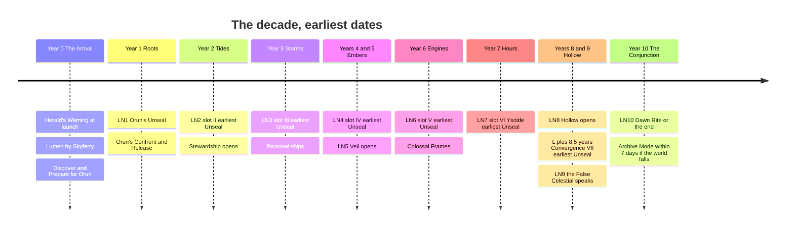
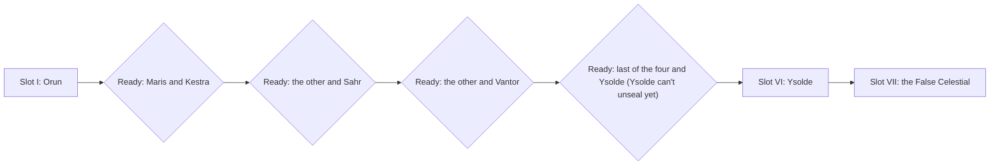
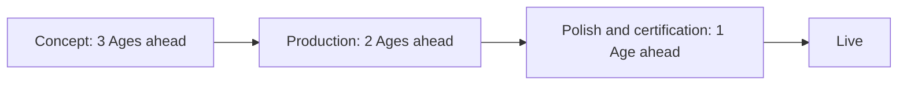

# Ten-Year Live Plan

How the decade is scheduled and run in real time: the dates, the release rhythm, the buffers, and the preparation for both endings.

> **Version:** v0.1 · **Updated:** 10-10-2026 · **Owner:** Live Producer
>
> **Horizons:** H1 the launch year and Convergence I · H2 the Ages that follow · H3 Oasis 2.0 (success only)
>
> **Related:** [Ten-Year Saga](../03-narrative/ten-year-saga.md) · [Celestial Convergence](../05-systems/celestial-convergence.md) · [Time and Calendar](../02-world/time-and-calendar.md) · [Scope and Horizons](scope-and-horizons.md) · [Risk Register](risk-register.md) · [Legal and Compliance](../12-legal/compliance.md)

This plan owns dates and operations. The story of each Age and Long Night lives in [Ten-Year Saga](../03-narrative/ten-year-saga.md), and the rules of a Convergence live in [Celestial Convergence](../05-systems/celestial-convergence.md).

## 1. Principles

1. **Fix only what canon fixes.** Destiny's pre-written ten-year story was later called "comical" by its own studio [R15]. The fixed points are listed in [Ten-Year Saga: shape of the decade](../03-narrative/ten-year-saga.md#1-shape-of-the-decade). Everything else stays live.
2. **A saga can end and the world go on.** FFXIV's *Endwalker* closed a ten-year saga and the game continued [R16]. That is the success path.
3. **Honest clocks.** Earliest dates and scaling rules are published. Nothing is secretly made easier or harder, and a production delay is never hidden by tightening world conditions ([D-011](../../DECISIONS.md#d-011)).
4. **Players are never the buffer.** Slips are absorbed by [production buffers](#5-production-cadence-and-buffers), never by unannounced difficulty changes or by crunch.

## 2. Notation

| Symbol | Meaning |
| --- | --- |
| **L** | Launch: the moment of the Herald's Warning |
| **LN*k*** | The *k*-th Long Night: the 24-hour real-time window that starts on the *k*-th launch anniversary (L + *k* years) |
| **Year *k*** | The real year from LN*k* to LN*k+1*. Year 0 runs from L to LN1. |
| **Slot I to VII** | The order in which Convergences happen |
| **Age drop** | The major release at the Long Night that opens an Age |

Every Age begins and ends on a Long Night. Only Orun's Unseal is tied to a Long Night (LN1). Every other Unseal ritual uses a Domain event that comes round within weeks, so a missed window costs weeks, never a year ([D-016](../../DECISIONS.md#d-016)).

## 3. The decade at a glance

The timeline shows the earliest date of each Unseal and the fixed date of each world unlock, with Celestials in the reference order used for planning.

## 4. Year by year

An earliest date is a gate, not a promise. A Convergence unseals only when its date has passed and the world has met its published conditions ([Celestial Convergence](../05-systems/celestial-convergence.md)).

| Year | Age (reference order) | Opening Long Night | Earliest Unseal | Date-bound unlocks | Age drop |
| --- | --- | --- | --- | --- | --- |
| 0 | The Arrival | None (launch) | None | The Oasis surface, all six Domains, Lumen by Skyferry | The full launch game ([Scope and Horizons](scope-and-horizons.md#4-h1-launch-scope-by-system)); Discover and Prepare for Orun open at launch |
| 1 | Roots | LN1 | Orun at LN1. If the world misses LN1, a fallback rite at the next Lumen full phase (within 28 days) unseals him. | Verdant Spine era shift on Orun's Release | Returner's Path chapter; Orun's Confront and Release |
| 2 | Tides | LN2 | Slot II at LN2 | Stewardship ([D-038](../../DECISIONS.md#d-038)) | Slot II story; the first Celestial Gift |
| 3 | Storms | LN3 | Slot III at LN3 | Personal spaceships ([D-033](../../DECISIONS.md#d-033)) | Ship licensing and ship Artisans; slot III story |
| 4 and 5 | Embers | LN4 | Slot IV at LN4 | Veil opens at LN5 | Slot IV story; at LN5, Veil's landscapes |
| 6 | Engines | LN6 | Slot V at LN6 | Wider Frame ownership and Colossal Frames ([D-036](../../DECISIONS.md#d-036)) | Slot V story; the Wardens |
| 7 | Hours | LN7 | Slot VI (always Ysolde) at LN7 | None | Ysolde's story |
| 8 and 9 | Hollow | LN8 | Convergence VII at L + 8.5 years | Hollow opens at LN8 | Hollow; Convergence VII; the Returner's Path finale |
| 10 | The Conjunction | LN10 | None | None | Both endings, authored and certified ([preparing both endings](#8-preparing-both-endings)) |

### 4.1 What each Long Night asks of operations

The story beat of each Long Night is in [Ten-Year Saga](../03-narrative/ten-year-saga.md). This table covers only what operations must be ready for.

| Long Night | Operations focus |
| --- | --- |
| LN1 | The first 24-hour global event and the first Convergence ritual at world scale |
| LN2 | Community choice goes live with the first ready pair; Stewardship opens |
| LN3 | Personal ship licensing goes live; spaceflight load on launch and landing zones |
| LN4 | Standard Age drop |
| LN5 | Veil opens: the first new moon since launch and the largest load event of the mid-decade |
| LN6 | Colossal Frame battles: a netcode stress test in production |
| LN7 | Standard Age drop |
| LN8 | Hollow opens |
| LN9 | A global message to every Returner at once; final-year end-of-service notices begin ([OPS-041](#9-end-of-service-honesty-and-people)) |
| LN10 | The decade's concurrency peak; broadcast spectacle [R24]; a two-branch event |

### 4.2 What is pinned, whatever the order

From slot II, the community's progress decides which Celestial comes next. These rules keep the decade coherent whatever order the world chooses.

1. **World unlocks follow dates, not Celestials.** Personal ships (LN3), Veil (LN5), Colossal Frames (LN6) and Hollow (LN8) arrive on their dates even if the world is behind, so a struggling world still gets new places to go. The most recent Release frames each unlock in the story. Hollow opens for exploration at LN8 whatever the state of the world, but Convergence VII still unseals only after all six Celestials are freed.
2. **The ready pool fills in a fixed sequence:** {Maris, Kestra}, then Sahr joins, then Vantor joins. Slots II to V are the community's choice from that pool.
3. **Ysolde is always slot VI.** She becomes ready once four Celestials are freed and can unseal only after five, so Zero's name stays late ([D-016](../../DECISIONS.md#d-016)).
4. **Order-dependent beats get variants.** Any story beat tied to a Celestial has an authored variant for every slot that Celestial can fill. Narrative owns the variant list.

The flowchart shows how the ready pair moves from slot to slot.

- **OPS-024 [H2]** At most one Convergence is in Unseal or Confront at any time. If the world falls behind, the next Convergence may unseal as soon as the current one is released and its own conditions are met, with no minimum gap. *Acceptance:* schedule simulations with every slot late by up to two years never show two Convergences in Unseal or Confront together.

## 5. Production cadence and buffers

### 5.1 Release cadence

| Cadence | What ships | Notes |
| --- | --- | --- |
| **Age drop** (at each Age's opening Long Night) | New Convergence content, Domain story, Returner's Path chapter, era shift and any date-bound unlock | The year's main release |
| **Quarterly update** | Festival content (the Festival of Lanterns, Library Day), side stories, Artisan lines, quality-of-life | Three a year between Long Nights |
| **Monthly patch** | Fixes, balance, new Weaver templates | Never story-critical |
| **Hotfix** | Safety, exploits, outages | Any time |

Regional seasons ([Time and Calendar](../02-world/time-and-calendar.md)) run systemically and need no release.

### 5.2 Pipeline depth

Content moves through three stages ahead of going live.

- **OPS-020 [H1]** Both members of a ready pair are content-complete and certified at least 120 days before the earliest Unseal date of the slot they could fill. Because the community chooses, production always carries one Convergence more than the next slot needs. *Acceptance:* the live dashboard shows both ready Convergences certified by the deadline; a miss triggers the [late-content rules](#53-when-content-is-late).
- **OPS-021 [H1]** Long Night event content is locked 60 days before the Long Night. *Acceptance:* nothing changes in the final 60 days except safety and stability fixes.
- **OPS-022 [H1]** Annual plans commit at most 80% of team capacity. The other 20% is buffer for slips, live issues and community-driven work. *Acceptance:* committed estimates in the annual plan add up to no more than 80% of capacity.

What must be complete on launch day is set in [Scope and Horizons](scope-and-horizons.md#3-from-h0-to-launch) ([OPS-023](scope-and-horizons.md#3-from-h0-to-launch)).

### 5.3 When content is late

Earliest Unseal dates and date-bound unlocks are published one Age ahead ([D-018](../../DECISIONS.md#d-018)). Once published:

1. A date may move later only, with at least 90 days' public notice and the reason stated.
2. A date never moves earlier.
3. Published conditions are never tightened to hide a delay.
4. If a slot's content would miss its date, the order of response is: offer the other ready Convergence, then move the date with notice, then reduce side content in the Age. Story-critical content is never cut.
5. Hidden canon is never scheduled publicly. The public calendar shows Long Night dates, earliest Unseal dates and date-bound unlocks, never story reveals ([D-018](../../DECISIONS.md#d-018)).

## 6. Community choice: timing

| Step | When |
| --- | --- |
| The next ready Domain is revealed | At the Release of the current slot |
| Both ready Domains run Discover and Prepare | From the reveal until one unseals |
| The world's progress chooses | The first ready Domain to meet its published conditions after the earliest date unseals; the other stays ready with all its progress kept |
| Progress is shown | The World Clock shows both Domains side by side at all times |

There is no ballot. What Returners actually do makes the choice, which keeps it inside the world and hard to brigade. The mechanics are in [Celestial Convergence](../05-systems/celestial-convergence.md).

## 7. Systems that grow with each Convergence

Each Celestial adds a new kind of play, and the systems below get their main investment in the year that Celestial is freed. The mode travels with the Celestial, whatever slot it fills.

| Convergence | Mode it adds | Systems that grow |
| --- | --- | --- |
| Orun | Ground climb | Traversal, colossus climbing, Prepare crafting |
| Maris | Understanding | NPC Minds (negotiation), underwater play |
| Kestra | Sky | Aerial combat and flight |
| Sahr | Shared burden | Group mechanics |
| Vantor | Machines | Colossal Frames, Wardens |
| Ysolde | Time | Chronicles, time-echoes |
| The False Celestial | All of them | Every system, plus free-form answers that are recorded and never judged by AI |

## 8. Preparing both endings

The outcome is genuinely open, so both endings are built in full, and neither track may be starved to pay for the other ([D-011](../../DECISIONS.md#d-011)).

| When | Success track: Oasis 2.0 [H3] | Failure track: Archive Mode ([D-047](../../DECISIONS.md#d-047)) |
| --- | --- | --- |
| Year 6 | Concept for Oasis 2.0's first world | Technical spike on what Archive Mode keeps (avatar, house, Chronicles, the Grand Library) |
| Year 8 | Vertical slice of the first world | Feature-complete on every platform family still supported |
| LN9 | Ready to announce in the epilogue | Certified; distribution and licence terms signed off by counsel ([Legal and Compliance](../12-legal/compliance.md#6-consumer-law-and-the-planned-ten-year-end)) |
| LN10 | Dawn Rite branch; the Oasis endures; Oasis 2.0 arrives in stages | Final-event branch; live servers close; Archive Mode released |

- **OPS-030 [H2]** Both LN10 branches are certified on every platform at least 90 days before LN10. *Acceptance:* certification records for both branches exist by the deadline.
- **OPS-031 [H2]** Archive Mode is released within 7 days of the live servers closing. *Acceptance:* release date audit.
- **OPS-032 [H2]** If the world fails, the live servers close at the end of the LN10 window, so every time zone gets the full final 24 hours. *Acceptance:* the shutdown runbook's close time equals the start of LN10 plus 24 hours.
- **OPS-033 [H2]** If the world succeeds, the live service continues past LN10 with no new end date, and Oasis 2.0 arrives in stages. If an end of service is ever planned after that, it is announced at least 12 months ahead and an Archive Mode is released. *Acceptance:* the success-path terms are in the Terms of Service before LN9.

## 9. End-of-service honesty and people

- **OPS-040 [H1]** The planned end is announced from day one: in the Herald's Warning, the Terms of Service and every store page ([LGL-050](../12-legal/compliance.md#6-consumer-law-and-the-planned-ten-year-end)). This goes further than today's law, in the direction the EU debate is moving [R12], and supports licence disclosures [R14]. *Acceptance:* counsel review LGL-C08 is signed off.
- **OPS-041 [H2]** From LN9, every purchase screen shows the time left on the World Clock, and no subscription term or prepaid item extends past LN10. *Acceptance:* store audit at LN9.
- **OPS-042 [H1]** No crunch. Rockstar's reported crunch on *Red Dead Redemption 2* [N7] is a cost of authored density we refuse to pay. Overtime is never mandatory. Long Night operations run on a published rota with time off in lieu. Anyone working more than 8 hours of overtime in a month is reported to leadership, which triggers a scope review. *Acceptance:* a quarterly overtime report, and no month over the limit without a scope review.
- **OPS-043 [H1]** Every Long Night and Age drop has a post-mortem within 30 days that covers team wellbeing as well as metrics.

<!-- citation links: generated, do not edit by hand -->

[N7]: ../../references/film-literature-and-music.md#n-series-sources
[R12]: ../../references/ready-player-and-lifecycle.md
[R14]: ../../references/ready-player-and-lifecycle.md
[R15]: ../../references/ready-player-and-lifecycle.md
[R16]: ../../references/ready-player-and-lifecycle.md
[R24]: ../../references/ready-player-and-lifecycle.md
